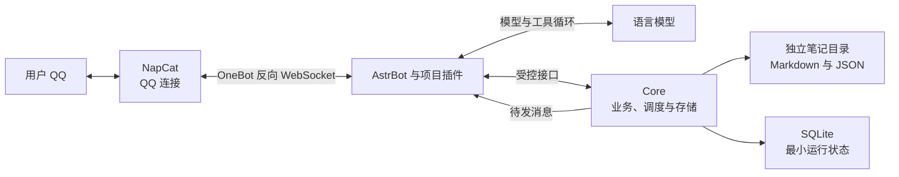
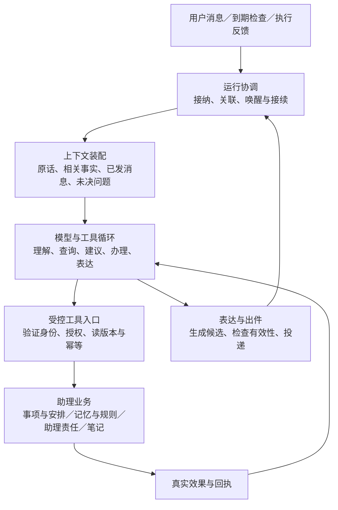
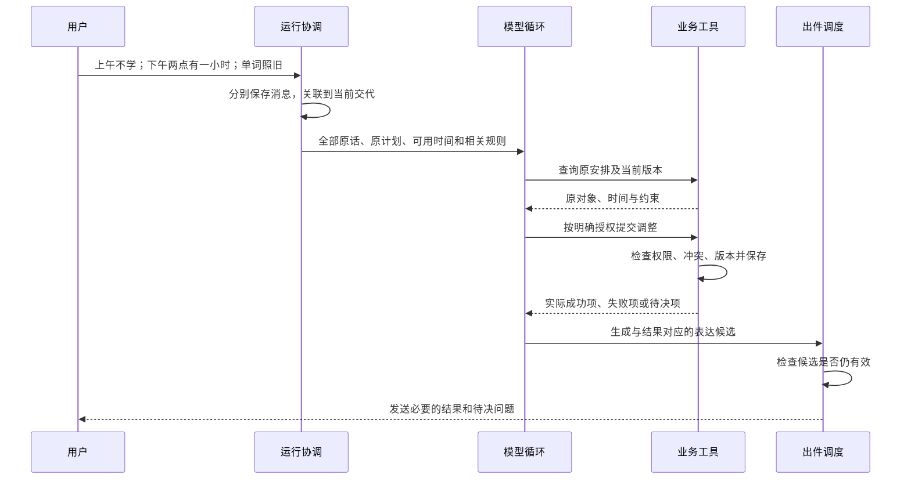
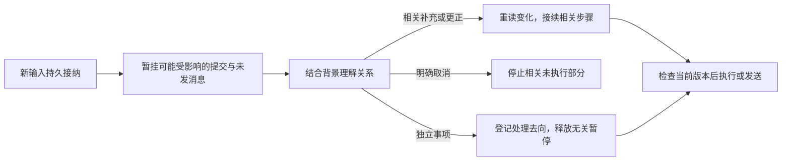
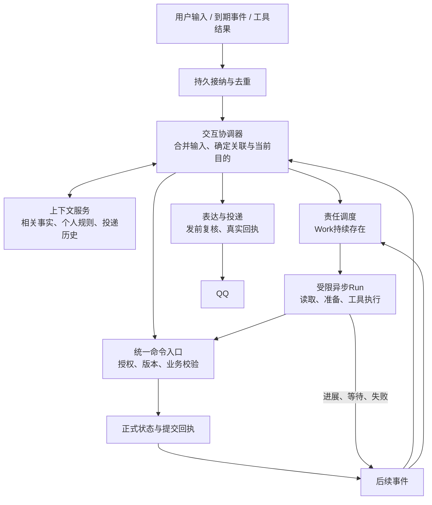
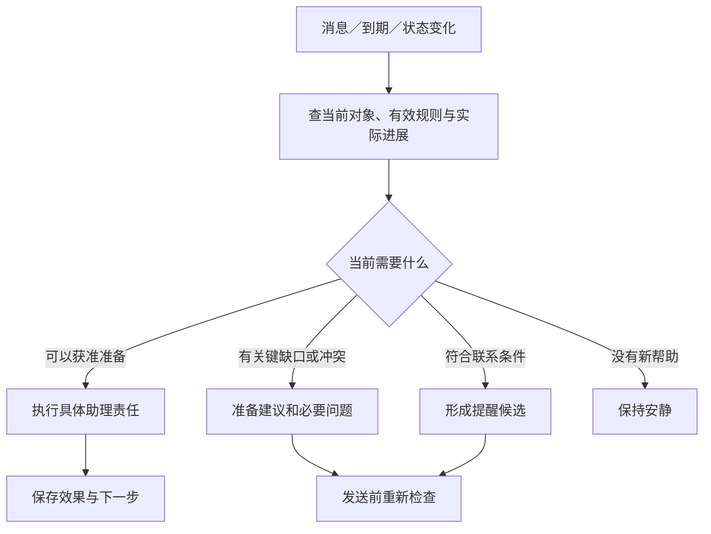
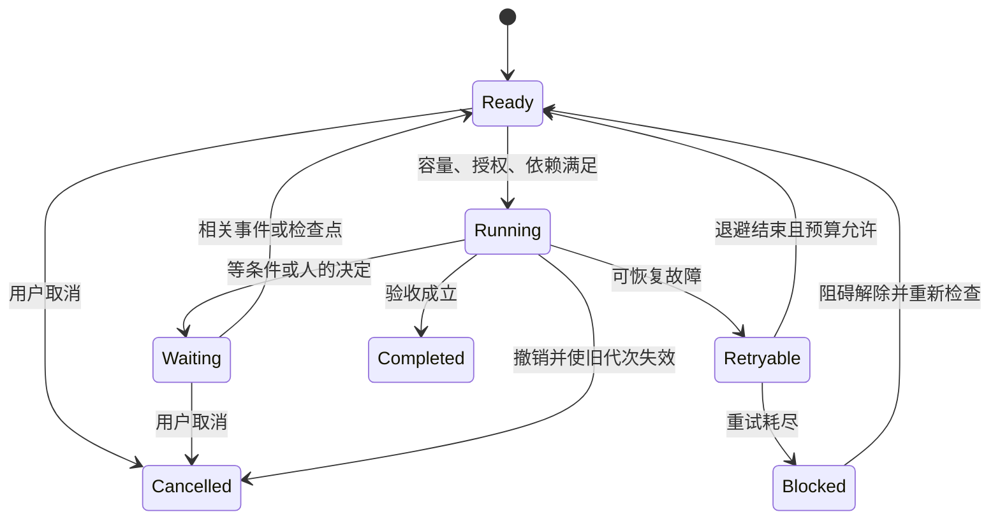
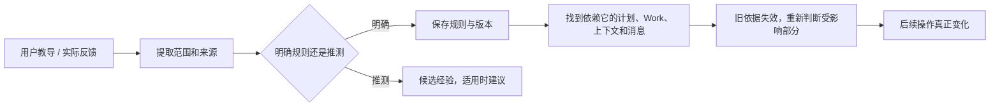

# 私人助理的架构设计：从通用模型到持续协作

> 架构研究与改造提案｜2026-11-01
>
> 本文论证产品为什么存在、需要怎样的运行模型，以及现有代码应如何改变。它不是完工报告。现有实施基准仍是 [ARCHITECTURE.md](ARCHITECTURE.md)；本文的变更须按第8章合并进该基准、[DDD.md](DDD.md) 和 [CONVERSATION.md](CONVERSATION.md)，再实施。图示不表示生产已具备，也不表示新增独立服务。

## 1. 我们需要怎样的助理

晚上，你与助理确定第二天的英语学习安排。第二天临时有事，你发来几条消息：

> 上午先不学了。
>
> 下午两点有一小时。
>
> 单词照旧，语法先放一放。

你希望她理解这是对同一份计划的修改：找到原安排，检查下午是否可用，只处理相关事项，更新记录和提醒，再把需要你知道的变化说清楚。她不应该让你重新解释整个计划，也不应该一边答应改期，一边继续发送上午的旧提醒。

这个例子包含两种不同的工作。模型需要理解“照旧”“先放一放”指什么，判断是否缺少关键条件；软件需要确保修改真实保存、新旧安排不冲突、过时消息停止发送。两者缺一，聊天都难以变成可靠的协作。

### 1.1 产品目标：减少反复记事、决策与启动的负担

助理围绕三件事工作：

- **接住交代：** 找到相关背景，把已接受的事情、仍在讨论的建议和真实发生的进展分清。
- **帮助行动：** 安排可行的下一步，准备需要的材料，在用户约定的时机提供提示。
- **持续接续：** 遇到延误、阻碍或新决定，更新受影响的部分，保留尚未解决的责任。

用户通过 QQ 使用它；个人笔记保存在自己的文件目录。当前范围是单人使用的 MVP。产品不要求用户维护会话编号、重复在多个地方打卡，或每天填写主观评分。

### 1.2 为什么需要模型之外的架构

我们把系统是否有效拆成三个问题：

| 问题 | 模型能提供什么 | 系统还必须提供什么 |
| --- | --- | --- |
| 理解这次交代 | 结合语境解释意图、指代与取舍 | 原始消息、相关背景、可补查入口 |
| 把事情办成 | 选择工具、提出调整、说明结果 | 权限校验、版本检查、真实提交与回执 |
| 过一段时间继续 | 根据新情况重新判断 | 持久记录、到期唤醒、投递及故障恢复 |

因此，提示词只是其中一个组成部分。即使模型能说出很自然的中文，如果收到的背景过时，或者旧消息已经排进队列，它仍可能在错误的时间说出不合适的话。

### 1.3 深度定制为什么可能有必要

**个性化的价值在于改变决策，不只是改变称呼和语气。**同一句“今天不想学了”，在不同情况下应有不同处理：时间冲突、身体不适、任务难以启动、目标已经改变，不能一律缩短任务，也不能一律撤销。

助理需要利用已经知道的条件；仍缺少会改变处理方式的信息，再询问。不能把“我猜到了”当成用户的真实动机。

| 个人条件 | 例子 | 必须影响什么 |
| --- | --- | --- |
| 目标与承诺 | 考试日期、成果验收、习惯最低行为 | 优先级、达标判断、需要用户决定的取舍 |
| 资源与约束 | 可用时间、固定预约、现有材料 | 排程、准备工作、可行性判断 |
| 授权与协作规则 | 可自动移动弹性安排；今天不联系 | 能否执行、何时联系、何时停止 |
| 有事实依据的经验 | 同类整理任务几次用了约一小时 | 后续估计与建议，不擅自改变承诺 |

称呼、语气和篇幅偏好属于表达适配，可以存在，但不能替代以上条件。我们希望交付的是“一次说明以后，后续处理真正发生变化”。

这里提出的是可检验假设：模型和任务相同，加入相关、有效的个人条件，应减少错误安排、重复解释和无效询问。如果只让语气更亲近，或者维护偏好的负担超过收益，这种定制没有达到目的。

### 1.4 需要定制，不等于必须全部自研

下表比较实现路径，不是未经实测的品牌排名。我们尚未证明其他产品都做不到，也不以自研本身作为价值。

| 路径 | 适用情况 | 必须验证的不足 | 代价 |
| --- | --- | --- | --- |
| 通用Agent加个人提示词 | 临时问答、简单工具任务 | 跨会话责任、规则变化和投递是否能连续保存 | 最低 |
| 成熟平台加插件与个人资料 | 平台已有稳定运行能力 | 插件能否控制事件、取消、授权和恢复 | 中等，依赖平台接口 |
| 自有领域内核与轻量Harness，复用接入平台 | 个人条件需要影响长期执行全过程 | 是否比插件方案更有效，维护成本能否接受 | 较高，但执行边界可控 |
| 自建通用Agent平台 | 多租户、多渠道、广泛工具生态 | 单人QQ MVP是否需要这些能力 | 当前理由不足 |

本项目选择第三条作为待验证方向：保留NapCat、AstrBot和模型，自己掌握必须稳定的领域事实与执行合同。平台若已提供可用的异步会话、恢复或工具接口，优先适配，避免重复建设。

因此，立项理由应当表述为：**让个人已认可的目标、约束和反馈持续影响真实行动，减少反复管理助理的成本。**不能仅凭“市场上机器人很多，但我想做一个更懂我的”就认定产品成立。

## 2. 总体架构：领域内核与 Agent Harness 分离

整体分为接入、助理运行和个人数据三个部分。用户只面对一个助理；内部职责各自有明确边界。逻辑上一个助理，不代表所有推理和等待只能占用同一个执行槽。

### 2.1 现有工程的部署关系

下图描述仓库已有的主要连接关系，不表示所有业务路径已经完成验收。

**NapCat** 负责连接 QQ。**AstrBot 与项目插件**负责接收消息、调用模型、转发工具请求及消息投递。**Core** 是项目服务的名称，承接业务规则、工具执行、状态保存和调度。模型通过受控接口工作，不直接获得服务器任意目录的访问权。

这是一套以单 Core 为中心的部署。逻辑职责分开，不意味着要为每个职责新建服务或数据库。

### 2.2 Core 内部如何分工

对外看，Core 像一个整体；工程上需要区分运行机制与助理业务。围绕模型管理上下文、工具、执行和恢复的部分，可以称为 **Agent Harness**。任务、习惯、日记等则属于具体业务。

下图展示目标职责，部分交流机制仍待落地：

这里的关键连接是反馈：工具结果必须回到模型，模型才能据实回答；新消息必须影响运行中的判断和未发消息，用户的补充才真正有用。

### 2.3 模型和程序各自决定什么

模型判断需要语义理解的部分：用户是在讨论还是要求执行，哪几条消息属于同一交代，什么资料相关，当前应回答、询问还是建议。

程序约束能够明确验证的部分：请求来自谁、对象是否存在、引用版本是否仍有效、操作是否超出授权、同一操作是否已经做过、消息依据是否已失效。

例如，模型可以建议把学习移到下午；程序必须检查真实时间安排和权限。语言表达再肯定，也不能代替成功回执。没有足够授权时，建议仍然是建议。

### 2.4 Harness、领域内核和适配器各自是什么

本文把 **Agent Harness** 定义为管理模型执行生命周期的运行层：接纳事件、准备上下文、运行模型与工具循环、安排执行、输出消息并处理故障。它不只是工具集合，也不等于任务管理业务。

| 边界 | 回答的问题 | 本项目例子 |
| --- | --- | --- |
| 领域内核 Domain Core | 什么操作在业务上成立 | 任务完成、习惯达标、排程冲突、承诺变更 |
| Harness | 谁在处理，用什么背景，何时继续，结果是否仍可用 | 输入合并、上下文、作业调度、取消、输出 |
| 适配器 Adapters | 怎样连接具体设施 | QQ连接、模型接口、文件和SQLite |

DDD定义业务所有权和不变量；事件驱动架构连接异步变化；持久执行维持跨故障的责任；上下文工程提供模型当前需要的依据。它们解决不同问题，不能互相替代。

Anthropic将会话记录、模型与工具运行循环、执行环境分别建模。这种分离允许各部分独立恢复和替换。我们借鉴接口边界，不引入其托管基础设施。[Managed Agents架构](https://www.anthropic.com/research/managed-agents)

### 2.5 当前主要矛盾及代码依据

系统需要同时做到：持续办事又能随时接话；灵活理解又能可靠操作；长期了解又能使用当前事实。现在最值得优先修复的是：**计算过程、长期责任、状态提交和对外表达的生命周期没有充分分离。**

以下是本地静态代码核对，不是服务器性能测试。路径相对于 [服务工程](../../.dev/secretary-service)。

| 代码入口 | 已观察到的行为 | 意义 |
| --- | --- | --- |
| `apps/core/core.ts`：`processPending()` | 持有回合租约处理队列，若干前台处理后等待`assistant.drain()`，设置120秒上限 | 存在队头阻塞路径，不表示每条消息一定等120秒 |
| `apps/core/model-job.ts` | 前台、后台、表达、分类使用同一个`runtimeMeta().model_job` | 后台推理与前台接话竞争同一槽 |
| `core.ts`前台取件 | `LIMIT 1`取待处理消息 | 已有分类批处理，但不能据此认定执行已支持自然的多消息合并 |
| `apps/core/deadline.ts` | `Promise.race`结束等待 | 超时不等于底层操作停止，晚到结果仍需失效检查 |
| `core.ts`：`recent_interactions` | 从已处理输入的回复元数据获取近期交流 | 模型生成过和用户实际收到，需要进一步区分 |

已有Work、权限检查、领域规则和恢复机制应当复用。需要改变的是连接与运行方式，不能因发现瓶颈而把全部工程判定为无用。

### 2.6 必须分开的对象及交接合同

| 对象 | 含义 | 结束依据 |
| --- | --- | --- |
| Task / Habit | 用户要实现的成果或行为 | 用户约定的验收、取消或结束 |
| Work | 助理接下的一项持续责任 | 责任验收、明确取消或移交 |
| Run | 为推进Work发起的一次计算与工具执行 | 完成一步、等待、失败、取消或超时 |
| Conversation turn | 需要共同理解的一组交流，可包含多条消息 | 当前交流目的解决，或明确等候回复 |
| Utterance / Delivery | 一段表达内容及其投递 | 已发、失败、未知、待发取消或过期 |

Work完成不等于用户Task完成；Run失败不等于承诺取消；生成回复不等于用户收到。这些对象是逻辑区别，不要求全部建立新表或同名类。

| 交接 | 必要信息 | 接收方必须保证什么 |
| --- | --- | --- |
| 接入→接纳 | 事件ID、身份、原文引用、发生与到达时间 | 持久接收并去重；外部时间不决定内部提交顺序 |
| 接纳→交互协调 | 接纳序列、输入批次、会话版本、已知事项引用 | 合并补充与纠正，歧义关联不能当成确定事实 |
| 协调→调度 | Work、目标、授权、依赖、预算、读取版本 | 接纳成功后才说接下了，不重复建责任 |
| 执行→领域命令入口 | 操作ID、Run代次、授权引用、预期版本、变更 | 统一检查授权、时效和业务不变量 |
| 执行→协调 | 成功/等待/失败、回执或证据、剩余责任 | 区分工具结果和模型解释 |
| 协调→投递 | 内容、目的、所回应输入、依赖版本、有效期 | 发前复核，记录真实渠道结果，不推断已读 |

错误至少区分授权不足、版本冲突、依据过期、暂时不可用、结果未知和不可恢复。只有可重试类别进入有界重试；改个措辞不能消除操作失败。

## 3. 一次交代怎样变成实际结果

理解总体架构后，可以沿一条交代观察内部协作。

### 3.1 从用户原话到工具执行

目标流程如下。图中的输入归并、分次表达和统一发送检查属于专项改造内容。

“下午有一小时”不必然意味着所有学习都能放进去。原任务需要多久、是否有硬截止、语法是暂停今天还是改变长期计划，都要结合已有记录判断。只有会改变处理方式且无法从记录中补全的缺口，才需要问用户。

### 3.2 为什么要区分四种记录

| 记录 | 它回答什么 | 例子 |
| --- | --- | --- |
| 用户任务 | 最终要得到什么成果 | 周五前提交演讲稿 |
| 用户习惯 | 约定的最低行为是否发生 | 今天是否读过一组单词 |
| 时间安排 | 准备在什么时候推进 | 明天14:00—15:00写初稿 |
| 助理责任 Work | 助理接下来欠什么工作 | 开始前找到老师的要求和上次草稿 |

这四种记录不能互相代替。时间到了，不代表行为发生；用户开始写，不代表稿件完成；助理准备好了材料，也不代表用户已经学习。

分开以后，计划变化有了明确作用范围：移动时间安排不用偷偷改变任务截止，降低习惯启动难度不用伪造任务达标，重启后也可以继续追查尚未完成的助理责任。

### 3.3 成功一半时怎么办

执行多个动作之前，要确定它们是否必须共同成立。必须一起生效的修改由受控提交协调；独立动作允许分别返回结果。文件与 SQLite 之间不是天然的数据库事务，恢复机制必须记录提交阶段并核对实际效果。

如果第一项已经成功、第二项失败，后续接续保留第一项效果，只处理未完成部分。QQ 回复发送失败时，也只恢复投递，不重新创建任务。对外发送结果未知时先核对，不能为了“确保收到”就盲目重发。

这项设计解决的是一个常见错误：把“整次对话没顺利结束”误认为“所有操作都没有发生”。

## 4. 对话怎样具有连续性

自然交流要求系统允许用户按自己的节奏说话。它同时涉及内容理解和运行顺序。

### 4.1 用户说的是一段交代，网络收到的是多条消息

现有主路径主要按单条入件处理。目标设计引入轻量的对话回合：原始消息各自保存，在有上限的短收集窗口内一起提供给模型。模型判断它们是补充、更正、取消还是独立事项。

时间接近只决定哪些消息一起呈现，不决定它们语义相同，也不赋予额外授权。这样既能处理三条连发，也不会把紧接着的闲聊误当成计划批准。

### 4.2 新话怎样改变旧工作

目标机制由“输入修订”和“运行代次”协调。它们可以理解为：这次处理读到了哪版消息，目前哪一次运行仍有执行资格。

只在数据库里记一条“有新消息”不够。检查必须出现在工具执行、业务提交、表达入队和实际发送等边界。用户说“第二项不用了”，才能阻止第二项未执行操作和未发答案。

已经成功提交的事实不会因新消息消失；需要撤销时是一次新的受控操作。已经进入渠道调用的消息也不能假称撤回，只能如实记录并控制后续。

### 4.3 自然表达需要合适的情境和出口

模型生成之前，需要知道这次要回答什么、相关背景是什么、已经向用户说过什么，以及还有哪些问题没解决。准备过但尚未发送的回答不能被当成共同背景；渠道接受消息也不代表用户已读或同意。

目标表达接口允许模型在同一个工具循环里按需要分次说话：直接答案、必要问题、真实进展和最终结果都有各自用途。程序不按逗号切句，不强制先说“收到”，不在结果之后自动追加一篇同义总结。

| 场景 | 应形成的交互 | 需要的机制 |
| --- | --- | --- |
| 已知答案的简单问题 | 直接回答 | 不强制前置承接 |
| 确实需要等待的查询 | 必要时说明正在查哪部分，随后交付结果 | 表达不终止工作；责任可接续 |
| 用户已补充关键答案 | 使用新信息继续 | 未决问题关联与关闭 |
| 详细说明或完整清单 | 内容完整、组织清楚 | 允许完整正文，不为短而漏项 |
| 回答过程中用户改口 | 相关剩余内容重新判断 | 输入更新与发送前检查 |

因此，自然度的目标是情境贴合：接什么、怎么说、何时说都合适。消息更短或拆得更多，都不能单独证明这个目标达成。

### 4.4 运行模型：计算可并发，提交需协调

目标采用一个逻辑协调器、有限的异步Run、统一的领域命令入口。同一会话的状态决策有序处理，但长推理和工具等待必须在临界区外进行。不能一边持有提交锁，一边等模型回答。

这是单服务中的逻辑模块。短工具调用可直接处理；只有跨等待或需隔离上下文的工作才启动独立Run，不为每个简单问题增加一层模型。

执行顺序如下：

1. 输入先持久接纳，获得递增序列。按有上限的窗口合并连续消息，保留原始顺序。
2. 协调器读取一致快照，启动推理后让出处理权；新消息仍可接纳。
3. 新输入未完成关联判断前，暂停可能被其影响的旧写入和待发消息。未知关联时保守阻止当前会话产生的待提交副作用，无关读取可以继续。
4. 关联完成后，标明影响的Work、对象和输出。无关工作恢复；相关工作补入新信息或更换Run代次。
5. 分类失败有界重试；仍不清楚时保留危险操作并说明阻碍，不能让整个系统永久冻结。连续新消息合批并设置处理上限，避免永远等待用户停下来。
6. 结果回来后校验授权、所读版本及Run代次。适用才提交；过时则重读或重算，不能因为“已经算完”就执行。

输入与提交恰好同时发生时，由短临界区内的持久接纳/提交顺序决定：先接纳的新决定可以阻止旧提交；已经提交的事实由新命令更正，不假装先前效果没有发生。

这里借鉴Actor的消息与状态所有权，不引入Actor框架。Actor系统也必须设计请求交错；使用这个术语不会自动解决阻塞。[Orleans请求调度](https://learn.microsoft.com/dotnet/orleans/grains/request-scheduling)

### 4.5 容量、取消与公平性

首轮实验可设置一个前台推理槽、一个后台推理槽。这是待测参数，不是最佳配置的结论。

- 后台不能占用前台预留容量。状态查询、纠正和取消优先于新增后台工作。
- 每个Work默认只有一个有效Run；新尝试启动时旧代次失效。
- 后台按照到期、风险和等待时间获得执行机会，避免前台一直聊天导致后台饿死。
- 队列、重试、上下文和费用均有限额。容量不足时停止启动新后台尝试，保留已经接下的责任及原因，这叫背压。
- 上游模型限流仍会影响前台，需预留调用预算。若供应商整体不可用，不承诺正常响应。
- 取消分两件事：尽力中止实际计算，以及立即使旧执行失去提交和发送资格。不能依赖取消请求必然成功。

幂等操作ID防止重复，版本检查防止过时决定，代次令牌防止旧执行越过新的所有者。三者不能互相替代。

## 5. 助理怎样在没有新消息时推进

主动性意味着依据已有承诺和当前条件继续工作。它需要被唤醒，也需要知道什么值得处理。

### 5.1 定时检查是入口，业务状态决定行动

系统接收三类基本信号：用户新消息、约定时间到达、事项或工具状态变化。当前实现中有定时扫描与事件通知；本文的事件视角不要求引入外部消息队列。

例如用户已告诉助理正在学英语，例行检查不应再机械问“你现在做什么”。沉默也只表示状态未知，不能自动记成没做。检查时刻由用户配置，联系前还要考虑当前反馈、暂停范围和消息是否有实际帮助。

### 5.2 从提醒走向推进，关键是下一步责任

提醒解决“此刻想起这件事”；持续推进还需要下一步、所等条件、检查时间和完成依据。Work 保存这份责任，运行器按条件领取，工具负责执行，检查器根据实际结果判断是否完成。

用户今晚确定明天计划时，助理可以检查关联的年、季、月、周笔记，经统一模板补齐必要文件，再把已接受安排落实到日。上层文件为空时不编造目标，也不要求为了目录完整先填完所有层级。

某个任务延误后，先检查依赖、固定承诺和剩余时间，只调整受影响部分。若需要改变成果、硬截止或做重要取舍，带着建议询问。简单顺延并不能解决所有阻碍。

### 5.3 减少行为摩擦，但不承诺控制用户

行为支持借鉴福格行为模型：提示要适时，行动要可做，目标要与用户动机相连。工程上的对应做法是准备材料入口、明确第一步、采用用户接受的最低行为，并在反复受阻时调整方法。

这是一组可检验的产品假设。行为是否持续，还受健康、环境、资源等条件影响；系统不能把所有困难归为任务设计错误，也不能把“机器人稳定发提醒”宣传为“用户已经形成习惯”。

### 5.4 持久责任与短执行的生命周期

Work的状态反映责任下一步在等什么，Run的状态反映一次计算是否还活着。一次模型失败不应删除Work；上下文清理也不能清掉未解决承诺。

这是目标Work推进状态，须映射并修订既有状态合同，不另建平行状态机。每次进入Running可以启动新Run。每个非终态必须有下一种明确依据：待调度、等待指定事件、等待到期检查、等待用户或等待修复。

验收必须指向证据。例如“准备材料”的责任完成，证据是材料及可用入口；它不能把用户的学习任务标为完成。Work结束时关闭相应订阅、检查点及失效待发消息。

持久执行研究关注跨故障接续。Temporal提供成熟工作流机制，但本项目当前只借鉴责任和执行分离，不引入其服务，也不宣称实现了其确定性重放能力。[Temporal执行模型](https://docs.temporal.io/workflow-execution)

## 6. 状态怎样保存，为什么不全塞进数据库

长期合作需要持久化，但不同数据承担不同责任。

### 6.1 一种事实有一个正式归属

| 存储 | 保存什么 | 为什么这样分 |
| --- | --- | --- |
| Markdown | 日记、计划正文、技能与决策笔记 | 用户可以直接阅读、编辑和迁移 |
| 正式 JSON 记录 | 任务、安排、规则、习惯事实、长期记忆与助理责任 | 结构可校验，能保存来源、对象关系及版本 |
| 最小 SQLite | 入件、作业、操作和投递等运行记录 | 支持去重、领取、重试、恢复及清理 |
| 模型上下文 | 本轮需要的原话、事实与工具结果 | 是按需装配的工作视图，不另建全文真源 |

正式记录为模型提供依据，模型窗口不是唯一记忆。长期规则需要保留来源和适用范围，临时例外需要有效期；更正或撤销不仅修改文件，还要让相关作业、上下文和待发消息失效。

当前不引入向量数据库。可按对象引用、日期、结构化过滤和文本检索补查资料。只有检索质量确实不足，且有评测证明新方案值得增加维护成本，才重新选择。

### 6.2 日记与业务状态怎样对应

日记承载给人看的记录，任务和安排承载可执行的结构。两者通过明确关联连接，助理只更新受管内容，保留用户正文。首次创建周期笔记走统一模板和日历引擎，不让模型临时推算目录、链接和日期字段。

“正文唯一真源”并不禁止保存任务时间和完成状态。约束的是不要把整篇日记另存进数据库，造成两份正文；结构化事实与正文引用的用途不同。

### 6.3 如何避免旧事实覆盖新决定

工具查询登记读取的对象版本或文件哈希；提交时再次检查。若用户或另一个有效操作已经修改，旧方案失去直接覆盖资格，必须重读后接续。多文件提交与恢复读取也要遵守共同的一致性合同。

这项机制同时保护办事和说话：安排修改后旧提醒要失效；规则撤销后依赖它的建议也不能继续照发。业务正确性与对话自然度在这里共享同一条变更传播链。

### 6.4 用户模型：从保存偏好到实际改变行为

每条个人规则至少需要内容、适用情境、来源、确认状态、生效与失效时间、版本。没有证据的推测不存成确定事实；不能建立“用户懒惰”这样的性格归因。

规则处理有明确顺序：系统安全边界由程序强制；用户当前明确决定只修改其涉及的承诺；临时例外按范围覆盖长期规则，到期恢复当时有效的长期版本；行为经验只用于估计和建议。不能用“最后一句话”无条件覆盖所有旧规则。

这个闭环不需要训练模型。检验“学会了”的方法是：教导之后不再重复提示，换同类任务、换会话、重启后仍按有效规则行动；情境不适用时不乱套，撤销后不从旧摘要和作业中复活。

### 6.5 上下文是可重建视图，不是记忆真源

前台需要当前话题、相关承诺、已送达内容和待决事项；执行器需要当前Work、授权、材料和检查点。两者交换事实引用和结果，不互相灌入全部历史。

上下文包带来源引用、版本及截取时间，源数据改变时失效。短期对话清理前保留仍需接续的责任与有效规则；对话复用可以触发长期记忆候选，但不能“用过一次就永久保存”。

上下文工程关注有限窗口中有用的信息及补查入口。因此先按事项、时间、明确引用检索，只有语义召回成为实测瓶颈，才比较向量检索。我们没有证据证明向量数据库永远无用，也没有理由仅因Agent流行就部署它。[Anthropic上下文工程](https://www.anthropic.com/research/effective-context-engineering-for-ai-agents)

## 7. 长期运行靠哪些边界保障

### 7.1 权限围绕工具和工作区建立

用户身份由接入端和 Core 校验，模型不能自己指定“这是主人”。笔记操作限定在授权工作区，路径检查覆盖越界、符号链接与受保护目录；首次周期笔记创建调用模板工具。

笔记和引用资料作为数据处理，不因其中写着命令就提升权限。工具参数必须符合合同；业务写入还需要相应的授权与读取依据。密钥保存在仓库外，并限制进入模型上下文和日志。

这不等于声称系统不存在攻击面。渠道、插件、网络和模型上下文都有各自风险，必须结合实际部署测试；单个路径检查不能代替全部安全验证。

### 7.2 恢复依据是持久事实，不是重新猜一遍

服务重启时，要分开检查三件事：用户交代是否仍欠处理、业务效果是否已经发生、消息是否已发送或结果未知。分别恢复，才能避免重复做事或补发过期提醒。

运行期限、有限重试、幂等键与清理策略共同限制故障扩大。进程健康只说明服务可用，还要检查作业是否长期无进展、责任是否失踪、费用和存储是否失控。

当前没有把一个可自主修改生产系统的外部 Watchdog Agent 作为默认保障。优先采用明确的运行状态、检查和恢复入口；模型诊断可以辅助，但不自动获得修改生产配置的权限。

### 7.3 跨文件一致性与诊断边界

Markdown、JSON与SQLite不共享天然事务。目标提交路径是：验证读取版本，记录恢复意图，准备替换内容，完成受控替换，确认提交回执；故障后先核对未决提交再开放相关写入。沿用既定恢复机制，不再另建一套全文事件库。

应用内读取需要经过统一快照入口，避免读到多文件修改的中间状态。外部编辑器直接读取多个文件，不享有数据库式原子快照；这是文件真源方案的真实限制。人工改动导致版本不符时保留正文并处理冲突，不能强制覆盖。

业务提交与待发效果用可恢复的提交ID关联，只有确认业务已提交才能发送成功结果。消息投递结果未知时保留未知，不以盲目重试制造重复消息。

每次交代关联输入ID、Work、Run、命令回执及投递结果。分别记录接纳、排队、模型推理、工具等待、提交和投递耗时；日志记录状态、原因和引用，不默认复制私人正文或密钥。这样才能定位是模型慢、后台占槽，还是渠道失败。

## 8. 当前进展，以及怎样证明设计成立

### 8.1 现有基础与目标改造

以下来自本次本地代码与配置检查，不是线上验收结论。

| 部分 | 已有入口或机制 | 尚不能据此宣称 |
| --- | --- | --- |
| QQ 接入 | NapCat、AstrBot 插件和渠道适配代码 | 所有网络故障下均可投递 |
| 模型与工具 | agent-runtime、application、workspace 等入口 | 所有自然说法都能理解且正确执行 |
| 任务与责任 | domain、assistant、work-runner、work-checks | 所有长期任务都可自主连续推进 |
| 数据与恢复 | Store、SQLite、文件与恢复代码 | 任意故障时序都保持一致 |
| 连续对话 | 已有新输入检查及交流保护逻辑 | 已实现输入批次、完整回合协议和全双工体验 |
| 自然表达 | 已有角色提示词与模型表达路径 | 现有表达已达到目标自然度 |

当前专项差距包括：主路径按单条入件处理；最近交流不完全等于实际投递历史；进度仍有固定兜底路径；最终文本与技术分片尚不能替代语义表达及中途接话。具体修改见 [CONVERSATION.md 第2章](CONVERSATION.md#2-当前代码与改动落点)。

### 8.2 验证连接，而不只验证模块存在

验证从完整剧情开始：前晚确定计划，按模板生成记录；次日临时更改；工具一项成功一项失败；用户中途取消；发送结果未知；服务重启后接续。每一步同时检查原话、业务状态、文件和真正发送的消息。

| 要证明什么 | 使用什么证据 |
| --- | --- |
| 连续输入没有丢失或重复执行 | 模型桩、假时钟、确定的消息插入点与状态断言 |
| 工具真实办成且可恢复 | 操作回执、文件和结构化状态；提交阶段故障注入 |
| 语言适合当前情境 | 真实模型完整交互样本，按意图、背景、信息、措辞和节奏评审 |
| 长期责任持续存在 | 30／90天时间推进测试，另行记录真实连续运行 |
| 用户负担降低 | 实际重复交代、无效询问、更正和手工补救的使用记录 |

时间推进测试不能冒充真实运行九十天；措辞流畅不能抵消错误操作；程序测试通过也不能替代用户体验评审。本文没有提供本轮新运行的测试结果或性能数据。

### 8.3 比较候选架构，而不是按术语多少选方案

| 候选 | 收益 | 代价 | 判断 |
| --- | --- | --- | --- |
| A：保留全局串行模型循环，主要改提示词 | 改动少，便于保护写入 | 长工作仍可能阻塞交谈 | 作为实验基线，不作为目标 |
| B：单逻辑协调器、异步Run、统一提交入口 | 同时改善接话、接续、取消和恢复 | 必须完善版本、归属与投递合同 | 优先验证的目标 |
| C：每事项常驻自治Agent，多Agent自由协作 | 多任务隔离与专业化潜力 | 重复理解、协调冲突、费用和多头沟通 | 当前证据不足，不采用 |

目标B仍是轻量单服务。独立执行上下文不等于独立部署；多个推理槽不等于每个任务必须使用多个模型。保持文件真源、最小SQLite和既有接入方式。

### 8.4 通过对照实验判断设计是否更好

固定模型、任务、工具与事件轨迹，先比较A和B。用模型桩及可控工具延迟验证运行机制，再用真实模型评估理解和表达。分别记录证据，避免将模型随机性归功于架构。

| 假设 | 实验 | 支持证据 | 反证或限制 |
| --- | --- | --- | --- |
| 解耦改善交互 | 后台工具阻塞60秒，中途查询、纠正和取消 | 前台启动不依赖后台结束；旧操作正确失效 | 仍卡在全局资源、上游限流或提交锁 |
| 上下文分区改善相关性 | 相关事实相同，加入大量无关事项 | 正确率不降，输入成本或延迟改善 | 缺少跨事项背景导致错误增加 |
| 个性化改善行动 | 同样任务，有/无有效个人规则 | 错排、重复解释和无效询问减少 | 维护负担更高，或错误套用增加 |
| 事件推进优于机械询问 | 已报告状态、长期未回、依赖条件解除三组情境 | 已知不再问，未知不捏造，条件满足会继续 | 漏事件、重复联系或无反馈时永远停滞 |

单次成功不足以支持结论。记录样本、模型版本、重复次数和失败轨迹；保留样本外的真实说法检验泛化。这里没有预填成功率，也没有声称已经运行上述新实验。

### 8.5 必须合并进原基准的变更

| 原合同需要调整的地方 | 修订 | 保留 |
| --- | --- | --- |
| 单助理被实现为单个全局模型槽 | 单一责任归口，前台与后台容量分离 | 单一对外人格、领域真源 |
| 回合租约覆盖长推理和等待 | 会话决策和提交用短临界区，长计算外置 | 幂等、写入协调、恢复 |
| Work与单次模型处理耦合 | Work持久，Run可替换 | 既有Work对象和验收 |
| 新输入保护可能冻结所有旧工作 | 持久接纳序列、关联范围、有界分类和恢复 | 过时写入、过时输出必须拦截 |
| 已生成回复成为共同背景 | 依据实际投递事实组装上下文 | 原始输入与必要审计 |
| 偏好只保存在记录或提示词 | 将规则依赖连接到计划、Run和待发动作 | 可查、可改、可撤销 |

先修订共享合同，再修改调用方。删除冲突描述，不建立平行的另一套状态机。本文仍是提案，不能把上表视为软件已经完成迁移。

### 8.6 最小实施切片

| 顺序 | 首先构造的失败场景 | 主要入口 | 退出条件 |
| --- | --- | --- | --- |
| 1. 基线与追踪 | 后台慢工作期间询问进展 | `core.ts`、模型与投递入口 | 分清接纳、排队、模型、工具、提交、投递耗时 |
| 2. 拆分Run与全局槽 | 后台等待时前台接话 | `model-job.ts`、`core.ts`、`work-runner.ts` | 前台不等后台；同Work不双跑；旧代次不能提交 |
| 3. 输入合并与纠正 | 连发三条修改，中途再补充 | `agent-runtime.ts`、`conversation.ts` | 不漏项、不重复操作、不覆盖最新明确决定 |
| 4. 统一结果与输出 | 成功后回复丢失，旧结果晚到 | 命令回执、`scheduler.ts`、AstrBot插件 | 不重做成功业务，不发过时内容，状态如实 |
| 5. 规则变化传播 | 教导、修改、临时例外、撤销 | 偏好存储、上下文、Work检查 | 新规则影响动作，旧规则不复活 |
| 6. 恢复与连续体验 | 重启、断线、人工编辑冲突、一周剧情 | Store及端到端链路 | 责任可接续，原文保留，没有伪造完成 |

每步先在隔离数据中验证，再迁移真实使用。代码回退与数据恢复分别准备；已变更的数据结构不能靠回退程序就自动兼容。

### 8.7 发布门禁与实际价值

固定关键用例中出现越权写入、虚假成功、丢失正文或重复业务副作用，任何一项都阻断发布。分别在提交前、中、后插入新指令，验证顺序与版本；用假时钟验证恢复和长期责任，另行记录真实连续运行。

性能记录前台有效回复的p50/p95以及各阶段耗时，不能用每条先发固定承接话来美化“首响”。成本按每个有效结果的调用数、token和费用统计；容量不足必须有可解释的等待与上限。

产品价值至少通过一整周真实协作开始观察：完整接纳了多少交代，用户重复解释多少次，因系统错误手工补救多少次，无效提醒多少条，到期的助理责任兑现了多少。等待用户、外部条件不满足与系统失败分别统计，不能靠改状态美化结果。

零失败只描述受测样本，不保证所有未来情境。任务成果、习惯发生和服务稳定分别记录；没有行为反馈时保持未知。我们要验证的是用户是否少了一层管理负担，而不是机器人是否一直有话说。

## 9. 阅读与参考

- [总架构](ARCHITECTURE.md)：能力、共享合同、状态与实施验收。
- [领域设计](DDD.md)：模块职责、所有权和跨模块连接。
- [自然交流实施合同](CONVERSATION.md)：自然度定义、现有差距、协议与代码改造。
- [决策记录](DECISIONS.md)：项目选择的背景与取舍。

架构研究参考 [《Super-agent 设计探索：迈向更自主的 Agent 系统》](https://www.bilibili.com/opus/1265361021143351318)。重点是将持续协作拆成事件、会话、执行与上下文问题，再讨论机制和实验，不能只借用文章结构。其多会话方案与实验结果不作为本项目实现或效果的证据。

本轮还核对了 [DeepSeek公开原型](https://github.com/deepseek-ai/dsh-superagent-prototype)，提交`6337fc823ce20251c8de8085948165c81aaa701e`。仓库明确说明它是研究代码，不是正式产品，也不与文章内部实现完全相同。

其中，Engine通过同步事务修改领域状态，将外部工作排队后交给适配器执行；执行侧按任务组织会话，并为人的跟进预留容量。这支持我们研究“状态提交需要协调，长时间计算不必整体串行”的方向，但不能直接证明私人助理效果。[原型架构](https://github.com/deepseek-ai/dsh-superagent-prototype/blob/6337fc823ce20251c8de8085948165c81aaa701e/docs/007-architecture.md)、[执行模型](https://github.com/deepseek-ai/dsh-superagent-prototype/blob/6337fc823ce20251c8de8085948165c81aaa701e/docs/003-execution.md)

关于 Harness、会话与执行环境的职责分离，参考 [Anthropic：Scaling Managed Agents](https://www.anthropic.com/research/managed-agents)。关于行为支持的理论起点，参考 [Fogg Behavior Model](https://behaviormodel.org/)。理论提供设计依据，产品效果仍需本项目验证。
