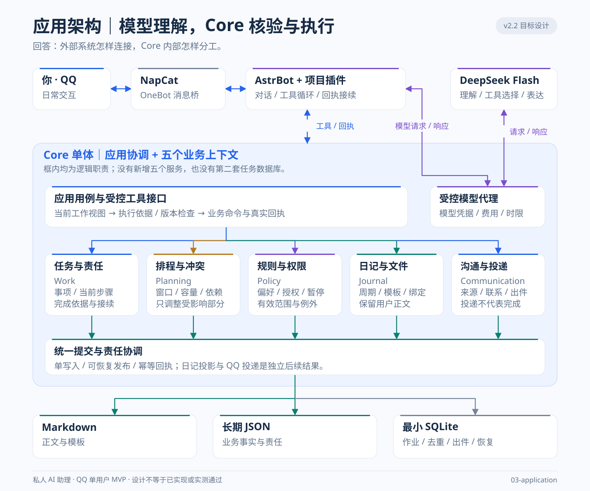
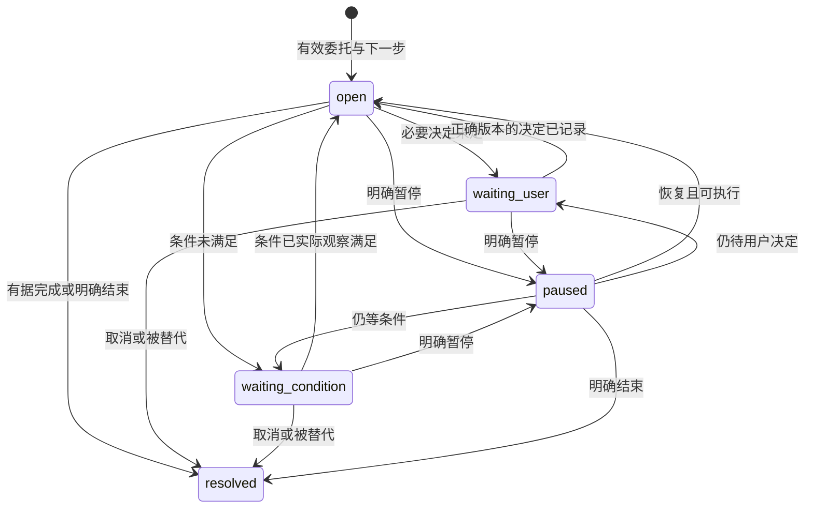

# 私人 AI 助理工程架构

版本：2.2｜基线日期：2026-10-27｜状态：目标设计，尚未按本版完成实施与验收。

**架构结论：保留一个 Core 单体，以自然语言工具循环理解交代，以有据可查的责任记录持续推进，以确定性的提交、权限和投递机制控制后果。** 用户只在 QQ 协作；复杂度由系统承担。当前不扩展 Web、收费或多用户。

先看[架构图册](Architecture-Atlas.md)：一张总览与八个分视图，按业务产品、系统设计、运行保障三层阅读；本文保留精确工程规范。

本版替代上一版的章节组织和工程要求。正文按“为什么建 → 由什么组成 → 怎样运行 → 保证哪些性质 → 怎样演进 → 怎样证明”六个问题展开。每条规范只有一个定义位置，跨章节通过编号引用；阅读时不必把重复表述拼成规则。

## 1. 设计依据：目标、范围与约束

### 1.1 要交付的结果

#### 1.1.1 用户结果

用户交代后，可以离开聊天；再次回来时，同一件事情仍有准确状态、下一步和必要材料。助理能在授权内准备、检查风险和修复安排；必须由用户取舍时，带着事实和建议询问。帮助应减少启动阻力、重复交代和手工补救，而不是增加打卡压力。

“行为稳定发生”是需要真人使用验证的产品假设。福格模型用于设计动机、能力和提示的支持，不能据此断言所有未执行都由任务设计导致，也不能保证对任何人都有效。运行稳定、助理持续跟进、用户实际行为改善，是三个不同结果。

#### 1.1.2 系统责任

| 需求 | 必须交付什么 | 主要设计归属 | 验证入口 |
| --- | --- | --- | --- |
| F1 承接 | 理解多项交代、讨论、修订、整体或部分接受，并准确保存 | 3.3 | R1/R2、真实语义对照 |
| F2 接续 | 聊天结束、重启和短期记录清理后，仍能找到当前共识和未完责任 | 2.3、3.2 | R2/R6/R8、E6 |
| F3 准备 | 不等新消息，按获准条件查材料、降低启动难度、推进可办部分 | 3.5 | R3/R5、E1/E10 |
| F4 适应 | 区分未知、延误、受阻和优先级变化，只修复受影响安排 | 3.4 | R4/R5、E4/E7 |
| F5 落实 | 模板创建、业务事实、日记条目和有效提醒保持可核对关联 | 3.6 | R1/R7/R8、E7/E9 |
| F6 可控 | 用户能修改规则、暂停、取消；授权和事实不由模型自行扩大 | 2.4、4.5 | R6、E3/E5/E9 |

#### 1.1.3 操作概念：人和系统各做什么

| 角色/场景 | 正常操作 | 责任边界与预期结果 |
| --- | --- | --- |
| 用户 | QQ交代、讨论、接受、反馈、更正、暂停，离开后返回继续 | 只承担真实反馈和必要取舍；R1/R4/R8检查不需从头解释 |
| 助理系统 | 查证、准备、获准办理、风险检查、结果接续 | 对已接受责任保持去向，事实/授权不足时不假办好 |
| 人工笔记编辑 | 通过同一服务器工作副本的既有受控入口改正文/勾选 | 普通正文是笔记；只有有效绑定条目经hash核验才转业务反馈，见3.6.3；不要求同步第二个本地库 |
| 部署维护者 | 配置、版本切换、无法自愈故障、备份恢复 | 运维权限不能交给模型；直接SSH改业务真源不属正常操作，须停写维护并核验 |

普通一天用R1/R3验证承接和准备；被打乱的一天用R4验证必要取舍；部分故障用R7验证成功部分保留和准确说明。产品操作概念由这些结果校正，不能只验证内部函数。

### 1.2 产品与部署边界

#### 1.2.1 保留的最小系统

单用户、私聊、QQ 优先；NapCat 登录 QQ，AstrBot 项目插件运行工具循环，Core 管理业务与文件，DeepSeek Flash 负责理解和表达。模型按已确定配置开启思考、使用 low；具体模型标识以可验证的有效配置为准。

只有一个服务器笔记工作副本。Markdown 保存正文；JSON 保存长期业务事实；SQLite 保存最小运行状态。服务代码、笔记数据、秘密、QQ 登录卷分别管理。已有 Web 接口保留兼容与认证，当前不新增 Web 功能。

这是一套接受短时停机的单机架构，不提供主机高可用。取舍是降低运行和一致性成本，以可恢复提交、独立备份和明确降级补足；整机丢失的边界由5.3.3说明，不用额外副本和分布式锁掩盖当前规模。

#### 1.2.2 不纳入本次工程

不新增微服务、消息中间件、向量库、完整会话数据库、多 Agent 编排或任意脚本能力。不恢复 Pi、官方 QQ Bot 或三端 Git 同步。不把日记模板变成管理界面，不批量迁移和改写历史笔记。

这些边界不免除必要的恢复、权限、测试和维护；它们决定采用模块和现有文件完成工作，而不是堆叠基础设施。

#### 1.2.3 保证成立的环境假设

| 假设 | 怎样检查、何时检查 | 不成立时的限制 |
| --- | --- | --- |
| A1 单机、本地文件系统、唯一应用写者 | 启动检查挂载/路径/进程锁；发布验证存储语义；维护工具遵守同一排他协议 | 不支持共享NFS多写；无法排他时拒绝写入与投递，见4.3.2 |
| A2 渠道身份链可信且有稳定事件ID/时间 | 认证桥接连接，从登录bot与事件sender/private属性取值；联调检验重连、乱序和原始时间 | 入站组件失陷超出身份真实性保证；缺可靠事件依据时不直接执行变更，见4.4.2、4.5.1 |
| A3 主机时钟/时区可信 | 启动检查时间同步状态，运行比较墙钟与单调耗时差；修改时区验证待执行机会 | 歧义时间机会挂起核对；不伪造逾期/倒计时，见2.3.2 |
| A4 提供者遵守所声明模型协议和usage语义 | 发布自检、实际模型语义验收；每次响应验证结构、标识及usage | 协议失败停止该调用路径；usage未知保守计费，见4.3.3、5.1.2 |
| A5 备份来源、密钥和快照可用 | 每次备份验一致清单/目标/可读性；发布和恢复演练验证解密与空目录恢复 | 不宣称RPO/RTO达成，未解决恢复风险限制发布，见5.3.3 |

每次发布记录这五项的实际检查结果。假设是可失效的前提，不是写进文档便自动成立的事实。

### 1.3 不可破坏的约束

以下编号是后续代码与验收共同引用的不变量，其他章节只定义实现机制。

| 编号 | 不变量 |
| --- | --- |
| I1 | 任务完成必须满足原验收；习惯发生必须满足当时有效的最低行为。计时、安排、助理准备和消息送出不能代替用户行为。 |
| I2 | 沉默保持未知，不解释为未做、完成、批准、取消或放弃。 |
| I3 | 成果、最低行为、硬截止、执行窗口分别保存；重排不能偷偷修改前三项。 |
| I4 | 已读对象不是批准；模型、笔记内容和工具返回不能自行授予权限。 |
| I5 | 同一事实只有一个真源；助理责任引用业务对象，不复制第二份任务、排程或正文。 |
| I6 | 活动责任有可执行下一步或明确等待、暂停；分析完成不等于责任完成。 |
| I7 | 业务提交、责任转换、日记投影、语言生成、渠道投递分别报告实际结果。 |
| I8 | 在已定义的接收与恢复边界内，重试不重复副作用；失去去重依据时先保护和核对，不宣称无限期 exactly-once。 |
| I9 | 新决定、版本和规则能使旧结果失效；异步旧结果不得覆盖当前状态。 |
| I10 | 准备资格与联系资格独立；不联系不自动撤销准备授权，静默也不增加权限。 |
| I11 | SQLite 不保存日记、文章、模板、完整 registry 或完整模型轨迹的第二份正文。 |
| I12 | 保护用户正文、目录与历史事实；周期使用自然季度、ISO 周和自然年分段。 |
| I13 | 主动联系必须在网络发送前通过有效性、暂停、时机和预算检查。 |
| I14 | 除用户指定原文外，正常可见语言由 LLM 组织；文案不能决定业务事实。 |

### 1.4 文档权威与工程方法

#### 1.4.1 文档分工

| 文档 | 唯一职责 |
| --- | --- |
| [README](README.md) | 简明介绍价值与入口 |
| [PRD](PRD.md) | 产品范围、用户流程与可观察行为 |
| [Assistant-Study](Assistant-Study.md) | 真实助理研究、行为机制与适用边界 |
| [Architecture-Atlas](Architecture-Atlas.md) | 本文的SVG可视化与必要读图说明，不另立一套规范 |
| 本文 | 未来实施必须遵守的结构、协议、质量目标与发布门禁 |
| [DDD](DDD.md) | 当前实现位置、运维方法、问题与实际验证证据 |

冲突时，用户明确要求优先；未来工程按本文执行，当前能力以代码和证据为准。发现反例，修改所属条款、版本和对应测试，不另立一套平行架构。研究论据不证明代码完成，设计目标不冒充实测结果。

#### 1.4.2 方法如何用于本项目

需求分解、双向追踪、生命周期门禁和配置管理借鉴 [NASA 系统工程手册](https://www.nasa.gov/reference/systems-engineering-handbook/)；按本项目风险裁剪，不搬用航天项目的流程重量。领域边界和不变量借鉴 [DDD 参考](https://www.domainlanguage.com/wp-content/uploads/2016/05/DDD_Reference_2015-03.pdf)。

质量要求采用“刺激—环境—响应—尺度”场景，并参考 [ISO/IEC 25010:2023 的公开质量模型说明](https://www.iso.org/standard/78176.html)检查覆盖。本文第4章是本项目的质量合同，不宣称完整标准符合性或认证。

安全贯穿开发、交付、运行和修复，参考 [NIST SSDF 1.1](https://csrc.nist.gov/pubs/sp/800/218/final)；提示注入、过度代理和敏感信息风险参考 [OWASP GenAI 风险项目](https://genai.owasp.org/llm-top-10/)。新增实现按最小失败测试、最小修改、必要重构推进，参考 [TDD](https://martinfowler.com/bliki/TestDrivenDevelopment.html)。方法名称不代替证据。

#### 1.4.3 工程覆盖如何检查

按下表反向检查遗漏，而不是只检查已有目录。一个概念适用于本项目，就必须能指出设计所有者、失败后果、控制和验证；不适用则说明裁剪理由。覆盖项“有定义”不等于“已实施/已验证”。

| 工程层面 | 核心概念 | 唯一设计归属 |
| --- | --- | --- |
| 系统/需求 | 操作概念、边界、假设、约束、需求分配、双向追踪 | 1.1—1.4、6.3.2 |
| 架构/接口 | 内聚/耦合、依赖方向、领域所有权、协议、权衡决策 | 第2章、5.1.3 |
| 运行/并发 | 状态机、互斥、锁序、重入、隔离、线性化、进展性 | 3.1—3.3、4.3.2 |
| 时间/资源 | 时钟、期限、容量、背压、公平性、预算、取消传播 | 2.3.2、3.4—3.7、4.3 |
| 数据/一致性 | 身份、来源、引用完整性、幂等、耐久、快照、保留 | 2.3、3.3.3、4.4.2、5.3 |
| 安全/危害 | 身份认证、授权、信任边界、最小权限、隐私、失效后果 | 2.4、4.5、4.9、6.1.2 |
| 质量/验证 | 性能、可靠性、兼容、可维护、可测性、验证与确认 | 第4章、6.2—6.3 |
| 交付/运行保障 | 构建复现、配置、升级、可观测、事故、灾备、退役 | 第5章 |

系统级审查同时检查接口之间的组合后果和共同失效，例如同一磁盘同时损坏真源与备份、同一模型同时承担理解与表达。参考[NASA的需求、接口、风险与决策管理](https://www.nasa.gov/reference/6-0-crosscutting-technical-management/)和[SEI关于质量属性与架构取舍的说明](https://www.sei.cmu.edu/library/modifiability-tactics/)，不把名词数量作为成熟度。

结果导向的设计条款必须形成“依据/原则 → 机制与数据 → 代码责任 → 输入/处理/输出 → 失败路径 → 可判定结果”的链条。具体协议在所属章节定义，6.4提供实现索引。不能只引用一个测试剧情或源码目录就算设计完成；也不能把每个原则都拆成独立服务。运行要求落实到程序，工程治理要求落实到构建、发布或验收产物。

#### 1.4.4 研究原则到程序设计

下表对接DDD第14.5节的P1—P7，不重写研究论证；D编号指向6.4的具体代码入口，R/E指向验收。它检查产品原则是否真正改变程序行为。

| 研究决策原则 | 程序设计去向 | 可观察结果 |
| --- | --- | --- |
| P1 连续工作 | D07/D08/D09/D12：对象引用、当前草案、步骤责任与唤醒 | R2/R3/R8中换会话仍接同一事情 |
| P2 据实说明 | D10/D16/D17/D19：逐组回执、独立投影/投递、EffectSummary | R7中部分成功/unknown不被讲成全好 |
| P3 授权内先办 | D05/D11/D12：basis/grant、既有排程、责任执行 | R3/R4合法准备直接办，改变承诺才待决 |
| P4 准备/联系分开 | D12/D13/D18：两种资格和三种控制 | R3联系关闭仍准备，外发0 |
| P5 改变相关条件 | D11/D14/D17：真实障碍、规则和有反馈的支持尝试 | R5缺资料/时间冲突/不会开始得到不同帮助 |
| P6 减少协作总成本 | D08/D09/D17/D32：相关检索、批量决定、简洁询问与使用观察 | 少重复交代/确认/手工补救；没有每日评分负担 |
| P7 反例控制扩张 | D01/D25/D31/D33：复用边界、生成契约、先失败再改与发布证据 | 修同类根因，不靠新增Agent/服务或删除测试过关 |

M1—M6研究方案对应为：M1→D08/D09；M2→D07/D12；M3→D12/D13/D18；M4→D10/D11/D16/D19；M5→D14/D17；M6→D30/D32/D33。Study中的接续、准备、适时支持三项机制分别由上述组合承担，不能只在persona中写“像真人助理”。

## 2. 静态架构：边界、事实与接口

**Core 是应用与领域执行内核，不是另一个意图分类模型。** LLM 选择工具和提出行动；Core 保证这些行动有身份、有依据、符合约束，并留下可恢复的真实效果。

### 2.1 部署单元与依赖方向

#### 2.1.1 系统组成



图中模块不代表新进程。定时器、投递和后台准备都在 Core；已有模型代理统一控制凭据和调用预算。AstrBot 与 NapCat 不挂载笔记卷，只有 Core 通过受控工具访问它。

#### 2.1.2 代码分层

依赖方向为“渠道/HTTP适配 → 应用用例 → 领域规则”；存储、模型和渠道驱动通过明确接口接入应用层。领域函数接收快照和命令，不直接读取文件、调用 HTTP 或询问模型。应用层决定跨领域协调，适配层不得另建一份排程和业务规则。

保留现有 registry 物理发布单元；不为形式上的分层拆成几十个仓储。小函数可以仍在原文件中，先隔离责任与测试边界，再在确有收益时拆文件。

### 2.2 领域分工

| 上下文 | 拥有的事实与规则 | 对外结果 | 不拥有 |
| --- | --- | --- | --- |
| Work | Task、Habit、反馈与更正、Proposal 决定、Followup 接续责任 | 当前承诺、验收、责任与结果 | 时间资源与消息送达事实 |
| Planning | 可用时间、窗口、依赖、容量、局部重排 | 安排、风险、受影响集合 | 改变成果、最低行为、硬截止的批准 |
| Policy | 明确规则、授权、例外、暂停、联系限制 | 当前有效权限与偏好 | 从行为推测出的性格或同意 |
| Journal | 周期索引、模板、文件和条目绑定 | 创建、读取、投影、冲突结果 | 从普通复选框创造执行承诺 |
| Communication | 入件归属、联系候选、出件、渠道回执 | 来源、联系机会与投递状态 | 用户已读或执行的推断 |

跨上下文只通过应用用例传递 ID、版本、命令和结果。变更产生 `changed_refs`，应用层据此协调相关责任、安排和派生结果；禁止一个上下文绕过所有者直接改另一个对象。

### 2.3 数据所有权与最小模型

#### 2.3.1 真源和派生数据

| 内容 | 权威位置 | 设计限制 |
| --- | --- | --- |
| 日记、文章、模板、附件 | 笔记文件与 Attachment | 正文不入运行库 |
| 任务、习惯、安排、提案、规则、责任 | `.agent/state/registry.json` | 一份当前业务状态，严格 schema |
| 每日发生、反馈、更正、计时/规划实例 | `.agent/state/days/` | 行为时间、报告时间分开 |
| 必要长期文字事实 | `.agent/context/` | 不默认分析私人叙述形成心理画像 |
| 收发、有限恢复补丁、作业与回执 | SQLite | 有界运行信息，不成为第二业务库 |
| 相关引用索引、工作视图、资格与风险 | 从真源派生 | 可丢弃和重建，版本失效 |

SQLite 仍限 `schema_meta/documents/inbox/events/outbox` 五表。后台作业复用 inbox/events 的有类型记录；新增字段进入受限 payload/metadata，不新增通用任务数据库。schema_meta 可保存紧凑运行代次、清理水位和预算计数，不能借此塞入全文。

#### 2.3.2 对象身份与时间

所有业务对象有稳定 ID、版本和可信来源；文件以规范相对路径及内容 hash 参与并发检查。不得用标题或摘要相似度代替身份。通用引用包含 `kind/id或path/role/observed_version或hash`；观察版本不授予权限。

业务日期使用有效 IANA 时区，默认 Asia/Shanghai。发生时间、用户报告时间、受信接收时间分别保留。相对提醒从受信接收基准计算；模型处理不能悄悄重置计时。期限、执行起止和联系窗口分别表示，过期时明确失效。

绝对时刻使用带偏移的标准时间格式，重复规则保留本地时刻与IANA时区。修改时区不自动移动已确认的一次性绝对时刻；未来重复实例按明确生效范围重算。夏令时产生不存在/重复时刻且无已接受消歧规则时保留待定，不能默默选两个或伪造时刻。相对计时进程内用单调时钟，重启只按可信持久截止恢复；时钟不可信则needs_resume，不能把墙钟差记成真实投入。

程序统一使用Clock适配而非各处自行Date.now：返回wallNow、monoNow、trusted和reason。部署预检读取主机时间同步状态；启动无可信检查则时间能力受限。运行比较两次墙钟增量与单调增量，初始差异超过5秒转untrusted，冻结预算日/防重水位推进及有歧义的新时间机会；真实回执、普通查询仍可保存。重新通过时间同步检查后核对窗口，不追发。时区变更按旧/新规则找受影响的未来本地日历实例，沿用原occurrence_key重算，不生成第二订阅；已确定绝对时点保持。

schema还需验证真实日期、有限数值、单位与长度，拒绝NaN/Infinity、超安全整数版本和隐式单位转换。路径/文件名的大小写及Unicode冲突在目标文件系统检查：已有路径不批量改名，不能把两个身份悄悄合并。序列化和hash算法固定，迁移验证变化，避免仅换键序/换行就误判业务身份。

#### 2.3.3 助理责任的必要扩展

Task 表达用户要得到的成果；Work 表达助理还欠什么查证、准备、协调或交接。二者不能互判完成。继续使用 `Followup.work`，保留现有摘要、owner、next_action、condition、source 和外层 next_check_at，仅补以下字段：

| 字段 | 单一用途 |
| --- | --- |
| `refs` | 最多8个 task/habit/plan/proposal/rule/note 引用；role 为 subject/input/output/decision |
| `step_id` | Core 生成的当前步骤身份；改措辞、重试、分析与发送不换 ID |
| `done_when` | 当前步骤的有类型完成检查，见3.2.3 |
| `wake_on` | 引用变化或反馈触发条件；定时仍用 next_check_at |
| `delegation` | 接受时保存的可信 Source、能力枚举、固定对象/路径授权范围、规则版本与可选到期；不从新增 refs 推导扩权 |
| `resolution` | completed/cancelled/superseded/legacy_unspecified，以及时间、来源、必要紧凑证据 |

summary 用于导航，不能复制 task.outcome/acceptance、整份排程或正文。必要证据绑定 work/step/intent 与真实对象版本，不依赖一条即将清理的聊天记录。授权范围内新发现的真实材料可加入 refs；拟创建输出须处于已批准路径内，成功后绑定真实 hash。超过8个必要引用时拆步骤或引用有界材料索引，不静默丢验收依据。普通闲聊和已答清查询不制造长期责任。

### 2.4 接口与执行权限

#### 2.4.1 工具合同

前台和后台共用 `secretary`、`workspace`、分页查询及现有 proposal 工具。生成契约是参数结构真源；Core、插件工具目录和有效提示词同步更新，拒绝未知字段和动作，不能静默忽略后声称执行。

每个变更用例接收：身份、来源依据、目标引用、期望版本、稳定 action_identity、请求范围。返回有类型结果：applied/already_applied/pending/rejected/conflict/failed/unknown；包含 operation_id、目标效果、changed_refs、projection 状态和可补救部分。查询也返回省略范围、版本及补查入口。

具体扩展现有BusinessCall.action_groups：每组增加最多8个`basis_refs`，kind限current_input/proposal_decision/rule/delegation，携带对应ID、必要版本与选择范围；Core从本次真实会话取回来源，拒绝模型传入任意Source冒充批准。后台会话由Core绑定grant_id/work_id/step_id，工具参数只能引用不能改写。回执返回服务端intent_ref，旧action_identity仅作兼容标签，不能自行决定去重身份。来源结构可核验不等于语义绝对正确，仍须真实模型负向对照。

统一错误合同至少含 `code/stage/effect/retry_policy/scope`；effect区分not_applied/partial/unknown，retry_policy区分none/reread/backoff/reconcile_only。HTTP状态不能代替业务效果。规则与映射只在4.4.1定义，不允许适配器各自决定“失败全部重试”。

#### 2.4.2 三项独立核验

1. **硬权限：** 当前本人/有效后台来源，操作与路径处于允许范围。
2. **执行依据：** 当前明确指令、有效方案决定、明确规则或已接受委托。
3. **新鲜度：** 对象、规则、当前方案及步骤仍有效，领域约束未被破坏。

`observed_refs` 只表示读过；旧 `authorized_objects` 仅作为兼容读取别名。模型关联依据，Core 从真实入件、决定、规则或委托取回核验。模型提供 `userAuthorized=true` 不具有证明力。语言是否构成指令仍可能误解，必须由6.2的语义反例检验。

#### 2.4.3 后台凭据

Core 为一个有效 work/step 签发服务端绑定的短期 `BackgroundGrant`：accepted_source、有效规则、allowed_operations、对象/路径范围、原成果与期限约束、observed_versions、policy_stamp、步数/费用上限、expires_at。模型可以使用，不能签发、扩展和延期。

允许的委托能力限于 `read_related/prepare_next_action/manage_work/create_period/write_named_artifact/reflow_flexible`。后两项必须有对应明确范围；不能从“用户有一项任务”推导任意正文写入和重排权限。旧 Source ID 而没有可核验范围时，保持待核对。

后台可维护自己当前步骤和合法交接，不能改变 delegation、放宽验收、自批新任务、改硬截止或对外联系他人。refs是事实关联，delegation/grant是授权边界：允许在固定边界内加入真实材料和结果引用，新增引用本身不增加权限。每次提交重新核验当前规则；委托快照不能维持已经撤销的授权。工具桥无凭据拒绝写入，有凭据逐项校验，不能简单删除旧 coordinator 的写保护。

签发步骤固定为：取当前work/step与delegation → 与现行规则、能力限制及事故门禁求交 → 绑定运行代次、相关版本和作业预算 → 建立服务端grant → 交给现有工具桥。任一步没有依据就不签；提交时再求交，不能只验签发时快照。grant不跨作业复用，撤销/换step/换运行代次后失效。

恢复门禁同样进入上述能力交集，不能因为旧delegation仍有合法Source而绕过；范围解除后以新policy_stamp签发新grant，旧凭据不恢复使用。

#### 2.4.4 跨进程接口控制

| 接口 | 合同所有者/权威位置 | 确认含义与失败责任 |
| --- | --- | --- |
| NapCat→AstrBot事件 | OneBot事件协议；项目插件负责取值/校验的适配合同 | 收到事件不等于Core接纳；事件重发沿用原外部ID，插件不伪造本人来源 |
| AstrBot→Core入件/工具 | `packages/contracts/api.ts`、`agent-tools.ts`生成schema；bridge消费 | 入件ack只在持久接纳后返回；工具回执说明实际业务效果；传输重试复用身份 |
| Core→AstrBot→NapCat出件 | Core渠道合同与插件`/send`须使用同一生成请求/回执schema | 发送请求被接收不等于QQ接受；缺真实回执保持unknown；仅Core决定重试 |
| Core模型代理→提供者 | 内部API合同与受控提供者适配 | HTTP成功仍需结构/usage验证；本地预算、deadline与grant不交给提供者维护 |
| 运维/既有编辑入口→Core | 现有API/CLI数据与版本合同 | 业务接纳、正文保存、投影分别确认；不以界面成功提示替代耐久回执 |

发布时握手或核对兼容清单，传递协议版本、request/事件ID、运行代次及关联身份。Python插件与TypeScript端不得各自手写一份不校验的隐藏协议；共享生成schema并做双端契约测试。超时是否允许重试由稳定身份与effect决定，不能把“没收到回复”当作“没执行”。

## 3. 动态架构：系统与工作怎样持续运行

**一次交代的闭环是：承接 → 查证 → 决定 → 办理 → 核对效果 → 接续或收尾。** 本章分别定义系统、业务对象、交互、计划、主动工作、日记和通信的运行机制。状态由事实转换，不能由一句模型总结转换。

### 3.1 系统运行生命周期

#### 3.1.1 状态与开放门禁

| 状态 | 进入动作 | 可开放能力 | 转换条件 |
| --- | --- | --- | --- |
| starting | 验证配置、秘密路径、数据卷、单实例锁和版本组合 | 存活探针、受认证诊断 | 配置与旧恢复版本受支持后先进入 recovering；否则安全失败 |
| recovering | 按创建记录的schema恢复旧prepared，取得一致基线；迁移后再核对文件、遗留租约和水位 | 诊断；不接新业务写入、不投递 | 旧提交恢复后才能迁移；最终核对一致且未知投递受保护才开放 |
| migrating | 在一致基线上维护锁下迁移，记录旧版本及结果 | 诊断；不接新业务写入、不投递 | 完整迁移后回 recovering 做最终核对；失败保留现场 |
| ready | 本地数据与执行门禁就绪，各依赖可用 | 按授权正常工作 | 依赖失败转 degraded；停机转 draining |
| degraded | 记录故障范围和仍安全的能力 | 仅开放未受影响能力 | 逐项自检恢复，不能用一次模型成功清空其他故障 |
| draining | 停止新作业/投递认领，撤销异步旧提交权，限时完成安全提交 | 状态与必要收尾 | 到期中止等待并保留未知，随后进入maintenance或stopped |
| maintenance | 已排空后的停写快照、迁移准备或数据库压缩 | 存活/诊断；不接新业务、不投递 | 明确记录暂停与影响；完成后经recovering核对再开放 |
| stopped | 释放锁和连接 | 无业务 | 重启必须重新经过校验和恢复 |

正常停机排空初始上限30秒；已经开始的文件提交完成或保留可恢复 prepared，不能强删锁和 WAL。租约使用单调耗时防超时误判，业务日期仍使用有效时区的墙钟。发现显著时钟回退/跳变时，重算机会并暂停有歧义的时间投递，不能把 tick 补跑当成大量新机会。

#### 3.1.2 故障按能力降级

数据一致性未知时，业务写入和主动投递关闭；模型不可用时，可靠查询、已经确认的原文提醒和非模型恢复仍可运行；QQ 离线时保留有效业务与准备，不将离线时间的消息积压成上线补发。单独关闭主动助理不影响用户来询问和处理数据。

`/healthz` 表示进程与事件循环存活；`/readyz` 表示本地执行是否安全；模型、QQ、工具桥等在受认证状态接口分别显示。外部模型暂时失败不能触发容器无止境重启；存活失败与数据故障才按对应运行策略处理。

### 3.2 业务对象生命周期

#### 3.2.1 状态归属

下表为目标语义，兼容已有字段；仅 Followup 明确增加 paused。不能把“待办、计划、出件、分析”混用一个状态机。

| 对象 | 建立与活动阶段 | 终止阶段 | 再次使用/更正规则 |
| --- | --- | --- | --- |
| Task | draft → ready → in_progress；可进入 blocked，条件解除回可行动阶段 | done / cancelled | done 要有验收事实；更正后重算状态，不复活旧窗口。取消后继续须有明确恢复/新委托 |
| Habit 定义 | draft → active ↔ paused | retired | 修改记录生效范围和定义版本；恢复不补欠账 |
| Habit 单次机会 | unreported / partial / did / did_not / skipped | 事实保留，可有明确更正 | 按发生时定义；不能用新门槛追改过去；unreported 不等于 did_not |
| Plan | planned → active | finished / expired / cancelled | 结束表示时段结束，不表示 Task 完成；改期结束旧实例并关联新窗口，不重用旧投递机会 |
| Proposal/决定 | pending；按版本、hash、action 索引保存 accept/reject/defer | accepted / expired / cancelled | 部分决定保留剩余范围；defer 仍待定；过期后不执行旧批准 |
| Work/步骤 | open / waiting_user / waiting_condition / paused，见3.2.2 | resolved + resolution | 转下一步骤沿用 work ID、换 step ID；已结束不靠 tick 复活 |
| 个人规则 | 记录适用对象、范围、生效/结束时间及明确来源 | 撤销、被替代或到期 | 正式修改使旧规则失效；临时例外到期恢复当前长期规则 |
| Automation 定义 | active ↔ paused | retired | 重复定义与单次 occurrence 分开；改周期撤销未来旧机会，不复制第二订阅 |
| FocusSession | active ↔ paused；异常恢复可 needs_resume | finished / cancelled | 结束计时不代表成果达标；不自动开启下一轮 |
| 日记绑定/投影 | 建立关联 → pending → applied；冲突进入 conflict | 解除关联或目标终止 | 人工正文保留；冲突先核对，不能覆盖重建 |
| 模型/准备作业 | pending → running | done / failed / superseded | done 仅是作业结束；同 work/step/事实机会重试复用身份 |
| 出件 | pending → sending | sent / failed / unknown / cancelled / expired / abandoned | unknown 必须核对；原机会不可因重启重新成为 pending |

终态、归档、物理删除是三个概念。归档只退出当前视图，不改历史事实；删除受5.3的数据引用和保留规则约束。需要纠正终态时，保存旧依据、明确更正来源和受影响集合，再派生当前安排。

#### 3.2.2 接续责任如何转换

`open` 的 owner 为 assistant，必须有可执行下一步；`waiting_user` 为 user，必须指向具体待决事项；`waiting_condition` 为 condition，必须有可观察条件或检查点。`paused` 保留此前责任和原因，恢复时重查，不能一律恢复 open。`resolved` 必须填写 resolution。



一次步骤转换必须一起保存：旧 step 的结果依据，以及新 step_id、owner、next_action、done_when、wake_on/next_check_at；或保存 resolved。用户改方向时旧步骤记 superseded，不伪造 completed。发送询问不等于成功交接，下一处理者、决定对象和后续条件必须已经保存。

工具协议在现有save_work增加refs、done_when、wake_on等有界描述；step_id、delegation和resolution不接受模型直接赋值。应用层提供内部`transitionWork(expected_work_version, expected_step_id, evidence_refs, next_step或close_reason)`：核对当前步骤与授权，运行完成检查，构造新步骤或终态，再进入共同业务提交。旧control_work的stop明确表示取消；完成必须通过检查器；恢复调用同一条件计算，不只改status。

#### 3.2.3 步骤完成检查

`done_when` 是固定判别联合，不接受脚本、自由表达式或任意属性查询。检查绑定 work_id、step_id、检查版本和证据；引用必须来自当前 refs。

| kind | 最小参数 | 通过依据 | 不通过的情况 |
| --- | --- | --- | --- |
| business_applied | intent_ref、目标 refs | Core登记且绑定当前work/step的intent_ref，其必要效果全部applied且未失效 | 兼容标签、无关历史成功、仅提案、部分失败或unknown |
| material_verified | 输入/输出 note refs、已接受的检查要求 | 真实文件/hash 和约定的存在/内容条件满足 | 仅文件存在就声称语义质量合格 |
| decision_recorded | proposal ID/version、选择范围 | 对应版本与范围的明确决定已保存 | 问题已发送、无所指的“好”、defer 或旧案 |
| condition_observed | ref、固定 checker | 仅 dependency_done/task_terminal/note_available，以当前事实检查 | 推断对方回复、身体状态、本人行为 |
| user_confirmed | 当前步骤、具体准备结果 ref | 用户明确接受该准备结果 | 模型自批或将接受准备记作 Task 完成 |

能验证入口存在，就按已委托要求验入口，不额外要求用户形式确认。语义质量无法可靠自动验证时才保留必要接受。上述检查收束助理步骤，不给用户 Task 增加替代完成通道。

### 3.3 对话处理与业务执行

#### 3.3.1 当前工作视图

模型先获得有界派生视图：请求与业务日期、所指对象、当前展示方案、已接受部分、相关责任/等待、有效规则、材料入口和能力。取回优先级依次为：显式引用 → 本次展示集合 → 关联责任与共识 → 依赖/冲突 → 适用规则与材料 → 其他近期记录。

继续使用现有分页查询；约12000字符是初始预载预算，不是完整知识上限。关键引用、授权来源与安全约束优先，长正文给 hash、位置和补读入口。预载没有不等于没有记录；必须补查后才能下结论。索引可用关键词找候选，但意图与授权不能靠关键词裁决。

当前共识写入 proposal/work，而非期待30天聊天永远存在。缓存按对象版本、文件 hash、规则版本失效；指代仍无法可靠定位时只澄清所指，不凭相似标题猜。

每个语义作业以新工作视图开始，本作业内保留有界且配对完整的tool_call/result。压缩不能删掉硬约束、失败/unknown和必要来源，也不能把模型摘要升级为批准。作业结束丢弃临时轨迹，仅保留正式事实、决定与责任。中断恢复先查询真实效果，用新上下文接续，不续跑旧tool_call；上下文预算耗尽时保存责任后退出，不裁掉规则强行继续。

#### 3.3.2 自然语言如何形成命令

同一轮允许查询、解释、反馈和多个执行意图。明确完整指令直接办理；讨论、假设、引用和能力询问不产生执行承诺。多轮讨论修改当前草案，不每句话建新案。

复用save_proposals而非新造工具：组可带proposal_id/expected_version，只更新该案尚未决定的范围；已决定部分保留在decisions。修改校验基线、递增version/hash，撤销旧展示引用和候选；无ID才建立新案。每次展示集合保存有序`{proposal_id,version,hash}`，用户说“第二项/这些”据此取原版本；内容已变则核对差异，不把旧序号套到新案。

用户大致谈妥时，可整体复述当前版本和必要取舍；随后整体接受、排除某项或接受并修订，均按所指范围处理。不规定机械确认轮数，不逐条重新索要已给授权。“好”在多个合理所指并存时才澄清；缺信息先查现有记录，只有阻碍行动的缺口才问。

工具合同要能表达批量、修订和依赖；模型选择错工具与工具不能表达正确意图必须分别定位。禁止在主工具循环之外再叠一个全量关键词意图器，也不默认加第二模型作裁判。

#### 3.3.3 统一提交协议

前台用户和后台 grant 共用以下执行路径：

```text
接收并去重 → 构建工作视图 → LLM 按需查证与选工具
 → 核验权限、依据、版本、领域约束
 → 计算业务变化与 reconcileWork 的确定性责任转换
 → 单写入共同发布业务组、责任和必要后续意图
 → 分别执行日记投影与联系处理
 → 以后续真实回执再次协调相关责任
 → 根据真实效果表达
```

共享对象、规则或时间资源的一组操作使用同一读取基线。任务、相关安排、责任转换和必要后续意图进入同一个可恢复业务发布；独立组允许部分成功，明确要求整批一起才使用 all_or_nothing。原子组失败不能先发布一半；独立成功组不能因另一组失败重复执行。

稳定身份由Core登记intent_ref，传输call_id与模型action_identity不控制身份。Proposal决定以原案版本/选择范围定位，后台以work/step/步骤内动作定位；直接指令首次以真实input及规范化payload登记逻辑组，并在现有business事件保存绑定。相同来源内相同动作更换call_id/标签仍取回同一intent；用既有intent换payload返回冲突。新来源明确要求再次做相同事情时可建新intent，不能按内容永久禁止合法重复。结果与未完责任返回intent_ref供后续接续；必要长期绑定按4.4.2保留。

语义payload排除call_id、兼容action_identity、expected_*观察版本、ReadStamp、grant_id、运行代次和尝试时间；这些用于本次执行核验，不改变逻辑身份。正常重启后可查询旧intent结果，继续执行仍须新会话/新grant。若业务语义本身改变，显式创建带supersedes_ref的新意图，不用修改旧intent冒充重试。

Store 在 SQLite 记录 prepared 与有限补丁，按基线 hash 发布文件，核对后写 applied。读业务前恢复半提交；未知文件状态保留冲突，不用目标快照强盖。持久发布需要同卷原子替换、文件同步，以及平台支持的目录同步；断电耐久性必须实测，不能只由 rename 推断。

部署要求SQL使用WAL、synchronous=FULL、foreign_keys=ON并核验有效值。prepared先耐久提交，再发布文件；文件及必要父目录同步、applied回执耐久完成后，才能报告保存成功。SIGKILL只验证进程故障，不等于断电测试；底层文件系统/磁盘不兑现同步语义时不能承诺断电零损失。

业务查询先通过恢复屏障，不读到半提交真源。分页采用稳定排序和带revision的游标；快照变化则明确重读，不拼接不同revision后声称完整。跨多次工具读取可以看到新版本，但提交需核验实际依赖的完整读取集与相关资源版本；无关对象变化不应让全部工作反复失效。

读取集由Core工具层自动登记`ReadStamp`，不是让LLM自行声明：entity记录ID/version，note记录规范path/hash，policy/resource记录实际规则与排程范围，集合查询记录规范化过滤条件及匹配集合的摘要（包括空集）。集合摘要由确定性选择器对完整匹配ID/版本计算，不只hash当前页；没有实现的查询范围不得宣称无幻读保护。

提交在writer内重算这些stamp。读取过的对象或空闲/不存在结论变了则冲突；未影响相关stamp的变化允许在最新registry上重新应用纯命令，再计算责任并交Store.commit。Store文件基线使用这次writer内最新hash，不能用模型回合开始的全局hash拒绝所有无关变化。分页仍固定其查询快照。范围级stamp未贯通前只能保留保守全局围栏，并在实施报告明确局部并发优化未完成。

本作业成功写入也会改变stamp：每次提交后仅根据该operation_result/changed_refs在writer内推进本作业受影响的预期stamp，防止第二组被自己的第一组误伤；不能把全部stamp盲目刷新而吞掉外部变化。显式重读同一范围产生新读取代次替代旧stamp，保留其来源。共享约束组仍由同一提交计算，独立组分别核验。

Markdown、JSON、SQLite、QQ 不构成一个全局事务。日记投影和网络发送是可恢复后续效果；它们失败不能重做已经成功的业务。

#### 3.3.4 责任协调与回执

`reconcileWork(changed_refs, operation_result)` 在应用层复用现有 afterActions/Followup：找到相关责任，读取最新事实与权限，运行完成检查，执行步骤转换/解除等待/收尾，登记必要唤醒，使旧作业和候选失效。普通 kind=work 不再跳过。

协调器只办理确定性的事实转换，不自行发明用户目标。原业务可确定的责任转换在发布前计算、共同提交；提交后只根据投影等新增回执补做后续协调，使用稳定后续身份，不能重跑原业务。后续协调中断由已保存意图恢复。引用不存在、材料已变或旧证据不再适用时，转为明确缺口；仍独立有用的材料和责任不随原任务一起误删。

面向模型的 `EffectSummary` 分开列实际 applied、already_applied、pending、failed、unknown、projection 和仍需决定的部分。最终语言只能据此描述；模型润色不作为独立事实证明。后台结束只保存效果与可选联系候选，不调用前台回复通路绕过联系门禁。

### 3.4 计划与异常处理

#### 3.4.1 排程边界

先保护固定事项、睡眠/生活边界和明确休息，再按确认的重要程度、硬截止、依赖和剩余工作排弹性任务，留下缓冲。同一时间只有一项主要工作。未提供可用时间时不能把空白日历当成全天有空；不确定耗时必须标估计，必要时先做小试验。

任务完成、计划时段结束和习惯发生分开记录。硬截止可以没有值，但确定性定时提醒必须有可计算时点/窗口；用户指定期限时不能遗漏。开始、预计结束和硬截止有冲突，不能靠删掉其中一个解决。

#### 3.4.2 变化影响算法

每次异常使用同一流程：确认事实 → 从目标 refs 找依赖与资源冲突闭包 → 排除无关安排 → 生成最小可行修复 → 检查新冲突与授权 → 提交或保留必要取舍 → 撤销旧提醒。

依赖图写入时拒绝循环；排程资源与固定窗口必须一起检查。不同冲突不能用相互覆盖的一条 notice 保存；稳定 issue_key 表达同一问题，问题解决后才退出，防止每 tick 重复提问。

| 已知情况 | 首选处理 | 必须交给用户的边界 |
| --- | --- | --- |
| 晚开始或超时 | 从当前时间重算相关弹性窗口、使用缓冲 | 撞固定事项、硬截止或需要改变成果 |
| 新急事 | 按现有优先规则插入，说明挤掉什么 | 重要性不明或两项承诺不可兼容 |
| 缺材料、工具、方法 | 查真实入口，准备示例/小试验，推进独立部分 | 购买、对外联系或未授权资源 |
| 等别人/外部条件 | 记录等待对象、可观察条件和检查点 | 等待威胁交付，需要改变承诺 |
| 用户明确疲惫/不适 | 降低当天负荷并保护休息 | 重要承诺冲突；不推断医学结论 |
| 没有回复 | 保留未知，继续已有授权内工作 | 只有该信息会改变安排时才在适当时点核对 |
| 明确多次未启动 | 检查目标仍否重要、最低动作、环境和支持方式 | 暂停、换目标、改变标准须由用户决定 |
| 已过截止且结果未知 | 分别记录过期与未知，提出补救 | 不擅自宣布失败或延长硬截止 |
| 提前完成/明确取消 | 结束相关推进，保留可用成果 | 新增承诺仍需接受 |

如果所有方案都不满足约束，明确给出不可兼容之处、代价和推荐取舍；不能循环重排制造“已安排”。顺延只是一个选项，不能代替查找阻碍。

### 3.5 主动工作与学习

#### 3.5.1 触发与准备资格

主动性来自持久责任和可观察唤醒：相关对象/反馈改变、约定检查点、近期截止风险、周期准备机会。定时 tick 只扫描到期索引，不逐秒遍历笔记和调用模型。无活动责任、无新事实、无到期机会时，模型调用为零。

`prepareEligibility` 检查：有效委托、当前 step、未暂停、条件、能力与模型预算。`contactEligibility` 只在3.7定义；关闭联系、处于静默/专注或普通建议名额不足，不能成为跳过获准准备的理由。

后台据2.4的 grant 查询材料、准备下一步、写获准稿件、补必要周期或移动获准弹性安排。准备必须留下真实结果、等待或交接。缺权限时保留待决，不以一句“已分析”结束责任。

周期准备的首个责任由Core引导：有效规划规则到期 → 用`rule_id/target_business_date/period_kind`派生稳定责任key → 有则核对，无则创建一个work，委托来自该规则 → 进入同一grant/准备路径。不能要求模型先虚构一份work才能得到创建work的权限；规则停用使尚未开始的派生机会失效。

#### 3.5.2 唤醒防空转

作业键使用 `work_id/step_id/cause_id`；cause 是实际输入、操作、相关对象变化或约定检查点，不是当前 tick。事实指纹排除分析时间和联系时间，防止自我变化重新触发。相同步骤同一机会最多一个有效作业；初始最多2次有依据尝试，明确错误不盲重试，修复条件后才能生成新机会。

waiting 状态只有对应事实变化或到期检查才运行。job.done 与 work.resolved 分开；一次分析结束仍欠执行时，必须保存下一动作和新条件，不能永远被旧指纹压住，也不能无新信息重复分析。

wake_on只允许有类型的ref_changed、matching_feedback和3.2.3固定条件，不接受脚本。每次业务发布保存changed_refs和待协调意图，再更新“ref→活动work”的内存索引；最多64项，启动从真源重建。启动还比较work保存的已核对版本/hash与现值补漏唤醒，不能只依赖崩溃会丢失的emit。next_check_at认领复用同一作业键，未完成协调事件不得被清理。

#### 3.5.3 用户控制的三个范围

| 控制 | 停止什么 | 保留什么 |
| --- | --- | --- |
| 联系暂停 | 对应事项/日期/长期范围的主动外发 | 已接受承诺和获准内部准备 |
| 事项暂停 | 该 work/事项的主动准备、重排和联系 | 历史与明确等待条件 |
| 全部主动助理关闭 | 所有后台准备和主动联系 | 本人来问时的查询与显式办理 |

新增有类型的 `assistance.enabled` 表示第三项，不能借关闭 contact.enabled 表达所有控制。恢复时重新计算条件和有效窗口，不补发积压消息。暂停不假记成取消或完成。

#### 3.5.4 学习如何真实影响以后

明确教导保存为适用领域、条件、做法、生效范围和来源；执行性授权须规范化为有类型规则，普通文字原则只影响建议。第二天、换话题、清理聊天和重启后，都从正式记录检索使用，而非依赖模型记忆。

复用set_personal_rule/control_rule/undo_rule与ruleValue/workingPrinciples：LLM提出key、类型化value、purpose、对象/类别范围与有效期，Core核验后写入现有user_rules并递增rules_revision。相同key正式修改替代有效版本；自由文字working原则只送建议上下文。解析时先按生效时间/范围过滤，再按明确例外和既定优先关系选择；仍冲突返回具体rule IDs而非任取一条。结果带生效范围，并触发受影响机会重算。

修改/撤销规则递增版本，撤销受影响旧作业和待发候选；临时例外只在指定范围优先。两个有效规则冲突且无既定优先关系，提出一个具体取舍。明确本人反馈优先于模型猜测；不得把“懒惰、缺自制力”等推断保存成事实。没有执行工具时，保存偏好不能冒充获得能力。

### 3.6 日记与周期联动

#### 3.6.1 创建与索引

统一日历/模板服务负责年、季、月、周、日，不能让 LLM 手工拼字段或照贴 Templater 脚本。创建目标日期时，由路径/元数据索引定位所需父级，仅补缺失文件；需要重点时只读相关片段，不层层全文扫描。

```text
01. Daily/YYYY年/年度计划.md
01. Daily/YYYY年/第N季度/季度计划.md
01. Daily/YYYY年/第N季度/MM月/月度计划.md
01. Daily/YYYY年/第N季度/MM月/YYYY-Www/周计划.md
01. Daily/YYYY年/第N季度/MM月/YYYY-Www/YYYY-MM-DD.md
```

自然季度；周按周一与自然年首日较晚者归档，跨年保留各年片段。跨月日记可以引用位于前月的同一周计划。年→季→月→周→日保留重点引用，上层空白保持空白，不虚构目标、不复制全文。

显式创建或有效自动创建规则才补文件；`planning.auto_create_daily` 与 Journal 的显式/自动创建权限在应用用例中统一判定，不能一个开关开启就绕过其他硬权限。已有文件不重建，模板错误返回明确失败。

#### 3.6.2 规划与回看

晚间默认21:00是可修改的工程设置。按下一业务日定位周期，准备已有任务/习惯、有效上层重点、可用时间、固定事项和风险；用户已决定的直接接续，只为真实取舍发问。接受后的任务、起止、硬截止和下一步写入业务并投影到次日日记。

实现复用createPeriod/Coordinator.ensureDiary与现有planning.buildNight/reflow：先按目标日生成缺失周期及索引，读取重点片段和授权事实；在快照上计算固定占用、可用空档、依赖、已接受优先级与容量；结果拆成可直接落实的既有授权安排和需接受的proposal。后者的决定经3.3共同提交，再project到日记。未决定草案不能先写成有效执行安排；已有正文/已接受事项不重建。边界回看使用一个target_date关联period_kinds集合，合并到同一次规划责任，不各发一套。

周末、月末、季末、年末在同一规划机会合并边界回看：核对未完承诺、影响下期的变化、需要调整的规则和下一阶段重点，不重复汇总下层流水账。以目标业务日和周期边界判定，不依赖主机日期或重复创建多个回看消息。

#### 3.6.3 正文保护与反馈

只修改已授权受管条目，绑定 task/habit ID、日期、行指纹和 hash；绑定勾选转为对应业务反馈，普通示例框不成为承诺。未绑定手工记录不凭文字相似自动认领。

禅、改进、随笔等私人叙述只在明确授权时读取分析。人工改动导致 hash 冲突时保留原文和待合并效果；投影失败显示 pending/conflict，恢复只补投影。规则、机器字段和开发解释不写进用户模板。

### 3.7 沟通与消息投递

#### 3.7.1 科学提示的作用位置

提示是行为入口，内容应使当前动作更容易发生：合适时机、一个明确下一步、真实材料入口、低门槛启动；成果任务保留最终验收，习惯保留最低行为。已经执行时减少打断，已知受阻时提供解除阻碍的帮助，不能复制同一句催促。

自然语言由 persona/workflows 与当前事实共同引导：亲近、简短、有主见；需要取舍时说明事实、影响、建议和所需决定。反复明确未推进时可以认真指出现实差距、建议重审和换方法，但不羞辱、不猜心理、不以假装生气施压。每次跟进须带来新信息、安排或必要决定。

程序交给compose的是有类型、只读的SupportContext：cause、目标/习惯标准、真实下一步/入口、已知进展/阻碍、有效窗口、规则引用和确需决定的部分。cause由已确认事实派生（开始机会、执行中、材料阻碍、容量风险、明确反复未启动等），无反馈单列unknown，不匹配“懒”等关键词。模型据此选择降低动作难度、准备方法、调整时机或带建议询问；不得改变验收。SupportContext只在当前作业派生，不变成新台账。

compose输出只提交文案与事实引用，不执行业务。发送前校验对应事实/版本仍有效；过长或不符合结构时在当前表达预算内至多重写一次，不循环润色。风格/羞辱/心理推断用真实模型反例及人工审阅检查，不声称程序字段能证明人格效果。工具结构纠错上限与此表达重写分别计数，全部仍受作业/日预算限制。

支持接续复用Followup.attempts，仅保留最近3次策略、实际帮助和明确反馈；新增可选step_id、feedback_kind与feedback_source以关联证据。反馈分unknown/effective/not_effective/refused，sent和沉默不转“有效/失败”。下一次有真实新证据时带上尝试记录，模型比较是否换方法；用户拒绝某调整后，在同一有效条件下不改口气重提。旧字符串outcome保留为legacy，未核对不自动当失败；长期明确原则仍由user_rules持久保存。

#### 3.7.2 联系资格与预算

`contactEligibility` 独立检查有效订阅/联系依据、控制范围、静默、专注、机会窗口、去重、提醒次数和预算。用户规则覆盖工程默认的时间与方式；不覆盖身份、权限和事实约束。

普通建议初始每日4条、最小间隔60分钟；明确订阅与一次性提醒使用受保护的独立额度，合计初始最多60条/日。每计划默认最多2次，跟进间隔默认90分钟；同刻最多合并3项，保留各自关联。默认静默23:00—08:00，近期明确指定实例只有在规则明确允许时例外。上述都是可配置工程初值，不是科学常数。

订阅过密超过保护额度，建立时就说明限制，不能先接受“每分钟无限提醒”再静默漏发。晚间计划、回顾、调整通知同样计入相应预算；不能更换消息名义绕过限额。

#### 3.7.3 派发与取消边界

模型文案准备与到期派发是独立有界作业。已有原文或已生成有效出件先派发；派发、入件和维护循环不得 await 无关模型。指定发送 Hello 不调用模型改写。

流程为：候选有效 → 必要时生成文案 → 持久认领 → 发前核验 → 登记发送开始并启动渠道调用 → 记录真实结果。最终核验与持久写入 `send_started_at` 在同一单写入回合完成；释放锁后至调用渠道适配器前不得 await/yield。该登记是不可撤销发送边界，不等于远端已收到。取消先提交则不启动；发送开始先登记则按可能在途处理。模型与网络等待均不持写锁；不可让出区间只包含最终核验、登记和启动调用。租约默认60秒，渠道调用默认15秒超时。

有未解释的新输入时，相关主动候选先挂起；关联不明时对普通主动联系保守挂起，避免旧建议抢先发送。独立原文提醒不受无关慢模型阻塞；若新输入可能改变该订阅，同样先核对。自然语言暂停在解析提交前不能承诺瞬间理解，解析后的门禁必须立即生效。

| 取消发生点 | 必须做到 | 无法保证的部分 |
| --- | --- | --- |
| 尚未认领 | 旧候选失效，不认领 | 无 |
| 已认领、尚未登记发送开始 | 发前核验与取消串行化，撤销发送 | 无 |
| 已登记发送开始，包括网络在途 | 撤销后续跟进，保留 sent/unknown 事实 | 不能保证未外发或撤回可能已被 QQ 接受的消息 |

sent 必须有渠道确认依据；缺少可靠回执不能假记成功。明确失败在有效窗口内最多2次受控重试，间隔默认30/120秒；unknown 占用预算，不当失败盲重发。渠道不支持核对时保持未知，窗口关闭即停止发送，默认再保留7天核对期后才可 abandoned，不能改sent。重启遗留 sending 先转 unknown；只处理仍有价值的当前机会，不补发一串过期消息。

## 4. 质量合同：工程必须保证哪些性质

**质量要求必须能被故障、负载或反例检验。** 本章按九类性质分解，每类只规定本类尺度和控制；业务含义引用第3章。下列数字是初始设计目标，尚非当前实现能力或实测承诺。正式报告必须同时记录硬件、数据规模、版本和测量范围。

### 4.1 功能正确性

Q1：满足 F1—F6 和 I1—I14。所有修改通过有类型命令进入唯一业务通路，不允许渠道插件、定时器或文案修补另开写入捷径。分别验证对象最终状态、依据和副作用数量，不能只测接口返回200或回答“好了”。

规则函数、真实模型选工具和工具执行效果分别验收。验收中的“未做”必须来自明确反馈；缺反馈保留未知。正确性失败不得由更换台词、删断言或把不支持项目改名为已支持掩盖。

### 4.2 交互可用性

Q2：用完可以离开；用户不需要知道 Core、grant、作业 ID、数据库和模板字段。已有材料能查就查，已有授权能办就办；只问真正阻碍推进的一个必要问题。普通答复目标约90字，复杂取舍按需要展开，不能为字数隐藏失败。

交互验证以真实状态和协作负担为尺度：同一信息不重复索取；接受一批后不逐项重问；换话题不强拉回打卡；无需给每日主观分；长期离开回来不补欠账。语言质量允许人工审阅和多种自然说法，不用唯一预写台词作为答案。

### 4.3 性能与资源效率

#### 4.3.1 参考负载和延迟目标

Q3 的初始参考环境为2 vCPU、4 GiB内存、SSD单机；Core 进程上限512 MiB，AstrBot/NapCat 各自保留独立限制。基准数据为10000份 Markdown、正文合计不超过40 MiB、1000项未清理任务（其中活动不超过200）、32个活动习惯、64项活动 work、500项当前/近期安排、256条规则。附件不计入正文预算，不为建立文本索引读取附件全文。

交互基准分开运行：20分钟内每5分钟1条入件；另测1分钟10条的单次突发，并有订阅和后台责任。参考日另用30条有效入件检查全天预算，所有后台、工具循环和表达共同占4.3.3额度；不保证每条都能耗满单作业上限。压力检验可触发明确背压/限额，不能把该状态报正常全办完。以上是待验证包络，不是可静默删数据的产品硬限；超包络时保留真源、报告降级，不能截前N项假装完整。

| 指标 | 初始目标 | 测量边界 |
| --- | --- | --- |
| 本地状态/分页查询 | p95 ≤250ms | 预热后、有效分页；不含模型/公网 |
| 小型业务发布的持锁时间 | p95 ≤250ms | 常规小组变更；大迁移另计 |
| 已就绪出件的内部派发延迟 | p95 ≤2秒，最大≤5秒 | ready期间，起点为max(due_at,全部合法联系门禁开放时刻)，终点为启动录制渠道；不含公网送达 |
| 入件接纳 | p95 ≤250ms | 认证、去重和持久接纳；不含模型理解/最终回复 |
| 前台语义作业 | 执行总时限120秒；最终表达10秒 | 从取得模型执行槽起算，包含工具循环；排队另记，超时保留准确结果 |
| 后台准备作业 | 执行总时限60秒 | 从取得执行槽起算；不能每轮重新获取完整时限 |
| 无事可做 | 模型调用0 | 等待、静默空闲和没有真实变化时 |

延迟同时报告原始due_at到实际发送的用户等待及原因。合法静默、预算和最小间隔可推迟门禁开放；模型准备、队列等待和渠道占槽不能伪装成门禁关闭而移出指标。入队时已无法满足时间机会，必须说明风险或拒绝该时间承诺，不能报准时设置成功。

测量记录预热、样本数、起止时间、成功/失败、最大值和分位数；样本不足100个时同时列逐项/原始分布，不能用少量样本的p95宣称长期水平。正常、过载、依赖故障、停写维护分别报告，也报告包含故障/维护的总用户等待，不能靠排除样本制造达标。

大笔记使用片段/分页；现有单文档2 MiB、附件20 MiB输入上限保留。限制在读取/解析前检查，不能先把任意大文件加载进内存再拒绝。

#### 4.3.2 并发、背压与公平性

保留一个业务写入者；模型和网络均在锁外。调度循环只做有界认领和登记，不等待模型完成。到期派发、入件处理、模型准备、维护分别推进；禁止“先等所有文案生成，再检查能发什么”。

锁序固定为：持模型作业槽的工具可以申请writer；writer内可以开启短SQLite事务，但不得反向持SQL事务等writer，也不得在writer内等待模型槽、网络或再次申请writer。工具回调沿用当前作业槽，不重入申请同一槽；最终表达在该作业内或释放后重新排队。日志/维护不得另建反向锁序。

进程排他锁使用本地操作系统可释放的独占锁，持有到进程退出；不得仅靠墙钟判锁过期后偷取仍存活写者的权限。作业租约不是写锁；每次提交核验运行代次、当前step和认领代次，旧租约结果不能提交。离线维护也取得同一进程锁。活锁通过有界重读控制：相关冲突初始最多2次重算，仍冲突转明确等待；不因无关更新无限废弃模型结果。

模型先保留1个并发槽，不用多路调用解决排队问题。前台优先；每连续处理3个前台作业后，若后台有合法待办，给最早期限/等待最久的后台一次机会。期限已不可满足时报告风险，不伪造及时准备。槽释放时重新选，不让后台永久饥饿；本次作业不得靠无限工具步数占住槽。

前台待处理作业初始上限10，后台可调度 work 上限64；同 work/step/机会合并，过载延期准备，不能丢已接受责任。本人连续消息可在尚未开始的同一回合关联处理，但保留各自 input_id、顺序、否定和来源；不能简单拼接后裁掉早先交代。

新入件可以使相关旧作业 superseded 并中止无效模型请求；不靠“不提醒/暂停”关键词获得队列特权。超容量时必须明确未接纳，而非报已记下；已接纳入件不得静默丢弃。短期发送围栏按3.7.3执行，不承诺在模型失效时立即理解任何自然语言。

维护按批次让出执行，普通批次持锁目标≤100ms；索引按 changed_refs 更新，不在每个 tick 全扫 registry 与全库正文。同步VACUUM/大快照无法边阻塞事件循环边保证派发SLO，只能排空后进入明确停写维护，公开暂停时段与影响，不计为正常ready。在线日备份若超过短锁预算则取消在线方式并转维护快照，不把隐藏停顿当性能通过。

#### 4.3.3 模型和费用预算

代理统一在调用前原子预留、返回后结算；前后台、表达、结构纠错、失败与重试都计入。初始工程限额如下，须进入受校验配置和契约，不能只放在提示词里：

| 层级 | 初始上限 | 超限行为 |
| --- | --- | --- |
| 单请求 | 输入16384 token、输出4096 token | 先取必要片段/分页；不能裁掉硬约束后调用 |
| 单语义作业 | 16次工具调用、12次模型请求，且受4.3.1总时限约束 | 保存实际效果/未完责任，结束循环 |
| 单业务日 | 120次模型请求、输入输出合计500000 token，两者先到为准 | 停新模型调用，保留事实与可用原文提醒 |
| 后台同一机会 | 最多2次有依据尝试 | 记录原因，等条件变化或下一合法检查 |

这些是成本保护初值，不是价格承诺；真实价格与模型 ID 单独配置。思考 token 若由提供者计费必须纳入。usage 缺失或超时保守保留已预留额度；不能按0结算。无可靠 tokenizer 时使用保守字节上界和协议余量，不靠字符数冒充精确 token。

预算紧凑计数持久化，重启、更换 call_id、重试和时区变化不重置当天额度。恢复丢失可信计数时，所有新付费模型调用（含前台与表达）进入保守预算保护，不能按0起算；恢复可信计数、进入下一受信预算日，或由用户明确批准新增有限额度后才开放。预算日期只能按受信结算向前推进。原预算之外增加费用须由明确配置/授权改变，模型不能自增额度。

预留算法落在现有模型代理：Core生成reservation_id，writer内短SQL事务读取schema_meta的预算日汇总，同时在events写model_reservation（job、日、预留请求数/token、reserved/settled/unknown/released）并增加预留；超限整笔拒绝，事务成功后才能调用网络。工具循环每次物理请求分别预留，不能一张票无限调用。

响应结算按reservation_id仅一次，把可信usage从预留转已用；无usage/传输未知保留保守占用，只有确定未启动请求才能released。启动扫描未结算记录恢复占用，汇总不一致取保守上界并阻止新调用，不能清空重算成0。过期汇总可按结算日清理，当前日和未结算记录属于清理保护根；模型代理、工具桥和表达器都必须经此入口。

unknown不能永久作为保护根：物理请求已终止、不再有可处理回执后，以完整预留量转保守settled，标estimated_usage/result_unknown而不释放额度；随后按完成事件保留期清理。仍可能返回的在途请求继续保护；业务/投递结果未知与费用是否已保守入账分开。不得为节省运行记录把未知调用计0。

### 4.4 可靠性与可恢复性

#### 4.4.1 失败隔离

Q4：单模块失败不污染已确认事实。最低故障处理合同如下；提交协议以3.3.3为准，数据恢复以5.3为准。

| 故障注入点 | 正确恢复 | 必须为零的错误 |
| --- | --- | --- |
| 模型调用前、中途或无效结构 | 有界退出，保留责任、准确效果与原因 | 未发生业务被报成功 |
| prepared前、部分文件发布后、回执前 | 基线核对与恢复后再开放读写 | 半套状态外露、重复业务 |
| 后续回执已记录、其协调中断 | 只补后续 reconcileWork | 重做原业务或丢失原提交内责任 |
| 日记投影失败/冲突 | 只补投影，保留正文 | 覆盖用户正文、重复建任务 |
| 表达失败 | 保留实际结果，后续据此说明 | 为取得回复重跑副作用 |
| QQ明确拒绝/结果不明 | 分别 failed/unknown，按3.7处理 | 将 unknown 当确定失败重发 |
| 磁盘满、只读、I/O错误 | 停相关写入，保留原文件与恢复记录 | 假保存、破坏最后好版本 |
| SQLite损坏/丢失 | 隔离旧库，进入恢复门禁 | 直接空库启动并重放消息 |
| 文件/规则/用户决定变化 | 旧作业失效，重读受影响对象 | 旧结果覆盖新状态 |

上游临时故障重试采用有上限退避与抖动；鉴权/契约错误不自动反复尝试。连续3次模型依赖失败先熔断60秒，之后仅1个半开探测；有效任务保留，不让每个 work 各自探测造成风暴。具体重试还受作业、费用和机会总上限约束。

错误与补救统一如下。所有子调用继承作业剩余deadline；不能60秒作业结束后，上游仍按125秒超时继续占槽和提交。取消/到期先撤销提交权，再尽可能中止传输；提供者不能取消的调用仍保留费用预留，迟到结果无写权。

| 错误类别 | effect与补救 | 不允许 |
| --- | --- | --- |
| 身份/权限、参数/schema无效 | not_applied；none，修正授权/参数后才产生新操作 | 原参数自动重试、自增权限 |
| 版本/相关资源冲突 | not_applied；reread，受4.3.2次数限制 | 覆盖当前状态、无限重算 |
| 上游限流/临时不可用 | 按实际效果；backoff，受剩余deadline/预算/机会限制 | 每层各自重试造成倍增 |
| 模型无效结构 | 没执行的部分not_applied；仅配置允许时有界结构纠错 | 因重新生成而重做成功工具 |
| 业务组部分成功 | partial；只处理失败/待定组 | 全部标成功或全批重做 |
| 发送/外部副作用超时未知 | unknown；reconcile_only，按3.7核对 | 当作确定未发生而重试 |

依赖故障按3.1降级，不通过重启探测模型。坏配置、未知schema和迁移失败保留诊断并退出或受限驻留；部署监管初始10分钟最多5次启动尝试，达到上限须维护者处理。启动自检也计入共享预算，不随重启免费探测；不能使用无限restart策略掩盖永久错误。

#### 4.4.2 去重的有效范围

业务效果使用稳定 action_identity，步骤用 work/step/intent，渠道入件用验证后的外部事件 ID。有限SQL去重表不是全历史永久账本：活动责任与当前决定所需的紧凑依据随长期对象保留，清理由5.3.2的引用保护处理。

正常入件初始接受窗口为事件时间距受信接收不超过30分钟、未来偏差不超过2分钟，窗口参数可配置；渠道必须提供经适配器验证的事件时间/ID。超窗、无可靠时间或恢复水位之前的旧事件，不直接再次执行副作用，进入忽略/核对路径。用户今天报告昨天行为是新入件，不受行为日期限制。

正常重启更换运行代次，旧会话/凭据/在途结果失效；已持久接纳的pending入件保留，核对现状后用新上下文重建作业，不能作为“旧队列”丢弃。丢库/备份恢复则建立新的恢复边界，不导入旧收发队列。仅凭发送时间或一个递增 ID 无法证明所有渠道情况；连接适配器需用真实事件验证乱序、重连与延迟。超过保留边界仍要自动处理历史指令，不在本MVP保证范围内。

schema_meta保存replay_floor与restore_boundary。受信时钟下，floor按max(旧floor、可信接收时间减接受窗口、恢复边界)单调推进，不使用“已见最大事件时间”，避免乱序误拒。新入件先检查事件时间边界/未来偏差，再按bot+actor+external_id查重，最后持久接纳；同ID不同payload隔离为冲突。清理在短事务先持久推进floor，再删除边界之前且无活动用途的去重记录。时钟不可信不推进floor/预算日，时间可疑新变更保留核对；已接纳业务不反向删除。

#### 4.4.3 可用性目标的边界

进程崩溃后，参考数据集上本地一致性恢复目标≤60秒；部署切换目标≤5分钟，均须测量。公网、QQ登录、上游模型不计为本地可用性保证。可靠性报告同时列各依赖停机和用户受影响能力，不能通过排除真实故障美化整体体验。

### 4.5 信息安全与隐私

#### 4.5.1 资产、攻击面与信任边界

Q5 保护笔记正文、长期事实、授权、密钥、QQ身份和资金预算。外部消息、笔记内容、模型输出、工具返回和恢复包均需验证；其中正文/模型不具有执行权。可信计算基包括宿主配置、Core验证/存储、受控部署产物，以及NapCat/AstrBot中证明账号归属、事件来源和保管桥接凭据的部分。合法入站桥完全失陷时，Core不能仅凭它传来的本人QQ号证明用户真实发言；文件、能力和后台grant边界仍必须有效。

MVP 假设宿主管理员可信、Core独占笔记卷的应用写权限。宿主 root、已控制Core进程的攻击者及有权限并发替换父目录的宿主进程，不在应用单靠路径检查可保证的边界内。若允许不可信本地并发写者，必须改用平台支持的 dirfd/无跟随相对路径操作和更强隔离，不能用重复 realpath 声称解决。

| 入口/风险 | 必须控制 | 验证反例 |
| --- | --- | --- |
| 身份冒充/渠道重放 | 桥接token、机器人来源、唯一使用者、私聊、事件来源及4.4.2接收门禁 | 陌生人、群、错误bot、重复/过期事件 |
| 笔记提示注入/工具返回注入 | 内容作为数据；权限仅从2.4依据取回；不执行资料里的命令 | 文档写“忽略规则/读取密钥/执行脚本” |
| 过度代理/混淆代理 | grant绑定会话、work/step、范围、规则版本、代次、期限 | 错会话、错步骤、撤销/过期授权、自扩权 |
| 路径穿越/链接/竞态 | 规范相对路径、隐藏区策略、文件类型与链接检查，见4.5.2 | `../`、绝对/UNC路径、符号/硬链接、链接替换 |
| 模型输出/接口注入 | 生成schema严格验证、SQL参数化、转义展示、不执行返回文本 | 非法字段、SQL片段、HTML/控制字符 |
| 网络外传/SSRF | 模型代理仅允许配置的提供者地址；禁用户指定任意URL/重定向；管理接口内网认证 | 云元数据/内网地址、恶意endpoint、假桥接请求 |
| 秘密/正文泄露 | 秘密在库外只读文件；日志最小化；模型只取授权片段；导出不含secret | 哨兵密钥进入错误、日志、备份或Git |
| 资源耗尽 | 长度/数量/调用/排队/预算限额，先验证后分配 | 大文件、无限工具循环、消息洪泛 |
| 依赖供应链/产物替换 | 锁文件、固定镜像digest、构建清单、依赖扫描与来源检查 | tag漂移、生成工具与Core不匹配 |

#### 4.5.2 文件与操作系统隔离

Core以非root运行，只挂必要笔记/运行/秘密卷；AstrBot和NapCat不挂笔记卷，模型工具无shell、安装包、任意网络或宿主机权限。不得挂Docker socket；Core的QQ桥接和管理端口不公开暴露。容器网络按角色限制，提供者秘密仅由Core读取。

文件访问不能只检查字符串。逐段检查根内父路径，拒绝不允许的隐藏运行目录、符号链接、重解析点与非普通文件；已有普通文件必要时检查硬链接数，拒绝异常共享inode。读时可用 `O_NOFOLLOW + fstat` 验证打开对象，发布时检查目标父路径、源hash和预期版本。Windows开发环境还要覆盖盘符、UNC、junction和设备路径。

`O_NOFOLLOW`对末级文件的保护不等于父目录竞态被解决；安全结论必须同时满足本节的卷写入假设。链接替换注入测试应保持库外哨兵内容不变；合法根内操作也须同时通过，不能以禁所有文件访问冒充隔离成功。

#### 4.5.3 个人数据和秘密处理

部署秘密、模型密钥、桥接token、QQ登录数据不进入笔记、提示词、源码和Git；秘密变更需使旧连接和旧凭据失效。日志默认只记ID、数量、耗时、错误码与状态，不记录正文、完整参数或模型轨迹。异常堆栈和模型错误也先脱敏。

主动规划只读取授权结构化事实与必要目标片段；自由叙述遵守3.6.3。用户显式要求读取其他合法笔记时可以按工具范围访问，不能把隐私保护误做完全没有读取工具。模型请求属于数据出站，必须限制片段、对象和用途，不因工作区可读就上传全库。

Git默认关闭。代码模板远端与私人数据远端分开；开启备份只能使用明确授权的私有目标和独立凭据。删除偏好时停止检索和使用，保留范围受限的必要更正依据；不在摘要或缓存留下另一份继续影响行为的旧规则。

### 4.6 兼容性

Q6：Core、插件、生成工具、提示词、schema和模型参数形成兼容组合，版本登记见5.2。协议不兼容时拒绝该能力并显示具体原因，不宽松忽略字段。新版本读取已支持旧数据，拒绝未知未来版本；回滚不能让旧代码盲读新格式。

适配器只转换渠道/模型协议，不能改变 I1—I14。兼容验收覆盖当前组合、允许的升级前组合、恢复包和常见换行/Unicode文件名；不默认承诺跨所有OS生产部署。生产基线为Linux容器，Windows用于当前开发验证。

### 4.7 可维护性与可验证性

Q7：一个规则一个所有者，一个变更一个可追踪依据。优先复用现有Store、工具循环、日历、排程、状态接口和五表运行库；新增字段必须说明所解决问题和生命周期。不为了架构图好看引入额外服务。

时间、模型、渠道、文件故障注入点可替换；生产逻辑与测试使用同一领域规则。生成工具和schema由源契约生成并检查漂移，不能手工改一份生成JSON补丁。结构日志和诊断以5.4为准，能区分理解、权限、业务、投影、投递故障。

有效测试验证结果与反例，不逐行镜像实现。新增行为先重现缺口；已有效的用例复用，避免同一种台词复制几十份。实际模型用例和纯程序测试分别报告。

### 4.8 适应性与可部署性

Q8：笔记与长期事实可导出到新空目录，代码/模型/渠道可以独立更新而不重置私人数据。部署采用现有容器组合、配置文件和秘密文件；不引入平台控制台。迁移和退出的具体顺序只在第5章定义。

替换Agent/模型或未来渠道时，通过同一工具合同、权限和事实真源接入，重新通过受影响门禁；“换供应商”不等于直接沿用旧语义证据。数据格式应可阅读、带版本；SQL运行库失去时可恢复长期事实，但不假装旧投递回执也仍存在。

### 4.9 后果安全与用户自主权

Q9：控制的是不当后果，而不仅是被攻击。主要危害包括错误承诺/完成、误写正文、漏掉重要取舍、错误外发、无限催促和费用失控。分别由 I1—I14、提交隔离、发前核验、预算与恢复门禁限制。

系统可指出差距、准备替代方案和提出必要取舍；不能借“为了你好”改变目标、增加惩罚、诱发羞耻或扩大联系。真人助理式主动性不是情绪操控。用户能暂停、修改、取走数据和停用，产品不以制造依赖衡量成功。

高风险错误一旦发生，先停止受影响能力、保留现场并核对影响范围，再修复和回归；不能只修回复。LLM不可用时不得编写成功结果维持人格，未取得的长期行为证据不得用于宣传效果。

## 5. 工程生命周期：构建、发布、保管与退出

**系统必须能安全地变化、恢复和停止，而不只是在一次演示中运行。** 运行态转换只在3.1定义，业务终态只在3.2定义；本章拥有软件版本、数据和运维的生命周期。

### 5.1 配置、构建与模型组合

#### 5.1.1 配置分工与生效

| 内容 | 所在位置 | 谁可变更/何时生效 |
| --- | --- | --- |
| 工程默认与schema | 服务 resources、生成契约 | 随发布；不能覆盖私人配置 |
| 部署参数/秘密 | 仓库外配置与只读secret文件 | 运维校验后生效，秘密不进模型 |
| 用户习惯、时间、规则、联系偏好 | Policy 所有的长期文件 | 本人交代经验证提交，影响相关未来动作 |
| 人格、系统、工作流提示词 | `.agent/prompts/`有效文件 | 明确变更后生成新指纹；旧会话失效 |
| 临时控制与例外 | 有来源和有效期的业务对象 | 原子提交后立即参与门禁，到期恢复当前规则 |

配置使用“工程默认 → 部署覆盖 → 类型化用户规则 → 有范围的临时例外”的解析顺序；身份、文件边界和禁止能力不能被低层偏好覆盖。未知字段、非法时区、负数预算和互相矛盾的范围在生效前拒绝。配置更新本身有版本，不能只修改文本而让旧候选继续执行。

复用config.ts的加载/验证与tool-effects.ts的policyStamp，收束为不可变EffectivePolicySnapshot：有效值、来源版本、policy_stamp、能力闸门及阻止原因。规则更新或受控配置reload先验证候选，在writer内发布相关版本与受影响后续意图，再原子替换内存快照；验证失败保留上个合法配置并报告。提交、grant、准备、发前检查调用同一evaluateCapabilities，不各自读一份默认值。

事故停用以`registry.operational_blocks[]`持久保存capability、reason_code、source_ref、created_at/cleared_at，由内部维护操作写入；普通模型工具不能解除。该字段纳入v2迁移/严格schema，活动项是清理保护根。重启从真源重建闸门，不能重启即解除事故；用户联系/事项暂停仍用原有Policy控制，二者职责不同。

丢库/备份恢复还要创建独立的持久recovery_guard（新运行库schema_meta，不从旧备份覆盖）：默认关闭后台写与主动投递，原因是备份后可能有已丢失的取消、撤权或事故控制。核对恢复点之后的控制变化及当前有效授权清单后，经明确维护操作或新的用户授权解除对应范围；无法核对保持关闭。普通重启不套此闸门，沿用现有有效控制；模型自检/ready不能解除。

recovery_guard参与EffectivePolicySnapshot及evaluateCapabilities，改变时更新policy_stamp；状态接口展示受限能力和核对清单hash。解除操作绑定当前清单/范围及新的可信来源，不接受恢复前Source或模型自签。读查询和已有事实的保护不依赖后台开放，费用恢复保护另按4.3.3计算。

#### 5.1.2 发布清单与模型会话

每份可部署产物记录：源码commit、锁文件hash、Core和插件版本、容器digest、工具/协议版本、registry/days/SQL版本、全部有效提示词hash、日历/模板引擎版本、模型ID、提供者配置摘要、thinking/low参数、关键策略配置hash。清单不含秘密值和私人正文。

会话与后台作业绑定该兼容指纹、运行代次和已观察对象版本。模型、工具或策略切换后，旧回话不能直接提交；可以取消后以新指纹重新读取。部署时由源契约生成工具目录并比较，不允许新Core配旧插件冒充同一版本。

模型生命周期是“配置校验 → 协议/工具自检 → 语义验收 → 受限运行 → 降级 → 恢复或升级”。自检通过只说明接口能用，不能证明整体接受、否定和指代仍正确。提供者无法固定底层模型版本时，记录可获得标识与变化迹象，按受影响关键语义复验，不宣称供应端永不变化。

#### 5.1.3 关键权衡与再决策条件

本表承担轻量设计决策记录，不另建决策平台。数值属于同一预算系统，调整一个限额时须同时检查延迟、费用、排队与用户结果，不能各自优化。

| 决策 | 选择、比较与代价 | 何时重审/验证 |
| --- | --- | --- |
| 单体与单写者 | 选择一个Core/本地卷；避免分布式协调，代价是单点停机和写吞吐上限 | 参考负载持锁/队列不达标先优化局部；真实多写需求才另立新范围 |
| 单模型槽与公平 | 并发1和3次前台后给后台机会；控制费用/竞态，代价是排队 | E2测排队年龄、临期风险和反馈体验；先减调用，不直接堆并发 |
| 模型日限 | 120次/500000token为费用保护初值，明确可能先于消息数量耗尽 | E3按参考日测各阶段消耗；增加限额须有配置/授权，不能削弱验收换便宜 |
| JSON长期事实/最小SQL | 可读真源与有限运行表；代价是可恢复跨介质发布协议 | E4/E6验证耐久/清理；性能不足先查扫描与写放大，不复制全文进SQL |
| 备份与高可用 | 一致备份/空目录恢复，暂不做热备 | E8测RPO/RTO、密钥可用与同机共同失效；异机目的地须明确授权 |

设计结论变化时在本表更新理由、证据、兼容影响和日期；旧证据是否仍有效按6.3.2处理。仅增加术语、库或管理页面不构成改进。

### 5.2 发布、迁移与回滚

#### 5.2.1 发布顺序

1. 冻结兼容组合；在隔离数据上完成第6章门禁。
2. 验证可用备份与恢复方法；停止新后台/投递认领，按3.1排空。
3. 先按旧schema恢复所有未完成提交，取得一致基线，再维护锁下迁移并核对；无法恢复就停止迁移。成功后切换Core、插件和生成工具。
4. 分别检查存储、工具桥、模型和QQ；恢复前重新验证当前授权及机会。
5. 在明确授权目标上做真实QQ收发和取消检查，再开放相应主动能力。

镜像固定digest，保留前一兼容组合；健康检查使用存活与本地就绪含义，不能用模型/QQ外部故障驱动无休止重启。升级保留私人笔记、配置、state、secret和NapCat登录卷，禁止用模板库覆盖生产数据。

#### 5.2.2 v1到v2迁移

registry目标为`schema_version=2`；days无结构变化则保留原版本；五表SQL保留。新增字段、metadata和规则均有严格schema与数量上限。新版双读v1/v2，写前一次性迁移；未知未来版本拒绝。

| 旧记录 | 迁移要求 |
| --- | --- |
| Task/Habit/Plan和历史日记 | ID、验收、反馈、日期和正文保持；不批量套模板 |
| 明确用asked_keys表示paused的waiting_condition | 转明确paused，保留原责任与来源，不自动唤醒 |
| 其他waiting_condition | 保持真实等待，不推断暂停 |
| 无refs/done_when/delegation的work | 保留legacy待核对；可查证，不猜关联、不获得新后台写权 |
| resolved但没有原因 | legacy_unspecified，不编造完成证据 |
| analysis.done | 仅是分析结果，不关闭责任和用户事项 |
| authorized_objects | 兼容读取为observed_refs，不作为同意 |
| 已发、unknown、过期出件 | 保留实际状态与防重保护，不重建补发 |

迁移前后比较对象数量/ID、笔记hash、规则、暂停、终态和引用；迁移二次执行应无额外效果。失败不半迁移启动，保留原文件和诊断。

#### 5.2.3 回滚与向前修复

只有旧程序可读取当前数据且不会丢新事实，才允许直接回滚产物。v2不能交给不认识v2的旧程序。切换后已有用户写入时，不允许用旧快照覆盖；优先兼容补丁向前修复。

需要数据回退时，停写保留新旧双方，核对增量和副作用后执行可验证恢复；无法可靠合并就保持停写并说明缺口。回滚不撤销已被QQ接受的消息，也不能把已取消事项复活。

### 5.3 数据生命周期

#### 5.3.1 从产生到删除

数据依次经过验证、发布、使用、修订/更正、失效、保留、清理。修改业务意义需要来源；物理清理不改变历史决定。对象移动/缺失产生引用失效事件，依赖步骤重新核对；不能一直显示“材料已准备”却指向不存在的文件。

活动引用图从未完责任、当前承诺、有效规则/决定、未完成提交、未知出件和必要恢复证据出发。被引用对象/紧凑证据在用途解除前受保护；用户显式删除原文时不偷偷另存全文，依赖工作改为缺口。旧无用对象可按保留策略退出，不能让引用保护演变成无限保留全部聊天。

实现extractRetentionRefs的固定类型分派：work提取refs/done_when/delegation必要依据，Task/Habit提取当前验收/定义与活动依赖，proposal提取仍生效决定，prepared提取恢复必需文件/事件，unknown出件提取待核对身份，未结算预算和活动operational_blocks直接列根。只提取执行仍依赖的引用；Source中的导航ID不自动要求永久保存整段聊天。

#### 5.3.2 清理与长期防重边界

默认本地04:30执行，可补一次到期维护；先检查备份和引用，再分批清理。继续复用现有maintenance，不建清理服务。

| 数据类别 | 默认保留/清理 | 永远不能仅按天数清除的部分 |
| --- | --- | --- |
| 终态出件正文 | 7天后清正文 | 仍在核对、投递或恢复所需正文 |
| 出件回执、终态入件 | 30天 | 活动引用与防重所需紧凑标识 |
| 完成/取消事件 | 90天 | prepared、未协调结果、活动step必要证据 |
| 结束安排、已收尾辅助责任/自动化 | 约30天 | 当前任务/责任仍引用的依据及必要来源 |
| 方案/临时规则 | 过期且无用途才清理 | 当前决定、有效范围、撤销/更正仍需的紧凑依据 |
| 删除恢复区、运行日志 | 7天 | 冲突/未完成删除恢复过程 |
| 长期Task/Habit事实、days、有效规则、必要context | 默认不自动删除 | 用户明确要求删除时按对应范围处理 |
| 防重水位、恢复代次、当前预算计数 | 紧凑维护、按用途更新 | 仍限制当前行为的屏障与额度 |

清理应先计算可删除集合，再在维护边界复核版本；不能边删边发现活动引用已断。用户规则撤销后，所有派生缓存/候选失效，清理不能让旧规则复活。终态源记录被删时，活动责任所需证据须已压缩到其正式长期依据中；压缩不能伪造原文和批准。

清理算法固定为mark→候选→复核→sweep：从上述根遍历有类型引用并标记；按保留期生成未标记候选；需要先压缩依据的，先经Store提交正式紧凑依据再重新标记；每批writer内复核相关revision及replay_floor，仅删除仍可删的集合。引用未知/证据不完整则保留并记录原因，不猜测安全可删。任一步中断可重新计算，不把内存标记当权威状态。

unknown的终止条件只按3.7.3执行。达到保留边界后，迟到事件按4.4.2处理，而不是无限保存收发全文。每周检查SQL压缩：数据库至少16 MiB且空闲比例至少25%，并确认空间足够（至少约2倍库体积再加余量）才安排4.3.2的停写维护；不每日盲目VACUUM。

#### 5.3.3 备份与灾难恢复

进程崩溃、SQL损坏与整盘丢失是不同故障。现有导出/恢复机制保留，日备份使用独立备份卷与受限目录；目标未配置/未验证时显示 backup_unconfigured，不能把发布记成已具备灾备。Git仍按4.5.3关闭，不以启用Git作为恢复的前提。

备份必须位于一致的维护快照：所有影响真源的prepared先恢复至完整一致状态，再暂停业务发布，取同一版本的registry/days/正文/附件与必要context，然后恢复写入。未能恢复则本次完整备份失败；故障现场副本只能作诊断，不计RPO达标。逐文件hash只能检查完整性，不能证明从不同时间拼出的业务一致。人工并发修改应被锁/快照假设排除或hash复核发现。

恢复清单含schema、创建时间、业务revision、逐文件hash、包含/排除项和恢复边界；不含secret、QQ登录、SQL旧队列、日志和服务代码。在线导出保留10000文件/48 MiB原始内容上限，超限走停写离线备份，不能裁掉一部分仍声称完整。

恢复在新空目录进行：先整包校验路径、重复文件、hash和受支持版本，再发布文件；失败不留下半恢复数据。重新配置秘密，重建派生索引，核对当前规则、暂停、未完责任及引用。建立新运行代次，不导入旧发送队列；恢复前入件/机会先核对，预算丢失遵守4.3.3。

已有恢复入口由服务工程执行：

```sh
node dist/server/apps/core/cli.js restore-data /secure-backup/secretary-data.json
```

备份文件与原始笔记同等敏感，采用限制权限和受控加密存储，密钥另存。使用受信来源的备份；hash不代替来源认证。每日一致备份的目标RPO≤24小时，参考数据集空目录恢复目标RTO≤30分钟；只有对应备份目的地与演练通过后才能报告达成。同机备份不能对整机/整盘丢失提供异机灾备；未配置私有异机目标时明确列此风险，不擅自上传私人数据。

发布算法：取得维护排他权并完成prepared恢复 → 将同一基线数据复制到备份暂存目录 → 核对清单后释放业务停写 → 仅从暂存副本打包/校验/加密 → fsync临时备份文件并同卷rename发布 → 最后更新最近成功记录。阶段失败不覆盖上一份好备份；未完成临时文件不算备份。

加密固定使用Node内置crypto的AES-256-GCM封装，每包独立随机96位nonce，保存格式版本/key_id/认证tag；32字节密钥仅从仓库外SECRETARY_BACKUP_KEY_FILE读取，暂存目录权限0700、文件0600。缺密钥或认证失败就拒绝，不能退回明文。密钥单独保管/验证可恢复性；轮换保留恢复仍在保留期备份所需旧key，密钥不进导出/日志。在线上限仍按明文清单计算。

恢复不逐个直接写目标：先认证解密到隔离暂存区，校验整包路径/hash/重复/schema；在目标同文件系统建立临时库、同步全部文件并验证引用/规则，再用目录原子发布到不存在的目标名。既有空目标须确认非挂载点且为空后仅移除空目录；非空/挂载目标拒绝覆盖。失败只留下可识别临时目录，不标initialized；Core只启动完整发布的库。已有restore-data入口支持显式加密包格式，旧明文导出仅作为已授权、受信离线导入兼容，不作为新自动备份格式。

发布恢复目录前创建空五表运行库及新的运行代次、restore_boundary/recovery_guard；不复制旧运行队列。运行库缺失而长期业务数据已存在时，修复初始化也先写保护闸门再开放。旧registry能恢复事实，不能证明备份后授权未变；因此解除后台/投递保护不以“hash一致”或“规则能读”代替5.1.1的当前授权核对。

### 5.4 运行观察与事故处理

#### 5.4.1 最小可观测性

复用现有状态接口和结构日志，不加监控平台。关联链为 `input_id → work_id/step_id → job_id → operation_id → projection/outbox_id → channel_message_id`，可空但不能编造。只记录必要ID/码/数量，遵守4.5.3隐私约束。

| 诊断面 | 至少展示 |
| --- | --- |
| 当前系统 | 运行状态、运行代次、兼容指纹、数据schema、最近恢复结果 |
| 队列/责任 | 待处理数量、最老年龄、下一检查、等待/阻止原因、过期风险 |
| 执行 | 成功/冲突/失败/unknown数量、持锁与各阶段耗时、恢复积压 |
| 模型 | 依赖状态、熔断、调用/工具步数、预算已用/预留/剩余、超时 |
| 通信 | QQ最后确认状态、待发/未知/过期、被静默/控制/预算阻止的原因 |
| 数据维护 | 最近一致备份、清理结果、引用保护数、磁盘余量、恢复演练日期 |

错误以模块、对象和原因分别保留 first_seen/last_seen/count/resolved_at；不能只用一个lastError被下一次成功覆盖。耗时分位数区分本地、模型和渠道；用户体验总耗时同时保留。无责任时不为写“活跃状态”制造模型调用。

可观测性自身有界：最多128组模块/错误码聚合，每组最多3个对象样本；不按任意input/object ID无限建map。延迟采用固定桶，关联详情用有界样本。日志初始单文件10 MiB、总量50 MiB、内存缓冲1 MiB，同时受7天保留限制，先到即轮转/丢弃可丢诊断并增加计数。日志写失败不占writer等待，状态显示diagnostic_degraded；业务耐久回执不可当日志丢弃。诊断接口也分页/限长，不返回全量日志和私人参数。

#### 5.4.2 事故闭环

发现 → 停止受影响能力 → 保留真源和现场 → 确认范围 → 修复/恢复 → 复验 → 恢复能力 → 记录根因和预防用例。未知副作用先核对，不先重试；正文风险先停写，发送风险先停该发送类别。

事故记录说明实际影响、未确认部分、已采取动作和剩余条件；不把模型失效归咎用户、不把QQ离线记用户未执行。修复必须回归同类根因，不能只针对一句话加关键词。运维变更遵守相同版本与授权规则。

### 5.5 停用与数据退出

先停全部主动能力和新认领，核对在途发送/unknown，排空安全提交，导出长期文件并验证，最后停止服务和释放连接。原笔记、长期事实和登录卷不自动删除；用户取走数据后无需依赖本服务阅读Markdown/JSON。

撤销部署凭据与机器人连接须是明确停用动作；保留数据还是删除数据单独处理。恢复使用重新走3.1门禁，不能把停用前队列全补发。模板发布只含干净样例和必要代码，不能附带生产registry、days、秘密、日志和备份。

## 6. 实施与验收：怎样证明本架构落地

**完成状态必须来自可复现证据。** 本章把现有差距、修改顺序、测试和发布收口连接起来；不再把设计条款重抄成“已实现”。

### 6.1 差距与工程风险

#### 6.1.1 当前实现差距

本表是2026-10-27本地工作区静态审计，含已有未提交改动；不代表GitHub或服务器实时版本。本次未运行真实模型、QQ或生产故障测试。

| 差距 | 当前证据/限制 | 实施归属 |
| --- | --- | --- |
| G1 当前工作可能被预载挤出 | core.context按前N项预载，另有分页；是检索风险，不是每次必然失败 | 3.3.1 |
| G2 普通work只有摘要和文本下一步 | Followup.work无正式refs/step/done_when/delegation | 2.3.3、3.2 |
| G3 分析结束而责任未转换 | syncFollowups跳过work，后台能力缺责任更新 | 3.3.4、3.5 |
| G4 准备受联系开关等耦合 | support入口静默/联系/名额与plan准备混合 | 3.5.1、3.7.2 |
| G5 后台写能力不是受限委托 | coordinator默认拒写；不能直接删保护 | 2.4.3 |
| G6 读取和授权命名混淆 | authorized_objects记录已读对象/版本 | 2.4.2 |
| G7 暂停借用等待状态 | asked_keys=['paused']哨兵恢复可能忽略原等待 | 3.2.2、5.2.2 |
| G8 慢模型阻塞到期派发 | scheduler.tick先await prepareLanguage；app循环等待tick后才处理其他部分 | 3.7.3、4.3.2 |
| G9 队列/成本缺完整合同 | 单in-flight、入件上限及关键词例外；输出上限不等于累计费用约束 | 4.3 |
| G10 短期清理与长期防重脱节 | maintenance按30/90天删收发/事件，缺完整活动引用与恢复屏障合同 | 4.4.2、5.3.2 |
| G11 路径检查/使用分离 | files.resolve检查后read再open；不能单凭realpath证明无竞态 | 4.5.1—4.5.2 |
| G12 运行/发布生命周期未统一 | 已有close、恢复和status，但尚缺3.1与5.2完整门禁 | 3.1、5.2 |
| G13 备份存在但一致性/灾备边界不完整 | 已有hash导出和空目录恢复，不等于一致快照/异机备份已验收 | 5.3.3 |
| G14 测试层证据不能互代 | 桩、真实模型、QQ和长期价值需要分别核验 | 6.2—6.3 |

主要修改位置均在现有工程：[Core](../../.dev/secretary-service/apps/core/core.ts)、[应用用例](../../.dev/secretary-service/apps/core/application.ts)、[调度](../../.dev/secretary-service/apps/core/scheduler.ts)、[Store](../../.dev/secretary-service/apps/core/store.ts)、[文件](../../.dev/secretary-service/apps/core/files.ts)、[维护](../../.dev/secretary-service/apps/core/maintenance.ts)、[应用入口](../../.dev/secretary-service/apps/core/app.ts)、[契约](../../.dev/secretary-service/packages/contracts/types.ts)、[领域](../../.dev/secretary-service/packages/domain/actions.ts)、[AstrBot桥](../../.dev/secretary-service/integrations/astrbot/astrbot_plugin_secretary/bridge.py)。这是定位入口，不要求为每个表格项新建一个模块。

#### 6.1.2 开放风险与发布处置

按“失效方式→后果→控制→验证→剩余风险”审查单点及组合失效，不编造概率或风险分数。本表是待关闭/明确保留的风险，不是声称每项缺陷已在生产复现。修复代码、控制已生效、控制经验证是三个不同状态；没有证据即未关闭。

| 风险 | 失败后果 | 主要控制/验证 | 发布处置 |
| --- | --- | --- | --- |
| K1 来源/意图或能力判断错 | 未授权承诺、假完成、越权读写 | 2.4/4.5；R1/R6/E5及负向模型对照 | 违反I1/I4则阻断对应能力，不用免责文案代替修复 |
| K2 写者重入/半提交/旧结果 | 死锁、正文或长期事实丢失、覆盖新决定 | 3.3.3/4.3.2；E4/E5并发断点 | 未验证互斥、恢复与耐久时不开放新增写通路 |
| K3 旧事件、未知发送被重做 | 重复任务、重复消息，取消后继续跟进 | 3.7/4.4.2/5.3.2；E6/E9 | 无可靠结果时保留unknown/保护，不用盲重试提高送达率 |
| K4 日志/调用/队列无界 | 满盘、费用失控、重要工作饥饿 | 4.3/5.4.1；E2/E3与唯一错误ID洪泛 | 超限控制必须有效，才能恢复相应后台能力 |
| K5 模型/协议/假设漂移 | 同样交代得到不同权限或错误安排 | A1—A5、5.1；语义回归、双端契约、实际环境检查 | 不兼容/未知未来格式停相关能力；已知供应端变化触发复验 |
| K6 单机/外部渠道/模型共同失效 | 暂时不可用或数据无法恢复 | 3.1/5.3.3；E8、受控故障及恢复演练 | 单点停机/公网延迟是保留边界；同盘备份不算异机灾备，不能标成已消除 |

维护者负责技术证据与修复；用户决定明确承诺、额外费用和私人数据目的地。用户接受风险不能解除硬权限和事实不变量。可保留的残余风险记录影响、条件与恢复办法；违反硬约束的缺口不能靠“接受风险”发布。

### 6.2 验证体系

#### 6.2.1 分层证据

| 层级 | 检查内容 | 不能据此宣称 |
| --- | --- | --- |
| 静态审计 | 边界、依赖、schema、耦合、秘密和生成漂移 | 运行已经正确 |
| 确定性测试 | 领域不变量、并发、恢复、状态和副作用 | 模型已理解自然语言 |
| 实际模型隔离测试 | 真实指代、否定、工具选择、授权依据、批量与效果 | QQ真实送达、真人长期有效 |
| 真实QQ联调 | 本人入站、真实出件回执、暂停和版本 | 用户已读/完成行为 |
| 可控时钟长期验证 | 7/30/90天、清理、重启、跨周期、规则演变 | 真实稳定运行90天 |
| 真人连续使用 | 重复交代、错误更正、手工补救、打扰和行为反馈 | 无对照情况下的因果有效性 |

Verification回答“是否按要求做对”；Validation回答“用户是否获得所需帮助”。两者分别留下证据，不把机器人在线时间算作行为改善。

#### 6.2.2 最小但完整的场景集

复用DDD的R1—R8连续剧情；旧A—K每项需要指向真实断言和证据，不能只因被归到某个剧情就批量通过。参数化同类反例，避免重复整套测试。

| 剧情/工程场景 | 关键刺激 | 必须断言 |
| --- | --- | --- |
| R1 多项决定 | 讨论四项→排除一项→修订→整体接受 | 正确版本/范围真实发布，拒绝部分无副作用，不反复确认 |
| R2 拥挤与接续 | 无关任务挤满预载→大工具结果/压缩→工具成功后中断→清聊天→新会话 | 相关原案/责任可补查，调用/结果合法配对；恢复不重放旧工具，找不到不编造 |
| R3 静默与责任 | 联系关闭/专注→获准准备→重启→转交 | 实际准备有效，未授权外发0，责任正确转换 |
| R4 被打乱的一天 | 延迟+依赖+急事+固定承诺+暂不回复 | 影响闭包正确，必要取舍待决，无关安排不改 |
| R5 障碍与支持 | 未回复→明确未开始→材料缺失→改变最低动作 | 未知不记失败；支持随证据变化，原验收不漂移 |
| R6 学习一周 | 教导→换表达→临时例外→重启→撤销 | 会记/找/用、范围正确，旧规则不复活 |
| R7 部分故障 | 独立组部分成功+投影冲突+回复失败+QQ unknown | 成功不重做，各阶段据实，unknown不盲发 |
| R8 长期项目 | 多周期→等待→离开→清理/升级→恢复→结束 | 当前目标/结果/责任连续，旧消息不补发，结束真正收尾 |
| E1 慢模型隔离 | 模型悬挂120秒，独立原文到期，同时入件 | 原文按内部SLO派发，入件可接纳；分别报告用户总等待与内部延迟 |
| E2 容量与公平 | 参数化负载、公平性、模型工具回调/锁序、维护、唯一错误ID与日志满额 | 队列/观测资源有界，无死锁/责任丢失/饥饿；等待/执行/暂停分开实测 |
| E3 费用约束 | 小预算、并发预留、重启、usage缺失、丢库后大量本人聊天 | 无超额预留/重置或前台绕过，所有调用计账 |
| E4 崩溃与终态 | prepared/文件/applied各断点崩溃，作业期限先于子调用；完成更正与恢复暂停 | 实测PRAGMA/同步边界，半状态不外露；子deadline有效，迟到无提交权，旧窗口不复活 |
| E5 竞态与注入 | 取消/新规则/用户改文件时模型返回；恶意笔记/链接/错grant、伪密钥/正文泄漏检查 | 旧结果拒绝，库外哨兵不变，秘密不出现在日志/错误/模型请求/导出，合法操作仍能做 |
| E6 清理后重放 | 推进超过90天→清理/丢库恢复→旧事件/step重放 | 新副作用0，活动依据仍可查，无全文日志依赖 |
| E7 时间与周期 | 跨年周/自然季度、时区、时钟跳变、相对提醒处理晚 | 路径/引用正确，不重置倒计时、不制造补发 |
| E8 升级与灾备 | 双端版本/接纳ack断点、坏配置/迁移反复启动、坏快照/恢复包、空目录恢复、停用再启 | 不兼容/重启风暴被阻止，ack不夸大效果，整包失败不留半状态，真源一致，维护可见 |
| E9 取消时序 | 认领前、认领后未登记发送、发送开始登记先于/晚于取消 | 线性化顺序满足3.7.3，不假承诺撤回远端 |
| E10 低负担与无事 | 无活动责任长时间运行、用户14天离开后回来 | 空闲模型0，无补欠账/消息堆，已接受承诺仍可接续 |

下列为每条不变量的最小反例入口；实施时关联到实际测试ID与断言，不允许只写“I1—I14全部检查”。

| 不变量 | 反例/检查数据 | 可判定断言与主入口 |
| --- | --- | --- |
| I1 | 最低一句/可选十句仅做一句；任务计时结束但无成果 | habit=did且任务非done；R5/E4 |
| I2 | 连续48小时无反馈/未回答草案 | 发生保持unreported，决定不变成accept；R5/E10 |
| I3 | 执行窗口顺延而硬截止/验收已固定 | 原deadline/acceptance/minimum版本不变；R4/E7 |
| I4 | 仅读取对象，后台再自签grant或自批草案 | 写请求拒绝、批准状态不变；R1/E5 |
| I5 | 同一Task多轮讨论、重启和接续 | 同一稳定业务ID；work/SQL无另一份权威任务；R1/R8/E6 |
| I6 | 准备作业done但材料未到/步骤未办 | work保留准确下一步或等待，非无据resolved；R3/R8 |
| I7 | 一组成功、投影失败、发送unknown | 三阶段状态各自准确，回复不整体报成功；R7 |
| I8 | 重复事件/同step，清理后旧事件，再用同身份换payload | 新副作用0，异payload报身份冲突；E6/E4 |
| I9 | 生成期间取消、改相关规则、改正文 | 旧结果无提交权，当前版本保留；E5/E9 |
| I10 | contact关闭但获准准备到期 | 准备有真实效果，主动外发0；R3 |
| I11 | 放入唯一正文/完整registry后检查SQL用途与清理 | 无永久正文副本；有限prepared补丁受恢复/清理约束；E6/E8 |
| I12 | 跨年周创建，历史文件带哨兵hash | 目录/父引用正确，未授权历史hash不变；R8/E7 |
| I13 | 联系门禁在发送开始登记前关闭 | 不进入send_started；登记后则保留真实在途结果；E9 |
| I14 | 正常回复与明确指定Hello各一次 | 前者有实际LLM调用且据实；后者原样且无需模型；R7/E1 |

质量覆盖归属如下，表中引用是待取得的证据，不是通过标记：

| 质量要求 | 必要证据入口 |
| --- | --- |
| Q1 正确性 | I1—I14断言、R1—R8真实效果 |
| Q2 交互可用性 | R1/R2/R5/R6/E10，实际语言审阅与连续使用负担 |
| Q3 性能/资源 | E1/E2/E3，参考负载、内存、延迟与费用记录 |
| Q4 可靠性 | E4/E6/E8/E9，故障与恢复各断点 |
| Q5 信息安全 | E5/E6/E8，身份/路径/注入/秘密与恢复包负向测试 |
| Q6 兼容性 | E8、生成契约漂移检查、当前/前一允许组合 |
| Q7 可维护性 | 依赖边界审查、相同规则的生产/测试路径、诊断能定位R7故障 |
| Q8 适应性 | E8，空目录恢复、升级、退出与数据可读性 |
| Q9 后果安全 | R5/R7/E3/E9，用户控制与失败后影响核对 |

#### 6.2.3 模型测试的严格条件

对照组至少覆盖：整体接受、排除第二项、接受并修订、全部先不执行、引用他人命令、换话题后的“好”、两个合理所指、解释后执行、原案过期、预载挤出、可靠原案不存在。

同义表达产生等价效果；只改变否定、日期、对象和范围，应产生相应效果差异。每个关键场景先独立运行3次，保存全部结果和失败后的复验；3次全过仅为初始工程门禁，不是统计可靠性保证。增加样本须针对发现的风险，不能反复重跑直到偶然全绿后丢弃失败。

主要断言对象、版本、来源、约束和真实副作用，不只让同一模型打分。合理安排可以不同；越权、未授权承诺、假完成、重复副作用、正文丢失、隐藏部分失败任一出现，阻止对应能力发布。

### 6.3 实施顺序与收口门禁

#### 6.3.1 依赖顺序

| 阶段 | 最少工作 | 出口条件 |
| --- | --- | --- |
| A 建基线 | 冻结实际产物/配置与隔离数据，登记已有证据 | 当前能力、风险、已复现缺陷分开 |
| B 固事实和责任 | v2兼容、refs/step/paused/证据、reconcileWork | 迁移、转换、引用与更正测试通过，无第二真源 |
| C 通理解与权限 | 当前工作视图、批量契约、observed_refs、后台grant | 真实语义对照与合法/越权双向测试通过 |
| D 通主动与派发 | 准备/联系分离、作业防空转、异步派发、队列/预算 | 静默能准备、慢模型不堵出件、空闲调用0 |
| E 补工程生命周期 | 启停/降级、引用清理、防重水位、快照恢复、兼容清单 | 故障、超90天重放、空目录恢复和升级回退通过 |
| F 贯通与发布 | 日记/效果表达、R1—R8、参考负载、真实QQ | 未解决高危错误0；产物与证据版本一致 |
| G 观察真实价值 | 连续使用、负担与行为反馈，按问题修正 | 只报告实际取得天数与证据，不提前宣称长期有效 |

每阶段先补最小失败用例，再做最小修改和相关回归。发现共享根因，扩大到受影响不变量；通过后不无意义重复测试。阶段未过保留真实阻塞，不删数据、降低验收或写死示例结果。

#### 6.3.2 验收记录格式

每条记录至少包含：需求/场景编号、版本指纹、环境与数据、输入/时间推进、实际状态和效果断言、证据位置、通过/失败/未覆盖/部分证据、限制和修复后复验。日志只保留必要摘要；真实私人内容、密钥不进入模板库。

发布范围内每条F/I/Q须指向具体测试ID、可判定断言和证据；测试反向标明验证哪条要求。设计细节可引用精确章节，不必给每句话造新编号。需求、接口、假设、提示词或关键策略变更时，登记受影响链和失效证据，复验后才恢复通过；原剧情通过不能掩盖其中某条未覆盖。

Q1—Q9逐项关联到测试、测量或人工检查。第4章数字需有实测报告才能标达成；某类不适用必须给出具体边界和理由，不能留空当通过。现有有效证据可复用，但必须验证其版本/机制仍适用。

#### 6.3.3 完成的含义

只有对应实现、生成契约、迁移、权限、故障恢复、真实语义和渠道证据均满足，才能声明该能力完成。部署未授权/环境未给定的项目列明确未验证，不假冒发布。真实长期效果另列观察状态，不用短时测试替代。

当前本文交付的是结构化工程基线，不意味着G1—G14已经修复，也不意味着Q1—Q9已测达标。实施后的实际变化与证据归入DDD；PRD只更新用户行为边界。未知风险通过事故、反例、负载和实际使用继续发现，再更新所属条款；不承诺一份文档能预见所有未来问题。

### 6.4 逐条实现索引

本节只做条款到实现责任的索引，协议和算法仍以原章节为唯一定义。工程根目录为`.dev/secretary-service`；下列文件/已有入口已静态确认存在。标“拟”的函数/结构是本版要求实施的收束点，不冒充已有代码，也不要求每项新建一个文件。

同一实现可覆盖多项原则，但每行都必须产出可观察结果。D01—D30对应程序/运行产物，D31—D33对应必要的审查/验证产物。字段和策略先落生成契约，再改消费者；不能只改提示词或只把文件名写进报告。

#### 6.4.1 结构、事实与授权

| 设计单元/条款 | 现有修改入口 | 必须落地的处理与结果 | 验证入口 |
| --- | --- | --- | --- |
| D01 单体与职责：§1.2.1、§1.2.2、§2.1.1、§2.1.2、§2.2 | `deploy/compose.yaml`、`apps/core/app.ts:createApp`、`packages/domain/` | 保留三部署单元/一业务Core；适配器转协议，应用协调，领域纯函数；部署检查验证挂载/网络，依赖审查拒绝第二业务通路 | E8、Q7边界审查 |
| D02 环境与时间：§1.2.3、§2.3.2 | `scripts/check-deployment.py`、`apps/core/config.ts`、`apps/core/store.ts:now`；拟Clock | 预检结果入状态，所有时间入口读Clock；异常冻结水位/预算日，时区重算沿用机会身份；返回A1—A5逐项结果 | E7/E8/E3、部署预检 |
| D03 真源与事实：§2.3.1、§2.3.2、§2.3.3、§3.2.1 | `packages/contracts/types.ts`、`api.ts`、`packages/domain/actions.ts:applyActions`、`work.ts` | v2严格字段/数值单位；Task/Habit/Plan/反馈分别转换，保留定义与来源；Source/版本校验后Store发布，不用消息状态推导完成 | I1/I2/I3/I5/I11，R5/R8 |
| D04 工具与双端协议：§2.4.1、§2.4.4 | `packages/contracts/agent-tools.ts`、`api.ts`、`scripts/contracts.ts`、`integrations/astrbot/astrbot_plugin_secretary/bridge.py` | 生成basis/intent/草案更新/Work描述及回执schema，Python/TS共享；接纳ack与业务/渠道结果分开，错误含effect和补救类型 | R1/R7、E8、双端契约测试 |
| D05 执行依据与grant：§2.4.2、§2.4.3 | `apps/core/agent-runtime.ts:nativeSession/businessCall`、`application.ts`；拟deriveGrant/evaluateCapabilities | 核对basis_refs真实来源；服务端求交后签当前work/step/范围凭据；每次提交复核，模型自授/错绑/撤销均拒绝，合法范围仍可办 | I4/I9、R3/E5 |
| D06 启停与降级：§3.1.1、§3.1.2、§4.4.3 | `apps/core/main.ts`、`app.ts:createApp`、`core.ts:recoverPending/stop`、`deploy/compose.yaml` | 恢复旧提交→迁移→核对→开放；ready/依赖状态分离；排空/维护/有限启动失败受门禁控制，计量恢复和切换耗时 | E4/E8、恢复/切换测量 |

#### 6.4.2 对话、提交与接续

| 设计单元/条款 | 现有修改入口 | 必须落地的处理与结果 | 验证入口 |
| --- | --- | --- | --- |
| D07 Work转换：§3.2.2、§3.2.3、§3.3.4 | `packages/domain/work.ts:workAction`、`followups.ts:syncFollowups`、`apps/core/coordinator.ts:afterActions`；拟transitionWork/reconcileWork | 比较work/step版本，检查有类型证据，再共同提交下一步/等待/终态；投影等后续回执另作幂等协调，不能分析done即收尾 | I6/I7/I9、R3/R7/E4 |
| D08 相关视图：§3.3.1 | `apps/core/core.ts:context`、`application.ts:applicationCall`、`workspace.ts:workspaceCall` | 当前引用/展示案/责任优先；省略给分页入口，全文只读片段；新作业重建上下文、配对工具结果，不从摘要缺失断言无记录 | R2、I5/I9 |
| D09 草案与决定：§3.3.2 | `apps/core/agent-runtime.ts:businessCall`、`packages/domain/decisions.ts:decideProposal`、`packages/contracts/agent-tools.ts` | save_proposals支持原案版本更新；展示绑定有序ID/version/hash；resolve处理选择/修订，已决定范围保留；同批提交真正落实 | R1、真实语义对照 |
| D10 读取/意图/提交：§3.3.3 | `apps/core/application.ts`、`agent-runtime.ts`、`core.ts:execute`、`store.ts:commit/recover` | 自动登记ReadStamp含空查询/资源范围；writer内核验并基于最新状态应用；Core登记intent_ref；prepared→文件同步→applied耐久后回执 | I7/I8/I9、R7/E4/E5/E6 |
| D11 局部排程：§3.4.1、§3.4.2 | `packages/domain/planning.ts:buildNight/reflow/collectIssues`、`scheduling.ts`、`apps/core/coordinator.ts` | 复用空档/依赖/影响闭包；已授权最小重排，无法满足则保留issue与推荐取舍；硬截止/验收不变，提交后旧机会失效 | I3、R4/R5、E7 |
| D12 主动唤醒：§3.5.1、§3.5.2 | `apps/core/assistant.ts:tick/drain`、`coordinator.ts:tick/afterActions`、`core.ts:recoverPending` | 周期规则派生首个责任；changed_refs有恢复意图，引用索引可重建；同work/step/cause只一作业，准备后实际转交或等待 | I6/I10、R3/E6/E10 |
| D13 三种暂停：§3.5.3 | `packages/domain/assistant.ts:ruleAction`、`work.ts:workAction`、`apps/core/core.ts:cancelInvalidContact` | 联系/事项/全部主动分别控制；明确paused、assistance.enabled生效，恢复重新核对，不取消承诺或补发 | R6/E9/E10 |
| D14 规则与能力快照：§3.5.4、§5.1.1 | `packages/domain/assistant.ts:ruleAction/ruleValue/workingPrinciples`、`apps/core/config.ts`、`tool-effects.ts:policyStamp` | 规范化规则→版本发布→EffectivePolicySnapshot→失效相关作业/候选；冲突返回rule IDs；operational_blocks持久且普通模型不可解除 | R6/E5/E8，K1/K5 |

#### 6.4.3 日记、支持与消息

| 设计单元/条款 | 现有修改入口 | 必须落地的处理与结果 | 验证入口 |
| --- | --- | --- | --- |
| D15 周期与前夜：§3.6.1、§3.6.2 | `packages/calendar/index.ts`、`apps/core/journal.ts:createPeriod`、`coordinator.ts:ensureDiary`、`assistant.ts:reviewKinds` | 按目标日索引/补缺、读重点；buildNight给既有授权安排和待定草案；接受后落日记；多周期回看合为一次责任 | I12、R1/R8/E7 |
| D16 正文与绑定：§3.6.3 | `apps/core/journal.ts:bind/checkboxActions/project`、`core.ts:saveDocument/flushProjections` | 按ID/日期/指纹/hash更新受管行；人工勾选转实际反馈；冲突保留原文和待投影，恢复不重建业务 | I1/I7/I12、R7/E4/E5 |
| D17 科学支持与语言：§3.7.1、§4.2 | `apps/core/assistant.ts`、`coordinator.ts:preparation`、`agent-client.ts:compose`、`resources/prompts/` | 派生SupportContext含真实障碍/入口/最小动作；LLM选择帮助与表达，EffectSummary约束事实；有限重写，末尾不惯性提问 | I14、R5/R7、真实语言审阅 |
| D18 联系资格：§3.7.2 | `apps/core/coordinator.ts:contactState`、`scheduler.ts:candidates`、`packages/domain/assistant.ts` | 统一算联系依据/窗口/暂停/专注/两类预算；建立订阅先验容量，合并保留各自关联，blocked返回理由 | I10/I13、R3/E9/E10 |
| D19 派发与unknown：§3.7.3 | `apps/core/scheduler.ts:tick`、`astrbot-channel.ts:send`、`integrations/astrbot/astrbot_plugin_secretary/bridge.py:send` | 准备不阻塞派发；发前核验/开始登记串行化；明确失败才有界重试，unknown核对到期后终止，取消按线性化点判断 | I7/I13/I14、R7/E1/E9 |

#### 6.4.4 运行保护与维护

| 设计单元/条款 | 现有修改入口 | 必须落地的处理与结果 | 验证入口 |
| --- | --- | --- | --- |
| D20 性能/互斥/公平：§4.3.1、§4.3.2 | `apps/core/app.ts`、`core.ts:processPending`、`store.ts`、`deploy/Dockerfile`、`scripts/performance.ts` | 有界认领/模型单槽公平调度/固定锁序；生产入口持OS独占锁，离线维护同锁；相关冲突有界重读；记录完整延迟与容量 | E1/E2、Q3测量 |
| D21 费用预留：§4.3.3 | `apps/core/app.ts`模型代理、`agent-client.ts`、`store.ts` | 物理请求前SQL原子预留，reservation只结算一次；重启恢复在途/未知占用，额度丢失保护全部调用，边界处停止循环 | E3、I8 |
| D22 失败与期限：§4.4.1 | `apps/core/agent-client.ts`、`app.ts`、`agent-runtime.ts`、`deploy/compose.yaml` | 统一effect/retry_policy；子调用继承剩余deadline、超时撤提交权；重试/熔断/启动次数有界，成功组不重做 | R7/E4/E8 |
| D23 防重水位：§4.4.2 | `apps/core/core.ts:receive/recoverPending`、`store.ts`、`maintenance.ts:cleanup`、`bridge.py:receive` | 时钟可信才推进replay_floor；验时间→查ID→持久接纳；清理先推进边界；正常重启保留已接纳输入，丢库恢复不导旧队列 | I8、E6/E7/E8 |
| D24 文件/网络/秘密：§4.5.1、§4.5.2、§4.5.3 | `apps/core/files.ts:VaultFiles`、`workspace.ts`、`app.ts`、`config.ts`、`deploy/compose.yaml`、`scripts/check-deployment.py` | 受控卷和身份链；安全打开/发布检查、provider白名单、secret只读及出站片段约束；模型合法读写工具保留，越界拒绝 | E5/E8、哨兵/泄漏检查 |
| D25 兼容、迁移、回滚：§4.6、§4.8、§5.1.2、§5.1.3、§5.2.1、§5.2.2、§5.2.3 | `scripts/contracts.ts`、`compatibility.ts`、`apps/core/cli.ts`、`store.ts`、`deploy/` | 生成兼容清单/指纹，旧恢复先于迁移；迁移幂等/未知版本拒绝；切换保留私人卷，回退不得覆盖新事实 | E8、生成漂移与兼容组合 |
| D26 引用与清理：§5.3.1、§5.3.2 | `apps/core/maintenance.ts:cleanup`、`store.ts`、`packages/domain/`；拟extractRetentionRefs | 固定类型提取必要引用→mark→证据压缩提交→重新标记→按批复核删除；未结算/事故/未协调结果保护，不能只按年龄删 | I5/I8/I11、R8/E6 |
| D27 备份与恢复：§5.3.3 | `apps/core/store.ts:exportData/restoreData`、`cli.ts`、`files.ts:atomicWrite`、`maintenance.ts` | 一致快照入暂存后加密发布；AES-GCM独立密钥/nonce；恢复先整包认证与校验再同卷发布，不更新失败备份状态 | E8、A5、实测RPO/RTO |
| D28 诊断与事故：§5.4.1、§5.4.2 | `apps/core/app.ts`状态接口、`core.ts:emit`、`maintenance.ts`、`config.ts` | 关联ID与有限聚合/日志轮转；故障按模块保留，日志阻塞不占writer；事故门禁持久后修复，复验再解除 | E2/R7、Q7诊断检查 |
| D29 停用退出：§5.5 | `apps/core/core.ts:stop`、`app.ts`关闭钩子、`cli.ts`、`deploy/` | 停主动/认领→核对在途→排空→验证导出→停服务；保留私人数据与登录卷，再启不补旧消息 | E8/E10 |
| D30 质量与硬约束：§1.3、§4.1、§4.7、§4.9 | `packages/domain/`、`apps/core/agent-runtime.ts`、`tests/system-invariants.test.ts`、现有定向测试 | 所有变更经同一验证/提交；I1—I14落实单独结果断言；违规能力阻断，不以文案/删测试过关，不加重复业务服务 | I1—I14、Q1/Q7/Q9、K1—K6 |

#### 6.4.5 研究、审查与交付产物

| 设计单元/条款 | 现有落点 | 必须产出的结果 | 验证入口 |
| --- | --- | --- | --- |
| D31 工程依据：§1.4.1、§1.4.2、§1.4.3、§1.4.4、§6.1.1、§6.1.2 | 当前文档/DDD及生成契约审查 | 保持文档分工，核研究原则/假设/差距/风险；变化更新原位置与影响链，不把方法论做成新运行模块 | P1—P7、M1—M6、A1—A5、G1—G14、K1—K6审查 |
| D32 用户结果与验证：§1.1.1、§1.1.2、§1.1.3、§6.2.1、§6.2.2、§6.2.3 | `tests/`、`scripts/evaluate-model.py`、`evaluate-astrbot.py`、DDD | F/I/Q映射真实断言，分别记录桩/实际模型/QQ/时间推进/真人使用；三次失败保留，用户行为与系统在线分开 | F1—F6、R1—R8、E1—E10 |
| D33 实施与收口：§6.3.1、§6.3.2、§6.3.3 | `package.json`构建/检查、`scripts/check-deployment.py`、DDD证据 | 按A—G依赖推进，产物指纹与证据绑定；未覆盖/失败明确保留，变更影响使旧证据失效，部署与长期结论据实 | Q1—Q9逐项签收，缺证不能完成 |

覆盖审计以第1—5章和6.1—6.3的每个末级章节为单位，检查其是否进入D索引；编号F/I/Q/A/G/K继续引用各自正式表。新增规范或拆章节时必须同时修订相应D行与验收，不把“章节已被引用”当作算法正确的证明。

本版已补齐索引与关键执行协议；实现设计审查、程序实现、运行验收仍分别记录。字段虽已定义但生成契约未改、函数虽有方案但代码未落地，都只能记为设计完成，不能记为功能完成。

### 6.5 实施现状（2026-10-27 本地工作区）

本轮按第2—5章改造了代码，并用确定性测试取得证据。下表只记录本地工作区的实际状态；真实模型、真实 QQ 与服务器部署未在本次会话重跑（原因见6.5.2），不得据此宣称上线可用。

#### 6.5.1 差距项状态

| 差距 | 状态 | 落地位置与证据 |
| --- | --- | --- |
| G1 预载挤出 | 已实现 | 分页查询与读取版本（§3.3.1）：`read-stamps.ts`、`application.ts`，空集合读取也登记版本 |
| G2 责任只有摘要 | 已实现 | `packages/contracts/work.ts` 的 refs/step_id/done_when/wake_on/delegation/resolution，registry v2 迁移 |
| G3 分析完即结束 | 已实现 | `packages/domain/followups.ts` 的 `syncFollowups` 与 `workAction`，由 `coordinator.afterActions` 触发 |
| G4 准备与联系耦合 | 已实现 | 每日 `assistance` 状态（enabled/style/allow_prepare_next_action/review_after_minutes），联系暂停不再阻断获准准备 |
| G5 后台无受限委托 | 已实现 | `background-grant.ts`：绑定 work/step、能力枚举、对象与路径范围、规则版本、到期，且每次提交复核 |
| G6 读取被误当授权 | 已实现 | `observed_refs` 取代 `authorized_objects`（旧字段只读兼容），授权只从真实依据取回 |
| G7 暂停借用等待 | 已实现 | Work 增显式 `paused`；迁移把 `asked_keys=['paused']` 转为 paused，其余等待保持原状 |
| G8 慢模型堵塞派发 | 已实现 | `scheduler` 派发与文案准备分离，指定原文提醒不等待模型 |
| G9 队列/费用缺约束 | 已实现 | `model-budget.ts`、`token-counter.ts` 与 DeepSeek tokenizer 资产；单请求/单作业/单日上限，物理调用前预留 |
| G10 清理后可能重放 | 已实现 | `packages/domain/retention.ts` 引用保护与 `replay_floor` 防重水位，维护先推进边界再删 |
| G11 路径竞态 | 部分 | `files.ts` 已用安全打开与发布前复核；父目录并发写者仍按4.5.1声明在应用保证之外 |
| G12 生命周期门禁 | 部分 | 已有单实例锁、恢复门禁（`/readyz` 待恢复即拒绝）、停机排空；degraded/draining 完整状态机尚未全部落到代码 |
| G13 备份一致性 | 已实现 | `snapshot-backup.ts`：一致快照＋AES-256-GCM＋独立密钥，恢复到空目录整包校验后发布并置持久恢复保护 |
| G14 证据互代 | 部分 | 确定性测试已重建；本轮未跑真实模型/QQ，历史模型证据按版本失效处理 |

#### 6.5.2 本轮验证与未验证

- 确定性回归：27 个测试文件、**334/334 通过**（零失败、零跳过）；`tsc --noEmit`、契约生成与生产构建通过。
- 性能（参考数据集 5,000 篇／100 MiB，Windows 开发机，非生产 2 核 2 GiB）：冷启动搜索 **1.58 s**（目标 ≤2 s），读取 p95 **8.9 ms**，保存 p95 **36 ms**，峰值 RSS **396 MiB**（上限 512 MiB），包络检查通过。
- 本轮修复：`restoreData` 在 Windows 上“删空目录后立刻改名”会得到 EBUSY，改为先把空目标改名让位、失败则回滚；恢复用例由失败转为通过。
- 未验证且不冒充通过：真实 DeepSeek 对话评测、AstrBot SDK 实机循环、手机 QQ 收发、生产部署与灾备演练。本次会话 WSL 调用被拒绝、服务器无可用 SSH 凭据，故未重跑。

#### 6.5.3 与“已完成”的差别

按§6.3.3，本版只能记为“本地实现与确定性验证完成”。真实语义（R1—R8、E1—E10）、QQ 投递、部署与长期效果仍缺证据；补齐前，不把本版描述为可交付的 v2.2 成品。
