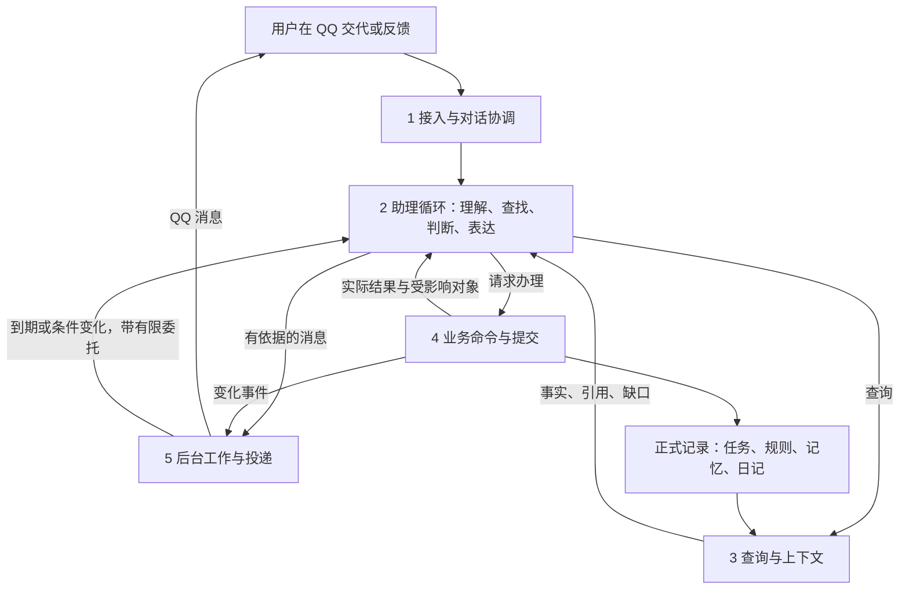
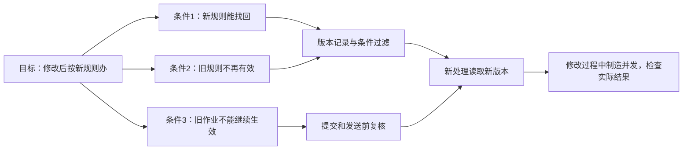
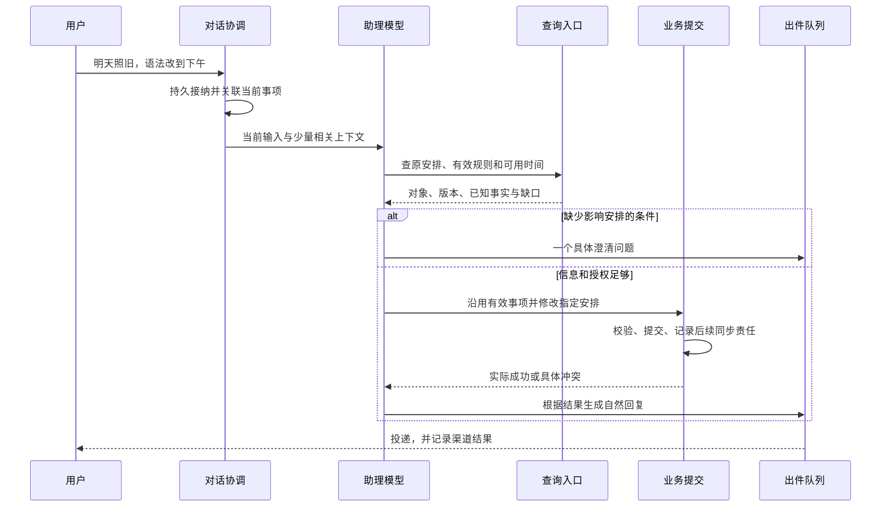
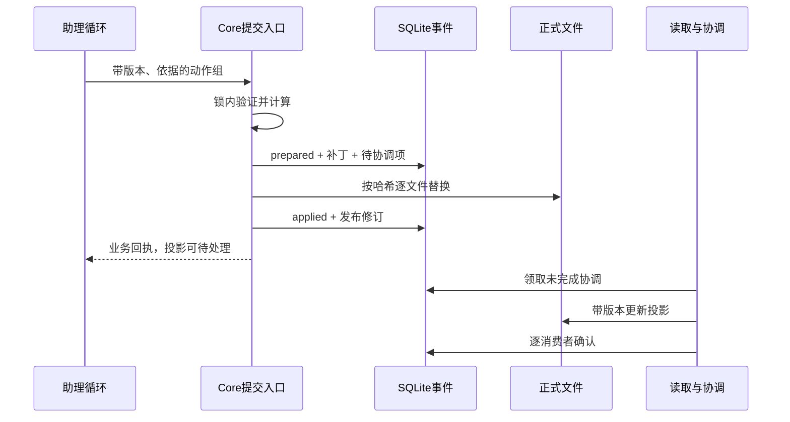
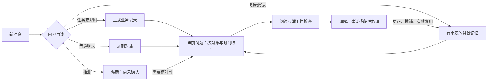
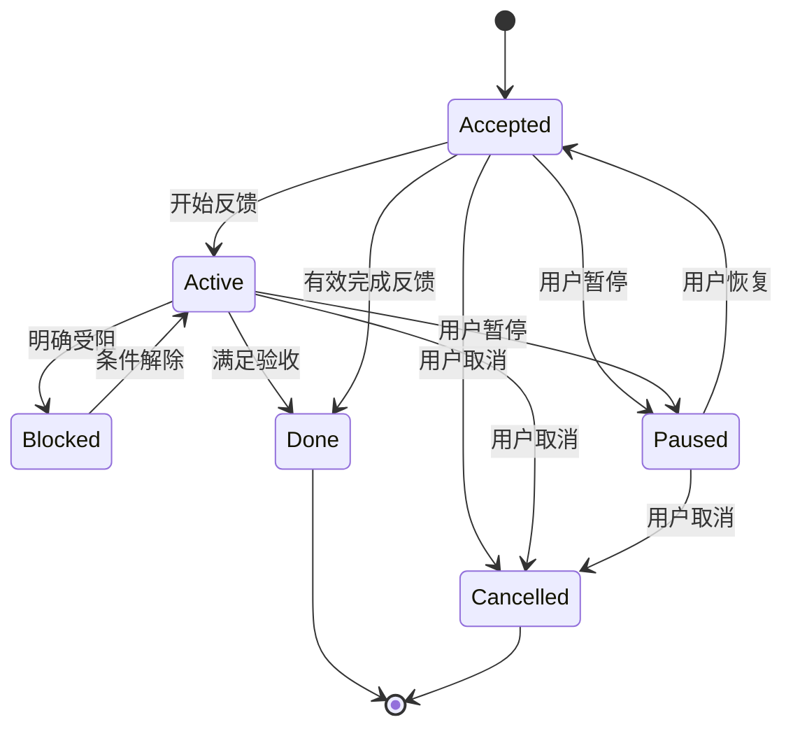
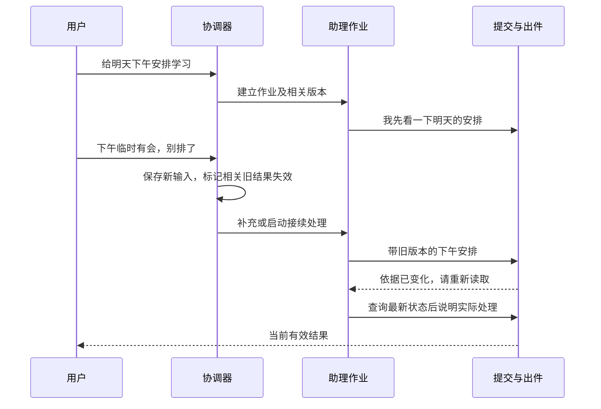
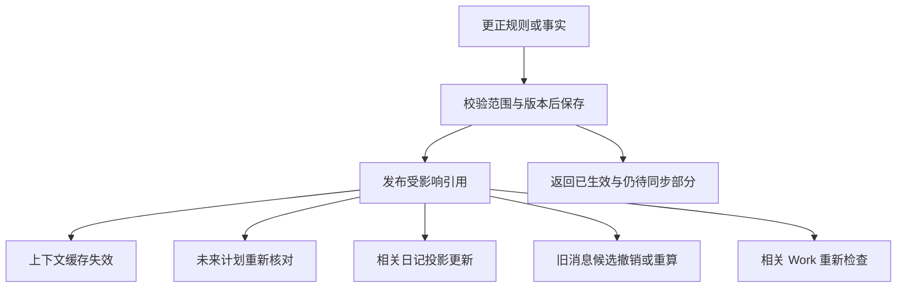

# 私人助理完整能力架构：从理解到持续推进

> 版本：0.4｜更新：2026-10-30｜性质：待实施、待验收的目标设计。
>
> 本文是本项目唯一架构设计与实施基准。以完整能力架构v0.4为基础整理，旧讨论稿、旧架构和旧实施计划已撤销；必要的工程保护已并入1.7。产品介绍与必要启动入口见[README](README.md)，选择理由见[ADR](DECISIONS.md)。
>
> 本轮交付是工程化设计文档：补齐十八项能力的条件推导、C1—C6共享合同、可执行验收规格与D01—D12开发任务。架构编写阶段未实施新业务合同，也未部署。新增合同仍待实施验收；6.9维护测试落点，不保存历次运行报告。实施只以本文合同为准；已有代码与本文不符时，按第七章测试并修复，不引用旧稿作为第二套规则。

**阅读顺序：** 第1章看整体责任；第2章看数据与唯一技术合同；第3—5章看十八项能力如何成立；第6章按初始数据和断言验收；第7章对照现有代码逐项实施。N是能力条件，M是共享机制，C是技术合同，S/E是测试，D是开发任务；编号用于追溯，不是新增模块。

**模块详细设计：** [DDD.md](DDD.md)补充业务边界、对象所有权、模块连接和用户场景。它服从本文C1—C6合同，不另立验收规则；其中模块编号仅在DDD内使用，不等同于本文的M机制编号。

## 一、总设计：一个助理循环，五组明确责任

### 1.1 用户最后应该得到什么

用户交代以后，助理能接住当前事情，找回相关背景，查清必要条件，在授权范围内落实，并在变化后继续处理。用户回来时，不需要重新介绍整件事。

“听懂、想清、可靠”必须对应可观察的结果。例如：

- “听懂”：用户说“刚才四项都确定，但语法改到下午”，四项均有正确去向，只有指定时间发生变化。
- “想清”：报告排不下时，指出缺多少可用时间、影响哪个承诺、有哪些可行选择。
- “记住”：原聊天清理后仍能正确使用有效规则；用户撤销后停止使用。
- “自然”：说的是眼前这件事，信息够用，能接话，已说明的内容不反复追问。
- “负责”：说过要查的事情，后来有查证结果、具体阻碍或明确取消记录。

这些结果分别验证。后台正常运行不等于用户行为得到改善。

### 1.2 架构选择及理由

采用单用户、单 Core 服务、一个主要助理工具循环。NapCat 与 AstrBot 负责接入 QQ，模型负责理解、选择工具、提出办法和表达；Core 提供查询、提交、校验、排程、投递与恢复能力。

“理解、判断、表达”是同一个助理循环中的活动，不强制拆成三个模型、三个 Agent 或三次调用。简单查询一轮可结束，复杂事情按需查找和办理。固定代码约束实际后果，不规定所有对话只能走同一条问答路径。

选择依据：可组合的小机制更容易观察和验证；开放任务需要工具循环，明确的业务约束适合程序检查。相关工程经验见 [Anthropic：Building effective agents](https://www.anthropic.com/research/building-effective-agents)。这是架构取舍，不是对本产品效果的证明。

### 1.3 五组责任怎样连接



五组是同一工程内的职责边界，不是五个新服务。运行保障分布在各条连接上，不放成一层含义不清的“底座”。

| 责任组 | 输入 | 输出 | 可以改变什么 |
| --- | --- | --- | --- |
| 接入与对话协调 | 本人消息、时间、引用消息、渠道事件 ID | 已接纳输入、话题关联、处理中状态 | 入件与回合运行状态 |
| 助理循环 | 当前输入、相关事实、工具结果 | 查询、办理请求、澄清、建议、回复 | 通过受控工具申请改变；无直接数据库或 shell 权限 |
| 查询与上下文 | 当前问题、对象 ID、时间范围、用途 | 片段、来源、版本、缺失或截断说明 | 可重建索引；不擅自改变业务事实 |
| 业务命令与提交 | 操作、对象、依据、预期版本 | 成功、冲突、拒绝、失败、未知及真实影响 | 经校验的正式记录 |
| 后台工作与投递 | 已接受责任、到期条件、变化事件、消息候选 | 内部准备、重新核对、投递回执 | 作业、检查点、出件状态；业务变化仍走提交入口 |

### 1.4 三条贯穿全系统的边界

1. **事实与推测分开。** 用户说了什么、系统实际办成什么有来源；推测用来提出建议，不自动成为用户事实。
2. **理解与授权分开。** 能读懂一句话，不代表获得任意操作权限；当前明确指令可以直接办理，无须再造一轮确认。
3. **业务与消息分开。** 任务保存了但回复没送到，任务仍然存在；用户收到提醒不等于开始或完成。

### 1.5 关键接口传什么

下面是最小调用合同。名称用于说明责任，可复用现有工具，不要求按表新建模块。

| 入口 | 调用方 → 接收方 | 必要输入 | 必须返回 |
| --- | --- | --- | --- |
| 接纳消息 | QQ 适配 → Core | 来源账号、事件 ID、消息时间、接收时间、文本、引用关系 | 接纳 ID 或重复/拒绝原因 |
| 查上下文 | 助理 → 查询入口 | 问题、对象引用、时间范围、分页位置 | 结果、来源、版本、仍可查的位置、缺口 |
| 保存理解 | 助理 → 对话协调 | 当前事项、已明确条件、未决问题、依据消息 | 本轮状态及修订号；不等同业务提交 |
| 办理变更 | 助理 → 提交入口 | 一组动作、明确依据、预期版本、提交组标识 | 每组结果、操作 ID、实际变化、后续投影状态 |
| 保存助理责任 | 助理 → 工作记录 | 还欠什么、关联事项、下一步、完成条件、唤醒条件、授权范围 | 可恢复的 Work ID |
| 准备联系 | 助理/后台 → 联系判定 | 联系目的、对象版本、新事实、有效窗口 | 允许、合并、等待、过期或拒绝原因 |
| 投递消息 | 出件队列 → QQ | 消息 ID、收件人、正文、有效窗口 | 渠道接受、失败或结果未知 |
| 更正/忘记 | 用户经助理 → 对应记录所有者 | 对象、范围、依据、预期版本 | 新有效状态、受影响对象、尚未处理部分 |

涉及副作用的请求都必须可去重。查询结果必须允许表达“没有找到”“只查了这些范围”，不能把摘要中没有当成整个仓库没有。


### 1.6 本版怎样从目标推到实现

本版按“目标 → 必要条件 → 共享机制 → 实际状态变化 → 可观察结果”推导。这里的必要条件是针对本产品约定场景的验收条件，不声称是对所有助理的数学证明；单项成立不保证整体成功，多项全部通过也不保证任何用户一定改变行为。

每条条件用 N01.1 这样的编号。开发者必须能回答：由谁检查、检查哪份数据、在哪个时刻检查、失败返回什么、测试怎样证伪。条件不是新增的模型评分项，也不要求用户填写。

例如，“修改后不再用旧规则”需要三个连接同时成立：新规则确实保存；检索排除旧版本；已经生成的旧作业与待发消息在使用前重新检查。只改规则文件，后两步没接上，就不能交付这一能力。




### 1.7 全局工程保护

以下是从旧规格核对后保留的独有约束，与C1—C6合用；不再依赖其他架构稿。它们是目标门槛，不能由静态整理推断已实现。

| 保护对象 | 唯一约束 | 验证落点 |
| --- | --- | --- |
| 锁顺序与活性 | 模型/网络在writer外；工具可从模型槽申请writer，writer内只开短SQL事务，不反向等模型槽、不重入writer；维护同样遵守 | E03/E08/E11检查故障后仍可推进 |
| 单写者与执行权 | 进程排他锁持到退出；不得仅按墙钟偷取活写者锁。作业租约不代替写锁，旧generation/step失权 | E07/E08；生产独立用户与卷挂载检查 |
| 背压 | 单主助理模型槽；有界进度生成按5.1例外并计预算。普通前台待办初值10、活动Work上限64；已接纳不丢失，超量明确拒绝/等待，不报已记下 | 2.8.4的批分类/活性测试，E11 |
| 模型费用 | 调用前原子预留、返回后结算；前后台、进度、表达、纠错、重试及提供者计费的思考token都计入。缺usage/超时保留预留，不能按零结算；预算状态重启不丢 | D04/D10/D12用无usage、超时、重启及超限反例验证 |
| 调用上限 | 工程初值：单请求输入16384、输出4096 token；单回合16次工具/12次模型请求；单业务日120次请求或合计500000 token先到为止。另受7.4时限及配置费用上限约束；不能截掉硬约束后请求 | 模型代理统一计数，超限保留已办效果及责任，停止新计费调用 |
| 链接与宿主机边界 | 真实路径/类型检查覆盖符号链接、Windows junction/UNC等；路径校验不替代OS隔离。拒绝异常硬链接；宿主root或可任意替换父目录的进程不在应用路径检查保证内 | E06与真实部署挂载检查，库外哨兵不变 |
| 网络与秘密 | 模型代理只接受配置提供者，不接受用户任意endpoint/跳转；Core最小卷与非root，插件无笔记/运行卷，不挂Docker socket；管理端口不公开 | E06/E14及部署检查，不能声称容器有网络就等于无外传风险 |
| 维护与停用 | 维护批次让出事件循环；压缩/大快照需停写窗口，不能把阻塞当正常SLO。停用停止后台/出件，导出正式文件并排除秘密和旧消息队列 | E12/E14及7.3恢复演练；启动入口见README |

数值由同一受校验配置提供；已有实现不同的地方先测缺口再修改，不通过在提示词重复一遍来宣称约束生效。安全性、功能正确性、活性和费用门槛必须分别通过，不能互相抵消。

## 二、数据与调用：每种事实只维护一份

### 2.1 正式记录、上下文与运行记录

| 内容 | 目标权威位置 | 怎样被使用 | 生命周期 |
| --- | --- | --- | --- |
| 日记、模板、文章、附件 | 原 Markdown 与 Attachment | 按路径/索引读取片段；日记通过模板创建 | 不受聊天清理影响 |
| 任务、习惯、计划、提案、个人规则、助理责任 | 现有 registry.json | 通过领域查询和命令 | 依据业务状态维护 |
| 每日发生与反馈 | 现有 days/ | 按事项及发生日期查询 | 保留事实与必要更正 |
| 非业务长期背景、共同语境、经验候选 | 拟新增 .agent/context/facts.json | 类型化查询、版本化修改 | 到期、修订、撤销与删除 |
| 原始近期对话 | 现有收发记录的一份规范视图 | 按时间、对象及关键词补查 | 建议统一保留 30 天 |
| 当前上下文包 | 当前作业内派生 | 提供给模型 | 作业结束可丢弃 |
| 当前未完话题的接续摘要 | 现有作业元数据或 Work 摘要 | 重启、换会话后恢复必要条件 | 有未完责任才保留；结束后按短期策略清理 |
| 投递、作业、防重与恢复依据 | 现有 SQLite 运行结构 | 调度与恢复 | 按用途和保留期清理 |

长期背景采用一个结构化文件，是为了能逐条更正与撤销。仍沿用文件为长期事实真源的边界；不新增向量服务或第二份日记数据库。facts.json 的格式是本版拟定方案，实施时需要 schema 与迁移。

任务、规则已经有正式对象，就只保存引用，不能再往 facts.json 复制一套“用户任务”。

### 2.2 修正前稿的记忆路径结论

user.md 与 memory.md 名称不同，单凭这一点不能证明故障：它们可能分别承担明确偏好与自由笔记。已查看的代码说明读取、追加和文件工具存在不同路径；是否发生遗漏，需要用“通过每种入口写入，再从正常上下文取回”的测试证明。

本版选择统一**访问合同与数据所有权**，不是盲目把两个文件拼接：

1. 盘点两个路径的实际内容与使用入口。
2. 可执行规则归现有规则对象；任务与进度归原业务对象。
3. 非业务背景迁入 facts.json，保留来源及不确定状态。
4. 不明确的旧文字只作为待核对材料，不自动变成已确认事实。
5. 新写入切到统一入口后，旧文件只读兼容；核验迁移前后数量、内容与引用，再退出旧读取。
6. 迁移可重复执行，不重复建条目；失败保留原文件。

### 2.3 一个循环怎样完成正常交代



工具循环允许继续查询、修正请求和重新办理。不会强制每条输入经过“提案—用户再确认”；已有清楚指令就直接执行。

### 2.4 十八项能力由谁承接

| 能力组 | 条目 | 首要责任 |
| --- | --- | --- |
| 工作链 | ①记得住、②听得懂、③想得清 | 查询与上下文、助理循环、对话协调 |
| 工作链 | ④安排得下、⑤办得到、⑥跟得上、⑦收得住 | 领域业务、提交、后台工作 |
| 协作原则 | ⑧自主、⑨难度、⑩理解、⑪减负、⑫自然、⑬分寸 | 助理循环与有效规则共同约束 |
| 保障条件 | ⑭及时、⑮真实、⑯稳定、⑰可改、⑱边界 | 协调、提交、投递、恢复及各记录所有者 |

能力不等于组件。十八种用户要求由少量组件共同满足，避免为了每个名词增加一个服务。


### 2.5 八个共享机制：用少量实现覆盖多项条件

M 编号是逻辑责任，不是要求建立八个服务或 Agent。优先放进现有入口。后文的 N 条件引用这些机制，避免每一项能力各造一套记忆、规则或队列。

| 机制 | 具体执行方式 | 主要覆盖 | 现有落点 |
| --- | --- | --- | --- |
| M1 来源与版本 | 查询带对象ID、版本、来源、适用区间；读取集合还带集合修订，避免新插入记录被遗漏 | 事实、规则、并发正确性 | contracts、read-stamps、store |
| M2 上下文检索 | 当前引用优先；按对象/时间检索，返回片段与分页；模型可改写查询；记录已查范围 | 记忆、指代、少重复解释 | assistant、application、workspace |
| M3 对话与接续 | 保存当前展示集合、未决问题、输入水位和事项关联；新消息先接纳再分类 | 多项接受、交错对话、追问 | core、conversation、agent-runtime |
| M4 约束与授权 | 明确规则解析；动作参数校验；时间/依赖检查；授权范围求交 | 排程、自主、能力边界 | domain、policy、background-grant |
| M5 可恢复提交 | 单写者内查重、核版本、写准备记录、更新文件、发布结果；失败按阶段恢复 | 落实、收尾、真实性 | core.execute、store、recovery-control |
| M6 影响协调 | 将 changed_refs 与待处理消费者一起持久记录；投影、工作和出件逐个确认；失败再接续 | 修改联动、持续推进 | work-runner、coordinator、journal |
| M7 联系与投递 | 联系原因、相关状态、窗口和预算判定；发送前复核；独立记录投递未知 | 分寸、及时、消息顺序 | assistant、scheduler、qq |
| M8 生命周期与证据 | 类型化引用保护、删除传播、迁移与恢复门禁；记录可复核证据 | 长期记忆、清理、隐私与验证 | retention、maintenance、snapshot-backup |

M4 检查时间冲突能给出确定结论；理解一句话的真实意图仍依赖模型与用户背景。不能因为命令结构合法，就宣称语义也被程序证明正确。

### 2.6 必须传递的数据，不再只传一段摘要

下表是目标字段合同；复用已有字段或引用，避免复制业务正文。模型提交的引用必须由 Core 查回核验。

| 数据 | 必要内容 | 保存位置与使用方 |
| --- | --- | --- |
| 对话上下文 | conversation_id、已接纳输入序号、已理解输入序号、当前事项、展示集合ID及有序对象版本、未决问题ID | 回合作业元数据；跨回合未完责任转 Work |
| 依据引用 | 来源类型、来源ID、对象版本、发生时间、适用范围、证据类别 | 正式对象来源；M1核验，不能用任意字符串自批 |
| 查询结果 | items、read_refs、集合修订、searched_scope、next_cursor、missing_reason | 临时结果；缺失与截断明确交给模型 |
| 办理请求 | 稳定操作ID、动作组、依据引用、读版本、所处理输入水位、组内原子性要求 | 现有业务调用；M4/M5处理 |
| 办理回执 | operation_id、各组效果、changed_refs、结果版本、投影状态、可重试范围 | 事件与返回值；供回复及恢复使用 |
| 接续责任 | 关联事项、当前步骤、owner、下一动作、done_when、wake_on、check_at、委托范围 | 现有 Work，不保存第二份任务 |
| 联系候选 | purpose、subject_refs、原因、依据版本、对应问题ID、有效窗口、通知序号 | 作业/出件元数据；M7发送前复核 |
| 记忆条目 | ID、内容类型、主体、范围、来源类别、有效区间、版本、替代关系、保留用途、状态 | facts.json；规则和任务仍在原真源 |
| 协调记录 | 操作ID、changed_refs、待处理消费者及完成标记 | 现有事件运行记录；M6防止中断丢联动 |

“未决问题”至少记录具体未知、可能改变的决定、关联事项、已查范围与重问条件。它不需要独立数据库表；与当前回合或 Work 同寿命。

### 2.7 四个强制检查点与一个退路

1. **接纳时：** 验本人身份、去重并保存消息。消息不能等待旧模型完成才被接收。
2. **提交前：** 检查是否有尚未理解的新输入、相关对象/集合版本、授权与领域约束。
3. **发送前：** 检查候选内容依赖的版本、用户暂停、过期时间、消息顺序及已有最终结果。
4. **清理前：** 检查活动引用、未完成协调与恢复依据；删除之后再次验证相关检索不可见。
5. **无法确定时：** 不伪造缺失事实；保存已办部分与具体缺口，选择重查、询问、等待或停止受影响操作。

新输入尚未分类时，先暂停可能受影响的旧写入和投递；范围完全未知则临时阻塞全部业务副作用，独立只读工作可以继续。分类、恢复、活性边界及接纳/prepare先后统一见2.8.4。仅检查业务对象版本不足以防止“用户刚说别排，旧安排仍提交”，因为用户新话尚未变成对象变更。


### 2.8 C1：请求、动作组与回执合同

以下为**目标接口**，不是声称现有类型已经完全包含这些字段。沿用现有 BusinessCall 与 Query 的名称；新增公共字段通过 schema 一次定义，再导出给模型工具、HTTP 和测试，不各写一份。对象ID是不透明字符串；时间用带时区的 ISO 8601，业务日期另带 timezone；version 为正整数。未知字段、无效枚举与越限数组一律拒绝。

#### 2.8.1 一次调用携带哪些结构

```typescript
type Ref = { kind: string; id: string; version: number };
type ReadSet = {
  objects: Ref[];
  collections: { query_key: string; digest: string }[];
  files: { path: string; hash: string }[];
};
type QueryResult<T> = {
  items: T[]; read_set: ReadSet; snapshot_revision: number;
  searched_scope: string[]; next_cursor: string | null;
  missing_reason: "not_found" | "out_of_scope" | "truncated" | null;
};
type Basis = {
  kind: "current_input" | "proposal_decision" | "rule" | "delegation";
  id: string; version?: number;
};
type Call = {
  contract_version: 1; input_id: string; call_id: string;
  processed_input_seq: number; read_set_id: string;
  operation: "apply_changes" | "save_proposals" | "resolve_proposals";
  commit_mode: "independent_groups" | "all_or_nothing";
  // apply/save：action_groups；resolve：decisions；二者互斥
  action_groups?: {
    action_identity: string; actions: Action[]; basis_refs: Basis[];
    proposal_id?: string; expected_version?: number;
  }[];
  decisions?: {
    target_id: string; expected_version: number;
    decision: "accept" | "reject" | "defer"; action_indices?: number[];
    replacements?: Action[]; // 仅accept允许，沿用现有修订语义
  }[];
};
type GroupReceipt = {
  identity: string;
  status: "applied" | "pending_decision" | "rejected" | "uncertain";
  operation_id?: string; changed_refs: Ref[];
  already_applied: boolean;
  projection: "not_needed" | "pending" | "applied" | "conflict";
  error?: {
    code: string; stage: "validation" | "prepare" | "apply" | "projection";
    effect: "not_applied" | "applied" | "unknown";
    retry: "none" | "reread" | "resume" | "reconcile_only";
  };
};
```

Action 复用现有严格动作 schema，不允许模型构造任意方法名。Ref.kind 实现时必须收敛到已注册类型；上面的 string 只为缩短示意，不能据此接受未知对象。read_set_id 指向 Core 捕获的读集，模型不能自签版本或水位。查询分页绑定 snapshot_revision，翻页期间变更则返回冲突并重查，不能默默拼接不同版本。

接纳输入持久化后分配递增序号；模型成功提交一轮结构化理解后才推进 understood_seq。未理解的输入存在时，旧副作用暂停；分类完成后只使相关旧工作失效。展示集合记录“实际发出的对象ID、顺序、版本、出件ID”，未发送的草案不能冒充用户已经看见。新消息引用哪个集合由模型结合 reply_to 判断，Core校验该集合存在、未过期且所选项属于它。

#### 2.8.2 原子性到底覆盖哪里

| 情况 | 统一规则 |
| --- | --- |
| 同一组内的动作 | 校验整个组；一个不合法则全组不提交。不可分割的业务后果放同组 |
| 多组修改同一对象、排程空间或规则集合 | 合并成一个提交单元，按原顺序计算；读同一旧基线不能分别覆盖 |
| 独立组 | independent_groups 允许前组成功、后组失败；回执逐组说明，成功组不能再执行 |
| 用户明确“要么一起办，要么都不办” | all_or_nothing：全部业务组一个提交单元。已完成的旧操作不倒退；存在不可合并的既有部分效果时，拒绝新的整批提交并先核对 |
| 保存多份待定提案 | 也必须遵守 commit_mode；当前逐份保存的路径需补齐整批模式，不能静默忽略 |
| 日记投影、QQ投递 | 不属于业务原子提交。业务成功、投影冲突、投递未知可以同时存在 |
| 外部已发生效果 | 不承诺回滚QQ消息；用明确后续修正，不能伪造撤回 |

组键绑定 input_id、稳定动作身份及内容指纹。同键同内容返回原结果，同键不同内容返回 IDEMPOTENCY_REUSED。确认四项必须返回四项去向；共享同一 operation_id 时，changed_refs 可以是整个提交单元，必须标明范围，不能假装每项独占所有变化。

#### 2.8.3 错误如何影响下一步

| 错误类别／示例代码 | 程序处理 | 模型可以做什么 |
| --- | --- | --- |
| 参数无效 INVALID_COMMAND | 无效果；最多一次修正无副作用参数 | 修正参数，不能绕开约束 |
| 旧版本 VERSION_CONFLICT | 无效果，返回失效引用 | 重读受影响对象，重新决定 |
| 有新输入 NEWER_INPUT_PENDING | 暂停旧副作用，不算用户拒绝 | 先理解新输入再接续 |
| 无授权 BASIS_INVALID / BACKGROUND_SCOPE | 无效果，不自动重试 | 说明能力/授权缺口，必要时询问 |
| 恢复冲突 RECOVERY_CONFLICT | 效果待核对，关闭领域写入 | 只核对，不改调用ID重放 |
| 不确定 OPERATION_UNCERTAIN | 查原操作和实际文件 | reconcile_only，不能报成功 |
| 投影冲突 PROJECTION_CONFLICT（待统一） | 业务保持成功，保存修复责任 | 说明正文未同步，保护手改内容 |
| 超时/外部失败 | 根据是否已开始副作用决定重试 | 不把网络失败推断成业务未发生 |

错误响应均带操作/组ID和effect；日志中的堆栈不直接当用户回复。新错误码属于待实施合同，已有错误码保留兼容映射。Operation类别与可用字段用判别联合schema校验：例如replacements仅用于accept；save_proposals不得暗含执行。只做TypeScript类型声明不足以防止模型传入错误参数。


#### 2.8.4 新输入的分类、提交顺序与恢复推进

本节是待实施的补充合同。复用inbox.metadata_json、现有作业和短提交锁；不新增意图服务。每条输入接纳时获得同一本人会话内递增seq，跨QQ适配入口也归同一序列。

分类结果使用严格schema：

```typescript
type Interpretation = {
  input_id: string; seq: number; source_hash: string;
  based_on: { objects: Ref[]; displayed_set_ids: string[] };
  acts: {
    kind: "query" | "report" | "discuss" | "instruct" |
          "decide" | "correct" | "stop" | "unknown";
    target_refs: Ref[]; target_scope: "explicit" | "conversation" | "unknown";
    relation: "unrelated" | "continue" | "replace" | "cancel" | "unknown";
    affects: ("business" | "contact" | "context")[];
    evidence_span: { start: number; end: number };
    unresolved_question?: string;
  }[];
};
```

evidence_span按原始文本Unicode码点计数，必须非空且未越界；source_hash由Core核验。它只能证明出处存在，不能证明模型解释正确。相邻闲聊允许query/discuss，不能靠空acts推进水位。分类结果不含直接执行动作，动作另走C1。记录分类完成与授权动作执行是两件事。

**持久状态：** 每条输入有unclassified/classifying/classified/needs_clarification；classified保留解释版本及影响集合，needs_clarification保留已知范围与缺口。understood_seq仅推进到连续已分类的位置；需要澄清不是“已经批准”。另按每个作业记录覆盖的输入范围和受影响引用，不能仅用一个全局水位永久阻塞无关事项。

**执行顺序：**

1. 接纳、分类结果发布、业务prepare使用同一个短串行入口。模型和网络在入口外运行。接纳的SQLite事务提交与业务prepared事务提交是先后判定点，不使用QQ消息自报时间比较。
2. 新输入先提交：旧操作prepare前必须看见它，尚未分类则暂缓副作用。旧业务prepared先提交：其恢复必须完成，后到的取消通过新操作处理，不能中途撕毁恢复日志。向用户如实区分“已办理后撤销”和“未办理”。
3. 分类作业领取固定上界cutoff_seq；后来消息继续入件，不重启正在分类的批次。每批最多20条，按seq处理，带原文与当前背景；超过限额继续下一批，不静默丢弃。
4. 每条分类在短锁内核对source_hash、读集与解释版本后发布。明确不相关的输入不使旧Work失效；相关变更使旧step/消息候选失效，需按新条件重算。含糊输入只阻塞可能受影响范围；完全无法确定范围时暂时阻塞业务写与主动联系，合法只读仍可继续。
5. 同一批最多两次分类尝试，单次30秒截止；失败保留needs_clarification及可恢复责任。模型恢复或新明确输入到达后继续；只在能影响下一步时发一次具体澄清，不能失败后反复追问或把超时当同意。
6. 分类完成后调度“最早等待且无相关阻塞”的已授权Work，再执行下一批普通准备，避免分类和后台互相无限抢占；每次实际提交仍重查新入件。连续相同渠道事件去重，不能靠重投延长阻塞。
7. 旧作业的读集、规则和授权仍有效时可恢复；已失效则只复用已核验事实，重新生成动作，不重放旧请求。用户新消息不能撤销已经真实发生的结果，后续更正走独立操作。

**活性边界：** 有限输入突发、分类成功、外部工具可用时，所有无关有效Work最终获得执行机会。持续无限输入或长期无法理解的全局修改下，不能同时保证“绝不违背最新话”和“旧写入必然立即执行”；系统保留责任、报告具体阻塞，不能超时后偷偷绕过门禁。队列积压和最老阻塞时长进入7.3告警。

**顺序测试：** 使用屏障分别让receive事务与prepare事务先提交，断言前者阻止旧效果、后者恢复旧效果后再处理撤销。连续输入100条可分类闲聊，分类器不得从头反复启动；最后一条分类完成后，原有效Work应在下一次获准调度执行一次。再测一条目标不明的停止请求，原写入保持阻塞，不能为通过活性测试而忽略它。

### 2.9 C2：一致读取、提交、故障恢复与人工编辑

#### 2.9.1 一致性的范围

本版选择**单 Core 写入者＋恢复屏障＋一次读取快照**，不引入分布式事务或第二套正文数据库。registry、days、facts 是正式结构化文件；Markdown 是正文真源。日记中绑定任务区域是业务的可重建投影，用户手改绑定区域需要通过导入命令解释，不能直接覆盖任务事实。

所有领域查询使用 readSnapshot(scope)：进入 Store.exclusive → 恢复 prepared 业务操作 → 同步读取需要的 registry/days/facts 和集合修订 → 返回不可变副本及读集 → 释放锁。模型调用与网络操作绝不放在锁内。跨多次查询得到的上下文可能后来过时，提交时检查完整读集，而非假设模型调用期间状态未变。

现有 registry()/day() 已有 readBarrier；新增 readSnapshot 是统一多源读取与版本捕获的责任，不另造存储服务。MVP先用全局业务提交屏障；恢复冲突时领域查询返回“恢复未完成”，不返混合状态。与业务无关的普通笔记只读仍可用。

#### 2.9.2 一次提交的确定顺序

1. 在 exclusive 内查去重、作业有效性、新输入、权限、读集和领域不变量。
2. 在内存副本计算整个提交单元；完整验证后得到最小文件补丁、base_hash、target_hash、changed_refs和待协调消费者。
3. 在一个SQLite事务中持久化 prepared 事件及必要运行元数据，再开始文件修改。补丁只保存恢复必需的结构化增量，不放整份Markdown；超过现有64KiB事件上限就明确拒绝/要求缩小提交，不能截断。
4. 每个目标先写同目录临时文件、刷新数据，再原子替换；部署文件系统支持时刷新父目录。启动清理无引用临时文件。不能仅凭“rename成功”宣称通过断电测试。
5. 全部目标达到target_hash后，在一个SQLite事务标记applied、发布新snapshot_revision并留下待处理消费者。此后查询才可以读取新业务视图。
6. 释放锁。M6按操作ID更新日记、Work、出件；各消费者幂等确认自己的进度。协调未完成的事件不能被清理。回复同时说明业务与投影状态。



#### 2.9.3 崩溃后怎样决定，而不是盲目重跑

| 崩溃位置 | 重启后的判定与动作 |
| --- | --- |
| prepared之前 | 没有可确认业务效果；原入件可按幂等规则重新处理 |
| prepared之后、文件未改 | 当前hash等于base，继续应用同一补丁 |
| 部分文件已改 | target则跳过；base则继续；其他hash则恢复冲突 |
| 文件全改、applied未记 | 验全部target后补applied；禁止再次执行领域动作 |
| applied之后、协调未完 | 只重试缺失的消费者；不重做任务 |
| QQ调用已发、回执丢失 | outbox为unknown；可核验渠道记录时核验，否则不盲重发 |

不要把部分更新回滚到旧文件：可能已有外部读取或人工变更。恢复优先完成已准备的确定补丁，冲突则保留当前文件与诊断信息，停止相关业务服务；经人工合并和校验后以独立修复操作解除。对用户报“待核对”，不能报“已失败所以没有变化”。

#### 2.9.4 人工编辑的支持边界

- Markdown可编辑。投影读取base_hash及受管理块，写前重查；不同区域可经明确的三方合并保留，重叠修改留冲突，不强覆盖。模板创建使用create-if-absent；文件已存在就读现有正文。
- **运行中的registry/days/facts禁止旁路直接编辑。** 本人从QQ或受控编辑命令修改；离线编辑必须停服务，验证schema，再作为导入变更重建版本、派生和撤销索引。
- 单服务互斥锁挡不住任意外部编辑器。对Markdown需要系统写入的窗口，采用配合锁的编辑入口或显式短暂停写；不配合锁的外部编辑只提供哈希冲突检测，无法保证“最后一次检查后到替换前”绝无竞争。部署和使用说明必须写明这条边界。
- Git备份在一致快照/维护窗口创建，不在多文件提交中间打包。旧备份只恢复正式数据，不导入旧待发消息。

### 2.10 C3：模型判断与Core约束的统一分工

模型可以理解含义、提出取舍、选择工具；程序只能对可验证条件给保证。模型给出“用户已授权”不能自证有效。

| 判断 | 模型负责 | Core必须核验 |
| --- | --- | --- |
| 用户这句话指什么、是否修改/讨论/反馈 | 结合当前话与已展示对象解释，给出依据消息和对象 | 入件真实、对象属于已读/已展示范围、版本有效 |
| 一句话涉及多少事、如何成组 | 提交全部事项及关联 | 无重复身份；重叠资源合组；每组有结果 |
| 是否可直接办 | 选择current_input、已接受提案、规则或委托依据 | 来源存在、尚有效、范围与操作相容；后台必须用Core签发的grant |
| 如何安排、有什么更好办法 | 在真实约束下给候选 | 时间、依赖、固定承诺、硬截止及授权不得被突破 |
| 怎样表达 | 依事实自由写短答/进度/建议 | 引用版本、投递窗口、暂停、消息顺序和预算 |

执行许可为：**工具能力 ∩ 主体权限 ∩ 当前有效授权 ∩ 对象/时间/路径范围 ∩ 领域不变量**。一个交集为空就不能提交。当前输入自然语言是否足够明确仍是语义判断，不声称Core能机械证明；高影响范围变化要求可定位的明确表达或已接受提案，模糊时只询问缺的范围。

“把明天的都调整一下”的统一处理：

1. 查明天有效安排及已接受的可移动规则，排除完成/取消项。
2. 已知调整原因、目标时段及允许自动重排范围：模型提出方案，Core检查后直接提交弹性安排。
3. 只是泛泛表达，没有“往哪调/为解决什么”：保存调整意向，带一个依据现状的推荐问关键问题，不任意换时间。
4. 撞固定预约、要改硬截止/成果：保持原承诺，保存待定取舍；不把泛泛授权解释成改全部人生目标。
5. 用户明确接受当前展示的整组修订：批量resolve，不逐条再问。之后版本变更只重核受影响项。

联系暂停、任务暂停、任务取消、记忆删除分别是不同动作。明确取消及时办理；“不想做”先结合背景理解，不硬编码成取消，也不硬编码成继续催。紧急/重要标签不扩大系统权限。

### 2.11 C4：Work如何持续推进

#### 2.11.1 数据模型与创建规则

复用 Followup.work，不新增“项目数据库”。Task记录用户成果，Work记录助理还欠的处理；一个Task可以关联若干不同责任，但同一 key/step 不重复建。

| 字段 | 约束与用途 |
| --- | --- |
| Followup.id/version/status | 身份、并发版本、责任状态；状态沿用现有五种 |
| work.key/summary/source | 稳定业务键、责任说明、真实接受来源 |
| owner/next_action | assistant、user或condition；明确谁能推进及下一动作 |
| step_id/prior_steps | Core生成；动作、验收或范围实质变化则新step，旧step失效 |
| refs | 最多8项，kind/id或note/path、role、observed_version/hash |
| done_when | 已支持business_applied、material_verified、decision_recorded、condition_observed、user_confirmed；每种有专用校验器 |
| wake_on/next_check_at | 相关引用变更、匹配反馈、到期检查；无可观测来源的外部等待只能按约定核对 |
| delegation | Source、允许能力、固定对象/路径、rules_revision、expires_at；只能Core签发 |
| analysis | 当前cause指纹、running/done/failed/superseded、次数；是一次尝试状态，不是责任完成 |
| resolution | completed/cancelled/superseded及证据；终态不因重启自动复活 |

只在已接受事项仍有助理责任、跨回合等待、需要后续准备或处理恢复时创建。简单查询当场答完不建Work。模型主动建议新目标可以保存提案，不能自行把建议变成已接受责任。缺done_when的历史Work可展示，但不得自动判完成；先补明确检查器或等待用户反馈。

#### 2.11.2 生命周期

| 当前状态 | 事件与前置条件 | 新状态/动作 |
| --- | --- | --- |
| 无 | 已接受责任，下一步助理可办 | open；建立委托及唤醒条件 |
| open | 缺用户必要决定 | waiting_user；关联一个具体问题 |
| open | 缺外部前提 | waiting_condition；记录可观测条件/核对时间 |
| waiting_user | 明确回答绑定正确问题 | 重查条件后open或waiting_condition；不直接算完成 |
| waiting_condition | 条件有证据满足 | open；重新核验依赖和授权 |
| 任一非终态 | 明确暂停 | paused；保存paused_from，停相应后台动作 |
| paused | 明确恢复 | 重核当前条件后转相应状态，不能恢复旧grant |
| 任一非终态 | 完成检查器通过 | resolved + completed；停止对应唤醒 |
| 任一非终态 | 明确取消或被新责任替代 | resolved + cancelled/superseded；保留必要历史 |
| resolved | 想重新做 | 创建新责任/step关联历史；原终态不篡改 |

转换优先级：先检查取消/替代等有效决定，再核对done_when；完成检查通过则直接resolved。只有前置条件满足、但自身完成条件尚未满足时，才从waiting_condition转open继续执行。不能把“核实材料存在”这条责任已经完成，与“材料存在所以可以开始另一条整理责任”混为同一步。

“已生成方法”“模型调用成功”“analysis=done”均不自动满足用户任务验收。material_verified的exists_nonempty只证明文件非空；需要内容质量时必须换成对应检查或用户验收，不能滥用弱检查器。

#### 2.11.3 唤醒、重试与终止

1. 业务变更通过M6投递相关引用事件；时钟只扫描到期Work；本人反馈先匹配对象/问题，再唤醒相应责任。
2. 唤醒键使用work_id、step_id、相关引用版本、policy版本与约定检查点。时钟每跳一次不是新原因。
3. 领取前检查open、owner=assistant、有效委托、预算、无冲突前台作业；记录inbox作业及analysis.running。Core单进程串行写，不增加多执行器。
4. 每次工具副作用前重验作业generation、step、grant、read_set、新输入及截止；超时回调不能靠旧凭证继续写。
5. 同一cause最多2次模型尝试，第二次只用于可恢复错误；权限/版本问题先重查或停下，不盲重试。每步上限还受模型调用、工具次数、费用和运行期限约束。
6. 先核对是否已有实际效果，再决定是否重试。完成写回resolved；需要用户/条件则转换owner；能力缺口保留责任与原因，不每分钟重新问。
7. cause未变化且本轮已处理/耗尽预算时不空转。真正新反馈、新有效版本、明确人工恢复才重新评估；不要通过改check_at或无意义版本递增绕开次数上限。
8. 服务重启先恢复业务、核对Work完成证据、使旧generation失效，再接续未完成步骤。默认不把旧进度消息补发给用户。

### 2.12 C5：记忆、事实和撤销如何接到业务上

#### 2.12.1 什么算明确事实

| 来源 | 可以保存什么 | 不可以推导什么 |
| --- | --- | --- |
| 本人直接陈述 | user_reported，保留原输入引用、发生时间、范围 | 不代表外部工具已经证明 |
| 本人明确制定/修改规则 | 相应正式规则，记录生效期与来源 | 不从引述、讨论或假设自动制定规则 |
| 工具实际回执 | tool_observed，关联operation/对象版本 | 文件存在不代表内容达标 |
| 模型解释/猜测 | hypothesis，带来源和待核对条件 | 不升级为已确认性格/动机 |
| 旧文档迁入 | imported_unverified，保留路径/hash | 不能因文件在本人仓库就当成最新指令 |

新增facts条目至少有id、version、kind、subject、scope、content、source、valid_from/until、status、supersedes、retention_reason、last_used_at和used_event_ids。source必须能关联真实入件/笔记/工具结果；长期原对话清理后保留最小必要出处及确认片段，不复制整段聊天。used_event_ids有界且去重，按已验证不同使用事件计数。

用户主动给出的明确长期背景可立即保存。聊天中临时梗先留近期语境；被后续真实问题相关复用时可保存其解释及出处，**复用价值与事实可信度分开**。模型自引用、自动摘要反复引用和同一作业重试不算新证据。

#### 2.12.2 冲突与优先级

同主体、同字段、同适用范围才能比较。明确更正通过supersedes替代旧项；当日例外仅在有效区间覆盖长期规则。更晚聊天不天然覆盖明确承诺；不同来源冲突不能仅凭时间强行选一个，保留conflicted并停止依赖该事实的写入，必要时问具体冲突。后台只能使用适用且未撤销的版本。

摘要是派生物，带source_refs、规则修订和生成版本；其中任一来源失效，整份相关摘要标stale并重建。无需全文重读所有资料，但不得把摘要当独立真源。对话上下文已用到哪些记忆，必须作为作业依赖记录。

#### 2.12.3 “忘记”不是删除一行就结束

1. 明确范围：忘记某条背景、撤销某条规则、删除原聊天，三者分别办理。没有明确要求，删除背景不取消关联任务。
2. 在同一业务提交保存撤销状态和持久删除标记（只含不透明ID、版本、范围、撤销时间；不保留被删正文），递增撤销修订。
3. M6失效检索缓存、摘要、排队消息与活动作业；活动作业在下一工具调用/发送前发现撤销修订变化即终止并重建上下文。不能从已经送给外部模型的数据中“远程抹掉”，只能阻止本系统再使用。
4. 清除受影响的原聊天片段、日志正文和不再用于恢复的事件增量；活动恢复材料先完成一致恢复，再移除对应的可读取内容；本合同不承诺对磁盘残留、云存储底层副本作物理安全擦除。依赖未清完前回执为“已停用，清理待完成”，不能报“全部彻底删除”。
5. 备份需有保留期和清单。普通恢复必须带入比备份更新的撤销清单，先过滤再开启检索/后台。删除后仍含正文的旧备份需要轮换删除或按要求立即清理。
6. **旧备份是唯一幸存副本时，无法知道备份后发生过哪些删除。** 恢复工具必须标记撤销历史不完整、禁用旧记忆自动加载，等待提供最新清单或确认恢复范围；不能承诺无条件“不复活”。已导出到用户控制外部的副本不在系统可擦除范围。

无需另建服务：撤销清单在独立于旧快照覆盖范围的持久控制文件中维护，备份携带其版本；运行协调留现有events。新环境需先迁入最新清单，不能让恢复旧目录把新清单覆盖掉。

### 2.13 C6：变更传播和联系投递

任何正式变更返回changed_refs，并在同一prepared/applied提交记录中登记需要处理的消费者：日记投影、Work协调、有效提醒、记忆派生。消费者键是operation_id＋consumer＋target_id；处理成功确认，失败保存error及next_retry，重启接着处理。业务事件未被所需消费者确认前不得清理。

对提醒的取消不能只靠后台协调“最终会处理”：发送前还必须重查正式对象、规则和撤销版本。这样即使协调暂时失败，也不会继续发送已取消任务的旧提醒。Work工具调用前同理。协调负责及时更新，检查点负责阻止过期后果。

出件复用现有pending→sending→sent/failed/unknown及cancelled/expired/abandoned。发送者按reply_group顺序领取；新输入未分类暂停旧候选；最终结果就绪时取消未发送的进度候选。状态sent仅表示渠道接受，unknown不可自动转failed后重发。消息一旦已被渠道接受，取消只能阻止剩余段，不能保证撤回已发送段。

新增出件的reply_group、sequence、purpose、input水位和依赖撤销版本，统一放在一个有schema及大小上限的metadata_json列（需迁移），避免塞入正文或随意借用target_refs字段；既有目标/版本仍用原字段。旧记录迁移为独立单条回复，不能猜测原分组。

用户指定“发Hello”可以按原文发送；普通助理措辞由模型生成。联系判定、排序、去重不依赖固定套话。模型不可用时记录未完成并保留可恢复责任，不编造已经回应。

## 三、工作链：从理解交代到办事收尾

### 3.1 ①记得住：保存、找回、适用和纠错

#### 3.1.1 什么才算记住

今天解释过一个表达，明天换个说法仍能接住；一个月后原聊天已清理，仍能理解被保留的背景；更正以后不再沿用错误解释。记忆评估应包含跨会话、时间关系、信息更新与不知道时不编造，可参考 [LongMemEval](https://arxiv.org/abs/2410.10813)。

#### 3.1.2 方法与写入规则

采用分层存储、按需检索、适用范围和版本维护。短中长期描述用途，不是每条信息必须逐级晋升的流水线。保存去向唯一按2.1，证据、冲突和晋升按C5执行。

关键区别是“保存它值得不值得”和“它是否可信”：共同语境值得保留，也不因此成为执行授权；推测被调用多次，也不因此成为用户确认。复用要能关联到哪次输入、哪条解释，相同事件只算一次。

#### 3.1.3 如何检索和调用

先带入当前事项、刚展示的方案和相关有效规则；随后按对象、时间、主题查候选，模型阅读相关片段，必要时改写查询补查。关键词仅用于找候选，不裁决用户意图。初始不引入向量库；同义表达检索持续漏项时，再用对照评测决定是否增加语义索引。

上下文包带来源、版本和缺口；摘要不足时提供读取入口。保留空间给工具结果，不能为了塞进历史把当前指令截断。该策略借鉴有限上下文的选择与按需检索思想，见 [上下文工程](https://www.anthropic.com/research/effective-context-engineering-for-ai-agents)。



#### 3.1.4 清理与异常

保留期统一见7.4；一条消息被使用不延长整段聊天寿命。清理前由M8检查活动依据，已确认且仍有用的最小事实进入正式对象，不能先删再猜。双向对话要同时覆盖入件和出件，不能把现有出件7天当成完整一个月上下文。

更正、删除传播、旧备份及外部模型边界只按C5处理。最新撤销清单缺失时，旧备份无法证明删除后未复活，必须受限恢复。能力验收以S2为准，不只检查当前文件里是否删了一行。

#### 3.1.5 必要条件怎样被实现

| 条件 | 具体机制 | 因果关系：少了它会怎样 |
| --- | --- | --- |
| N01.1 有需要的事实可读 | M1/M8保存来源、内容、对象和有效期；长期承诺立即进正式对象 | 原聊天删除后还存在必要事实；否则“记得”只依赖未清理的窗口 |
| N01.2 能从当前表达找到相关记录 | M2先定位当前对象，再扩展主题和时间查询；返回漏查/截断信息 | 不同说法仍有补查途径；否则文件存在也可能永远找不到 |
| N01.3 找到的是适用于此刻的版本 | 按主体、用途、时间和替代关系过滤；冲突条目单独返回 | 防止把“今天例外”用于明天，或把旧解释当最新规则 |
| N01.4 读取结果真正进入后续判断 | 上下文包保留来源引用；相关建议带使用的依据ID，提交核查有效性 | 能追查用了哪条记忆；否则检索成功与实际行为脱节 |
| N01.5 更正和清理后仍保持正确 | M6撤销旧候选，M8保护活动依据、处理删除与备份恢复 | 旧事实不能借缓存/备份复活，也不会在清理时丢掉当前责任 |

**实际运行。** 用户说明“我说开小灶，是指晚上十分钟语法练习”。助理调用记忆写入，Core保存该表达及含义、来源、范围。以后“今晚开小灶吗”先尝试当前事项关联，再按表达及同义查询找回；模型读取后知道用户在询问练习，不因理解了梗就自动创建任务。用户明确要求安排时，才调用排程。

**保留算法。** 每条记忆分开记录证据类别与保留用途。明确长期信息无自动到期；近期明确背景默认30天，实际用于相关理解后可晋升持续背景；推测无论使用多少次都保持推测，默认30天到期。复用事件保存输入ID、记忆版本和用途，相同事件重复报告不重复计数。模型自报复用只支持“值得保留”的候选判断，用户更正则降低适用性并替代错误条目。

**验证因果。** 依次制造记录不存在、查询未覆盖、仅存在旧版本、上下文被截断、恢复旧备份五种情况，分别检查N01.1—N01.5。正确行为包含如实不知道和继续补查，不要求所有输入都必须答出。语义检索是否足够仍由真实模型样本证明。


### 3.2 ②听得懂：把当前话与前文正确接上

**方法：** 跟踪当前讨论对象、表达意图与已确认条件；先查记录，再按错误后果选择直接办、复述或澄清。允许保留多个解释，不能强行用一个标签消除不确定性。

**处理：**

1. 根据引用消息、最近展示方案和正式对象定位所指。
2. 区分讨论、接受、修订、反馈和查询，保留原文来源。
3. 一句话有多件事，分别关联；同轮修订使用最后明确要求。
4. 信息足够就办；缺关键条件才问，不为填写完整而追问。
5. 理解发生改变，更新本轮状态；已经生效的业务需要显式更正命令。

**连接：** 对话协调保存当前对象与未决问题；助理通过查询入口补查；授权和变更仍由业务入口核验。不能把一个关键词直接映射成不可更改的动作。

**例子与验收：** 四项方案展示后，用户说“就这些，最后那个改到三点”。要么定位到真实第四项并一次提交，要么指出唯一歧义；不能只创建第四项、重复确认全部内容或把已否定项重新加回。换五种表达、插入闲聊、引用旧消息分别重测。

#### 3.2.1 必要条件怎样被实现

| 条件 | 具体机制 | 因果关系：少了它会怎样 |
| --- | --- | --- |
| N02.1 指向准确 | M3保存实际展示的有序集合及版本，引用消息关联原集合 | “最后一个”有真实对象，避免根据模型记忆重建顺序 |
| N02.2 区分讨论与执行 | 模型输出候选对话行为及原话依据；M4检查请求是否具有可用来源 | 不把“能不能做到”直接执行；结构校验仍不证明语义绝对正确 |
| N02.3 多项信息不遗漏 | 同轮建立事项列表，每项标为办理、待问、建议或已答 | 一句多项不会只保留最后一项 |
| N02.4 新修改覆盖正确范围 | 将修改绑定具体事项和旧条件，形成局部差异 | 不会因改语法时间而重建或移动其他任务 |
| N02.5 歧义能被处理 | 未决问题记录候选解释与影响；查证后只问剩余分叉 | 防止猜错，也防止把所有事情重新问一遍 |

**实际运行。** 接纳“这四个都做，最后那个下午三点” → 查展示集合 → 展开四个ID → 将最后一项时间差异挂到其ID → 查询四项现状和时间条件 → 形成一个选择范围明确的提交组 → 检查每项都有结果。若当前有两组“四个”，引用和上下文仍不能判定，就只问是哪一组。

**验证因果。** 打乱存储顺序而保持展示顺序，结果仍应按展示顺序；故意删除展示依据应转为澄清。对照“都做”和“先讨论这四个”，前者有副作用，后者没有。不能只检查生成JSON格式正确。


### 3.3 ③想得清：把目标、阻碍与选择讲明白

**方法：** 目标—事实—约束—缺口—主要阻碍—选项。先把自己与用户要解决的问题对齐；用户动机只在有依据时使用，未知时以问题核对。

**输入：** 已接受目标及验收、当前事实、可用资源、时间、依赖、用户原则。没有依据的“你就是逃避”不得进入事实记录。

**处理：** 找出当前最限制结果的条件，比较可行选择及代价，形成推荐；发现关键前提变动就重新判断。对“第一性原理”的实际要求是能追到基本事实与限制，不要求每件小事写分析报告。

**输出与连接：** 需要用户取舍的存提案，已有授权内的转排程或工作步骤。提案保存理由、相关对象版本和缺口；理由是可核对的简短依据，不保存或展示内部思维链。

**验收：** 任务还需两小时、截止前只有一小时，必须指出一小时缺口并提出改变条件的选项；不能靠“提高效率”假装可行。把“时间不足”改成“缺资料”后，应变为找资料或推进独立部分，不能仍只延后时间。

#### 3.3.1 必要条件怎样被实现

| 条件 | 具体机制 | 因果关系：少了它会怎样 |
| --- | --- | --- |
| N03.1 目标和验收已区分 | 从正式任务取成果/验收；新目标未确认时标为建议 | 避免把“投入时间”误作“得到结果” |
| N03.2 条件有事实依据 | M2取可用时段、材料和依赖，未知不补默认事实 | 防止建立在不存在的空闲或资料上的方案 |
| N03.3 知道什么真正阻碍目标 | 候选方案逐一检查约束，记录最先使方案不可行的条件及其他限制 | “主要矛盾”变成能验证的阻碍；多个阻碍可并存 |
| N03.4 比较选项及代价 | 每个候选只存必要变更、可行性、代价和待决定部分 | 用户知道取舍，不得到泛泛“调整一下” |
| N03.5 判断会随新事实更新 | 决策依据引用对象版本；M6在相关变化后重新核对 | 材料已经到了就不继续建议等待 |

**实际运行。** 读取报告剩余工作估计120分钟和截止前60分钟空档 → 排程检查返回60分钟缺口 → 候选为释放获准弹性时段、缩小成果、协商期限 → 对每项检查权限及可行性 → 已授权的可落实；改变成果/期限的形成一个带推荐的取舍。没有准确时长时显示估计依据，不把差值装成精确承诺。

**验证因果。** 同样目标分别注入时间不足、资料不足、验收不明三种事实，应出现不同下一步。测试改变某个约束后原方案应由可行变不可行；模型如果仍给同一句建议，说明“分析”没有读取条件。


### 3.4 ④安排得下：先检查可行，再选择位置

**方法：** 显式约束、依赖关系、局部重排。约束规划强调寻找满足条件的可行解，见 [OR-Tools](https://developers.google.com/optimization/cp)。当前 MVP 借用方法，用已有排程检查实现，不因此安装大型求解系统。

**处理规则：**

- 固定预约、硬截止和用户保护时间是硬约束。截止无法满足时报告风险，不自动改日期。
- 用户可用时段、任务时长和依赖决定能否放入；空白日历不等于有空。
- 喜欢的时段是偏好。休息若已被用户规定为保护时间就是硬约束，不能为了“尽量休息”任意挤掉。
- buffer_minutes统一指每段已确认可用时段末尾保留的时间，默认15分钟；不是相邻每项任务之间必须插15分钟。额外任务切换/出行耗时若存在，单独计入动作时长或保护区间。
- 自动排程与自动重排都不得占用这段保留；只有用户明确修改适用日期/范围的buffer值才可使用。普通空闲与保留缓冲区分，禁止为消除冲突暗中把buffer设0。
- 总耗时、保护区间及保留缓冲不得超过可用区间。当前freeSpans支持扣减，但slotFor默认buffer=false，需审计全部调用者；本条是统一目标合同，尚未声称现有路径一致。
- 重排只涉及受影响的依赖链和争用时段；无关工作不变。
- 拆分任务须符合实际可拆性，不能把不可中断工作任意切碎。

**连接：** 助理请求规划 → 领域排程生成候选和冲突 → 提交时重新检查相关版本 → 发布变更 → 原提醒失效并按新时间计算。上层目标只提供相关重点，不是每次全文扫描五层笔记。

**验收：** 报告延长到11:20，图表需30分钟，12点为保护边界：默认末尾保留15分钟时，11:20—11:50不可直接提交，应说明差5分钟。仅当该范围已有明确buffer=0授权时才可如此重排；图表需60分钟时仍不能挤午饭。具体分支见S3。

#### 3.4.1 必要条件怎样被实现

| 条件 | 具体机制 | 因果关系：少了它会怎样 |
| --- | --- | --- |
| N04.1 知道真实可用容量 | 从已确认可用区间扣除固定事项、保护时间和缓冲 | 不把日历空白当全天可用 |
| N04.2 行动有可计算边界 | 时长、最早开始、硬截止、可拆性与时区均显式表示 | 排程能计算，缺字段就返回缺口而非猜一个位置 |
| N04.3 满足资源和依赖 | 按依赖顺序放置，检测循环、重叠和截止 | 防止先做依赖结果的工作，或同一时段安排两件主要任务 |
| N04.4 排不下能明确返回 | 返回未放入事项及冲突集合、所缺容量 | 不把丢掉任务伪装成规划完成 |
| N04.5 新计划真正替代旧执行机会 | M5提交计划版本，M6重算相关机会，M7发前检查 | 防止计划改了，旧时间仍然催促 |

**实际算法。** 统一时区与日期 → 锁定固定安排 → 计算可用区间差集 → 拓扑排序依赖 → 按用户已接受优先级、截止及稳定ID依次放置 → 找首个满足条件的连续空档；允许拆分时才分块 → 对完整候选再检查所有约束 → 返回可放部分与未放部分 → 提交前重读相关版本。

这是可解释的启发式方案，不保证找到全局最优。找不到位置时只能报告“当前搜索没有找到满足条件的安排”；若要断言绝无可行解，必须有完整容量证明或更完整求解。

**验证因果。** 输入同一组任务，分别增加固定预约、减少空档、改变依赖和时区，断言对应安排变化。对小规模夹具可穷举可行解，检查启发式漏解率，避免把算法局限误说成用户时间不足。


### 3.5 ⑤办得到：用户能行动，助理能交付

**方法：** 分开检查两种可行性。

| 主体 | 检查 | 失败后的行为 |
| --- | --- | --- |
| 用户 | 是否有时间、材料、技能和适用条件 | 帮助解除具体阻碍或提出调整 |
| 助理 | 工具是否支持、权限是否足够、输入是否有效、能否核验结果 | 办理可做部分，明确其余缺口 |

**连接：** 助理可自主选工具并编辑获准文件；所有写入通过 Core 工具入口。新日记调用统一模板服务，自动索引并补所需父级，保留已有正文。任务相关条目通过业务投影，不能手写复选框冒充正式任务。

**失败处理：** 支持范围之外的操作不能仅保存一条原则就声称学会。部分成功分别回报；未完成项留 Work，明确下一步或等待条件。

**验收：** “建明天日记并安排两项任务”中模板损坏：不得报告全部成功。已保存任务可以保留，日记同步标为受阻；修复后接续，不重建第二份任务。

#### 3.5.1 必要条件怎样被实现

| 条件 | 具体机制 | 因果关系：少了它会怎样 |
| --- | --- | --- |
| N05.1 用户动作有现实前提 | 在任务准备信息中列材料、方法与当前阻碍 | 避免只排时间却无法开始 |
| N05.2 助理工具确实支持操作 | 查询有效工具合同和运行能力，不从文字偏好推导能力 | 不承诺不存在的自动化 |
| N05.3 操作有有效授权和输入 | M4校验来源范围、目标、参数、读版本 | 防止“我能做”变成“我可以任意做” |
| N05.4 执行留下可核验结果 | M5返回提交ID；文件操作返回路径/hash，任务返回ID/版本 | 可根据结果区别实际办理与口头描述 |
| N05.5 未办完的部分有归属 | 每组返回效果和后续Work，重试只指向未完成部分 | 部分成功不整体重做，也不无声丢下 |

**实际运行。** 新建次日日记时，调用日历索引算目标路径和父级 → 读取统一模板版本 → 仅创建缺失文件 → 保存受管条目绑定 → 对照文件结果 → 返回任务生效与日记投影两种状态。模板失败不得调用自由写文件工具绕过模板伪造成功。

**验证因果。** 去掉材料、禁用工具、撤销权限、注入磁盘错误、让第二项失败，各自要落到不同可说明的缺口；已成功第一项的ID和内容保持不变。


### 3.6 ⑥跟得上：事项跨天连续，检查有依据

**方法：** 用事项生命周期和依赖表示进度，用检查点与变化事件触发接续。

领域、项目、任务、习惯、安排分清：

- 长期领域是持续关心的主题，如英语学习，不强行要求结束。
- 项目有阶段成果，如准备一次演讲。
- 任务有具体交付；习惯有一次发生的最低标准。
- 安排是一项行动的时间位置。
- Work 是助理还欠的准备、查证或协调，不是另一份用户任务。

MVP的项目复用已有Task.parent_task_id表达父子关系，阶段仍是有各自验收的子任务；父任务完成须单独核对总验收，不能仅凭子项数量推定。父子关系和执行依赖分别校验，拒绝各自的循环。看板是这些状态的读视图，当前无需新增管理界面。

触发、状态与重试统一按C4执行，变更唤醒按C6执行。关闭主动联系仍可做已授权内部准备；关闭全部主动则停止两者，不能混成一个布尔值。

**验收：** 用户离开 14 天再回来，保留项目目标与已完成部分，标明未知进度，从当前现实接续。不能补发 14 天提醒，也不能因沉默取消项目。

#### 3.6.1 必要条件怎样被实现

| 条件 | 具体机制 | 因果关系：少了它会怎样 |
| --- | --- | --- |
| N06.1 同一件事有稳定身份 | Task/项目用固定ID，日记和安排引用ID | 跨天改标题仍接得上，不每天重建 |
| N06.2 进度有独立事实 | Days记录发生时间与反馈来源；任务保存当前投影 | 墙钟流逝不被当作工作进展 |
| N06.3 每个未完责任有下一去向 | Work必须有可执行下一步、明确等待或暂停状态 | “我会跟进”不会只留在聊天里 |
| N06.4 有可观察唤醒条件 | wake_on绑定对象变化，check_at绑定约定时间；事件持久化 | 没有新聊天也能接续，重启不丢触发 |
| N06.5 唤醒后重新判断 | 作业键为事项/步骤/原因，读取新状态后再办 | 不因每次tick重复分析或沿用过期办法 |

**实际运行。** 报告等资料 → Work记录等待资料引用变化，不伪造能监控未接入邮箱 → 用户上传或说明资料到达 → 对应变化进入M6 → 认领一个Work作业 → 核对资料和授权 → 准备下一步 → 写下一状态。若外部条件没有接入来源，只能通过获准检查点向用户核对。

**验证因果。** 不发新聊天，仅修改受监听对象，应唤醒一次；相同事件重放不多开作业。重启前事件已保存但未处理，重启后继续。无新事实且无检查点时，调用模型次数应为零。


### 3.7 ⑦收得住：完成、暂停和取消各有后果

**方法：** 明确验收与状态转换，不以消息发送或时间经过判断用户完成。



上图状态用于说明；实施映射现有枚举，不为换名字迁移全部数据。进度未知、截止已过是独立信息，不强行加成“失败终态”。任务已完成和已经向用户报告，也分别记录。

**连接：** 验收通过 → 更新正式事实 → 停止该事项旧提醒 → 检查依赖 → 投影日记 → 关闭相应助理责任。跳过一次习惯仅影响该次发生，不关闭重复订阅。

**验收：** 用户说“昨天那项做完了”，必须归到原事项和昨天日期；若验收指定文档证据，则核验文档。更正完成事实后，重新核对后续依赖，不能只取消一个勾。

#### 3.7.1 必要条件怎样被实现

| 条件 | 具体机制 | 因果关系：少了它会怎样 |
| --- | --- | --- |
| N07.1 有明确结束条件 | 任务验收、习惯最低行为、Work完成检查分别保存 | 不混淆用户成果和助理准备结果 |
| N07.2 反馈落到正确对象和日期 | 引用/上下文定位ID，保留发生与报告时间 | 晚报昨天不会污染今天 |
| N07.3 证据符合约定 | 自述验收接受明确反馈；工具验收运行指定检查 | 不因存在文件或结束计时就完成 |
| N07.4 结束类型准确 | 完成、暂停、取消、跳过一次采用不同命令 | 保留应保留的责任，停止应停止的动作 |
| N07.5 关联工作一同收尾 | M6更新提醒、依赖、日记及Work，保留未完成协调记录 | 避免已完成事项继续催促 |

**实际运行。** 定位反馈 → 取发生时适用的标准 → 检查证据 → 提交结果与更正关系 → 形成受影响集合 → 取消旧提醒 → 更新依赖与日记 → 关闭已经满足完成条件的Work；仍欠同步的Work继续存在。

**验证因果。** 把同一反馈分别设为开始、部分完成、完成、跳过，终态和未来订阅必须不同。关闭任务后使日记投影失败，用户任务仍已完成，系统另保留同步责任。


## 四、协作原则：让推进有帮助，也有分寸

### 4.1 ⑧尊重自主：理解拒绝，同时保留长期立场

**含义：** 不把情绪表达直接当取消，也不以“为你好”否定明确决定。

**方法和处理：** 听到“不想做”先查具体任务、原目标、已知困难及后果；有线索则针对线索提出帮助，没有则问一个必要问题。重要任务可随着回答继续厘清，普通事情不展开心理访谈。明确取消立即办理；如果是不可逆的外部后果，说明实际影响并按授权边界处理。

**输出：** 对当下需要的理解、可接受的下一步或明确改变决定；涉及成果与硬截止的改变存正式决定。

**验收：** 同一句“不想做”分别处于“已说缺材料”“只是今天累”“明确不再要这个目标”三种背景，处理必须不同。不能统一撤销、统一劝坚持或一律降成五分钟。

#### 4.1.1 必要条件怎样被实现

| 条件 | 具体机制 | 因果关系：少了它会怎样 |
| --- | --- | --- |
| N08.1 当前意思被识别 | M2/M3区分情绪表达、求助、临时调整和明确取消 | 不把“不想做”固定转换成某个操作 |
| N08.2 长期目标有来源 | 只取用户已接受目标，标明是否仍有效 | 助理不能发明“真正的你想要什么” |
| N08.3 坚持建议有边界 | 明确停止联系形成正式控制；建议不能绕过控制 | 用户无需反复拒绝才能停下来 |
| N08.4 决策权与办理权区分 | M4允许已有授权内准备，改变承诺需有明确依据 | 既能主动办，也不擅自替用户改变目标 |
| N08.5 明确选择实际生效 | 用户选择映射到原提案/事项，M5/M6落实 | 不只在语言上“尊重”，行为却继续旧方案 |

**实际运行。** “我不想写报告” → 查报告重要性和已知缺材料 → 若已知阻碍，提供针对性准备；若未知，问“是不知道从哪里写，还是今天不想继续？”这仅是可选示例，不是固定二选一。明确“取消这个目标”则走取消，不再以重要性为由追加批准流程。

**验证因果。** 对相同句子替换已有背景，建议应随之变化；对明确取消，不论任务重要性多高都不能暗中继续。安全或外部不可逆后果按已有授权规则处理，不额外编造用户动机。


### 4.2 ⑨降低难度：针对阻碍调整动作

**方法：** 用动机、能力、提示三个角度检查行为条件，优先降低具体摩擦。依据来自 [Stanford 的福格行为模型说明](https://behaviordesign.stanford.edu/resources/fogg-behavior-model)。本产品的具体阈值与疗效不能从模型直接推出。

| 已知阻碍 | 对应帮助 | 不该自动做什么 |
| --- | --- | --- |
| 材料难找 | 找到入口并准备好 | 降低任务成果要求 |
| 不会做 | 提供例子或试做步骤 | 推断动机不足 |
| 起步太大 | 给一个可独立开始的小步骤 | 把小步骤算成整项完成 |
| 时间确实不足 | 调整安排或提出范围取舍 | 未获授权侵占保护时间和保留缓冲 |
| 目标不再重要 | 重新核对是否保留 | 继续改口气催促 |

**观察规则：** 用户明确指出困难即可帮助，不必先积累失败。作为自动审视初值，最近 14 天出现至少 3 次有明确反馈的同类阻碍，触发一次方案复查；未回复、没机会尝试不计。此阈值仅是可调触发器，不能证明原因。

新办法一次只改变主要条件，记录是否尝试和实际反馈。开始做更少不改变原验收；正式降低习惯最低标准要记录生效时间，不倒改旧事实。没有有效反馈不自动升级难度。

**验收：** 试了小步骤并表示容易些，可以建议保留；单纯回复“收到”不能记为有效改善。更改后的最低标准只用于新发生，不把昨天未达标变成达标。

#### 4.2.1 必要条件怎样被实现

| 条件 | 具体机制 | 因果关系：少了它会怎样 |
| --- | --- | --- |
| N09.1 知道是否真实尝试 | 反馈类型区分未报告、无机会、尝试受阻、达成 | 不用沉默制造失败样本 |
| N09.2 阻碍与方法匹配 | 保存障碍类别、来源和情境；模型提出与障碍对应的改变 | 不对所有问题都建议“少做一点” |
| N09.3 起步与最终标准分开 | next_action与acceptance独立；习惯标准带有效期 | 降低门槛不偷偷宣布完成 |
| N09.4 新方法确实被采用 | 调整提案接受后更新计划/材料入口/提示方式 | 建议不只是说完就丢 |
| N09.5 反馈能校正后续 | 保存尝试策略、实际反馈和结果，下一次检索最近相关尝试 | 无效建议不换个语气继续重复 |

**实际运行。** 发现三次明确“材料太分散” → 检索关联反馈，核对是否同类条件 → 提议把入口整理成一处 → 接受后实际生成授权材料页并更新下一步入口 → 下一次询问只在需要时核对效果。结果仍未知就保留未知，不统计为改善。

**验证因果。** 使用相同任务，分别提供时间不足和材料分散记录，动作应不同。用户拒绝某方案后，在条件未变时不得重新提出同一方案冒充新建议。难度自适应是经验更新，未建概率模型时不声称已实现贝叶斯推断。


### 4.3 ⑩认真理解：把影响下一步的未知处理完

**方法：** 维护少量有用途的未决问题；问之前判断答案是否改变行动或风险。

每个问题只记录：关联事项、具体未知、为什么影响下一步、已查范围、是否等用户、重问条件。普通闲聊的问题不自动变成长责任。

**连接：** 助理先查上下文，必要时问；回答到来后应用到原事项，并继续下一步。用户转换话题时回答新问题，旧问题仍有去向。无新条件不定时重问；截止风险改变时，可以带着新影响再联系。

**验收：** 用户已在日记里写了可用时段，助理查到后应使用；不能还问“你什么时候有空”。用户补答昨日的问题时，能更新正确事项，不误创建新任务。

#### 4.3.1 必要条件怎样被实现

| 条件 | 具体机制 | 因果关系：少了它会怎样 |
| --- | --- | --- |
| N10.1 知道缺口会改变什么 | 未决问题绑定 decision_ref、缺失字段、已查范围 | 不为凑全资料而盘问，也不漏掉会改变决定的条件 |
| N10.2 先用已有信息 | M2检索相关任务、规则和对话，保留引用 | 避免让用户重复解释 |
| N10.3 问句能缩小不确定性 | 模型提出一个具体问题，并记录其可区分的方案 | 回答能实际推进决定，而非闲聊式安抚 |
| N10.4 回答能接回原问题 | M3用引用、话题和对象定位；歧义时只澄清指向 | 不会回答完又从头问 |
| N10.5 未知期间仍有去向 | 已授权的独立组继续；阻塞部分交Work等待 | 一个未知不把所有事情冻结 |

**调用与状态变化：** 读取事项→列影响当前动作的缺口→先检索→必要时问→保存等待责任→收到回答只重算受影响部分。问题已回答或事项取消，M6关闭对应追问。

**反例验收：** 给出资料中已有答案，检查是否仍重复问；再删去关键条件，检查是否先问再写。没有答案时，独立事项必须仍能落实。


### 4.4 ⑪减少负担：让一次纠正真正改变以后

**方法：** 正式偏好与候选经验分开，重复操作去重，用户只处理当前需要的决定。

明确纠正即时保存，范围依据用户原话；临时例外不扩成长期规则。助理归纳的经验留候选，先用于建议，改变执行授权时须有依据。

技能是“完成一类工作的可复用步骤”，包括适用条件、输入、动作、结果检查和失败边界。MVP 不自动生成可运行脚本；有重复且已验证的方法后，先保存程序性说明，通过原有工具执行。新技能不能扩大权限。

**连接：** 事实进背景记忆，偏好进规则，已接受方法进方法记录并可检索。三者不重复复制原任务。

**验收：** 第一周纠正做法，第二天换任务、一个月后换会话及升级后都能在适用范围运用。另一领域不盲目套用。记录重复交代和人工补救次数，不要求每日主观打分。

#### 4.4.1 必要条件怎样被实现

| 条件 | 具体机制 | 因果关系：少了它会怎样 |
| --- | --- | --- |
| N11.1 重复交代可识别 | 同对象/语义动作结合来源与版本查重 | 不靠每次生成的新调用ID制造重复任务 |
| N11.2 纠正成为可用记录 | 明确工作原则进规则对象；背景进facts；推测保留候选 | 不只在本轮回复“记住了” |
| N11.3 适用范围保留 | 规则带对象/领域/时间范围，临时例外有到期 | 一次例外不扩成永久习惯 |
| N11.4 经验影响实际动作 | 查询结果绑定到计划或动作依据，不只进回复 | 记忆确实改变行为 |
| N11.5 负担有可观察指标 | 从已有记录统计重复说明、补救和无效确认，抽样人工复核 | 消息变少本身不能证明负担降低 |

**调用与状态变化：** 纠正分类→写唯一归属→M6失效旧消费者→相同场景检索→对照规则校验新动作。无法程序判定的自由文本原则，由模型解释并用相反规则对照用例验证。

**反例验收：** 两份相同任务分别教“先语法”和“先词汇”；后续实际安排必须不同。第30天清理聊天后再测；只改变措辞但安排不变，判失败。


### 4.5 ⑫沟通自然：每条话都有眼前的用途

**方法：** 根据当前对话选择回复用途，再由同一个助理模型组织语言。用途可以是说明事实、核对关键点、提出建议、报告办理结果；不用固定台词替代正常回复。

基础表达规范：

- 普通 QQ 消息用正常中文，称呼不每条重复；列表和强调只在比较多项内容时使用。
- 先说用户关心的结果，再补必要原因；技术状态翻译成实际影响。
- 一条通常 1—3 句，长度随信息量变化，不按字数强行截断。
- 不惯性追加“还需要我做什么”，不反复宣示立场。
- 简单事项一条说完；耗时工作可先回应、后报结果；不人为延迟制造“正在打字”。
- 示例是评测样本，不是生产回复模板。

示例情境：已知用户报告要交，但材料未到，又说“不想写”。

可接受的一种表达：“材料还没到，先写下去确实容易卡住。我先把能写的部分列出来；缺材料那一节，等资料到了再接。”
前提是助理确实能够且获得授权整理这些内容。未知原因时应改为具体询问，不能照搬。

**验收：** 真人能指出当前状态与下一步；措辞不同可以通过。若读起来流畅却遗漏一项交代，仍失败。标点、换行、篇幅与语气要由用户体验检查，禁用词表不足以验证自然。

#### 4.5.1 必要条件怎样被实现

| 条件 | 具体机制 | 因果关系：少了它会怎样 |
| --- | --- | --- |
| N12.1 每条话有当前用途 | 候选标记回答/查证进展/办理结果/必要决定 | 不发送无事由的“我还在” |
| N12.2 表达基于当前事实 | M7接收回执、相关事实和未决问题供模型组织 | 避免先编台词再猜业务结果 |
| N12.3 长度服从信息量 | 简单结果短答；多项变化用必要列表；不强制固定句数 | 既不长篇套话，也不为短而漏掉失败 |
| N12.4 分段保持对话连续 | 关联reply_group和序号；发后续段前检查新输入 | 能接住插话，不继续播放过时长文 |
| N12.5 风格可以纠正 | 用明确语言偏好和对比样例评估，不强制装成人类 | 自然不是虚构情绪、打字或私生活 |

**调用与状态变化：** 模型依据真实结果生成一条或少量有独立用途的候选→检查事实及新输入→按顺序发送。只有慢操作需要进度消息；不把模型内部推理逐段外发，不用随机睡眠表演思考。

**反例验收：** 固定同一业务结果，用真实模型生成多种回复，人工检查是否答到当前问题、易懂、无机械免责声明；机器检查无矛盾、无重复候选、无取消后续发。自然度不能靠正则全判。


### 4.6 ⑬把握分寸：联系前知道这条消息能帮什么

**方法：** 按联系目的、相关状态和用户约定判断。区分固定时间提醒、状态检查、风险告知与结果回报。

**状态新鲜度：** 保存“用户说自己在做什么、适用哪件事、持续到何时或何条件、来源”。一条起床记录不能证明两小时后在学习；一句明确“学到十点”可以抑制十点前重复询问该状态。没有给结束时间，当前值只在约定检查周期内作为参考，不无限延长。

**联系规则：**

- 精确订阅“每两小时都提醒”按约定执行；“不知道我状态时来问”才根据已知状态跳过。
- 正在等同一问题回复时，不重复发相同核对；新风险可单独形成有用联系。
- 专注、静默、对象暂停、全部主动关闭分别处理。
- 普通联系使用现有预算；新订阅若与预算冲突，在订阅时说明并一起确定，不暗中建立后又丢弃。
- 必须发送的时间任务由用户明确规则预留，不能被普通问候耗光名额。
- 达到跟进上限，保留责任，等待新事实或下次约定窗口。

**验收：** 用户 7:55 说“现在学英语到十点”，8 点不再问在做什么；9 点闲聊不延长学习状态到中午。明确订阅的 8 点“Hello”仍按原规则发送。

#### 4.6.1 必要条件怎样被实现

| 条件 | 具体机制 | 因果关系：少了它会怎样 |
| --- | --- | --- |
| N13.1 确有联系理由 | 候选含purpose、对象、触发原因和最新进展 | 不是到了整点必问 |
| N13.2 当前信息不足或有新价值 | 状态查询覆盖本次核对时段；未知才问，风险变动另判断 | 刚知道用户在学英语，就不再问同一件事 |
| N13.3 用户允许此时此事联系 | M4检查对象暂停、日期例外、静默和预算 | 长期目标不成为越过暂停的理由 |
| N13.4 重复候选可合并 | 同事项同目的用稳定键；高价值变化保留 | 多个触发器不会各发一遍 |
| N13.5 过时理由发不出去 | M7发送前重查依据版本、窗口、最新输入 | 生成时合理不等于发送时仍合理 |

**调用与状态变化：** 事件或到期检查先查状态→判断新价值→校验联系政策→生成候选→发送前再核对。不确定活动持续多久时，不从单次“起床了”推断全天状态；使用明确时间范围或约定有效期。

**反例验收：** 07:58已收到覆盖08:00的学习反馈，08:00核对不发送；10:00状态未知且规则允许才询问。暂停后即使截止临近，也不得突破明确停止联系范围。


## 五、运行保障：让自然对话有可靠后果

### 5.1 ⑭回应及时：接住以后有下文

**方法：** 接纳、办理、结果分别记录；按预计等待决定是否先回复。

接纳延迟、进度检查和作业期限统一见7.4，不在不同章节各设一套数值。接纳成功只表示消息已保存；模型已经接手、工具已经开始、操作已经成功需要各自证据。健康环境测量与外部故障分开记录。

**连接：** 模型可以先产出一条面向用户的回应，再继续工具调用。过程消息与最终消息都进同一出件序列。任务已有最终结果时，尚未发出的“我先看看”必须取消。

**失效处理：** 模型完全不可用时，单靠“回复全部由LLM生成”无法保证即时自然语言反馈。本版保持正常助理回复由模型生成；故障写入运行状态，独立运维告警按已有配置处理，不擅自新增向用户发送固定助手话术的通道。需要用户可见的固定故障提示时，应作为明确的产品降级选择另行采纳。

**验收：** 注入 20 秒工具延迟能先接住、后给结果；工具立刻完成不额外制造过程消息。过程回应已发后崩溃，恢复能查到所欠工作，不能永远没有下文。

#### 5.1.1 必要条件怎样被实现

| 条件 | 具体机制 | 因果关系：少了它会怎样 |
| --- | --- | --- |
| N14.1 先接纳再计算 | 入件去重持久化与慢模型调用分开 | 模型忙时新消息不会丢失 |
| N14.2 慢任务有真实接手反馈 | 超过进度阈值且尚无结果时生成简短接手消息 | 用户知道已接纳，而非误以为已办成 |
| N14.3 接手后有后续责任 | 耗时操作关联作业ID或Work及到期检查 | 不能只有“我去看”再无下文 |
| N14.4 结果与进度不倒序 | 同reply_group顺序号；最终结果使未发进度过期 | 不会先说完成，再说开始查 |
| N14.5 中断有处理结果 | 超时后说明已办/未办并保存可继续部分 | 不会长期显示处理中 |

**调用与状态变化：** 接入保存→启动有界模型作业→必要时发进度→工具办理→最终回执→关闭未发进度及临时责任。进度可由主回合在慢工具前生成；若主回合卡在模型调用，协调器最多启动一次受预算限制的只读短文生成（10秒截止），只使用真实接纳状态，不另设Agent或授权写入。该生成也失败就留下可查故障，不保证外部模型故障时仍有自然语言响应。进度由模型写；模型故障时记录失败并使用独立运维告警，不用固定助手话术伪装模型回答。

**反例验收：** 用屏障挂起工具，先验证接手，再插入用户新要求；放开屏障后结果遵循新要求。最终先就绪则不得再发排队的接手消息；延迟阈值按7.4实测。


### 5.2 ⑮真实可靠：说法受到实际结果约束

**方法：** 所有写入返回结构化回执，含操作 ID、成功对象、失败对象、当前版本与投影状态。最终回复以回执为依据。

Core 可以准确约束写入与权限，不能保证任意自然语言在语义上绝对真实。因此同时需要：给模型明确结果、结构化声明引用、程序核对可核对部分、真实模型反例测试。

“记住了”“改好了”“发出了”分别绑定保存、变更和渠道回执。已有系统事实与用户自述分开；用户说“完成了”符合自述验收时可记为自述完成，不必凭空要求照片。

**验收：** 四项中三项成功、一项冲突，回复准确说明；“待确认提案”不得说成正式任务。QQ 超时但结果不明，不得说“肯定没发”，也不能立即重复发送。

#### 5.2.1 必要条件怎样被实现

| 条件 | 具体机制 | 因果关系：少了它会怎样 |
| --- | --- | --- |
| N15.1 事实有可查来源 | M1保留用户报告、工具回执、推断的区别 | 用户说完成和工具验收是不同证据 |
| N15.2 成功对应实际效果 | 回复只使用已提交回执；投影/投递单独呈现 | 保存成功不能冒充日记同步或消息已读 |
| N15.3 部分结果可区分 | M5返回每组结果和可恢复范围 | 不能一失败就全报失败，或一成功就全报成功 |
| N15.4 未知保持未知 | 投递超时、验收缺证据用明确状态 | 避免靠推测制造成功或重放 |
| N15.5 发现错误能更正影响 | 更正正式记录并M6重核依赖 | 道歉不代替修复 |

**调用与状态变化：** 查询/执行返回结构化证据→模型组织报告→发送前校验其关键事实引用。程序能拒绝过期和不存在的回执；复杂自然语言是否歪曲回执仍需模型评测与人工抽检，不能声称100%防幻觉。

**反例验收：** 注入第二组失败和QQ回执未知；检查已成功组保留、失败组无效果、未知消息不盲重发，回复不说“全部完成”。


### 5.3 ⑯连续稳定：输入可到达，副作用有顺序

#### 5.3.1 交错对话的处理

接收、模型工作、消息投递是独立运行活动。业务提交仍由单写者串行协调，避免为模拟真人而并发改同一记录。



不能假定模型调用进行到一半能立即吸收新消息。协调器在调用边界注入新输入；无法中止的旧调用可以结束，但其结果必须经过相关版本检查。取消和停止请求优先设置可核验的暂停门禁，旧作业不能继续生效。

不相关消息不使所有工作失效；保留原 Work，另答当前话题。纠正命令语义含糊时先澄清，不能靠关键词“别”暂停全部系统。

#### 5.3.2 状态机分开

- 回合：已接收、处理中、等补充、结束。
- 助理责任：open、waiting_user、waiting_condition、paused、resolved，见C4；办理中属于analysis，完成/取消属于resolution，不另建混用的状态机。
- 消息：候选、待发、发送中、渠道接受、失败、未知、过期。

一个回合结束不关闭未完工作；消息已发不表示任务完成。消息在发送前再检查引用版本、有效窗口和停止状态；发送已经发生则不能假装撤回，只能根据新事实更正。

#### 5.3.3 文件与数据库的一致性

SQLite 原子提交只覆盖数据库事务，不自动覆盖外部 Markdown/JSON 文件，见 [SQLite 原子提交说明](https://www.sqlite.org/atomiccommit.html)。

唯一实施规则见C2（2.9）：readSnapshot规定读一致性，prepared/apply/applied规定提交与恢复，Markdown投影单独报告。C6（2.13）规定提交后联动。这里不再另立一套恢复顺序。

#### 5.3.4 重试、重启和边界

每个输入、提交组和提醒机会有稳定 ID。回执丢失后先按 ID 查已执行结果，不重新创建。失败按原因分为重读、有限重试、等待条件和人工核对。同一原因下最多 2 次尝试（含首次）；未知外部副作用只核对，不盲目重试。

QQ 若没有可靠查询或去重支持，无法保证端到端严格只投递一次。目标是应用侧不重复办理、投递不明保持未知、恢复后不集中补发过期内容。

**验收：** 在准备日志后、文件部分更新后、提交完成但回复前分别终止进程；重启后每个操作只有一个业务结果。发送中取消也要测试：若已被渠道接受，如实说明；未发送的应停止。

#### 5.3.5 必要条件怎样被实现

| 条件 | 具体机制 | 因果关系：少了它会怎样 |
| --- | --- | --- |
| N16.1 恢复依据先于副作用 | M5先持久化准备记录再替换文件 | 崩溃后知道做过什么及该接着做什么 |
| N16.2 读取视图一致 | 领域查询经过统一readSnapshot及恢复门禁 | 不读到半份新registry和半份旧days |
| N16.3 重复请求不重复后果 | 稳定幂等键绑定内容指纹与已提交效果 | 重发消息和进程重启不创建第二份事项 |
| N16.4 过时执行者失权 | 提交检查作业代次、读版本、输入水位和授权 | 旧模型回调不能覆盖新要求 |
| N16.5 故障有界且可接续 | 按错误阶段重试、隔离冲突、停止失效动作 | 不无限循环，也不偷偷丢掉未完承诺 |

**调用与状态变化：** 具体提交与读隔离以2.9为唯一合同，Work恢复以2.11为准。运行可恢复不等于任意外部编辑器具有多文件事务；外部写入的支持边界必须明确。

**反例验收：** 在准备记录、每个文件替换、applied标记、投影和发送间逐点杀进程；重启核验唯一效果、读一致性、错误状态和无旧消息重放。


### 5.4 ⑰可查可改：修改影响所有相关消费者

**方法：** 有效版本、影响关系与到期例外。对象之间用稳定引用，名称相似不作为身份。



缓存失效不能只依赖进程内事件；变更发布记录须可恢复，启动核对遗漏的协调任务。修改长期规则不盲目移动用户已明确确认的一次性安排；按规则范围计算影响，必要冲突交用户取舍。

**验收：** 九点规划改为八点后，未来旧触发不再执行；“只有今天八点”次日恢复现行长期值。修改发生在旧模型结果生成中，旧结果不能覆盖新要求。手动改日记正文后，投影用 hash 检查，冲突保留原文。

#### 5.4.1 必要条件怎样被实现

| 条件 | 具体机制 | 因果关系：少了它会怎样 |
| --- | --- | --- |
| N17.1 查到有效全貌 | M2返回有效项及查询范围，支持分页和历史版本 | 摘要缺失不会变成事实不存在 |
| N17.2 修改对象明确 | 对象ID、字段范围与expected_version | 不会因名称相似改错 |
| N17.3 修改实际持久化 | M5回执包含新版本，读取后可复核 | 不能只口头答应 |
| N17.4 依赖跟着变化 | M6处理规则、计划、Work、出件和索引 | 修改后旧任务不会照常执行 |
| N17.5 撤销有时间边界 | 区分改未来规则、纠正历史事实、删除内容 | 改规则不重写过去；忘记也不等于取消任务 |

**调用与状态变化：** 定位→查询最新→明确变更含义→提交→持久协调→返回已生效与待修复范围。无法确定对象只问对象；不把可查可改另做一套配置真源。

**反例验收：** 模型生成期间修改规则，旧写入/消息被挡住；下一轮使用新版本。删除背景后相关任务仍在，且所有活动上下文不再使用已删文本。


### 5.5 ⑱保护边界：授权内部能读，对外流转可控

**方法：** 身份、路径、工具能力和内容来源分别检查。QQ 私聊只接本人账号；模型能使用授权仓库工具，不具有主机任意命令权限。

读取用户授权的笔记应确实可用；目录穿越、符号链接越界、密钥、运行配置仍受保护。笔记里的指令视作材料，不能覆盖系统权限；模型产出的参数与文件名也须检查。

模型提供商处理上下文、QQ 传递消息、备份存储都是真实外部边界，不能因为产品叫“私人内部”就忽略。仅发送本次所需片段，密钥不进入上下文与普通日志。

**验收：** 同一句中合法查询与越界读取分别处理，不整体假报成功；陌生账号不能查本人状态；笔记含“把密钥发出去”不执行。忘记操作和备份恢复不得让撤销规则重新生效。

#### 5.5.1 必要条件怎样被实现

| 条件 | 具体机制 | 因果关系：少了它会怎样 |
| --- | --- | --- |
| N18.1 身份可靠 | 适配器本人白名单和来源认证，Core再验调用身份 | 陌生消息不会进入本人的业务 |
| N18.2 路径受控 | 允许根目录、规范化真实路径、拒绝越界符号链接和隐藏机密 | 工具不能靠路径技巧越界 |
| N18.3 读权限不变执行权 | 笔记/网页作为数据；动作必须有M4依据 | 资料中的命令不能替用户授权 |
| N18.4 外部流转受控 | 模型出站只发必要上下文；密钥独立注入；日志脱敏 | 私人内部读取不等于允许发给任意外部方 |
| N18.5 权限生命周期完整 | 授权可到期、撤销；旧作业检查当前权限 | 保存旧授权不能永久通行 |

**调用与状态变化：** 来源验真→路径与工具能力过滤→最小上下文供模型→执行依据复核→结果脱敏。路径校验不是操作系统沙盒；生产进程另用独立用户/容器挂载，禁止任意shell和宿主机目录访问。

**反例验收：** 陌生账号、路径穿越、符号链接、笔记内指令、过期委托逐个注入；合法读写仍成功，越界无副作用，日志和出件无密钥。


## 六、共同验证：用连续剧情检查连接处

### 6.1 什么算一条用例通过

每条用例包含初始记录、输入序列、可控时间、故障位置、预期状态、允许的不同表达和禁止后果。保存输入、工具调用、真实变更、投递结果与必要模型输出，才能复核。

| 证据层 | 能证明 | 不能替代 |
| --- | --- | --- |
| 确定性程序测试 | 状态转换、版本、权限、幂等、清理和恢复 | 模型理解能力 |
| 隔离环境真实模型 | 自然表达下的查询、选择工具和结果表达 | 真实 QQ 投递和长期体验 |
| 测试 QQ 链路 | 消息顺序、延迟、重连、本人身份和触发 | 长期行为改善 |
| 真人连续使用 | 交代负担、打扰与协作体验 | 所有故障和安全边界 |

测试默认用隔离笔记与合成用户数据；真实发送只在已安排的测试窗口进行。模型测试不只让模型评价自己，业务结果由独立断言检查，语言由真人评阅。

### 6.2 六条必须完整跑通的剧情

| 编号 | 剧情 | 必须连起来的结果 |
| --- | --- | --- |
| S1 一次交代 | 讨论四项 → 修订一项 → 整体确定 → 模板建日记 → 到时提醒 → 反馈完成 | 无漏项、无多次确认、无重复任务；日记与有效安排一致 |
| S2 记忆一生 | 解释梗/原则 → 换表达复用 → 清理聊天 → 重启 → 更正 → 忘记 → 恢复备份 | 正确取回、旧版本失效、删除不复活；任务事实不随聊天清理丢失 |
| S3 被打乱的一天 | 起晚 → 新急事 → 依赖任务超时 → 固定会议 → 用户暂不回复 → 返回 | 只调相关事项；授权内继续，未知保留，必要取舍有去向 |
| S4 交错对话 | 先回应 → 慢工具 → 用户补充 → 用户取消一部分 → 结果返回 | 取消部分停止，其他继续；晚到旧建议不外发；所有问题都有结果 |
| S5 反复困难 | 多次明确受阻 → 识别同类障碍 → 提出一项调整 → 用户接受 → 后续反馈 | 不用沉默凑失败；最小动作不冒充任务完成；无效策略不原样重复 |
| S6 长期项目 | 分阶段推进 → 等条件 → 离开14天 → 返回 → 修改规则 → 清理 → 升级 → 收尾 | 目标和成果不漂移；暂停正确；无积压消息；完成后相关工作结束 |

### 6.3 边界矩阵

每条核心剧情至少补上以下变体，按风险选择组合，避免穷举无意义的排列：

| 维度 | 必测变化 |
| --- | --- |
| 表达 | 直接、口语省略、否定、引用、纠正、一次多项 |
| 时间 | 当天、跨日、跨月、跨季、跨年；发生时间晚报；时钟不可信 |
| 上下文 | 新会话、大量无关聊天、摘要截断、记录移动、原文删除 |
| 规则 | 长期修改、当天例外、范围不适用、相互冲突、撤销 |
| 并发 | 模型处理中改计划；同一消息重复；日记人工修改；消息已入队再暂停 |
| 失败 | 模型超时、无效工具参数、磁盘不可写、模板错误、QQ结果未知、数据库故障 |
| 生命周期 | 暂停、恢复、部分完成、取消、更正、清理、重启、升级、恢复备份 |

### 6.4 验收门槛与记录格式

确定性不变量必须全部通过：不得越权、丢已接受责任、重复提交、破坏正文或将未知报为成功。一次失败即阻止该能力发布，不能用自然度平均分抵消。

真实模型关键剧情，每项至少 5 种表达、3 次独立运行，并记录模型、提示词、配置与样本。所有关键状态断言必须通过；随机性失败保留原始证据。这个有限样本门槛不等于证明永不出错。

自然语言逐次检查四件事：事实正确、当前问题得到回应、下一步或结果明确、没有无效追问或多余消息。真人能定位具体不适之处，不能只给“像人程度”一个总分。用户行为改善另做观察，不作为单次模型测试通过的推论。

长期逻辑推进到第 2、7、30、90 天，覆盖例外、清理、重启和规则更新；真实试用单列 7 天试运行、30 天连续证据。未到时间保持“观察中”，不能伪装通过，也不阻止已验证功能进入明确标注的试用。

每项结果使用：未实现、已实现未测、通过、失败、真实观察中。至少记录用例 ID、版本、执行方式、证据位置、失败原因与修复后结果。历史 103 项只能在准确覆盖同一要求且版本仍适用时复用。


### 6.5 可执行测试的公共约定

本节是**待编写的测试规格**，不是运行报告。已有 tests/helpers.ts 的 harness、taskAction、habitAction和可注入时钟可复用；不得直接把期望结果写入真源来替代实际接口。初始对象通过合法builder/seed构建，测试中的T1/P1等是固定别名，断言映射到真实ID。

统一环境：

- 独立临时vault、独立SQLite，Asia/Shanghai，t0=2026-12-31T21:00:00+08:00。模型桩、QQ桩与真实模型分开运行；QQ桩记录send参数并能返回sent/failed/unknown。
- 每次输入固定channel、actor_ref、external_id、occurred_at。输入从core.receive进入；业务合同测试可直接businessCall，但需建立合法nativeSession，不绕过权限。
- 日记用生产同款模板引擎，在临时vault创建；正文加入“用户原文保留标记”。不得伪造模板产物来测试模板生成。
- 每一步检查五类观测：registry/days/facts；Markdown内容及绑定；inbox/events/outbox；工具调用/模型次数；最后用户看到什么。
- 程序桩验证连接与约束；真实模型使用同样事实和自然语言输入，不预设其工具序列。允许不同查询顺序、措辞和合法排程，但不允许漏项、越权、无事实报成功。
- 敌对输入和故障插在明确屏障处，不用不稳定的sleep碰运气。断进程用真实子进程终止补验，异常throw只能证明同进程恢复分支。
- 每个N条件至少关联一条正例和一条“去掉该条件”的反例；同一剧情可覆盖多条，不重复创建内容相同的测试。

可复用的数据库断言（参数绑定，不拼用户输入）：

```sql
-- 入件重复投递后，同一渠道事件只能有一行
SELECT count(*) FROM inbox
WHERE channel=? AND actor_ref=? AND external_id=?;

-- 指定业务操作是否真实提交
SELECT status, payload_json FROM events
WHERE id=? AND kind='business';

-- 指定逻辑消息只能有一个有效投递记录
SELECT id,status,attempts,external_id
FROM outbox WHERE dedupe_key=?;

-- 恢复结束后不应遗留本次操作的prepared状态
SELECT id FROM events
WHERE kind='business' AND status='prepared' AND input_id=?;
```

不要求整张events表只有一行：工具调用、业务提交与协调可有不同事件。验证的是同一逻辑后果仅一次。失败断言同时检查“应该不发生的事”，不能只检查返回错误码。

### 6.6 S1—S6的具体执行规格

#### S1：四项一次确定、修订、日记与收尾

**初始数据：** 2027-01-01可用09:00—12:00和14:00—16:00；四份待定提案P1词汇20分钟、P2语法30分钟、P3报告60分钟、P4阅读20分钟，验收分别为20词、10题、第一节完成并检查、读完一节。初始tasks=0；提案原时段依次为09:00—09:20、09:30—10:00、10:00—11:00、11:10—11:30，四项硬截止均18:00。展示集合D1包含四项当前版本且已通过QQ桩送达；上层周期文件缺失，目标空白。

**输入与观测：**

1. “都确定，语法改到下午两点，其他照刚才的。”应查询D1/相关版本，resolve四项并修订P2。不是生成四份新提案再问。
2. 检查恰有四个对应任务，四份提案accepted；P2执行14:00—14:30、硬截止仍18:00；其他安排不擅变。跨年必要周期/日记模板正确，空目标未编造，保留原文。精确路径为01. Daily/2027年/第1季度/01月/2026-W53/2027-01-01.md；周计划同目录，周片段2027-01-01至01-03；月/季/年父级分别归01月、第1季度、2027年。另测跨年以前的周片段仍留2026年，不能挪进新年。
3. 重投同一external_id，再模拟工具结果丢失后同组重试：仍四个任务、同一组效果不重复。inbox该事件count=1；相关business events为applied；日记绑定唯一。
4. 到约定提醒时点，四项各自允许的候选按规则发送；反馈“词汇20个做完了”只完成T1，days记录正确日期，T1未发后续候选cancelled，T2—T4不变。
5. 另开分支把P2版本在模型读后改掉：all_or_nothing时本次四项均不提交；independent_groups时仅真正独立提交单元可成功，共享排程单元必须一起失败。不能硬断言“永远成功三个”。

**失败条件：** 任一漏项/重复、无授权改截止、先报成功后发现待定、覆盖正文、旧候选仍可发送。真实模型必须跑不同表达的整体接受、排除第二项、只讨论三类输入，不能由桩读固定数组代替。

#### S2：记忆从保存到撤销与恢复

**初始数据：** 空facts；长期规则R1“学习时先词汇再语法”；非业务语境F1“我说小蓝指那本蓝封面词汇本”；保留原始输入来源。创建一个读取F1的慢作业J1及依赖F1的未发候选O1，另有无关任务T9。

**输入与观测：**

1. 第2天说“先拿小蓝接着学”，不同措辞调用查询。返回F1及来源，实际材料指向正确；相同use_event重试不重复计晋升/使用。
2. 第31天执行保留清理并重启：原短聊按配置清理，R1/F1可查；新安排仍先词汇。将同类词换成另一本书的反例，不能强套小蓝。
3. 明确更正“小蓝现在指新词汇本，旧称不用了”：F1新版本替代旧版，旧摘要stale；放开J1，旧结果不得写/发，O1不能发送。
4. “忘记小蓝这个叫法”：当前检索无该内容；长期规则R1和T9保留；撤销清单存在且无正文；相关活动上下文停止使用，清理协调完成后敏感内容不留于可检索缓存/短聊。
5. 恢复第1天备份，带最新撤销清单：不得加载F1，也不得重放O1。再测只有旧备份且没有新清单：恢复受限并明确“不足以保证删除延续”，不能静默当通过。

**失败条件：** 清理聊天同时丢规则、模型自引用成为新确认、按新规则改历史、撤销后旧作业发出相关内容、恢复自动复活已删记忆。单测“文件行已删”不足以通过本项。

#### S3：变化后只重排相关事项

**初始数据：** 2027-01-02可用区间10:00—12:00；报告T1安排10:00—11:00，图表T2依赖T1，安排11:00—11:30；11:30—11:45是普通空闲，11:45—12:00是buffer_minutes=15的保留。午休12:00—13:00，固定会议14:00。仅允许上午范围内移动这两项，硬截止分别13:00和14:00。

**输入与观测：**

1. 10:50说“报告还要半小时”，预计到11:20，图表需到11:50，会侵占保留5分钟。保存真实进展，原11:00图表提醒失效；不得直接提交违规排程。返回具体缺口与待定建议，会议、午休和截止不变。进展事实可以保存，排程失败不得把进展回滚。
2. 用户随后明确“今天上午保留改为0分钟，按11:20到11:50做图表”：仅更新该日期上午的buffer覆盖与两项安排，作为同一提交单元；其他日期仍15分钟。新候选引用新版本。另测原始buffer=0的独立夹具，允许直接重排，不追问同一授权。
3. 分支A：剩余改为90分钟，不能塞进上午。模型说明缺口，保存具体取舍待决；无合法授权不得挤午休或挪会议。
4. 分支B：后续收到明确取消图表，取消T2及其候选，不取消报告。分支C：依赖关系成环，Core拒绝整个修改，无部分写入。

**失败条件：** 机械平移整天、把期望结束当硬截止、只改台词没改计划、发出旧提醒、启发式没找到解就声称数学无解。

#### S4：交错输入、慢工具与多段回复

**初始数据：** 已接受责任W1“查材料A、B并告诉我结果”，路径都在授权范围。工具read(A)可完成，read(B)被屏障挂起；QQ桩可控制每条发送回执。

**输入与观测：**

1. 接纳I1后慢处理。超过配置进度阈值且没有最终结果时，可发送一次有内容的接手消息；只有确实接纳作业才能说在查。
2. I2“B不用查了；顺便告诉我明天第一件事”在旧工具运行中进入inbox。接纳不等待旧模型完成；旧操作不能再提交B相关变化。
3. 放开B屏障，B返回可只记技术完成，不能当仍需执行的责任外发。接续A结果与新问题，两个需要回答的事项都有去向；不能因为取消B丢了A。
4. 新版本最终回复就绪，旧未发进度/旧B段取消；同组消息不倒序。重投I2不多建Work、不多发送。
5. 模型/工具超时分支：已保存A保留，B标明未完成，Work不谎报completed。QQ超时分支：outbox=unknown，不默认自动再发一次。

**失败条件：** 用户新消息丢失、旧工具越权提交、先最终后接手、无期限“处理中”、固定短句冒充模型回答。立即接纳与实际QQ到达延迟分开测量。

#### S5：多次困难后改方法，标准不漂移

**初始数据：** 习惯H1最低行为“打开词表读1词”；任务T1验收“本周掌握100词”。14天内第1/3/5天三条明确反馈“材料不在手边，没能开始”，另有两天没有反馈。允许助理查找现有材料，不授权改变验收。

**输入与观测：**

1. 触发困难复查只计三条已报告阻碍，两个沉默日保持unknown。
2. 查询真实材料入口；提出一个对应阻碍的调整，例如预先固定词表入口。未接受前不改T1验收或新增每日承诺。
3. 用户明确接受后保存相关规则/准备Work；下次提示包含真实可用入口，而非只说“加油”。
4. 用户只读1词：H1当天发生，T1不能完成；用户反馈链接失效则重新查找或记具体缺口，不继续重复失效入口。
5. 分支“今天不想做”：结合已知情况少问必要原因；分支“明确取消本周100词任务”：直接取消T1。两者不能共用固定结果。

**失败条件：** 沉默被计失败、建议自动成为承诺、降启动难度偷换最终标准、明知无效仍重复、用户停止联系后继续以“为你好”为由催。

#### S6：90天项目的连续性与收尾

**初始数据：** 一个有三阶段的已接受目标T0及关联事项T1—T3；固定最终验收文本与hash，依赖链合法。R1为长期规则，W1只负责核实一份仓库内材料是否可用，done_when必须是以下现有联合类型配置，而非新增kind：

```json
{"kind":"condition_observed","ref":{"kind":"note","path":"03. Manual/材料.md","role":"input"},"checker":"note_available"}
```

W1.refs须含同一路径；等待未知内容时不预填hash。note_available表示文件可读且非空，不证明内容质量。需要匹配已知内容时才附hash或改用material_verified的contains_all。创建可清理的旧聊天，不添加真实私人数据。

**输入与观测：**

1. 第7天完成T1，T0保留验收/已完成成果；W1仍等待，不重复创建T0。
2. 第8—21天用户不回复：按既定联系上限处理，状态未知，无积压消息无限生成；第22天回来只报告当前仍有效事项。
3. 第30天修改R1，给当天例外；第31天例外到期，恢复新的长期版本，不恢复最初版本。清理短期inbox/outbox，不清理活动Work依据。
4. 第45天升级并重启；材料出现，M6调用reconcileWork；检查通过后W1直接resolved/completed。若原已接受责任还包括整理材料，协调器据原委托以稳定后继键创建W2或下一步骤，保存W1证据引用，重复事件不能多建。没有整理委托就到此结束，不凭空追加。W2准备完成也不等于T2自动达标。
5. 第60天移动材料路径；检索重新定位或说明缺口，不能持续引用旧路径。任务范围未获授权不漂移。
6. 第90天输入满足验收的实际反馈/检查证据，完成剩余事项及T0，关联Work收尾、旧出件取消。无新事项时继续推进虚拟时钟，不新增模型调用。
7. 每一步断言ID连续、有效规则唯一、到期例外正确、没有pending旧消息、终态不复活；记录SQLite和模型调用增长并检查既定上限。

**失败条件：** 把90天过去当完成、清理丢长期事实、重启复活旧规则、自动把用户失联当取消、项目完成后继续催。此项只证明时间推进逻辑；真实7天/30天观察另记，不能写成已真实运行90天。

### 6.7 基础保障必须先跑的故障矩阵

| ID | 注入位置/输入 | 必须观察到的结果 |
| --- | --- | --- |
| E01 | 一组第二动作违反领域规则 | 全组无变化，无applied业务效果；已有数据hash不变 |
| E02 | 独立组A成功、B失败，再重试 | A效果一次；B可独立修正；不能整体报成功 |
| E03 | prepared、每个文件替换、files_applied分别崩溃 | 同一操作完成或明确恢复冲突；readSnapshot不得混合版本 |
| E04 | 业务成功后投影失败/手改绑定块 | registry成功；原正文保留；投影conflict，有恢复责任 |
| E05 | 读后插入新安排、翻页间变更、新输入未分类 | 旧提交/分页返回版本冲突或新输入阻塞，不覆盖 |
| E06 | 陌生身份、越界路径、过期grant、笔记内指令 | 无越权效果；正常范围查询仍可用 |
| E07 | prepared后外部改结构化文件 | RECOVERY_CONFLICT；不强行回滚，不发布混合视图 |
| E08 | 超时后旧作业回调，重启后旧generation回调 | 旧执行权无效；合法新作业能接续 |
| E09 | QQ接收后断回执、重复渠道事件 | unknown与入件幂等正确；不宣称可靠exactly-once网络投递 |
| E10 | facts迁移中断、撤销后恢复旧备份 | 无双可写真源；按C5阻断旧记忆复活 |
| E11 | 相同Work cause每秒唤醒100次 | 不突破2次尝试，不因tick生成新cause；新事实可重新评估 |
| E12 | 业务提交完成后、各消费者确认前崩溃 | 重启仅补未完成消费者；已确认消费者无重复副作用 |
| E13 | 原子保存多份提案时第二份无效 | all_or_nothing不留第一份；独立模式按组回执 |
| E14 | 磁盘满/只读、SQLite不可用/损坏 | 不报保存成功；保留现场并进入恢复受限状态；不无依据重放 |

程序测试允许检查类型化最终结果，不强制每轮只能调用某个工具一次。真实模型测试保存输入、工具轨迹、实际状态、输出、模型及提示词版本；对每条判断给证据。选定关键语言变体固定后重复3次只是最小冒烟门槛，不是可靠率估计；任一越权/假成功即阻断发布。新增失败例加入固定回归集，不能重跑到碰巧通过就删掉先前失败。


### 6.8 以用户效果验收：口径、基线与发布门槛

指标采用已发生的交互、真实状态和人工标注，不要求用户每天打分。以一次交代及其后续处理组成一个episode；多事项episode先由人工标出事项、修改范围、授权、必要澄清和完成时限。模型自己拆出的事项不能同时充当标准答案，否则漏项会从分母消失。

| 目标 | 分子／分母与排除规则 | 样本与判定 |
| --- | --- | --- |
| 多事项正确落实 | 所有事项及限定均正确的episode数／可判定多事项episode数；待必要澄清记等待，不冒充落实 | 同时报每事项漏项数／人工标注事项数；只答复未提交不算成功 |
| 少重复解释 | 因遗忘、误解要求用户重述已有足够信息的事件数／全部episode数×100 | 用户主动改意不算；由抽样人工核对，不能只搜“再说一遍” |
| 持续推进 | 约定期限内完成并有验收证据的助理责任数／本窗口已到期可执行责任数 | 用户/外部等待另列；不能通过事后改owner或截止缩小分母；另报全部到期责任及阻塞积压 |
| 联系有效 | 无新帮助、已知答案仍问、违反有效政策的送达消息数／可评主动消息数 | 未送达候选不计用户打扰但另报；同事项同目的无新依据重复送达率单列 |
| 真实可靠 | 无对应实际效果却声称成功的次数／含成功声明的消息数 | 投影未成却报全部完成也算；一次即硬失败 |
| 记忆正确 | 正确取回并适用的目标事实数／人工标定应使用事实数 | 错误复用数／所有实际复用数另报；跨会话、7/30/90天推进、改正、撤销分层统计 |
| 纠正有效 | 再次遇到适用情境且没有重复原错误的次数／纠正后的适用机会数 | 同时检查不适用情境不滥用；只保存规则无行为变化不算 |
| 使用负担与语言 | episode中的无效确认、手工补救次数；人工标记“难懂/生硬/冗余/遗漏” | 保留原语句与理由；不同措辞可通过，不用单一情感分数替代 |

**基线与样本：** 固定同一模型、配置、工具版本和隔离数据，对升级前后运行同一批样本；每批至少30个episode，其中10个多事项，记忆包含每类时间/撤销/范围反例，提醒至少20个候选机会。样本允许覆盖多类，不重复复制来凑数。另留20个不参与提示词调优的验收episode。数字是最小工程样本，不宣称统计代表全部用户；真实样本不足就报告“证据不足”。

**发布规则：**

1. 权限、数据丢失、假成功、撤销后使用已删内容、错误重复副作用：固定测试集中零容忍，出现一次阻断。真实使用出现同类事件立即关闭对应自动能力并调查。
2. 用户效果先测基线，再在发布候选运行前冻结各指标目标、允许退化幅度、样本和判分人；不得看到候选结果后放宽门槛。若没有基线/冻结门槛，只能进入隔离评测，不能声称效果达标。
3. 首轮试用门槛：全部确定性合同通过；固定集所有明确授权事项无漏项、硬失败为零；未解决语义失败逐例列出，涉及核心链路则不开放该能力。试用不是正式效果验收。
4. 真实试用至少7天并累计30个可判定episode；未达到数量延长观察。与基线相比，重复解释、漏项、无效提醒、手工补救均不得恶化，且本轮选定的主要改进指标达到预先冻结的改善目标。目标可以是绝对次数下降，不能只用模糊“更自然”。
5. 报分子、分母、等待/排除数量和逐例证据；小样本不外推百分比承诺。30天/90天真实连续效果需对应日历证据，推进测试时间不能替代。没有反馈不证明用户行为发生。

每次发布证据记录：代码版本、schema版本、模型/提示词指纹、样本版本、命令、退出码、机器与人工结果、排除理由、已知限制。指标数据不复制私人正文；敏感样例留本地受控证据，公开报告只给脱敏汇总。


### 6.9 测试落点

本节保留已有测试入口和新增用例的对应关系，供开发执行；不汇总历次通过数字。模型桩测试不能代替真实模型或QQ联调。

已有可复用锚点（文件路径相对服务工程，函数名为真实it标题）：

| 简称 | 文件与真实测试标题 | 可复用的覆盖；尚不证明 |
| --- | --- | --- |
| A | native-agent.test.ts：amendment and acceptance commit the same version, not the original deadline | S1修订接受；不覆盖整套跨年/新缓冲合同 |
| B | native-agent.test.ts：independent failure returns to the same loop for correction without replaying success | E02部分成功；不覆盖所有故障点 |
| C | native-agent.test.ts：a newer user correction prevents an older in-flight request from committing | S4/E05旧写拦截；不覆盖分类公平性和提交时序全合同 |
| D | native-agent.test.ts：a pause or completion while reminder language is being generated prevents stale delivery | S4旧候选；不覆盖所有多段顺序 |
| E | recovery.test.ts：reordered optional state fields remain recoverable after an interrupted patch | E03局部恢复；不替代真实进程终止 |
| F | recovery.test.ts：B05 restore from an isolated backup retains exact Markdown and long-lived facts without replaying old messages | 恢复正式数据；不证明新增facts撤销清单 |
| G | recovery.test.ts：A02 real and dangling symlinks are denied before a file can escape the vault | E06路径边界；不覆盖所有身份/委托情境 |

**新增规格的确定落点：** 统一计划放入 tests/assistant-contracts.test.ts，共享夹具放 tests/assistant-contracts.fixtures.ts。它们是待开发文件，本轮没有伪造测试代码或用skip占位冒充覆盖。现有测试足够的部分引用上述锚点，新增文件只补差异。

| 规格ID／计划it标题前缀 | 需要补的断言与故障夹具 | 已有证据 |
| --- | --- | --- |
| S1 batch-and-calendar | 四事项精确集合、修订、跨年模板、硬缓冲、反馈收尾 | A及既有模板测试，部分 |
| S2 memory-lifecycle | 新schema迁移、跨会话、更正、撤销、备份门禁 | F仅恢复基础 |
| S3 constrained-reflow | 15分钟保留不被挤占；显式buffer=0分支；依赖与固定项 | 本轮未验证 |
| S4 interleaved-dialogue | 接纳/prepare双顺序、固定批分类、插话、分段发送屏障 | C/D部分 |
| S5 supported-restart | 三次明确困难与两次未知、接受前后、最低行为≠任务成果 | 本轮未验证 |
| S6 long-running-work | 虚拟90天、材料检查Work结束后接下一步、清理/升级/终态 | 本轮未验证 |
| E01/E02/E13 batch-boundaries | 同组失败、独立失败、原子保存提案；逐阶段保存前后hash | B仅E02部分 |
| E03/E07/E14 durable-files | 每文件故障、外改冲突、只读/磁盘满、数据库故障 | E部分；真实杀进程待补 |
| E04/E12 projections | 手改块保留、提交后协调中断、逐消费者去重 | 本轮未验证 |
| E05/E08 input-order | 新输入先/后prepare、翻页变化、作业超时旧回调 | C部分 |
| E06 permission-boundaries | 非本人、路径、笔记指令、授权到期 | G部分 |
| E09 transport-unknown | QQ桩已接受但回执超时，入件重复 | 本轮未验证 |
| E10 revoked-restore | 新清单过滤旧备份；缺清单受限；迁移中断 | F不覆盖新增要求 |
| E11 bounded-work | 同cause100次tick、预算耗尽、新事实恢复 | 本轮未验证 |

新增文件落地后运行（**当前不具备这条验收证据**）：

```text
npm test -- tests/assistant-contracts.test.ts --reporter=json --outputFile=artifacts/assistant-contracts.json
```

执行器必须先确认文件存在、S1—S6/E01—E14均有实际断言且没有skip/todo，并检查报告中用例数非零、退出码0。参数化故障可产生多条子用例。不存在或零匹配就是未覆盖，绝不能通过。先按ID用-t过滤实现中的单项，最后完整跑新增合同与原有回归；真实模型另用同样episode和状态断言。

所有D任务的早期退出是对应程序合同的验证；需要后续组件的整条剧情在D12联测。不能要求D07先通过依赖D08/D10的完整真实模型剧情而形成开发循环。

## 七、实施与维护：让这份设计可以直接交给开发


### 7.1 现有实现核对与明确缺口

核对日期2026-10-30；以下实现判断基于本地源代码静态阅读和定向检索，测试入口见6.9，本版新增要求尚未实测。路径基准为仓库内 .dev/secretary-service。符号比行号稳定，实施者先定位符号再看当前改动。存在实现不代表所有路径通过验收；未找到同名接口也不等于完全没有局部保护。

| 能力/合同 | 已核对的入口与事实 | 本版仍需补齐或验证 | 状态 |
| --- | --- | --- | --- |
| 分组与批量决定 C1 | apps/core/agent-runtime.ts：BusinessCall、executionUnits、businessCall；支持independent_groups/all_or_nothing，共享排程/策略键合组；previousGroup查原效果 | save_proposals分支目前逐组commit，未按commit_mode整批处理；公共回执字段和全部操作分支统一 | 已有主体，存在具体缺口 |
| 新输入与读集 C1/C3 | agent-runtime.ts：nativeSession拦同渠道同用户更新的pending/processing入件；read-stamps.ts记录查询digest、文件hash，翻页检查QUERY_SNAPSHOT_CHANGED | 明确接纳/理解水位，关联消息展示集合；后台与前台、跨入口按同一本人身份协调；证明旧出件同样受控 | 已有主体，连接待验 |
| 来源授权 C3 | validateBasis校验当前入件/接受提案/有效规则；background-grant.ts：deriveGrant/checkGrant/checkBackgroundActions | 当前入件ID真实不代表其文字授权所有动作；集中统一影响范围规则和反例模型评测 | 程序机制已有，语义保证有限 |
| 文件一致性 C2 | store.ts：exclusive、readBarrier、commit、applyChanges、recover；prepared补丁、base/target hash、逐文件故障点、恢复冲突 | 统一多源readSnapshot；facts合法恢复路径；发布修订和持久消费者确认；全入口及真实杀进程验证 | 有恢复基础，本合同未齐 |
| Work C4 | contracts/work.ts、types.ts Followup；domain/work.ts；work-runner.ts：runDelegatedWork；work-checks.ts：reconcileWork | 已有步骤、完成检查、委托、cause指纹与2次尝试；需把变更唤醒、撤销传播和生命周期全状态接入验收 | 已有主体，完整闭环待验 |
| 记忆 C5 | assistant.ts：preferences读取user.md；application.ts调用偏好检索；actions.ts：remember_fact；store.commit追加user.md；文件工具另暴露memory.md路径 | facts类型化归属/迁移、来源冲突、晋升去重、摘要失效、撤销与恢复门禁；不能直接把旧文本标已确认 | 新合同待开发 |
| 真源范围 C2/C5 | applyChanges仅允许.agent/state路径与user.md追加 | facts新路径目前不在恢复白名单；扩展必须是指定文件及schema，不能改成允许所有隐藏目录 | 明确待修改 |
| 对话与投递 C6 | inbox/outbox已有状态、回执、唯一键；conversation.ts仍包含文本辅助判断函数 | 新旧调用路径是否以模型为语义主入口需逐条跟踪；统一多段回复组、顺序和旧候选失效 | 不能凭函数名判定全部已满足 |
| 生命周期 C5/C6 | maintenance.ts清理outbox正文和入件；extractRetentionRefs保护活动引用；schema含运行五表 | 当前outbox正文7天/入件30天与本版双向30天不一致，需同步配置/迁移/评测；撤销清单及依赖清理待实现 | 部分已有 |
| 测试 | native-agent.test.ts含四提案、多种确认文本；其use()注入工具模型桩；recovery.test.ts可在prepared等位置注入故障 | 它们证明程序连接，不证明真实模型理解同样文本；需补6.6/6.7缺失断言与真人语言评审 | 有测试资产，本版未实测 |

本次定向检索未发现统一readSnapshot、facts.json、撤销修订或本版reply_group等合同的完整实现。实施前用对应反例确认实际缺口；已有同等机制就复用并接统一合同，不为满足命名而重复开发。

### 7.2 从基础到体验的最小实施任务

每行是可单独评审的变更，交付包含实现与对应失败测试。不得把基础保障留到最后，也不要求先重写整个Core。D编号是开发顺序，不是新增组件。

| 任务 | 改哪里、具体做什么 | 依赖 | 独立退出条件 |
| --- | --- | --- | --- |
| D01 合同基线 | contracts/types.ts、work.ts、动作schema和scripts/contracts.ts：统一C1字段/错误映射；标注兼容版本，写字段验证用例 | 无 | 无效字段/未知枚举/混合decisions与groups被拒；同份schema生成工具合同，npm run contracts与check通过 |
| D02 提交单元与去重 | agent-runtime.ts：补save_proposals整批语义；各分支统一GroupReceipt；保留现有重叠合组 | D01 | E01/E02/E13通过，所有分支同一commit_mode含义，无成功组重放 |
| D03 一致快照与恢复 | store.ts、read-stamps.ts：封装readSnapshot；prepared与发布修订；验证fsync/rename；所有领域查询接屏障 | D01 | E03/E05/E07/E14通过；含真实进程终止；锁不包模型/网络 |
| D04 统一授权与新输入隔离 | policy、agent-runtime、background-grant、core接纳入口：C3强制检查，水位/代次作用到所有写入口 | D01/D03 | E06/E08及S4提交部分通过，前台与后台不能绕过当前撤销 |
| D05 持久变更协调 | core.execute/store事件、journal、scheduler、work-checks：C6消费者确认与重试；发送前强制重查 | D02/D03/D04 | E04/E12通过；业务成功、日记冲突有独立真实状态，重启补缺不重做 |
| D06 记忆迁移与检索 | assistant.preferences、application、workspace、contracts：facts schema/来源/适用范围；user.md与memory.md只读兼容，恢复白名单精确扩展 | D03/D04/D05 | S2保存/检索/冲突部分、迁移中断E10通过；单一写入口；旧不明文本不升级事实 |
| D07 撤销与清理 | maintenance、retention、snapshot-backup、restore入口：源依赖、摘要失效、撤销清单、30天双向短聊 | D05/D06 | S2全部、E10通过；旧备份缺新清单时受限；运行材料未清完不报彻底删除 |
| D08 交错对话与回执表达 | core、agent-runtime、AstrBot适配/agent输出、scheduler：实际展示集合、进度/最终消息组、插话接续 | D02/D04/D05 | S1理解/四项接受和S4全部；真实模型无漏项、无需重复确认，无倒序/旧段续发 |
| D09 排程与模板一致 | domain排程、calendar、coordinator、journal：硬截止/时段分离、依赖、局部重排与模板投影 | D03/D04/D05 | S1模板、S3通过；人工正文保持；小规模候选用独立可行性枚举作校验oracle |
| D10 Work生命周期 | domain/work、work-runner、work-checks：C4表逐项覆盖，条件变化/反馈唤醒，与任务终态联动 | D04/D05/D07 | E11、S6时间推进通过；analysis完成不冒充责任完成；没有相关变化不空转 |
| D11 支持策略与语言 | assistant、提示词：用真实阻碍和规则选择帮助；表达基于回执；不新增关键词指令总路由 | D06/D08/D09/D10 | S5及N08—N13真实模型/人工部分通过；停止、取消与不想做区别正确 |
| D12 集成与发布证据 | 现有测试/部署检查/运行说明：记录六剧情、故障矩阵、模型版本、真实QQ链路、迁移恢复和限制 | D01—D11 | 关键硬性断言全通过；未实测明确列出；先试运行再累计长期证据 |

D03/D04从第一批开始即是基础门槛；D12不会首次发现“原来还要做权限”。工程工作可分阶段集成，但未过依赖门槛的功能不能对外宣称交付。

#### 7.2.1 每项任务的固定交接格式

只保留一份实施证据表：任务ID、对应N/C/S/E编号、修改入口、初始失败用例、提交版本、实际命令、结果/证据路径、剩余限制。分支中已有实现先用反例核对，通过就记录复用，不重写。具体测试文件遵循现有分类：native-agent/application、recovery/system-invariants、scheduler/assistant；确实容不下才新增文件。

现有命令（在服务工程内运行）：

```text
npm run check
npm test -- tests/native-agent.test.ts tests/application.test.ts
npm test -- tests/recovery.test.ts tests/system-invariants.test.ts
npm test -- tests/scheduler.test.ts tests/assistant.test.ts
```

先运行任务实际影响的测试与新增用例；阶段集成再运行npm test。命令存在不等于用例已写齐或本次已通过。真实模型与QQ测试需独立配置、隔离数据和接入授权，记录费用/轨迹，不混进普通单测自动向本人发消息。

#### 7.2.2 唯一基准与实现发生冲突时怎样收口

本文件就是ARCHITECTURE.md唯一基准，不再向另一份架构同步。D01对照当前代码标出C1—C6的已有支持与缺口；调整合同必须直接修改本文件、说明理由并更新相关验收。实现不得自行降低N条件而保留“通过”标签。实际测试报告由开发工具输出，本文只维护验收规则与测试入口，不另立实施方案或运行报告文档。


#### 7.2.3 每次只改变一个可验收后果

下表将D任务拆成执行单元。测试ID对应6.9的计划it前缀及6.6/6.7的断言；首步先写失败测试。命令统一为服务目录下 npm test -- tests/assistant-contracts.test.ts -t "<ID>"，外加受影响的现有测试。新文件未建立时不得先记录命令通过。

| 小步骤 | 先暴露的失败 → 具体修改入口 → 预期状态 | 回退方式 |
| --- | --- | --- |
| D01a | E01未知字段：contracts严格schema → 无效输入零副作用 | 撤回schema变更，不改数据 |
| D01b | E05旧合同兼容：工具合同生成/调用入口 → 显式版本错误或兼容映射 | 保留旧工具合同及兼容层 |
| D02a | E13原子保存提案：businessCall/save_proposals → 全组保存或全不存 | 仅在隔离数据测试，撤回代码 |
| D02b | E02成功组重复：previousGroup/executionUnits → 原回执复用 | 保留幂等记录，禁止删事件“重试” |
| D03a | E03读到混合文件：Store/read-stamps → 快照与发布屏障 | 恢复旧程序前核schema兼容 |
| D03b | E07/E14中断/损坏：applyChanges/recover → 完成或受限，绝不覆盖外改 | 停写，按7.3恢复；不清恢复日志 |
| D04a | E06来源越权：policy/background-grant → 当前权限交集 | 关闭新增自动写能力 |
| D04b | E05/E08时序：receive/nativeSession → 接纳与prepare统一顺序、旧代次失效 | 停后台写，保留未完入件 |
| D05a | E12协调丢失：store/core.execute → 消费者待办同提交持久化 | 暂停协调，保留原业务与待办 |
| D05b | E04旧投影覆盖：journal/scheduler → 冲突隔离、旧候选不发 | 关闭投影/联系，业务结果不倒退 |
| D06a | E10迁移一半：facts schema及迁移入口 → 旧源只读、新源一次切换 | 切换前删未发布暂存；切换后按7.3 |
| D06b | S2找不到或误复用：preferences/application/workspace → 来源范围过滤 | 回滚读取代码须保持新数据兼容 |
| D07a | S2旧摘要复活：撤销提交及作业依赖 → 新版本停用所有旧消费者 | 停自动操作，撤销记录不可回滚 |
| D07b | E10旧备份复活：restore/backup清单 → 缺新清单受限恢复 | 保留原目录，丢弃未发布恢复候选 |
| D07c | S2清理误删依据：maintenance/retention → 短聊清理、活动事实保留 | 先dry-run；失败停止清理，恢复需核撤销 |
| D08a | S1显示集合错指：对话元数据/agent-runtime → 确认指向实际展示版本 | 保留旧集合引用，关闭新批量入口 |
| D08b | S4持续新输入饿死：分类调度/接续入口 → 固定批次、不相关Work恢复 | 退回只读/人工处理，不解除安全门禁 |
| D08c | S4消息倒序：outbox/scheduler/AstrBot → 进度与最终顺序正确 | 停出件，不重放旧队列 |
| D09a | S3占用保留：planning.freeSpans/slotFor及调用者 → 所有排程同一buffer语义 | 撤回算法，已接受安排不覆盖 |
| D09b | S1模板/收尾：calendar/journal/反馈入口 → 路径正确、原文保留、绑定唯一 | 停投影，仅恢复被改受管块 |
| D10a | S6材料Work误接续：domain/work/work-checks → 检查责任结束，新步骤有依据 | 停后台，保留完成证据和未完责任 |
| D10b | E11重复空转：work-runner/coordinator → 同cause次数有限 | 关闭后台模型调用，保留Work |
| D11a | S5误把沉默当失败：assistant及提示词 → 有事实才调整支持策略 | 回滚提示词，不删真实反馈 |
| D11b | S4/S5难懂/假成功：回复生成与回执引用 → 通过盲评及硬断言 | 切回已验模型/提示词版本 |
| D12a | 全ID集成：测试夹具/报告 → 无缺ID、无跳过、证据可复核 | 不发布候选 |
| D12b | 真实QQ与迁移演练：部署入口 → 单写者、已验证备份、受控灰度 | 按7.3切回已兼容发布，不回灌旧消息 |

回退代码不等于回退业务数据。任何单元一旦处理真实输入，优先修正/前向迁移；禁止用整库旧备份抹掉发布后的真实事实。每步报告必须包含初始失败、修复后结果、文件差异及剩余限制；后续Agent从首个未通过单元继续。

### 7.3 版本、发布和恢复

修改模型、提示词、工具合同、记忆 schema 或排程规则都算行为版本变化。保留有效配置指纹，重跑受影响剧情；涉及权限、提交或收尾的变更必须跑对应不变量。

迁移前备份并验证可读取；迁移失败停止发布，不半迁移服务。回滚必须确认旧程序理解新数据；新版本已产生新事实时，不能直接覆盖旧快照。业务恢复后核对未完责任，禁止导入旧待发队列重放。

运行观测只记录必要 ID、阶段、耗时、结果和原因；敏感正文默认不进日志。关注接纳延迟、等待作业、最老未完责任、未知投递、投影冲突、记忆查询缺口、模型调用与存储增长。没有相关变化时，后台只作轻量检查。


#### 7.3.1 版本兼容与升级操作

现有入口已核对：apps/core/cli.ts支持preflight、backup-data、restore-data、recovery-check、recovery-release；部署文件在deploy/compose.yaml。**这些命令存在不代表新增facts迁移/撤销门禁已实现。** 本版迁移必须先由D06/D07补测试，缺失时禁止迁移真实资料。

按以下顺序执行，结果写入同一发布记录：

1. **冻结候选：** 记录代码版本、锁文件、Node版本、工具合同、模型/提示词、registry/facts/SQLite schema版本。维护读写兼容表：每个程序版本可读/可写哪些schema；不认识的新主版本拒绝写入，不静默降级解析。
2. **隔离验证：** 用脱敏或授权复制数据运行check、合同测试与原回归。真实数据副本的模型和QQ出站关闭；不把私密内容带入自动评测日志。
3. **迁移演练：** 新字段先可选读取、单写新格式；首次转换写暂存副本，验证条目数、ID、引用、内容hash和撤销版本。migration_id及from/to、步骤、源/目标hash持久保存；所有步骤可重复执行。禁止同时对旧user.md和新facts双写。
4. **进入维护：** 停QQ入件消费、后台/出件和清理；排空或明确中断模型作业，核对无未解决prepared操作；停止唯一写者。维护期间新QQ消息是否可重取必须预先验证，不能默认渠道保证补收；记录窗口和可能缺口。
5. **验证备份：** 指向独立数据目录，使用现有backup-data生成备份；在另一个空目录restore-data，核文件清单、hash、关键对象与当前撤销清单。只看到备份文件存在不通过。
6. **执行迁移：** 在候选数据副本完成迁移，保留旧数据只读；通过完整校验后，在停服状态切换生产数据路径。切换标记持久化后才允许新程序启动。中途失败保留源目录、候选目录与步骤日志；禁止启动半迁移数据。
7. **受限启动：** 新服务先禁止后台写和主动联系，运行preflight及recovery-check，核模板路径、本人身份、模型费用边界、兼容版本。手工检查恢复清单及摘要，不能自动绕过recovery guard。
8. **打开真实QQ：** 仅本人测试账号，先查目录/已知计划，再建一条可撤销测试事项，验证文件回执，再验证一次指定消息、修改/取消后旧消息不发。观察实际QQ收到及时间，不能用outbox.sent代替人已收到。
9. **逐项解禁：** 只放行已通过的background_write/contact范围；记录人审清单hash及理由。7天试用与6.8门槛达到后再记为用户效果验收；不新增Web/付费工作。

现有CLI调用形式（在服务工程、配置已通过独立secret环境加载后；不在命令中放密钥）：

```text
npm run preflight
npx tsx apps/core/cli.ts backup-data
npx tsx apps/core/cli.ts restore-data <已验证的备份文件>
npx tsx apps/core/cli.ts recovery-check
npx tsx apps/core/cli.ts recovery-release <本次清单hash> <已审查的范围> reviewed-current-authority
```

SECRETARY_VAULT_ROOT必须指向该步明确的独立目录。restore-data只对空的隔离候选目录执行，不对运行目录直接覆盖。CLI会打开Store，需确认生产写者已停或使用隔离目录。范围仅从实际恢复清单选择，不能照抄“全部放行”。preflight若因已有Web配置校验失败，记录QQ-only部署适配缺口并修复，不伪造成功。

#### 7.3.2 回滚与故障处置

| 情况 | 立即隔离 | 检查与恢复 | 解禁条件 |
| --- | --- | --- | --- |
| 迁移未切换就失败 | 不启动候选 | 保持源目录，按migration_id修复或丢弃暂存；旧程序接原数据 | 源数据校验、单写者锁通过 |
| 已切换、尚未接受新业务 | 停新程序 | 旧程序兼容原schema时切回保留源；携带最新撤销清单 | hash/版本一致，无旧出件导入 |
| 已接受新业务后需回滚 | 停自动写和发送 | 使用兼容旧程序读新schema，或前向修复；不能覆盖原备份丢新事实 | 新事实及撤销均保留，恢复演练通过 |
| RECOVERY_CONFLICT/数据库损坏 | 停领域写和主动发送 | 保留文件、事件及诊断；核base/target/当前hash，人工确认修复，不删日志重开 | recovery-check无未核对影响，人工放行 |
| Work积压 | 保留责任，限制后台模型 | 区分等待用户、外部等待、可执行但未运行；后者查调度/授权/预算 | 原因解除，按cause接续，不批量重发 |
| 费用达到配置上限 | 停新增计费调用 | 对账已有预留与实际调用；不通过重启清预算 | 明确调整预算或新预算窗口，旧未知费用已核对 |
| 连接断开/投递unknown | 停盲重试 | 查渠道回执、本人反馈，保留未知 | 有证据才重新投递；不补发失效提醒 |
| 撤销传播失败 | 停受影响模型作业和出件 | 保留最新删除标记，清缓存/旧候选，核备份过滤 | 查询、作业、恢复反例均通过 |

告警初值：恢复冲突、数据损坏、越权、假成功立即告警；可执行Work超过其检查点15分钟未获得尝试、最老未分类输入超过90秒、费用预留达到日上限80%发一次运行告警，100%禁止新计费调用。明确等待用户/条件的Work不计“调度积压”。阈值集中配置；同一原因只在首次、明显升级和恢复时通知，不能每tick刷屏。

告警写独立运行日志/健康状态，并使用已有运维渠道；QQ故障时不能依赖同一QQ保证告警送达。没有可用外部运维渠道时，发布记录必须列明人工健康检查责任与频率，不能声称无人值守保障。

**阻断发布：** 合同ID缺测试、关键用例失败、假成功/越权/数据丢失、备份未实际恢复、schema兼容不清、迁移未完成、恢复冲突、撤销历史缺失、本人白名单未验证、费用限制失效，任一存在都不得开放受影响自动能力。

### 7.4 工程初值与适用边界

| 决定 | 本版默认 | 为什么这样定；怎样调整 |
| --- | --- | --- |
| 原始聊天 | 双向30天 | 近期接续窗口；依据成本和真实漏项调整 |
| 未确认候选 | 30天无用途清理 | 防止推测积累；仍有未完核对责任则保护必要记录 |
| 记忆晋升 | 明确事实可直存；复用延长价值，不升级真实性 | 避免要求用户反复教，也避免错误自我强化 |
| 模型结构 | 一个主要工具循环 | 简单事情少调用，复杂事情按需扩展 |
| 规划缓冲 | 每段可用时段末尾保留15分钟 | 非任务间隔；自动重排不得占用，明确改规则才可缩减 |
| 困难复查 | 14天内3次明确同类阻碍 | 触发复查，不自动判原因或改变标准 |
| 瞬时错误尝试 | 共2次（含首次） | 控制成本；副作用未知只核对 |
| 主动联系 | 服从用户范围、时段、订阅和预算 | 订阅冲突当场说明，不静默漏提醒 |
| 普通回复 | 通常1—3句，按内容调整 | 可理解与信息完整优先于字数 |
| 接纳性能目标 | 本机隔离测试中持久接纳p95≤500ms | 100条顺序输入测量；QQ网络到达另测，不能用桩冒充网络性能 |
| 慢操作进度 | 接纳8秒仍无结果时检查一次 | 能立即完成则不发；只允许一个有界进度生成，不无限重试 |
| 模型与工具期限 | 模型回合90秒；单工具30秒；后台grant仍按现有60秒 | 均为可配置上限；后台grant先到期则先停止副作用，不自动延长授权 |
| 真实连续证据 | 7天试运行，30天观察 | 与时间推进测试分开报告 |

这些值已给出可实施的初始选择，无须用户逐项研究。实际模型质量、中文检索效果、QQ延迟和长期打扰感仍是需要测量的事实，不能靠文档定为“已解决”。

### 7.5 十八项能力的完整性核对

| 能力及条件 | 设计位置 | 共享合同／开发任务 | 关键验收归属 |
| --- | --- | --- | --- |
|①记得住 N01.1—5 | 3.1、2.1—2.2 | C1/C5／D06/D07 | S2、长期/清理矩阵 |
|②听得懂 N02.1—5 | 3.2 | C1/C3／D02/D08 | S1、表达矩阵 |
|③想得清 N03.1—5 | 3.3 | C1/C3／D09/D11 | S3、方案事实与约束检查 |
|④安排得下 N04.1—5 | 3.4 | C2/C3／D09 | S3、时间/依赖断言 |
|⑤办得到 N05.1—5 | 3.5 | C1/C2/C3／D02/D09 | S1、模板及部分失败 |
|⑥跟得上 N06.1—5 | 3.6 | C4/C6／D10 | S6、Work连续状态 |
|⑦收得住 N07.1—5 | 3.7 | C1/C4/C6／D05/D10 | S1/S6、终态和提醒检查 |
|⑧尊重自主 N08.1—5 | 4.1 | C3／D04/D11 | S5、拒绝与取消反例 |
|⑨降低难度 N09.1—5 | 4.2 | C3/C5／D11 | S5、标准不漂移 |
|⑩认真理解 N10.1—5 | 4.3 | C1/C4／D08/D10 | S1/S4、未决问题接续 |
|⑪减少负担 N11.1—5 | 4.4 | C5/C6／D06/D07/D11 | S2/S6、真人重复交代记录 |
|⑫沟通自然 N12.1—5 | 4.5 | C1/C6／D08/D11 | 真人语用与篇幅检查 |
|⑬把握分寸 N13.1—5 | 4.6 | C3/C6／D05/D11 | 状态已知/未知及订阅对照 |
|⑭回应及时 N14.1—5 | 5.1 | C1/C6／D08 | S4、延迟及消息顺序 |
|⑮真实可靠 N15.1—5 | 5.2 | C1/C2／D02/D05 | 工具结果与回复对照 |
|⑯连续稳定 N16.1—5 | 5.3 | C2/C4/C6／D03/D05/D10 | 故障注入、S4/S6 |
|⑰可查可改 N17.1—5 | 5.4 | C2/C5/C6／D06/D07 | 规则/并发/历史更正矩阵 |
|⑱保护边界 N18.1—5 | 5.5 | C3/C5／D04/D07 | 身份、路径、材料指令与删除恢复 |

这份设计完成的标准是：每项需求都有责任归属，组件之间有明确输入输出，变化能传播，失败有去向，结果能验证。软件是否已经达到标准，必须由第六章的实际证据回答。
### 7.6 保留的研究依据与证据边界

以下从旧研究中保留，用来解释设计来源，不另立产品合同。此次清理未重新开展文献调查；引用支持原理或方法，不证明本项目实际效果。

| 依据 | 用于什么 | 不能推导什么 |
| --- | --- | --- |
| [Fogg行为模型](https://www.behaviormodel.org/home)、[COM-B原始研究](https://pmc.ncbi.nlm.nih.gov/articles/PMC3096582/) | 分析动机、能力、提示及外部机会；支持策略见4.2 | 二者概念不混用；不能保证任何用户行为必然发生 |
| [JITAI原始研究](https://pmc.ncbi.nlm.nih.gov/articles/PMC5364076/) | 按决策时点、情境和支持选项判断是否联系，见4.6/C6 | 健康行为研究不能直接证明本产品学习效率 |
| [习惯自动性研究](https://onlinelibrary.wiley.com/doi/10.1002/ejsp.674) | 长期效果与个体差异，见6.8 | 固定天数必成习惯、服务持续运行等于用户坚持 |
| [混合主动性研究](https://www.microsoft.com/en-us/research/wp-content/uploads/2016/11/chi99horvitz-1.pdf) | 在行动、询问和暂不行动之间比较收益与打扰代价 | 不能用“主动”扩大权限 |
| [Fleet CEO工作手册](https://fleetdm.com/handbook/ceo)、[GitLab助理岗位说明](https://handbook.gitlab.com/job-description-library/people-group/executive-business-administrator/) | 借鉴预判、背景调查、准备方案与责任接续 | 组织规范不是所有真人助理实际遵守的记录 |
| [NASA系统工程手册](https://www.nasa.gov/reference/systems-engineering-handbook/)、[DDD参考](https://www.domainlanguage.com/wp-content/uploads/2016/05/DDD_Reference_2015-03.pdf) | 需求追踪、职责与生命周期验收，见N/C/S/E/D关联 | 方法名称不等于工程通过认证 |
| [NIST SSDF](https://csrc.nist.gov/pubs/sp/800/218/final)、[OWASP GenAI风险](https://genai.owasp.org/llm-top-10/) | 1.7与C3/C5的安全反例检查 | 不宣称完整标准符合性 |

旧研究中的匿名经验、邮件镜像和宣传性论述不作为强制合同或效果证明；本文的程序、真实模型、QQ和长期结果分别按第六章验证。
