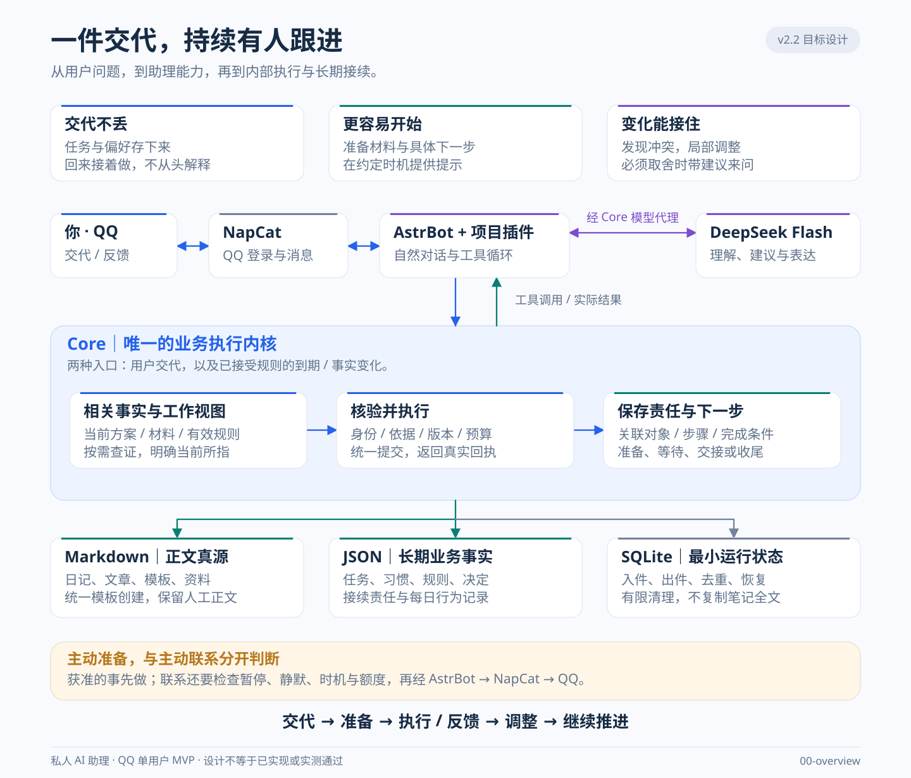
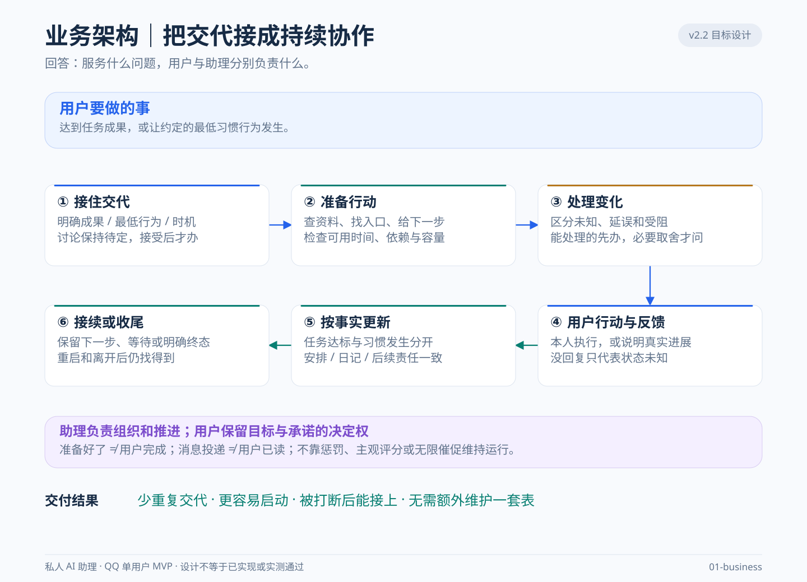
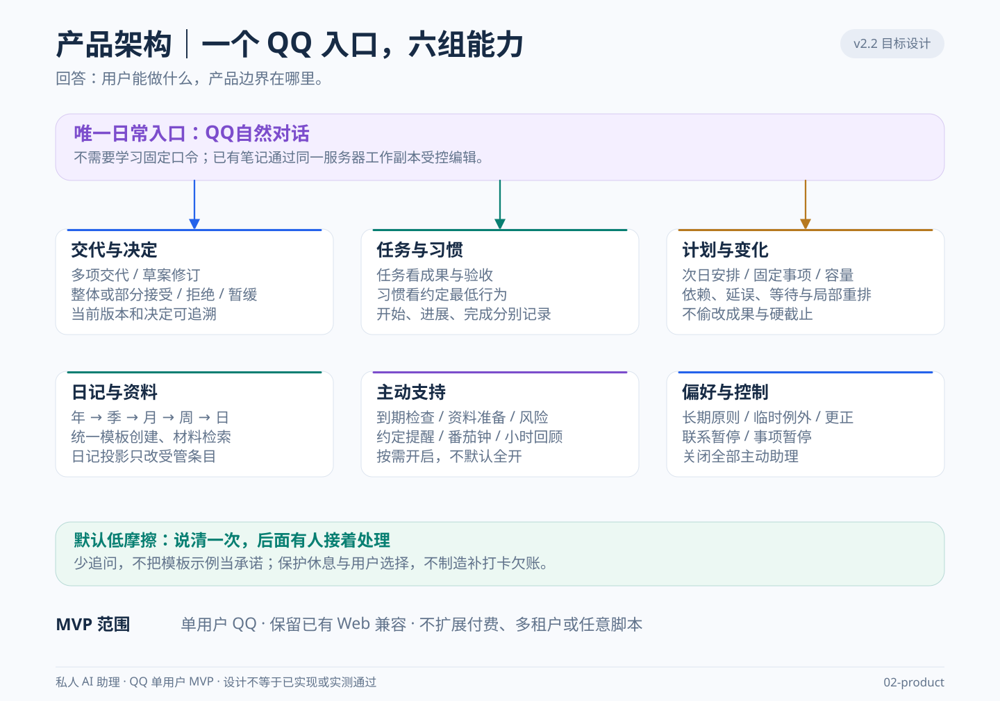
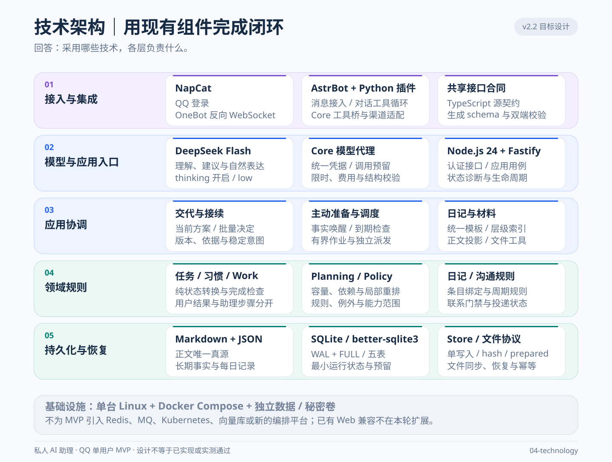
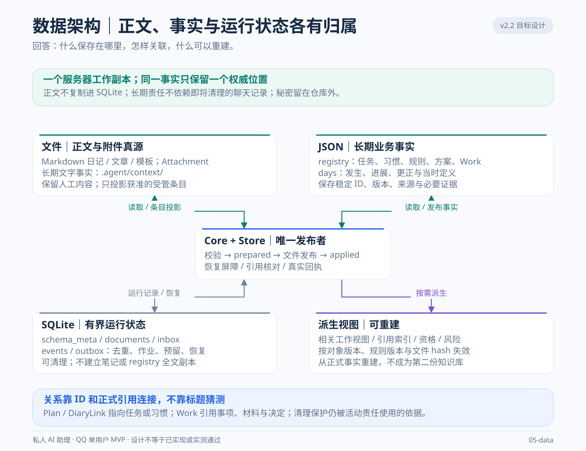
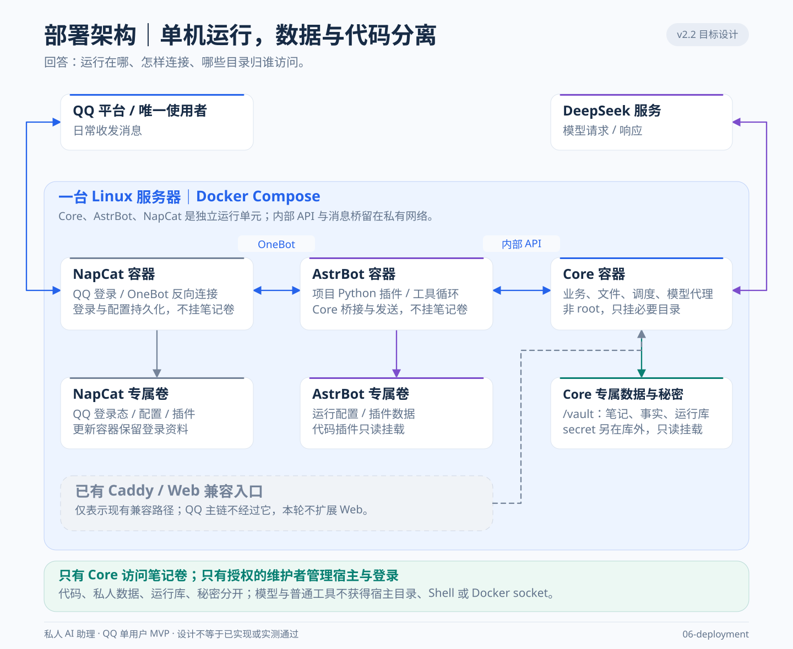
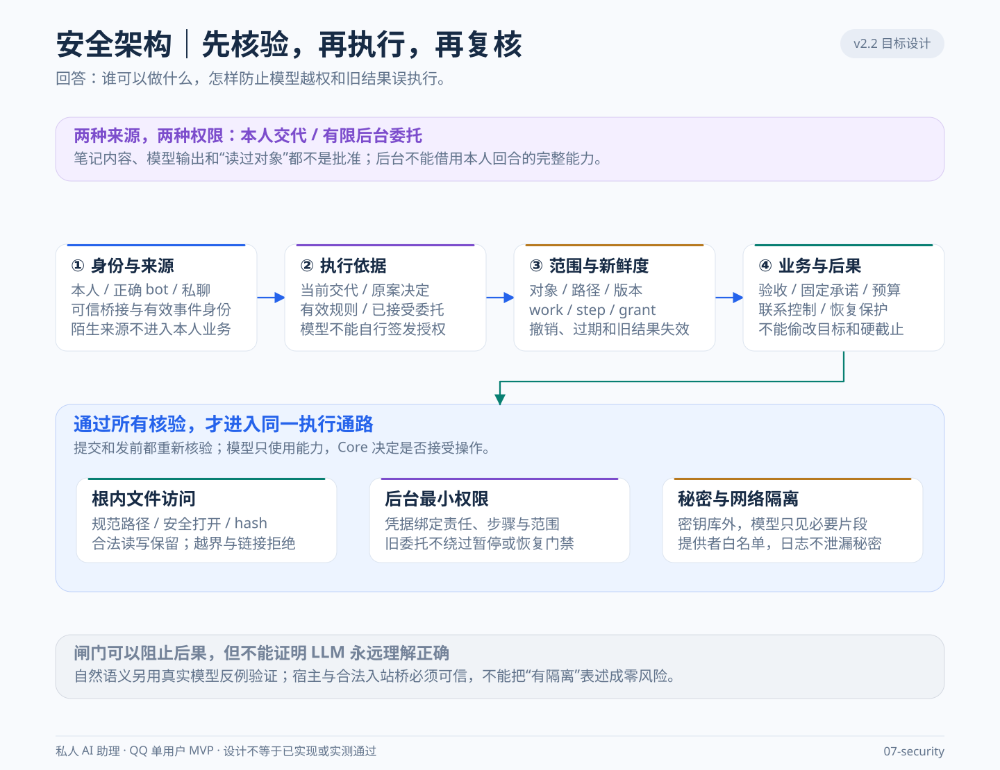
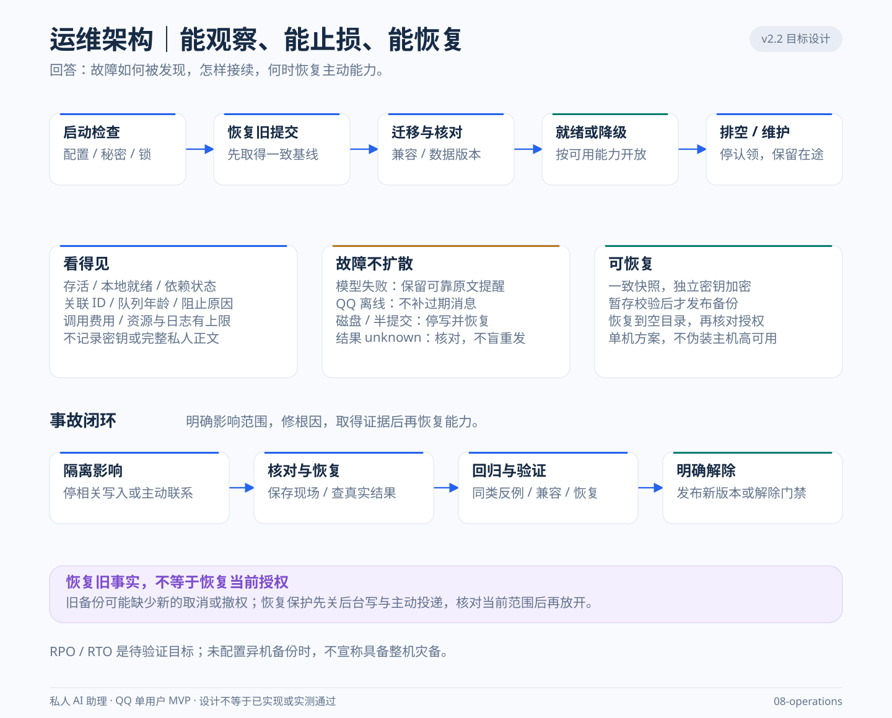

# 私人 AI 助理架构图册

基准：[ARCHITECTURE.md](ARCHITECTURE.md) v2.2，2026-10-27。

**这九张图表达同一套目标架构：LLM 理解和选择工具，Core 核验并执行，正式文件保存事实，助理依据持久责任继续推进。** 图册不是第二份规格，也不是部署完成或验收通过的证据。具体字段、算法、数值和门禁以架构正文为准；当前实现与验证状态查看 [DDD](DDD.md#13-验证方法与已知边界)。

## 阅读方式

先看总览，再按问题选择视角。同一个模块在不同图中出现，是分别说明其能力、职责、技术或运行位置，不代表多份实现。

| 层级 | 视图 | 回答的问题 | 基准章节 |
| --- | --- | --- | --- |
| 总览 | 00 | 一件交代如何被接住并持续推进？ | §1.1、§2.1、§3 |
| 业务产品 | 01 业务 | 谁承担什么责任，怎样从交代走到结果？ | §1.1、§3.2—3.5 |
| 业务产品 | 02 产品 | 用户得到哪些能力，哪些事不做？ | §1.1—1.3、§3.6—3.7 |
| 系统设计 | 03 应用 | 运行单元和 Core 逻辑模块怎样协作？ | §2.1—2.4、§3.3 |
| 系统设计 | 04 技术 | 现有技术如何支撑执行、保存和恢复？ | §2.4、§4.3—4.6、§5.1 |
| 系统设计 | 05 数据 | 正文、长期事实和运行状态分别归谁？ | §2.3、§3.3.3、§5.3 |
| 运行保障 | 06 部署 | 单机上的服务、网络和卷怎样隔离？ | §1.2、§2.1、§4.5.2、§5.2 |
| 运行保障 | 07 安全 | 什么操作可以执行，哪些输入没有授权能力？ | §2.4、§4.5、§4.9、§5.1.1 |
| 运行保障 | 08 运维 | 如何启动、降级、恢复、维护和退出？ | §3.1、§4.4、§5 |

箭头表示信息或控制关系，双向箭头表示请求与响应；不表示跨 Markdown、JSON、SQLite 和 QQ 的全局事务。部署图的虚线表示已有兼容入口。Core 内部框均是同一进程的逻辑职责；只有部署图中的容器框表示独立运行单元。每张图都标注“目标设计”。

## 0 总览

从上向下读：用户价值 → QQ 接入与模型理解 → Core 核验、办理与保存责任 → 三类事实位置 → 后续准备与联系。

一次交代既可由本人发起，也可在已接受规则到期或相关事实变化后继续。后台准备和主动联系分别核验；关闭联系不等于撤销合法准备，关闭全部主动助理才同时停止二者。无有效责任或机会时不调用模型维持“活跃”。

## 1 业务产品层

### 1.1 业务

六个环节描述协作责任，不对应新的服务或 Agent。助理负责接住交代、准备和协调；用户承担本人行为以及不可代办的取舍。结果核验后，责任进入下一步、明确等待、暂停或有依据的终态。

任务按已接受成果验收，习惯按发生当时的最低行为记录。沉默保持未知；材料准备、投入时长和消息送出都不能代替用户完成。必要决定要附事实、影响和建议，不能把整个安排工作退还给用户。

### 1.2 产品

六组能力覆盖承接、执行、调整和接续。自然语言可以整体或部分接受、修订、拒绝、暂缓当前版本；不要求固定口令，也不机械规定确认轮数。信息和权限足够的明确交代直接办理，讨论不能自动变成承诺。

前夜按目标日期索引年、季、月、周、日，只补缺失模板文件、读取必要重点。上层为空保持空白；已有授权安排可接续，新承诺待接受后才落实到日记。周期末回看合并处理。番茄钟、小时回顾和联系频率按用户选择启用，不默认全开。

## 2 系统设计层

### 2.1 应用

NapCat 负责 QQ 登录和 OneBot 桥接；AstrBot 项目插件组织对话与工具循环；DeepSeek 负责理解、选择工具和表达。模型请求经过 Core 模型代理，工具调用经过 Core 应用用例，两条路径不能混为模型直接操作文件。

Core 内部五个上下文分别拥有事项与责任、排程、规则权限、日记文件、沟通投递。它们由应用层协调，共用单写入和恢复协议。业务与可确定的责任转换共同发布；日记投影和 QQ 投递分别形成后续回执，失败只补对应效果，不重做成功业务。

### 2.2 技术

技术分层对应接入、模型入口、应用协调、领域规则、持久化恢复。Python 插件与 TypeScript Core 消费同一生成契约；领域函数不直接读文件、访问网络或询问模型。保留一个 Core 单体，不额外引入消息中间件或多 Agent 编排。

模型代理负责每次物理请求前的持久费用预留、总时限和受控提供者访问。一个模型执行槽在前后台间有界公平调度；模型准备与到期派发独立推进。SQLite 的 WAL/FULL、文件同步与可恢复提交分别承担耐久性，不能仅凭 rename 声称断电零损失。

### 2.3 数据

三类真源及其职责如下；派生视图只提供检索和计算，不另建知识库。

| 真源 | 保存内容 | 关联方式与生命周期 |
| --- | --- | --- |
| 笔记文件、Attachment、`.agent/context/` | 正文、模板、附件和必要长期文字事实 | 规范路径、hash；保护人工正文，私人叙述不默认参与分析 |
| `.agent/state/registry.json`、`days/` | 任务、习惯、安排、决定、规则、接续责任与每日发生、更正 | 稳定 ID、版本、来源；Work 引用对象，不复制任务或排程 |
| SQLite 五表 | `schema_meta/documents/inbox/events/outbox` 中的有限运行状态 | 去重、作业、费用预留、回执、有限恢复补丁；按用途和引用清理 |

目标 registry 采用 v2，days 无结构变化时保留原版。迁移前先恢复旧提交；遗留 Work 不猜关联、不自动获得后台写权。清理保护活动引用和未结算依据，防重水位先持久推进再删除旧记录。正文或完整 registry 不另存到 SQLite。

## 3 运行保障层

### 3.1 部署

单台 Linux 主机运行 Core、AstrBot、NapCat，私有接口连接各运行单元。Core 非 root，只挂必要笔记、运行和秘密卷；其他两者不挂笔记卷，各自保留配置与登录数据。秘密在仓库外只读挂载，管理端口不公开，也不挂 Docker socket。

既有 Caddy/Web 是 QQ 主链之外的兼容入口，本轮不扩展。代码模板不能覆盖生产数据，升级保留私人卷与登录态。Git 默认关闭；备份目标和独立密钥需明确配置。单机接受短时停机，没有主机高可用；同机备份不能当作异机灾备。

### 3.2 安全

四道核验分别回答：来源是否真实、依据是否成立、范围与版本是否有效、后果是否满足业务约束。读过对象只形成观察记录，不代表批准。笔记、模型输出和工具返回都不能自行签发权限。

后台 grant 由 Core 绑定 work/step、可信委托、固定对象或路径范围、现行规则、运行代次、期限和预算，提交时再次求交。新增材料引用不扩权。恢复保护和事故门禁不能被旧批准、模型自检或重启解除。文件访问同时检查路径、链接、普通文件、打开对象和版本；安全结论依赖可信宿主及唯一应用写者，不宣称防住恶意 root。

### 3.3 运维

启动先检查配置、秘密和独占锁，再恢复旧 prepared、迁移并核对一致性，之后才开放安全能力。运行中分别判断存活、本地就绪、模型和 QQ；依赖故障按能力降级，不靠无限重启掩盖。排空后才能进入停写维护，维护停顿单独记录。

模型失败保留事实与可用原文提醒；QQ 离线不补发过期消息；unknown 核对而不盲重发。事故先隔离受影响能力，再核对、修复、回归，最后明确解除。日志、诊断、重试、队列和费用均有上限。

备份在一致基线上取暂存副本，经 AES-256-GCM 加密和校验后发布。恢复先认证、整包校验，在新空目录发布；不导入旧发送队列，并建立后台写与主动投递保护，核对当前授权后才能解除。RPO≤24小时、RTO≤30分钟及派发延迟等数值均是待测目标，必须有相应环境与证据才能称为达成。

工程定义见 [ARCHITECTURE](ARCHITECTURE.md)，产品行为见 [PRD](PRD.md)，当前实现与验证证据见 [DDD](DDD.md)。

应用视图借用 [C4 的分层表达方法](https://c4model.com/diagrams)，只保留对当前 MVP 有用的层级。九张图片均为独立 SVG，可放大、编辑或单独分享，无需运行脚本或联网加载图形。
