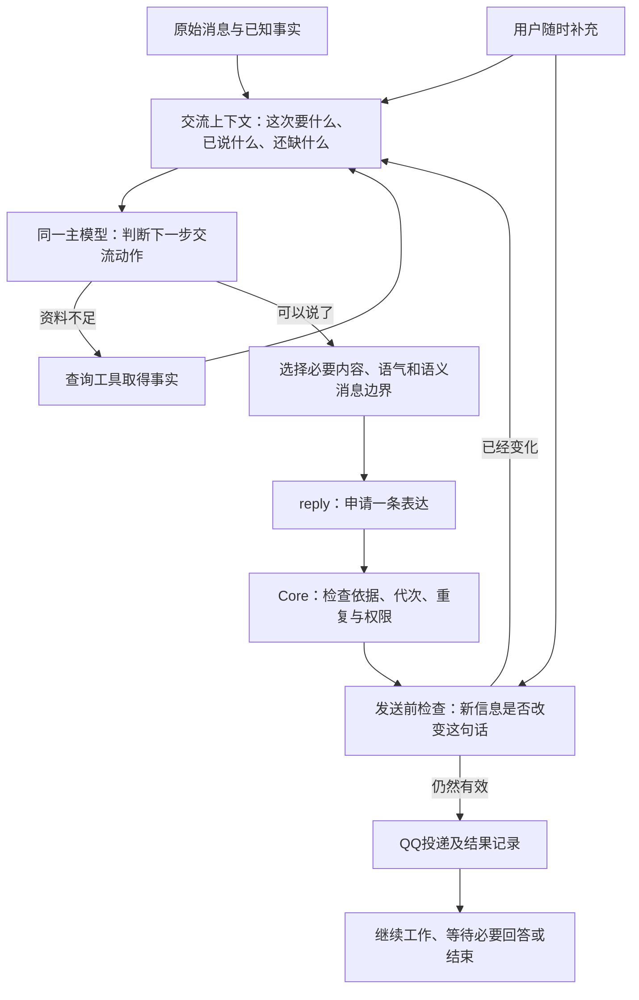
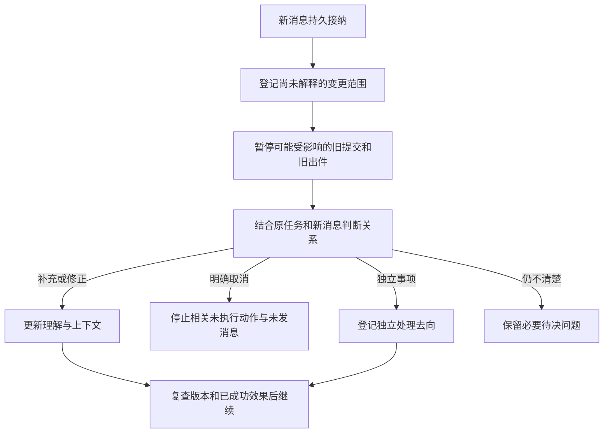

# 自然交流实施合同：理解、措辞、节奏与接续

> 版本：1.2｜日期：2026-10-31｜状态：待实施与验收。
>
> 本文是交给开发Agent的专项执行合同，细化[总架构](ARCHITECTURE.md)C1—C6及[DDD](DDD.md)的M1对话与决定、M6联系与投递。业务授权、提交、Work和恢复仍遵守总架构。本文不表示以下能力已经实现。本轮只编写说明，没有修改业务代码或部署服务器。

## 1. 先定义自然，再确定要改什么

### 1.1 自然度究竟是什么意思

**本项目的自然度，是一段交流与当时情境的贴合程度：助理明白你这句话在做什么，说出此时需要的话，用容易理解、关系合适的方式表达，并能随着你的补充继续调整。**

判断对象是一段有先后顺序的交流，包含上下文、停顿、插话和工具结果，不是孤立的一句文案。目标是让用户不用额外费力去适应机器：不必把一句交代硬凑成一条消息，不必看完无关报告，不必重复已说过的条件，也不必等她念完旧答案才能改口。

例如“我查一下”本身既不自然，也不生硬。资料确实要查、用户会等一会儿，此时说它可以很合适；用户只问已经知道的时间，每次也先说它，就成了机械流程。**评价单位是“这句话在这里是否合适”，不是“这几个词像不像人”。**

“自然”没有一套适用于所有人的标准口气。我们先约定中文QQ私人助理的通用基调：平实、温和、具体、能接话；再适配有来源的用户偏好。不要求冒充人类，也不模仿人的遗忘、拖沓、错别字或情绪伤害。

### 1.2 三层拆解：接什么、怎么说、怎样交互

三层分别判断回应的**内容选择、语言形式、时间与轮次**。每层条件在相关情境中都不可缺少，但单独满足都不足以保证自然；它们是本项目的工程验收划分，不是声称发现了人类语言的全部定律。

| 层次 | 必要条件 | 看什么才知道满足了 | 缺失时的典型表现 |
| --- | --- | --- | --- |
| A 回应贴切：接什么 | A1 接对当前意图 | 能指出本次在回答、讨论、处理困难还是办理，和用户当前要求对应 | “不想做”被直接当成取消；询问能力被当成新任务 |
| A 回应贴切：接什么 | A2 接上共同背景 | 指代有依据，使用已知条件，区分提出、送达、用户接受 | 问已经答过的问题；说“按刚才说的”却引用未送达建议 |
| A 回应贴切：接什么 | A3 内容够用且不越题 | 所问范围完整、关键限制不漏；其余信息有当下用途才说 | 问下次提醒，却清点所有结束任务；为了简短隐藏失败 |
| B 表达合适：怎么说 | B1 语义直接、句子易懂 | 用户能从文字中找出对象、结论、重要条件；需要行动时知道谁做什么 | 内部字段堆成一句话；“碰过任务”等说法需要再解释 |
| B 表达合适：怎么说 | B2 语气符合关系和情境 | 观点具体，既能提出建议，也尊重明确决定；措辞符合有效偏好 | 训人、客服套话、反复宣读立场，或者一味迎合 |
| C 互动顺畅：怎样交互 | C1 开口时机和信息增量合适 | 快答不多插一句；真等待有必要才承接；进展带来新帮助 | 例行“正在办理”；结果紧跟无用承接；无变化反复报到 |
| C 互动顺畅：怎样交互 | C2 消息边界与接话机会合适 | 按完整意思组织；用户补充后，相关未发内容和下一步会改变 | 长篇一次倾倒；短句硬拆刷屏；收到了插话却继续旧话 |
| C 互动顺畅：怎样交互 | C3 问答、修正和结束有连续性 | 必要问题回答后继续；说错能修正；讲清就停，未完事项有去向 | 已回答还追问；问了问题又替用户回答；无事仍追加邀请 |

这八项是自然度的直接观察面。第10.2节的十三项是支撑它们的实现条件，包含输入、记忆、投递和责任保存；不再把十三项当作另一套平行的自然度定义。

### 1.3 自然、正确、可靠分别验收

| 维度 | 回答的问题 | 反例 |
| --- | --- | --- |
| 自然交流 | 在这个情境里，话是否贴切、顺口、接得上 | 如实列出所有数据库状态，仍可能难读且不合时宜 |
| 事实与权限正确 | 说的、改的是否有依据和授权 | “九点，已经改好啦”很顺口，但实际上没有改成功 |
| 服务可靠 | 是否能兑现责任，故障后能否接续 | 说“我去查一下”很合适，但重启后把这件事忘了 |

三类都要通过才能交付合格助理。不能用“句子很自然”掩盖假成功，也不能用“程序测试全过”证明说话已经舒服。本文的总目标是三者共同成立，自然度专项评价主要用1.2的八项。

### 1.4 用对比说明边界，不规定唯一台词

下面是**合成设计示例，不是真人聊天证据，也不是应硬编码的回复**。同一句用户话，在背景不同的情况下可以有不同的合格答法。

| 情境 | 不合适在哪里 | 一种可接受表达 | 为什么更合适 |
| --- | --- | --- | --- |
| 已知九点开始，用户问“几点开始” | 先承接，再解释整个计划 | “九点。” | 当前只缺一个时间，不需要额外办理姿态 |
| 用户问“今天还有哪些提醒” | 只答九点，省掉其他有效提醒 | 用短列表列完整范围 | 用户要的是全量，稍长反而更省事 |
| 用户让查某天笔记，工具确实需要等待 | 每次统一说“正在办理你刚交代的事” | “我翻一下那天的日记。”随后给查到的内容 | 指明接下来做什么；如果结果已到，就直接发结果 |
| 重要任务；用户说“不想做”；原因未知 | 宣布不催不撤，或者马上削减验收 | “今天是累了，还是觉得这件事没必要做了？” | 这是会改变处理方式的缺口；不把猜测当事实。若原因已知则不再问 |
| 同一任务，用户刚说明只剩十分钟 | 再问为什么不做 | “今天只剩十分钟，先整理提纲怎么样？正文另找时间。” | 使用现有约束给建议；是否能这样安排还要服从原授权和截止 |
| 用户明确说“今天不要再提醒这件事” | 继续劝、反复确认 | 停止当天相应联系后：“好，今天不提醒这件事了。” | 意思已清楚，执行并结束；不暗中取消整个任务 |
| 已发第一项查询结果，用户说“第二项不用查了” | 把第二项旧答案发完才说收到 | 停未执行/未发部分，必要时简短接住取消 | 新话真的改变进程；不是只在最后补一声“好的” |

没有“所有消息必须两句”“不能有句号”“必须分三条”这样的判据。字数、标点、条数是观察信号，是否匹配这次交流才是判断依据。

### 1.5 研究依据与还不能证明的事

会话分析研究关注话语怎样承接前文、组织轮次和处理误解。针对真实中文微信聊天的研究也展示了分段、交叠与回指等现象，但其“自然发生的语料”与本项目“用户感到自然”的产品指标不是同一个概念。我们借用分析方法，不能把论文当成这套实现必然有效的证明。[Chen与Chen，2023](https://www.frontiersin.org/journals/communication/articles/10.3389/fcomm.2023.994192/full)

本文采用三种证据，不能混写：代码能确认现有处理路径；合成对话能说明预期与反例；真实模型和用户使用才能检验实际表达。当前假设是模型有足够的中文能力，但须在目标模型、实际提示词与工具上下文中验证。如果完整情境下仍持续答得生硬，要调整提示词、示例或模型，而不是继续堆并发机制。

### 1.6 范围与最小架构

复用当前单Core、AstrBot工具循环、SQLite入件/作业/出件、读集与提交机制。接收可以并行，单个用户的业务提交仍由受控入口串行协调。不新增多个助理Agent、向量数据库、外部消息队列或Web功能。

不输出模型内部推理。分次发的是用户有用的承接、已核实结果、问题和建议。不得为了仿真人加入随机延时、错别字或无意义语气词。

阅读顺序：本章定义目标；第2章找当前差距与改造主线；第3—7章给具体合同；第8章安排代码步骤；第9—10章验证实现和实际语言。第5章解决“候选话语如何产生”，第6章解决“此刻是否仍能发”，两者不能替代。

## 2. 当前代码与改动落点

路径相对`.dev/secretary-service`，按职责修改，行号不作为稳定接口。

| 入口 | 当前静态观察 | 要完成的调整 |
| --- | --- | --- |
| apps/core/core.ts receive/processPending | 入件立即持久化；主要按单条pending处理，受turnLease约束 | 持久接纳与开始理解分开；选择一个输入批次；通过回合调度处理 |
| apps/core/classification.ts | 有行为、关系、影响类别；没有完整对象引用 | 理解绑定原始消息和对象，区分同一事情的补充、修正、取消、独立事项及不确定范围 |
| apps/core/agent-runtime.ts nativeSession/processNativeInput | 新消息可挡旧写；完成旧模型后仍可能finishInput | 增加回合/代次/覆盖输入校验；接续新输入，禁止直接发送已经过时的旧结论 |
| apps/core/core.ts queueReply/queueProgress | 回复按渠道长度切割；进度另行入队 | 统一进入表达入口；语义消息边界由模型给出，渠道切割只作保护 |
| apps/core/scheduler.ts | 延时触发进度，存在固定兜底句；新输入检查主要约束主动联系 | 同一发送门覆盖回答、问题、承接、进展和提醒；删除日常固定承接路径 |
| integrations/astrbot/.../main.py | 工具循环后形成完整文本，可额外润色；stream=False | 提供表达工具及接续输入；工具发送后不再重复发送最终文本；减少全量二次润色 |
| apps/core/agent-client.ts、app.ts及contracts | 以单input和最终回答为主 | 兼容主input，补齐本回合消息集合、覆盖范围、表达与更新合同 |
| store.ts、resources/schema.sql | 已有运行库及迁移 | 补齐小型回合记录、关系索引和出件元数据；生命周期、升级与恢复一起实现 |
| apps/core/core.ts context | recent_interactions来自processed入件及metadata.reply；不等同实际送达 | 区分渠道已接受、未发和未知；不把发出当已读，也不把未发当双方共同背景 |
| apps/core/compatibility-runtime.ts | 优先读取vault的.agent/prompts，缺失才读resources；拼接运行instructions和communication | 自然交流规则进入实际加载的提示词，保留用户自定义，记录有效hash并验证重启后的版本 |

目前“能接收新消息”不等于“已合并理解”，“阻止旧写入”不等于“已停止旧回复”。逐个验收这两组区别。

### 2.1 一次真实运行的目标调用链

```text
bridge.py / QQ事件
  → Core.receive：保存原消息、通知对话协调
  → 对话协调：选批次、恢复当前事项、签发Run
  → Core.context：业务快照＋交流上下文
  → AgentClient.interpret → AstrBot主工具循环
      → 查询/业务工具：保持原受控合同
      → conversation：接收、解释新输入
      → reply：选择内容并申请一条自然表达
  → Core校验候选：身份、代次、来源、重复与结束状态
  → Scheduler：发送前再验证、投递、记录实际送达
  → 下一工具结果/输入更新：把真实送达和新事实反馈给模型
  → finishTurn：关闭本次运行，未完责任有去向
```

不额外建立“先意图Agent、再风格Agent、再润色Agent”的固定流水线。下面的理解、内容选择和措辞是同一个主模型循环的职责；程序只把必要上下文和反馈给对。

### 2.2 当前差距：不是模型完全不会说，而是交流被当作整条答卷

本轮重新读取本地源码。可以确认：persona已经要求日常措辞、按问题决定长短、不要反复声明立场。**因此只继续添加“自然一点”的提示词，不能解决整条处理链的问题。** 下表把观察与推断分开；没有重新访问生产服务器，不能据此宣称线上已改或仍与本地完全一致。

| 已核实的本地事实 | 与目标的差距／机制推断 | 最小修改及因果关系 | 证明改动有效的方法 |
| --- | --- | --- | --- |
| processPending按最早pending单条取件；主入口以一个input运行 | 连发容易成为多次独立问答，不等于一起理解。影响A1、C2 | 先持久收件，再用Turn合并展示；主模型看到完整交代后才选动作 | R01—R03：原消息保留，补充条件进入同次理解，无逐条强制回复 |
| recent_interactions主要读processed入件和metadata.reply | 模型拿到的是准备过的回答，不一定是已发出的交流。影响A2 | CommunicationContext补实际出件状态与未决问题，减少虚构共同背景、重复询问 | 同一建议分别设queued/sent/unknown；询问是否已接受仍需用户依据，不能仅凭sent |
| scheduler有固定进度兜底；时间阈值会进入进度流程 | 把“等了一会儿”当作“必须说一句”的依据。影响C1 | 时间只唤醒检查；主循环按工作阶段决定是否开口；结果到达淘汰未发承接 | R09—R11：立即结果、真实慢查、无新进展三种时序产生不同发送行为 |
| main.py通常取得完整final后，再在预算允许时全文润色 | 能改善措辞，但依旧把交流集中为最后一篇文本，还可能增加等待。影响B1、C1、C2；不能据此断言润色总是有害 | 主循环能直接调用reply，带真实背景选择内容与消息边界；新模式取消重复尾答和默认整篇重写 | 对照相同fixture验证信息未丢、无重复；记录时延，语言盲评检查是否退步 |
| queueReply按1800字符切割 | 只能解决渠道长度，不能决定哪个意思应先说、何时等用户。影响A3、C2 | 模型选择语义消息；程序仅做末端技术分片 | 同样长度的完整正文与交互式询问，消息形式必须符合各自目的 |
| processNativeInput发现较新pending后标记superseded_while_pending，仍finishInput | 标记过时不等于吸收修正，仍有旧答案入队路径。影响C2、C3 | 新输入触发范围判断；复用已成功结果，重建受影响候选，过时代次不能新发 | R04—R06、R12：在工具/提交/发送不同边界插入更正，观察实际后果 |
| scheduler部分版本/撤销检查在counts_as_proactive分支内 | 普通回答不能仅因“不是主动提醒”免于过时检查。影响C2、C3 | 全部消息共用发送有效性检查；注意力预算仍只对相关主动联系生效 | 回答、问题、承接、结果分别插入停止/更正，无旁路 |
| 有角色提示词，但不能仅从文件存在证明每次生成已遵循 | 词句生硬也可能来自模型在大量业务上下文中选错内容；这部分需要实测。影响A3、B1、B2 | 核对实际加载来源；精简冲突指令，用成对情境示例校准主模型 | 真实模型L01—L14；同一句话换背景应改变交流动作，不靠替换词表 |

**当前的主要矛盾：用户需要共同推进一段交流，现有主路径却主要围绕“处理一条输入，生成一份最终回答”组织。** 它把接话、措辞、进展和发送分散处理，缺少统一的“目前在谈什么、已经说到哪里、新话改变了什么”。这是由上述代码事实得到的架构诊断，不等于解释了每一个生硬词句。

需要同时修两条链：**语义链**负责理解、选择信息、措辞；**运行链**负责收件、接续、投递、结束。只改语义链，写好的话仍可能在错误时机发出；只改运行链，长报告只是变成几条短报告。

### 2.3 因果链：如何把自然表达能力用出来



这里没有一个“自然度开关”。工程通过五个因果环节消除限制，实际效果仍要用第10章检验：

1. **提供足够情境 → 能判断此时该接什么。** 原话、对象、用户已答内容、真实操作和投递状态一起可见，模型不必用泛化套话补缺。若背景已给齐仍误解，问题在理解/模型，不再归咎于收件。
2. **允许多种交流动作 → 不必把所有情况写成最终汇报。** 同一个循环能直接回答、查资料、问必要问题、给建议；表达工具不等于任务完成，因此说“我去查一下”之后仍能继续查。
3. **在生成前选择内容 → 消除报告式冗余的来源。** 先判断哪些事实与眼前问题有关，再用日常语言表达；不能先把全部状态写成长文，再指望分段恢复自然。
4. **输入和输出共享版本 → 补充真的能改变后续。** 接到“第二项不用了”，既更新理解，也阻止相关未发内容；只写入聊天记录没有这种效果。
5. **把实际发送及处理结果反馈回循环 → 下一句话接得上前一句。** 模型能知道自己已说什么、还欠什么；等待用户时释放运行资源，得到回答再接续。发出了不代表用户读了，更不代表同意。

Core不靠规则判断“这句够不够像人”；它验证可以确定的来源、状态与顺序。LLM负责有情境的语言判断。真实模型评测和用户试用负责检查语言是否达到效果，不再叠一个强制的“自然度裁判Agent”到每条线上消息里。

### 2.4 一段完整交互如何落地

合成场景：用户依次发“查一下明天安排”“主要看上午”“下午先不用”；查询过程中又说“英语那项先别改，我只是问问”。

| 步骤 | 模块具体做什么 | 模型得到什么／用户看到什么 | 解决哪个差距 |
| --- | --- | --- | --- |
| 1 接收 | receive分别持久保存三条；对话协调在有上限的收集窗口建批次 | 三条原话、顺序、同一用户；不会先执行第一句再机械回复后两句 | 输入单位与一段交代不匹配 |
| 2 理解 | context给出相关安排与交流背景；主循环识别查询范围为上午 | 可以直接调用查询；不产生改期授权 | 所有消息都进入办理模式 |
| 3 等待 | 查询慢且需要交代时调用reply；结果快则直接结果 | 可以是“我看一下明天上午的安排。”没有固定必发句 | 接不接话由定时器代替情境决定 |
| 4 补充 | 第四条持久接纳，相关旧候选暂停；会话读取更新 | 意图仍是查询，明确排除修改；已取得的有效查询结果保留 | 收到插话却不吸收 |
| 5 回答 | 主模型从工具事实选上午信息，按含义发一条或必要的几条 | 例如列出实际存在的上午安排；不加入下午报告，不虚构安排，不宣布改期 | 内容过量、事实与建议混杂 |
| 6 收口 | outbox验版本后发送，finishTurn登记四条输入去向 | 不追加“要不要替你优化”；查询完成，业务安排没有变化 | 一条条答、重复结束、无关邀请 |

验收不匹配示例台词，而检查：四条要求都被处理；零改期；下午未被无故展开；承接是否必要；已解释的补充影响了结果；查询失败时如实说明缺口。相同用例把最后一句改成“把英语改到十点”，则重新按授权与冲突规则办理，不能继续只查不改。

## 3. 最小运行模型

### 3.1 四种对象分开

| 对象 | 保存什么 | 谁负责 |
| --- | --- | --- |
| Input | 单条原始消息、身份、时间、reply_to、去重ID和单调seq | 现有接入/入件层 |
| Turn | 一段交流的输入集合、运行代次、未决事项及结束状态 | 对话协调；新增轻量运行记录 |
| Run | 本次模型调用所用输入版本、读集、租约和截止 | 现有model-job及工具会话 |
| Utterance | 模型生成的一条对外表达、用途、依赖和是否结束 | 先校验，再使用现有outbox投递 |

一个Turn可有多条Input、多次Run、多条Utterance。它不是新的用户任务或Work。普通问答结束即可清理；跨回合仍欠的具体准备/调查责任才按C4保存Work。

### 3.2 建议持久结构与约束

新增一个小型`conversation_turns`表和一个`turn_inputs`关系表；复用model-job/outbox，不再建同义作业表。严格schema和迁移与运行定义同时修改。

```typescript
type Turn = {
  id: string;
  actor_ref: string;             // 已认证本人，不能由模型指定
  channel: string;
  state: 'collecting' | 'running' | 'waiting_user' | 'closed';
  generation: number;             // Core递增；旧Run不可自签新代次
  input_revision: number;         // 本回合增加/重新关联输入时递增
  first_received_at: string;
  collect_until: string;
  max_collect_until: string;
  current_run_id: string | null;
  resolution: 'answered' | 'handed_off' | 'cancelled' | 'failed' | null;
};
type TurnInput = {
  turn_id: string;
  input_id: string;
  relation: 'pending' | 'continue' | 'correct' | 'cancel' | 'independent';
  handled_generation: number | null;
};
```

这些是目标结构，实施时允许合并等价字段，但必须保留身份、输入成员关系、版本、处理去向、恢复依据和唯一约束。一个Input只能有一个主处理归属；引用另一个回合不复制执行责任。

所有原始消息分别保存，不能仅用拼接文本取代。输入批次受总字节、条数和模型预算约束；超限拆批，但保留关联和未办事项。当前10条pending限制需协调调整：合法短连发不能因“一条算一个模型回合”轻易被拒；仍保留防洪上限并返回真实拒绝状态。

seq从持久高水位分配，不用剩余inbox行的MAX(seq)重建。聊天清理后不能复用序号或倒退理解进度。正式接纳、候选发送许可、提交许可共用Core内的短时协调顺序，不用接收时间比较代替顺序。

### 3.3 输入回执与业务授权分开

`handled_generation`表示这条消息已纳入哪次处理，不表示其内容获得批准。只有最终回执证明消息已回答、已落实、明确待决、交给Work或如实失败，才能结束其主处理状态。

多个入件可以由一个回答覆盖，不能对每个成员调用旧finishInput并重复发消息。新增`finishTurn`负责一份对外结果、每条Input的内部去向及恢复记录。

## 4. 连续输入与中途接话

### 4.1 初始汇合窗口

从第一条合格消息开始收集同一使用者、同一渠道的后续消息。建议初始参数：安静窗口800ms、最长收集2500ms，使用可注入时钟测试。这是工程初值，后续按实际体验调整，不是科学定律。

新消息把安静窗口向后移，但不能越过本批次最长收集时间。达到任一边界即开始一轮理解。服务重启按持久截止继续，不重置成无限等待。

时间接近只表示一起呈现给模型，不表示语义相同。模型必须逐条理解关系：一起交代、修正前句、独立事项、引用旧话题或仍不确定。不能以“同批次”把所有动作当成同一授权。

### 4.2 对关系作出结构化理解

在现有Interpretation上扩展，至少表达以下信息；严格schema同步导出，不把自由JSON直接当授权：

```text
input_ids：被解释的原始消息
relations：每条消息延续/修正/取消/独立/未知，指向哪条消息或对象
acts：讨论/提问/报告/指令/决定/更正等
target_refs：涉及对象及已读版本；没有可靠对象时明确未知
evidence_spans：各原始消息内的依据位置
unresolved：真正影响下一步的缺口
```

模型不能虚构已读对象。Core检查消息归属、证据位置、引用存在性、对象版本和操作范围。引述、否定、假设、他人文字都不能因批次包含而获得执行权。

理解与工具选择优先放在现有主循环内，不强制每条消息再调用一个分类模型。运行中的新消息只有在需要解除暂停/确定影响时，才使用有界的补充理解。长篇资料不机械逐条分类。

### 4.3 运行时接到新输入



可接续点：工具调用前、工具结果返回后、业务提交前、表达入队前、每条消息发送前。模型HTTP调用不能热注入新提示时，使用Core可核验的输入增量重启一次有界Run，或者让下一工具返回增量并继续；不假称已支持热注入。

同一用户最多一个有业务写资格的前台Run。补充输入不会启动一批同时修改计划的模型。非副作用的接收与分类可并行；锁内不等待网络。旧Run被替代后，代次校验会阻止迟到的工具调用和回复。

当前运行中每次新增消息先登记为待解释。**不要立即把全部旧工作永久作废。** 解释确定受影响范围后，才替代相关旧步骤；不相关工作继续。同一原因最多两次纠错，达到预算/截止则保留具体未决项，不因连续聊天无限重启模型。

等待远程调用不能成为唯一接续点。为当前Run接入新输入唤醒信号和AbortSignal：优先在最近安全检查点纳入；若仍在等待模型/只读查询，可中止等待并用新输入接续。对正在提交的业务先让短事务给出确定结果，再重读；对已经在途的外部副作用保留未知状态。旧进程即使未响应取消，也会被代次和许可检查挡住。实现必须测试这一点，不能只调用abort后假定远端已经停止。

### 4.4 接续的输入必须完整，不能只给80字摘要

接续上下文至少带：原始有序消息与时间、各消息关系、当前事项、已成功操作ID及效果、尚未执行动作、已发送内容、未发候选、当前规则及读集失效原因。

Run记录服务端确认的`covered_input_ids`及输入修订。nativeSession等写检查只放行已被该Run理解且仍有效的成员；本回合已覆盖的后续消息不能再被当成“外部新消息”把自己永久堵住。未覆盖新输入继续触发检查。

复合指令使用成员消息作为basis_refs：用户授权八点改九点，不能只绑定最早“八点”的消息。当前源记录格式不足时集中扩展；禁止把所有成员标processed以绕过新消息检查。

### 4.5 输入更新的具体端口

在现有application工具入口增加`conversation`操作，提供`read_updates`和`publish_understanding`两种模式，不让模型自行查询SQLite。实际模型工具仍名为`secretary`，参数为`operation: 'conversation'`、`mode: 'read_updates' | 'publish_understanding'`及该模式允许的字段；本文`secretary.conversation`只是这个操作的逻辑简称，不另注册一个名称相近的工具。

- read_updates：用服务端会话定位Turn，接收上次input_revision；返回尚未覆盖的完整Input、当前修订和已执行效果引用。没有变化返回空集合，不改变理解状态。
- publish_understanding：接收读到的修订、covered_input_ids及4.2的解释；Core校验成员、来源、证据和当前修订。若又有更新返回INPUT_UPDATE_CONFLICT及最新修订，不能假称已覆盖。
- 解释生效后，Core确定当前Run是否可接续；需要替代则签发新代次与上下文。模型不能自己增加generation、扩大授权或清除待处理消息。
- 业务工具/表达工具被新输入暂停时，返回INPUT_UPDATE_REQUIRED及上述查询入口；可复用现有NEWER_INPUT_PENDING做兼容映射，但必须携带可恢复原因，不能让模型猜下一步。

初次批次和必要的后续更新可直接随模型上下文提供，避免无变化也额外调用工具。工具会话、HTTP入口和Python工具目录由同一schema生成。

## 5. 分次表达与说话节奏

### 5.1 一个表达入口，复用出件

新增受控表达操作，逻辑简称`secretary.reply`，实际通过既有`secretary`工具的`operation: 'reply'`调用，在同一主模型循环中可用多次。它负责申请表达，不负责修改任务。沿用C1的去重、会话有效性和范围校验；该表达操作与业务写动作使用不同schema分支，不能因都是secretary工具就都计为业务变更。

```typescript
type ReplyRequest = {
  input_id: string;             // 兼容现有工具会话主输入
  call_id: string;
  operation: 'reply';
  response_form: 'chat' | 'document';
  purpose: 'ack' | 'answer' | 'progress' | 'question' | 'suggestion' | 'result';
  body: string;
  in_reply_to: string[];         // 本回合真实消息ID
  refs: { kind: string; id: string; version: number }[];
  effect_ids: string[];          // 声称已办成时指向真实操作
  waits_for_user: boolean;
  end_turn: boolean;
};
```

turn_id、generation、输入覆盖修订、规则/撤销修订由Core绑定，不接受模型自签。kind收敛到已注册联合类型；未知字段拒绝。一般讨论不强制提供业务回执；声称执行成功则检查真实effect。程序不能机械证明一句话所有含义正确，语言与事实一致性另做模型评测。

`reply`回执区分queued、sent、cancelled、unknown。入队不能说用户已经收到。重复call_id返回原效果，相同call_id不同正文按幂等冲突处理。工具失败时模型按真实结果接续，不能在最终文本里悄悄补一个重复发送。

### 5.2 三种表达形式

| 形式 | 选择条件 | 输出行为 |
| --- | --- | --- |
| 单条回答 | 一项简单问题或单项结果 | 直接answer/result并结束，零额外承接 |
| 分次交流 | 独立要点、工具过程中有新结果、需要用户参与决定 | 按意义调用reply；下一条仍检查输入与依据 |
| 完整正文 | 明确要求完整说明、清单、公告、可复制/转发内容 | 保留完整结构；超渠道上限才安全分片或交付文件 |

模型根据内容选形式。一个简单意思不拆成“收到”“好的”“我明白了”三条。复杂问题也不为追求短而扣住用户要求的必要信息。连续消息总量仍受会话预算限制；渠道技术分片共享一个语义消息身份。

普通表达每条承担一个主要用途，必要的“结果＋重要限制”可以合在一起。排程约束、状态、失败详情先由模型选择与当前问题相关的部分，不能照读工具message/effects。

### 5.3 承接与进展的触发规则

承接是条件行为，不是强制第一步：

1. 简单问题已有答案，直接回答。
2. 确实需要等待且用户尚不知道接下来做什么，模型可发具体承接。
3. 已经承接、没有新帮助，不重复报到。同一持续步骤默认最多一次ack。
4. progress必须带新结果、具体阻碍或有用的阶段变化；同一状态改写不算新进展。
5. 最终结果就绪，取消未发ack/progress。已发进展不重复放进最终答复。

计时器只能生成一次内部“检查是否需要回应”的事件，不能直接生成“正在办理……”正文。取消现有固定日常兜底和“超过阈值必发”的路径。简单回合不增加专门compose调用；长任务检查也受同一模型预算和期限约束。

若模型无法生成正文，保留未完责任和可查询失败状态，不以套话冒充继续工作。故障通知属于独立的操作故障合同，不能混成日常承接；沿用总架构的失败可见规则，不能因为取消兜底而把失败隐藏。

### 5.4 语言生成的最小准则

本节采用一个工作预设：所选模型具备自然中文表达能力。工程要做的是提供正确情境、允许恰当交流动作，并避免后处理把表达重新变僵。此前“自然、简短、像熟人”等指令保留为目标，但不能代替以下合同。

#### 5.4.1 条件一：先知道用户现在要获得什么

**结果：** 用户问信息就得到信息，讨论就共同讨论，表达困难就处理困难，不被自动拉进“任务办理”。

**缺少时：** 所有消息都被解释为交代任务，于是出现泛化承接、无关建议和生硬的执行汇报。

**方法：** 在主模型已有理解中标明当前交际行为、希望得到的结果、依据消息与真正缺口。允许一段话有多个行为。目的若只是推测，不能保存为用户确认的动机。

**落点：** 4.2的Interpretation及Core.context提供原话和相关背景；模型据此选择ReplyRequest.purpose。程序检查依据属于本回合，不靠关键词决定用户意图。没有明确副作用授权时仍可以讨论和回答。

**验证：** 用相同任务名称分别表达“介绍一下”“要不要做”“帮我安排”“今天做不动”，输出动作应不同；不能四种都先说正在办理或直接改计划。

#### 5.4.2 条件二：知道双方共同知道什么

**结果：** 接得上“刚才那件事”，不重复问已经回答的问题，不把未发送内容当成用户已看过。

**缺少时：** 只拿到用户上一句和系统状态，模型只能重新介绍；用metadata.reply当已展示记录，又会误以为用户知道尚未送达的建议。

**方法：** 为主循环构造一个明确的交流上下文，区分原话、实际送达、尚未发送、投递未知、用户已经接受和当前未决。聊天记录和业务记录保留各自来源。

**落点：** 新增纯装配函数buildCommunicationContext，优先放在对话协调模块，由Core.context调用；不新建独立模型或服务。最近交流优先取实际outbox记录，经reply_group/turn关联输入，不能只读入件metadata.reply。

```typescript
type CommunicationContext = {
  input_revision: number;
  inputs: { id: string; text: string; occurred_at: string; reply_to: string | null }[];
  delivered: { id: string; text: string; purpose: string; at: string; in_reply_to: string[] }[];
  queued: { id: string; purpose: string; in_reply_to: string[] }[];
  uncertain_delivery: { id: string; purpose: string }[];
  open_questions: { id: string; input_ids: string[]; needed_for: string; scope_refs: string[] }[];
  topic_refs: { kind: string; id: string; version: number }[];
  effects: { operation_id: string; status: string; changed_refs: string[] }[];
  user_style: { source_ref: string; content: string; valid_until: string | null }[];
  searched_scope: string[];
  truncated: boolean;
};
```

这是目标摘要结构，不复制第二份聊天正文库；text在请求内派生，SQL仍只存现有正文。字段中的kind/status等实现为已有注册联合类型，不接受任意字符串。近期长度受现有预算控制，标注截断，保留按原引用补查入口；不能固定取最近三句就声称背景完整。

**验证：** 先生成建议但不发送，再问“刚才那项”；不得假定用户见过。真正发出后再引用，应能对应。用户已回答的问题不能因跨回合再次出现。

#### 5.4.3 条件三：选对下一步交流动作

**结果：** 接话、回答、询问、建议、纠错与收尾各有具体用途；“有回应”不是唯一目标。

**缺少时：** 正文即使顺口，也会在应回答时反问、应查证时表态、应停止时继续安慰。

**方法：** 模型根据“现在缺什么才能继续”选择动作：答案已知→回答；资料缺失→查询；重要歧义→问一个具体问题；约束冲突→给建议及必要取舍；工作已办成→汇报实际变化。这里是推理规则，不是按用户句式执行的固定脚本。

**落点：** 主工具循环可查询、办理和调用reply。reply记录purpose、in_reply_to及实际依据；疑问关联open_question。无需额外输出长篇计划或内部思考。

**验证：** 同一用户说“晚点开始”，已有明确晚间空档时可以提出可行安排，缺决定性时间时才询问；不能永远问时间或永远自行定时间。

#### 5.4.4 条件四：只挑出当前需要说的内容

**结果：** 简单反馈不会被扩写成报告，必要的失败和重要条件又不被省略。

**缺少时：** 把任务状态、截止、数据库变化、提醒规则全部塞进一句“结果”。再加短句指令，只会把同一份报告拆碎。

**方法：** 回复内容按用途选择：直接答案、影响用户的真实变化、需要他决定的缺口，优先于内部过程。已交代且没有变化的内容不惯性重复。用户明确要求完整范围时必须完整回答，不以“自然”扣住细节。

**落点：** 给模型的工具结果保留结构化真实事实；表达指令要求挑选与当前问题相关的信息，不把message字段视为台词。`effect_context`需要区分事实与建议，不能把每个技术诊断都放入面向用户的草稿。

**验证：** “下一次提醒几点”必须包含正确时间；不因系统知道另外十项安排就全部列出。“今天所有提醒”则必须覆盖全部相关项，不能只说下一次。

#### 5.4.5 条件五：用日常语言组织因果和条件

**结果：** 用户读一遍，能说出她回答了什么、有什么影响、需要谁做什么。

**缺少时：** 使用内部术语，或一句同时塞入数个状态和附带条件，形成“词都认识、整句费劲”的表达。

**方法：** 有主体和具体动作，必要因果说清；把重要条件放在相关结论旁边。删除无关判断，必要时拆成完整句子。不是把术语逐个替换为口头词，也不是按逗号自动切句。

**落点：** persona.md保留精炼语言准则；execution.md只说明工具及事实约束，不堆说话禁令。模型主循环直接生成候选，不默认再跑一轮全文润色。代码不使用同义词表改写正文。

**验证：** 对照原事实逐项核对含义，再由盲评者复述答案和下一步。若需要解释“待安排”“有效”等词才能理解这一普通反馈，记录具体句子为问题；用户询问技术架构时准确术语可以保留。

#### 5.4.6 条件六：选择合适的关系与语气

**结果：** 温和、有判断，既不训人，也不轻易放弃用户已接受的目标；不靠客套或自我表态占用交流。

**缺少时：** 固定“收到”可能像客服，固定“我站在你这边”像表态；添加口癖、表情也不能解决理解错误。

**方法：** 通用基调保持平实、具体、尊重。结合有效偏好调整称呼、正式程度和信息密度。对“我不想做”先看明确障碍与目标，缺关键原因时温和询问，不自行诊断懒惰。明确暂停/取消与表达困难分开。

**落点：** user_style从正式规则和有来源偏好派生，并带版本。该字段是语言指导，不授予排程/取消权限。上下文里不放“用户属于懒惰型”等模型自封标签。

**验证：** 重要任务和无关紧要的可选活动分别表达不想做；既不能全都撤掉，也不能全都劝做。称呼偏好更正后，跨会话使用新偏好；事实和验收不因语气变化漂移。

#### 5.4.7 条件七：按意思形成消息，并留出接话机会

**结果：** 用户能在有意义的位置接话；一条消息不塞所有内容，也不拆成无意义的碎片。

**缺少时：** 即使有并发接收，主循环仍一次性写完并排好全部答案，用户只能看它发完。

**方法：** 每次reply先表达一个足以理解的动作或结果。可以一次准备多个要点，但不同要点在下一检查点重新确认；相关联的条件不能拆到让前一句误导的位置。不得故意让用户追问才能得到已经要求的完整答案。

**落点：** reply.body是一条语义消息，queueReply只作技术分片。异步返回queued后，主循环可以继续工具工作；下一reply和发送许可都检查新输入。需要先让用户看到再等待其决定时，先持久保存具体问题，再结束当前Run，不阻塞线程等待用户。

**验证：** 独立两项结果可以分条；“已改时间，但另一项失败”的重要限制不能被省略或拖到用户误以为全部成功之后。短答案硬拆为“好的”＋“时间是”＋“九点”判为碎片化问题。

#### 5.4.8 条件八：该快就快，等待时说有用的话

**结果：** 简单问答直接给结果；真实等待被适当接住，期间有下文。

**缺少时：** 统一等待阈值会制造“正在办理”紧接答案；为自然表达再调用慢模型，又让简单问题更慢。

**方法：** 按5.3生成必要承接；已有答案不发ack。只读资料一时未就绪时可以先说去查哪部分，阶段结果有用才补充。最终就绪时取消未发进展。不是给每次回复人为添加相同等待时间。

**落点：** scheduler取消固定progress正文和必发路径；主循环自然选择reply用途。计时检查只唤醒一次有预算的判断，不独占模型作业，不重复创建同一原因的检查。直接结果优先于未发承接。

**验证：** 控制工具在承接前就返回、承接后才返回、一直失败三种时序；分别检查直接结果、真实等待和明确失败去向。没有新进展不能每隔阈值换句话报到。

#### 5.4.9 条件九：询问、结束和负责有独立规则

**结果：** 缺必要条件才问，用户答了就往下走；事情讲清就停，答应查的事后来有着落。

**缺少时：** 每次都加“要不要”、问过不记、说了“我查一下”却结束回合，或者为了显得主动继续堆建议。

**方法：** question关联具体信息缺口、影响对象和已检查来源；用户已回答则关闭。结束前为每条输入记录回答/办理/待决/交接/失败，不把ack当答案。跨回合未完责任进入Work；普通问答不强行建长期责任。

**落点：** finishTurn校验输入去向和未完责任，Work检查真实done_when；主循环一旦有效end_turn就禁止普通尾随输出。问题和回答按引用/上下文衔接，不按固定口令确认。

**验证：** 已回答的条件不再问，四项整组认可不反复确认；慢查询失败或重启之后仍能查到处理去向；没有新需求时结束后不出现无关邀请。

#### 5.4.10 一段可直接落实的生成指令

实施Agent应把下述规则融入有效persona/execution及工具说明，去重后加载；这是语义生成指导，不是发送台词。不要把本节整篇原样塞进每次模型请求。

```text
先结合本轮全部消息和实际已送达内容，理解用户这次想得到什么。
能直接回答就回答。缺资料先查；缺会改变行动的关键条件，先查已有记录，再问。
每次开口只说眼前有用的内容。说明结果、影响和必要问题，不照读内部状态或工具message。
按意思选择一条或几条消息；完整清单和详细说明保持完整，不为短而漏项。
需要真实等待时可以具体接一句；已经接住且没有新帮助，就不用再报到。
用平常的中文说事，重要因果和条件说清。不要惯性自我表态、解释没做的事或追加邀请。
温和但有判断。表达困难不自动等于取消；明确停止则按范围停止。
通过reply表达，按conversation更新接收补充。没有真实结果不说办成；已发过的不再重复。
用户插话后先处理新的影响；说清以后结束，仍欠的责任明确交接。
```

### 5.5 主循环、表达工具和提示词必须一起改

1. packages/contracts：为reply、conversation和运行结果定义严格schema，工具目录由scripts/contracts.ts统一生成；保持既有secretary根工具名，由operation路由新增两种操作。不使用函数名字符串拼接调用任意Core方法。
2. bridge.py的Turn.call：转发表达操作到Core，保留call_id；记录expression效果但不将其算作has_mutation业务变更。reply入队不设置captured为完成，不停止后续合法查询。
3. main.py的原生循环：模型可以查询、办理和分次reply。有效end_turn后不再运行当前无条件的完整文本润色。已发送/排队的语义消息不允许被第二个模型整体改写再发一遍。
4. agent-client.ts和processNativeInput：目标返回类型区分`response_mode: utterances | legacy_text`。utterances模式按服务端出件/表达记录验真，允许无discussion；legacy_text才要求非空正文并走一次兼容发送。两种模式互斥，不能绕过EMPTY_ANSWER校验就允许无答案成功。
5. finishTurn：校验每条输入去向、表达和责任，然后关闭Run。resolution=answered表示已形成有效回答，不表示QQ已读；实际投递独立记录。最终候选被新输入取消时，未解决内容必须进入接续，不能因旧Turn关闭而消失。
6. compatibility-runtime.ts：统一装配instructions/communication，保留实际生效提示词来源和hash。resources默认、vault覆盖、容器内资源三者一致性要测试；不因只改resources就声称生产已生效。自定义提示词冲突按明确迁移处理，不能无条件覆盖用户内容。

可以把对话协调和上下文装配放到一个小模块，再按真实复杂度拆分；不要为上述六条新增六个模型或六个服务。

### 5.6 暂停与结束

`waits_for_user=true`表示缺少当前必要决定，保存具体问题和范围。停止重复追问，但独立已授权工作仍可继续。用户回复时按引用和语境关联，不把任意“好”批准所有待决事项。

`end_turn=true`是最后表达候选，不等同于已经送达。入队前必须核对当前覆盖的输入均有去向；封闭该代次的后续普通输出，防止工具回复后框架再发最终全文。投递状态仍由outbox维护；送达失败只重试投递，不重新办理业务。

状态转换统一为：collecting达到边界后running；必要问题发出且当前Run结束后waiting_user；回答完成或责任已可靠交接后closed。`waits_for_user=true`的最终表达进入waiting_user，不能同时标closed。新消息接纳可恢复waiting_user到running，或创建新的独立Turn；已closed的历史回合仅被引用，不直接复活旧Run。失败收尾标closed/failed并保留仍未完成的业务责任和实际效果。发送状态始终在outbox，不在Turn再复制一套。

旧适配器只返回final text时，兼容为一条语义消息；新表达工具已使用时禁止自动追加同义final text。兼容路径也接受同样的发送许可检查，不得成为旁路。

## 6. 统一发送许可

### 6.1 所有消息使用同一基础检查

在scheduler领取每条出件前验证：收件人/渠道正确、有效窗口、回合/代次、已覆盖输入、未解释的新消息、对象/规则/撤销版本、显式停止、回复顺序和重复效果。

覆盖receipt、system/progress、问题、结果、主动提醒；不能再用counts_as_proactive决定是否检查过时上下文。主动联系预算与静默等专属规则仍按联系类型区分，不能把直接回答也按主动提醒扣额度。

检查结果分为send、hold、cancel、recompose。记录机器原因供排查，不发给用户念。新消息尚未分类时暂缓可能受影响的旧候选；分类后无关则释放，相关则取消或重写。不得出现无解除条件的hold。

### 6.2 出件元数据

复用现有metadata_json，集中schema并限定大小，至少包含：turn_id、generation、semantic_message_id、sequence、purpose、in_reply_to、covered_input_revision、依赖引用及规则/撤销版本、end_turn、可选technical_part序号。

同一turn的语义序号由Core分配，不由模型猜。技术分片必须有完整顺序。取消前面的片段不能让后面的片段永远等待：整条语义消息终止，后续独立消息重新检查并获得可用顺序。

不同回合可以引用过去消息，但不能仅按outbox创建时间交错派发。新有效回答可以替代尚未发出的旧进度。投递结果unknown时暂停相应重发，不能从unknown改failed然后自动重复。

### 6.3 网络边界

检查许可与持久发送尝试使用短协调区间；不持有业务锁等待网络。新输入若在渠道已经接收后到达，只能停止剩余未发内容，不能承诺已发消息必然撤回。测试区分“取消先于许可”与“调用已在途”，避免不可能的保证。

## 7. 恢复、清理和成本

### 7.1 恢复

重启从Input、Turn、Run、真实业务效果和outbox恢复，不重新拼猜一段对话。旧Run失效；prepared业务先按C2恢复；已成功动作不重放。未完成回合有输入和责任去向；只补仍有效的回答，不集中补发旧承接。

SQLite迁移失败停止启用新协议，不能一半旧处理器、一半新发送器运行。功能开关只用于迁移；不长期保留两套都可写的对话通路。

### 7.2 清理

近期对话仍按总架构30天策略。只有回合已结束、输入处理终态、无未决投递/恢复/Work依赖时，才清理运行摘要和关系记录。等待用户的回合不能无限保留全文：到既定保留边界前将确有接续价值的责任迁入Work和最小来源记录，再按保留政策关闭短期回合。

不得清理到破坏输入序号、理解前缀、必要幂等或撤销证据。新增表及任何辅助计数都要有清理测试，避免重演fact_usage无限积累。

### 7.3 成本与时延

简单问题默认一次主模型循环，没有固定的分类＋承接compose＋全量润色三次附加调用。复杂场景按需补查和接续，全部计入原预算。连续输入以有限批次接住，不能每条都重启模型。费用/超时门槛复用配置，不把预算错误包装成“还在办”。

## 8. 实施顺序与退出条件

每步先补一个能失败的行为测试，再做必要改动；不先大规模搬目录。文件路径已在第2章列明。

| 顺序 | 改什么 | 独立退出条件 |
| --- | --- | --- |
| P1 | schema、回合成员关系、单调输入序号、迁移 | 升级/重启/清理后成员不丢、序号不复用；旧数据可读 |
| P2 | receive/processPending批次选择与finishTurn | 三条连续补充只形成一次完整理解；每条均有去向；没有三次自动回复 |
| P3 | 新输入关系、覆盖范围、代次和工具接续 | 修正生效、独立事项不被误取消、旧Run迟到写入被拒；已覆盖消息不会自阻塞 |
| P4 | reply工具、AstrBot接续协议与最终文本兼容 | 可以先给已核实部分；表达工具之后不重复final；成功声明有依据 |
| P5 | scheduler统一发送检查 | 改口挡住相关未发旧段；无关消息不永久暂停；所有消息类型同测 |
| P6 | 移除日常固定承接、调整语言示例 | 简单问题零多余承接；长查询有用才发；正文完整性不下降 |
| P7 | 恢复清理、真实模型与QQ验收 | 场景矩阵通过；真实效果与模拟结果分别说明 |

如现有函数已经满足退出条件就复用，不为“看起来模块化”重复造封装。公用schema变更统一生成HTTP/Python/工具合同，不能手改生成文件制造表面一致。

### 8.1 可逐项交给编码Agent的改动清单

以下是目标改动与测试名称，不表示函数或用例已经存在。优先新增一个小型apps/core/conversation.ts承接回合和上下文装配；其余复用现有模块。若已存在等价实现，通过合同测试后直接保留。

| 工作项 | 首先补的失败测试 | 具体修改入口 | 必须留下的证据 |
| --- | --- | --- | --- |
| A 有效交流背景 | tests/conversation-rhythm.test.ts：unsent_reply_is_not_shared_ground | Core.context调用buildCommunicationContext；按本人和回合读取真实出件，区分sent/queued/unknown | 同一建议未发、已发两种情况下，提供给模型的背景不同；原始入件保留 |
| B 实际提示词 | tests/runtime.test.ts：vault_prompt_override_is_reported；tests/test_agent_loop.py：dialogue_rules_reach_native_loop | compatibility-runtime装配；AgentClient传参；main.py的system_prompt | 默认/自定义提示词的加载来源、hash和生效文本可核对；不误改用户内容 |
| C 输入归并 | conversation-rhythm：burst_inputs_have_one_handling_owner | receive登记，conversation选批次，processPending不逐成员自动回复 | 原始消息数正确、模型批次正确、每条有去向、单一有效Run |
| D 接续与范围 | conversation-rhythm：correction_rebases_without_replaying_effect；tests/native-agent.test.ts对应旧代次 | conversation更新；nativeSession校验；AgentClient和Python取消/接续信号 | 已成功效果只一次，新条件进入模型，旧Run无写资格，无关事项可继续 |
| E 分次表达协议 | tests/command-contracts.test.ts：reply_only_queues_expression；tests/test_agent_loop.py：reply_does_not_capture_final | contracts/api与agent-tools统一schema；app/application处理reply；bridge转发并记录表达 | reply可用、字段严格、业务has_mutation不被误置；一条表达不终止全部工作 |
| F 主循环结束 | tests/native-agent.test.ts：utterances_mode_needs_verified_output；test_agent_loop：no_polish_or_duplicate_after_reply | main.py、AgentClient结果合同、processNativeInput、finishTurn | utterances与legacy_text互斥；空输出不能成功；final不重复；已送达正文不再被润色重发 |
| G 自然输出的发送条件 | tests/scheduler.test.ts：all_message_kinds_hold_on_related_input；result_supersedes_unsent_ack | Scheduler统一claimNextUtterance；Core queueProgress移除固定普通兜底 | answer/ack/question/progress/result/提醒逐类检查；相关取消有效，无关输入释放 |
| H 结束与责任恢复 | tests/recovery.test.ts：interrupted_expression_preserves_obligation；tests/lifecycle.test.ts：closed_turn_cleanup | Store迁移/恢复、维护清理、Work交接、finishTurn | 输入与责任不失踪，清理不复用序号，旧承接不补发，投递失败不重做业务 |
| I 真实模型自然度 | 第10.3节fixture，接入现有evaluate-model.mjs/evaluate-astrbot.py | 最小扩展评测脚本支持conversation套件及事件时序；用当前真实提示词和工具协议 | 完整输入、工具和消息序列；结构断言；语义评审；基线对比，所有失败保留 |

每项失败先回退该项代码或关闭未兼容的新协议；已经产生的业务事实不得用旧文件覆盖。纯上下文和提示词改进可以先行验收；回合协议的运行切换必须等相关端到端合同同时通过。

## 9. 可执行验收场景

测试使用隔离笔记、假时钟、可控制返回顺序的模型桩和渠道桩。先测结构和副作用，再用真实模型测表达；不向真实用户随机发测试消息。

| 编号 | 输入与时机 | 通过条件 | 必须判失败 |
| --- | --- | --- | --- |
| R01 | 0ms“安排明天”，300ms“上午英语”，650ms“下午有事” | 一个批次逐条保存并一起理解；上午条件正确，下午不占用 | 三次承接/三次独立排程、漏掉任一限制 |
| R02 | 连续“八点提醒”“改九点” | 只有九点有效，依据包括修正来源 | 同时八点和九点，或实际九点但回复仍说八点 |
| R03 | 同批“查日记”“另外提醒买药” | 两件都有去向，可统一反馈 | 只处理最后一条或把买药当日记内容 |
| R04 | 慢查询途中补“主要看英语” | 下一接续使用英语范围，回答不忽略新条件 | 继续发完整旧查询结论后才机械重答 |
| R05 | 提交前收到“先别改” | 先暂停相关许可，理解后停止未执行动作 | 旧操作先提交，再说收到 |
| R06 | 第一项已成功，第二项前改口 | 真实成功保留，第二项按新意图处理，有分项回执 | 全部重做或声称第一项未发生 |
| R07 | 输入A慢查询，B独立简单问题 | B有明确处理去向；不丢A；不存在无期限全局阻塞 | B失踪或A被直接取消；所有新输入都重跑A |
| R08 | 连发超过安静窗口但仍未到最长窗口 | 截止按规则，已收部分先处理，后续可接续 | 每次重置最长时间，永远不开始 |
| R09 | 简单已有答案的问题 | 直接答，没有固定承接或额外compose | 先发空泛“正在办理”再几乎立即发答案 |
| R10 | 长查询已接过话，无新变化 | 不重复发ack/progress | 同义报到或虚构查找步骤 |
| R11 | 最终结果与承接候选同时就绪 | 未发承接取消，仅发有用结果 | 先发承接，紧接相同结果 |
| R12 | 两段答案已就绪，第一段发送后用户修正 | 第二段暂停，按新信息重算或取消 | 第二段仍照旧发送；receipt不受检查 |
| R13 | 用户明确要详细说明/可转发正文 | 内容完整，组织清楚，必要技术分片有顺序 | 为“像人”强行省略或碎成刷屏 |
| R14 | reply工具已发最终结果，模型还有final text | 只产生一份最终表达 | 工具一次、框架又自动发一次 |
| R15 | 同一reply call_id重试；同ID正文变化 | 同内容去重，不同内容报冲突 | 重复发送或覆盖原效果 |
| R16 | outbox处于unknown时重启 | 先核对，不盲重发，不重执行业务 | unknown被当普通失败直接再发 |
| R17 | 新输入持续到来，含无关闲聊 | 无关输入释放暂停；相关未知有有限接续/待决去向 | 永久饥饿或越过未解释的相关变化提交 |
| R18 | 回合处理中重启，部分业务已应用 | 按真实效果接续；旧代次失效；各Input有去向 | 重建重复事项、漏消息或补发过期承接 |
| R19 | 30天/90天推进、输入清空、活动Work | 按政策清理短期状态，长期责任保留，seq和去重依据正确 | 新增辅助表无限增长或清理后旧消息重新执行 |
| R20 | 引用别人的话＋本人补充指令混在同批 | 分清来源与授权；不执行引用内容 | 把整批文本当本人批准 |
| R21 | 已发问题，用户在下一工具前已经给答案 | 问题不再追问，采用新答案 | 同一个问题重复问或仍等原答案 |
| R22 | 新消息在渠道调用已在途时到达 | 如实记录顺序和结果，只拦剩余未发部分 | 把在途发送说成已撤回，或据此允许后续旧段继续 |

建议新增`tests/conversation-rhythm.test.ts`承载R01—R08及回合恢复；其余优先补到现有scheduler、native-agent、application、astrbot及recovery测试，避免复制同一断言。Python协议也需要对应测试。

在服务目录执行：`npm run contracts`（仅合同改动时）、`npm run check`、聚焦Vitest回归、`npm test`；Python使用现有集成测试入口。实施者先检查实际测试配置再选择命令，不把本文命令清单当已运行证据。

## 10. 语言效果评测与最终交付

### 10.1 程序检查与真人判断分开

程序检查：原消息不丢、关系正确、操作和发送次数正确、版本有效、无过时后果、恢复可接续。模型桩通过只能证明程序协调，不证明自然语言质量。

真实模型评测至少覆盖：简单问答、慢查询、连续补充、情绪表达、任务冲突、详细解释、错误更正及中途插话。每组用不同说法多轮复测，不能只挑一个好听样例。

真人评审按以下失败现象记录具体原文，不给空泛“像人9分”：

- 问题没接住，或要求重复已知背景。
- 出现无用途承接、重复报到、无必要邀请。
- 一句塞入多个无关判断，需要反复读。
- 内容该完整却被省略，或简单反馈被扩成报告。
- 分条变刷屏、同义重复，或用户插话后旧内容继续倾倒。
- 用词顺口但事实/授权错误。

这些是失败判据，消息字数、条数只作辅助统计，不设“越短越好”。首次真实模型评测先形成全样本记录，任何已知的固定承接、重复发送、漏事项和忽略取消均为发布阻断；主观语气未确定时标待评审，不伪装通过。

### 10.2 十三项必要条件的实现与因果核对

“模型有自然表达能力”不代表任何输入包装和运行流程都会触发这种能力。以下十三项逐一检查：条件缺失时，系统制造了什么障碍；机制是否消除了障碍；实际结果是否成立。它们是适用场景下的必要支撑；不要求每次普通问答都经过全部机制。例如没有跨回合承诺就不必创建Work，没有歧义就不必提问。全部满足也不等于保证所有未来对话都自然。

与1.2的观察标准对应如下。每项标准必须有实现依据和可观察的结果，不能只测试接口成功。

| 自然度标准 | 支撑机制 | 主要验证场景 | 不能拿什么替代通过 |
| --- | --- | --- | --- |
| A1 接对意图 | N01、N04、N06 | R01/R03/R20、L05—L08 | 有分类字段不代表语义正确 |
| A2 接上背景 | N03、N05 | R21、L09/L12 | 模型读过历史不代表取对事实 |
| A3 信息够用 | N07 | L01/L02/L10/L11 | 字数更少不代表更合适 |
| B1 容易理解 | N08 | L09—L11及复述检查 | 没有生僻词不代表句子清楚 |
| B2 关系合适 | N10 | L07/L08及称呼偏好变更 | 带“好的”、表情或安慰不代表温和 |
| C1 开口合时 | N11 | R09—R11、L03/L04 | 发送更快、更多不代表有帮助 |
| C2 能够接话 | N02、N09 | R04/R12/R13/R22、L13 | 网络并发和机械分片不代表互动 |
| C3 连续收束 | N06、N12；未完责任另由N13保障 | R14/R18/R21、L12/L14 | 模型已结束不代表用户交代有去向 |

| 条件 | 目标结果与缺失后的问题 | 采用的方法／架构连接 | 实际判据 |
| --- | --- | --- | --- |
| N01 连续输入 | 一段交代可分条说；否则逐条抢答、重复承接 | Input分别存，Turn归并，主循环一起解释；不是复制多个模型 | R01/R03/R08；无漏消息、无逐条强制回复 |
| N02 中途插话 | 新条件能改变后续；否则多条发送仍是独白 | 输入唤醒、受影响范围、Run代次、工具/发送检查点 | R04/R05/R12/R22；取消发生在许可前则相关未发内容停止 |
| N03 前后接续 | 指代有可靠对象；否则猜“那个”或重复介绍 | 实际送达历史＋对象引用＋可补查背景，未知才澄清 | 变换指代和跨话题后仍能找到，查不到不编造 |
| N04 识别话语用途 | 不同意图得到不同回应；否则所有话都进入办理 | 多行为Interpretation＋当前目的＋reply.purpose，主模型语义选择 | 同一关键词的提问/讨论/指令/困难四组行为不同 |
| N05 共同背景 | 不要求重说、不假定未送达内容已知 | CommunicationContext区分接受、送达、未知、未发与截断 | 同一内容的sent/queued/unknown三种背景必须区分 |
| N06 必要询问 | 缺重要条件才问；否则装懂或问卷化 | open_question绑定缺口、影响及已查来源；新答案关闭旧问题 | R21；已有答案不再问，关键未知不擅自决定 |
| N07 信息恰当 | 现在需要的完整，当前无关的不倒出 | 按当前问题选择答案/变化/影响，完整范围请求保留完整性 | 下次提醒与全部提醒两个样例分别满足各自范围 |
| N08 语言易懂 | 普通反馈一读能懂；否则内部词和多判断堆积 | 日常措辞、因果/条件组织、拒绝照读工具文案；主模型直接表达 | 真人复述答案和下一步；不能只按字数或关键词评分 |
| N09 长短分段 | 消息形成可理解意思，细节要求不丢 | reply语义消息＋chat/document情境选择；技术分片置于末端 | R13/R14；不刷屏、不硬拆一句、不把长文机械搬成短泡泡 |
| N10 关系与分寸 | 温和且有判断，不迎合、不训人 | 有来源风格偏好＋情境推理；个人规则不改变工具权限 | 重要任务/可选事项/明确停止的不同回应，不能同一套话 |
| N11 时机 | 快答直接答，等待时有用才接 | 主循环条件承接，结果取代未发进度，计时器只唤醒检查 | R09—R11；等待状态无变化不重复报到 |
| N12 收束 | 讲清就停，必要等待有对象 | waits_for_user/end_turn＋finishTurn去向校验；禁框架自动尾答 | R14/R21；不尾随无关邀请，不漏用户已问部分 |
| N13 后续着落 | 承诺后来有结果、阻碍或交接；否则只有口头承接 | 真回执＋持续作业＋必要时Work＋恢复后的效果核对 | R06/R16/R18；重启、失败以后也能查到真实去向 |

### 10.3 直接可写成评测夹具的自然度用例

不要写“包含自然用词就通过”的测试。建议新增tests/fixtures/conversation-language.json，由隔离评测脚本读取；不得用生产私人聊天填充公开fixture。下面全部是合成验收数据。

每条fixture至少保存以下内容：

```text
id、family：固定身份与场景类别
initial：假时钟、任务/规则/笔记、已送达消息、未决问题、未发消息
events：按接纳顺序记录用户输入、模型/工具释放、渠道结果、新输入插入点
required_meanings：答案必须传达的含义
forbidden_inferences：不得擅自增加的事实、授权或心理推断
expected_effects：实际业务变化、投递与责任；也允许明确无变化
expected_flow：是否需要承接、是否等待、何种内容必须先到、什么时候结束
review_points：需要语义评审的歧义点
```

消息时序测试用可控制工具返回的Promise/事件；不能依赖真实sleep碰运气。表内表达约束是含义要求，不能逐字匹配示范句。

| 用例 | 初始数据与用户行为 | 必须表达／实际效果 | 不能通过的表现 |
| --- | --- | --- | --- |
| L01 直接问时间 | 当天已接受安排09:00—09:20；问“几点开始” | 正确说九点；无变更、无必发承接 | 列全日安排、问要不要查、错把九点说成估计 |
| L02 改问完整范围 | 同一初始数据另有13:00与21:00提醒；问“今天全部提醒” | 三项完整，时间用途对应，可短列表 | 为简短只答下一项；把暂停项补成有效项 |
| L03 真实慢查询 | 指定日记文件可读，工具由测试挂起；问“帮我找那天英语学到哪” | 必要时接具体查询；工具释放后给真实位置/内容 | 泛泛“正在办理”；查询尚未发生却说查过；每轮重复报到 |
| L04 结果很快 | L03工具立即返回，ack尚未发送 | 直接给结果；未发ack取消 | 为保持流程先发承接，再立即发答案 |
| L05 已有时间背景 | 已知用户今天14:00—15:00可用，原上午英语未开始；说“晚点学，我在调试” | 接住变化；若建议安排必须符合已有授权和容量 | 自动算失败、要求补课、擅自改deadline或强问已知可查条件 |
| L06 确实缺关键条件 | 无可用时间，用户要改一项提醒但没给新时间 | 只询问影响改期的时间；保留原状态或明确待定 | 一串关于心情/动机的问题；自己猜个时间声称已改 |
| L07 表达不想做 | 已接受重要成果，未明确取消；说“不想做这个了” | 利用现有障碍信息帮助判断；未知时温和问关键原因 | 立刻取消、训斥、猜用户懒，或复述一套立场宣言 |
| L08 明确停止 | 同L07，用户进一步说“今天不提醒这件事” | 停当天相应联系，任务本身不自动删除；简短反馈 | 继续劝、再次问是否确定，或把长期任务取消 |
| L09 查偏好与记忆 | 用户问“你了解我多少，记在哪” | 先说明实际相关背景和存放位置；按所需范围组织 | 把所有任务、旧测试提醒、目录逐项倾倒；声称完整了解用户 |
| L10 明确深入解释 | 用户追问“详细解释记忆机制和局限” | 完整解释来源、取回、更正/撤销与限制，分段清楚 | 因默认短答而只说一句；用无解释的内部字段堆概念 |
| L11 一项成功一项失败 | 两项已确认操作，工具回执一成功一失败 | 区分两项真实结果和必要下一步，重要失败不藏尾巴 | 总体说全好了；只说失败而让用户重做成功项 |
| L12 用户已回答 | 已问“九点还是十点”；候选又准备问一次，用户说“十点” | 采用十点，旧问题不再发；必要更新有真实回执 | 再问同一个问题，或把“十点”当无关聊天 |
| L13 接续中插话 | 先请求两项信息；第一条结果送达，用户说“另一项不用查了” | 停相关剩余查询/输出，保留第一项事实；简短接新意图 | 旧第二段全部发完再说收到，或删掉第一项结果 |
| L14 必要完成后结束 | 仅要求报告一项已完成结果，没有未决 | 一份真实结果后结束 | 追加“要不要帮你规划”“我一直都在”等无关尾巴 |

运行方式：先用模型桩验证原始事件、调用次数和状态；再在现有evaluate-model.mjs/evaluate-astrbot.py增加conversation套件，使用真实目标模型、有效提示词、原生工具和隔离数据。旧脚本没有该套件，实施者必须补入口并在package.json增加`eval:conversation`命令，不能把旧业务评测名称改成自然度通过。

目标命令为`npm run eval:conversation`，实施后才可执行；未设置显式隔离标记与模型预算时拒绝启动。默认不开QQ和Git，只捕获模拟渠道。至少每个用例两种自然改写，各两次独立生成，保留全部56次完整事件序列；这是起始发布样本，不是自然度的统计定律。先执行小样本诊断，修改停止后再执行完整组，避免边改边挑结果。

### 10.4 怎样严谨判断“表达自然”

把事实/流程检查和语言评审分别记录，任何一类失败都不能整体报通过。

#### 10.4.1 先规定评审者判断什么

每段样本同时展示：用户原话、必要背景、工具事实、消息实际顺序与时间。不展示版本标签，不只展示最后那句答案。评审按A1—C3逐项标`pass / fail / uncertain / not_applicable`，并写出具体消息及理由；`uncertain`不能折算成通过。

采用以下可操作问题，避免把“我喜欢这个口气”当唯一标准：

- **有没有接对？** 评审者从输入先写下用户这轮要得到什么，再检查答案是否处理。用户只想讨论却发生变更，事实/权限直接失败；回答一直要求安排任务，A1失败。
- **是否需要额外解释才能懂？** 评审者看一次后用自己的话复述“回答了什么、哪些限制重要、下一步由谁做”；与fixture必需含义核对。误解要指出具体歧义来源，不能仅凭个人不熟悉业务就归罪于措辞。纯问答允许没有下一步。
- **内容为什么要在这里说？** 每个主要意思应能对应用户提问、相关变化、必要限制、必要询问或情境需要的回应。找不到用途且影响阅读，A3失败；必要失败被省略同样失败。不是要求每个语气词都证明业务收益。
- **这时为什么要发？** ack时是否确有等待且需要交代，progress是否有新增帮助，result就绪时是否还先发旧ack。用户补充后，尚未发出的相关内容是否重新判断。
- **是否留下正常接话和结束的位置？** 必要问题问完能等用户，用户已答能继续；新输入能修正后续；完整解释不被强拆，也不逼用户不断回复“继续”。

“读起来不舒服”仍是有效反馈，但先记录为待定位：是信息不相关、句子含混、关系语气、发言时机，还是纯风格偏好。不要立刻追加全局禁词或永久字数上限。

#### 10.4.2 把语言缺陷和架构缺陷分开定位

同一个失败样本做三种对照，复用现有隔离评测脚本，不增加线上服务：

| 对照 | 如何执行 | 能说明什么／不能说明什么 |
| --- | --- | --- |
| 完整情境下的模型表达 | 给目标模型人工核对过的原话、相关事实、实际发送背景和同一有效语言指令，生成候选 | 若仍生硬，先修语义指导、示例或模型选择；架构升级本身不能保证解决。人工给齐背景只是诊断上限，不算端到端通过 |
| 实际上下文下的模型表达 | 保持模型与生成设置，换为Core实际装配的数据，比较多次输出及缺失字段 | 第一组好、此组差时优先检查上下文与指令干扰；单次差异可能是采样波动，不能直接下因果定论 |
| 完整事件链 | 用真实工具协议、输入插入点和出件队列执行同fixture，保留候选与真正发送的序列 | 候选好、实际交流差时，查延迟、分段、过时检查、重复尾答和回合接续 |

再用**最小情境变化**检验是否真会适应：仅把“下次”改成“全部”，仅把工具立即返回改成延迟返回，仅把“我不想做”改成“今天停止提醒”。期待相关内容或行为随之改变，其他事实保持一致。固定短句碰巧答对一例，不能当成自然能力。

诊断记录至少包含：标准编号、输入/背景、候选、实际发送序列、错误含义或时机、所处代码入口、修复及复测结果。该记录放既有评测产物目录；不新增一套给用户维护的评分文档。

#### 10.4.3 发布判定

1. **机械断言：** fixture规定的对象和版本、业务效果、幂等、消息去向、插话后果必须正确，R矩阵所有确定断言通过。
2. **含义检查：** required_meanings全部表达或有依据地说明缺口；forbidden_inferences均不出现。模型评审可辅助找问题，不能把“评审模型说不错”当唯一证据。
3. **语用检查：** 依据10.4.1按A1—C3判断。必须引用问题消息并说明原因，不能只给一个总分。
4. **风格偏好：** 在满足事实和语用的多个候选中，允许用户选择更合口味的表达。不同偏好不直接记成工程缺陷；已有明确偏好却反复违背，才属于适配失败。
5. **基线比较：** 同fixture用旧版与新版运行，随机交换展示次序，不标版本名；同一评审表比较。没有实际比较不能声称改进了多少。评审未完成标pending_review。

发布最低条件：确定性断言全过；所有已知的无用途固定承接、重复发送、忽略停止、漏要求和错误成功声明为零；56次样本逐项审查，无未解决的明确语用失败。存在争议的样本保留待评审，不能删除或用总体平均分淹没。尚无人完成语言评审时，只能交付“程序和模型样本已生成，语言效果待确认”，不能宣称已达到真人自然度。

评测记录保存于既有运行输出目录，包含模型/提示词hash、输入fixture版本、费用/时延、全部候选与判据，不新建一套长期宣传报告。真实QQ小范围联调再验证实际展示和插话顺序；样本测试与真实长期使用分开。

### 10.5 交付要求

交付源码、必要迁移和生成合同、针对连接的测试、真实模型评测结果及剩余限制。报告精简区分已实现、程序验证、模型验证、真实QQ验证。旧运行数字不沿用；测试期间源码变化则核对受影响范围。

实施以此专项闭环为范围：不顺便重构全部Core、不新增用户管理负担、不创建多套同义文档。只有R矩阵及相关原有合同通过，且真实交流不再出现已知阻断问题，才可以说本轮对话节奏改造完成。
