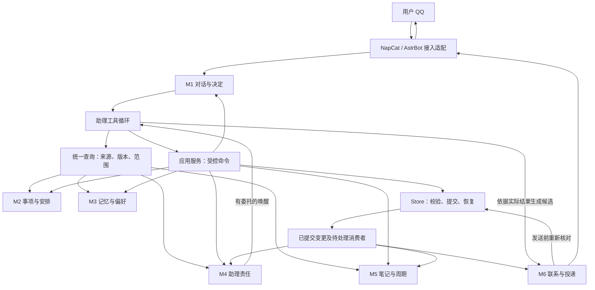
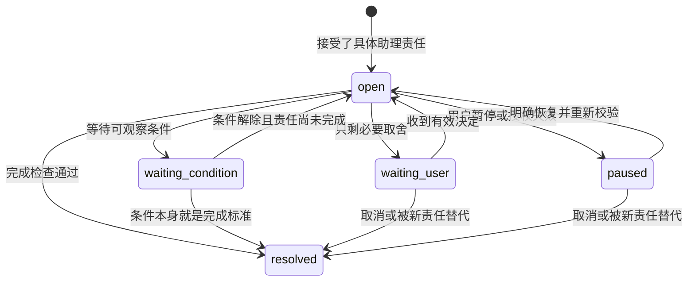
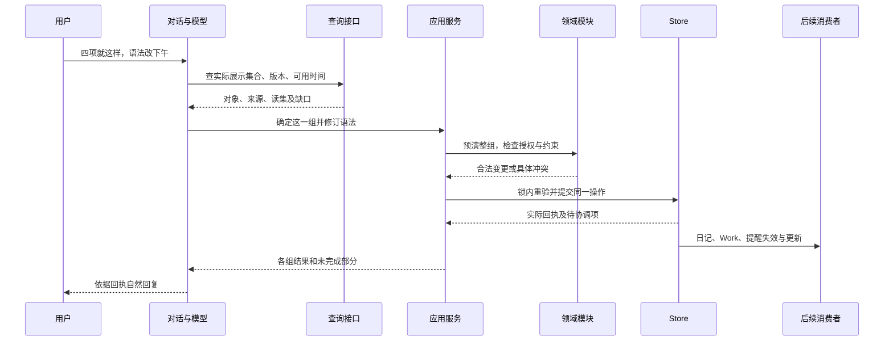

# 私人助理领域设计：模块职责、协作合同与用户闭环

> 版本：1.0｜日期：2026-10-31｜状态：目标详细设计，结合当前代码抽查，尚未整体实施验收。
>
> 本文从领域驱动设计（DDD）的角度细化 [ARCHITECTURE.md](ARCHITECTURE.md)。总架构仍是能力、C1—C6合同和验收的唯一基准；本文负责把它们落实到模块所有权、依赖方向、调用顺序和开发边界。选择历史见 [DECISIONS.md](DECISIONS.md)。不恢复之前已撤销的旧版 DDD。

**核心设计：一个模块化单体，六个业务边界，一个受控提交入口。** 模型可以灵活理解和组合工具，但不能绕过事实、授权和提交检查。任务变化后，日记、助理待办、记忆依赖和消息必须有明确的更新负责人。

这次问题不能全部归结为“没有划分模块”。还包括同一规则在不同入口解释不同、恢复缺少必要信息、测试没有检查跨模块后果。DDD负责明确归属和关系；是否正确，仍要由实现和验收证明。

## 1. 从用户需要出发：系统究竟在替谁做什么

### 1.1 一次交代的完整结果

用户说：“明天继续背单词和学语法，语法放下午。你先把材料找好。”

助理需要完成五件不同的事：

1. 找到“继续”所指的有效事项，排除已经取消或完成的内容。
2. 区分用户要做的学习，与助理承诺做的材料准备。
3. 根据真实可用时间安排；缺关键信息才问，不把明天整天视为空闲。
4. 保存有效安排，通过模板准备日记；只在实际保存后报告对应结果。
5. 持续处理材料、提醒和后续变化。后来用户说“语法取消”，这些关联内容也要随之处理。

用户不应知道内部有几个模块，也不应在 QQ 和日记里重复交代。模块化的价值，是让这五件事都有人负责，且不会相互冒充完成。

### 1.2 统一用词，避免同一个词指不同的结果

| 领域词 | 在本项目中的准确含义 | 不能被替代成什么 |
| --- | --- | --- |
| Task／任务 | 用户接受的成果要求，有验收条件，可有硬截止 | 一次提醒、一段聊天、助理已经查过资料 |
| Habit／习惯 | 重复行为及最低行为标准；每次发生单独记录 | 永久未完成任务、连续签到分数 |
| Plan／安排 | 某事项在某个时间窗口内怎样执行 | 任务本身；窗口结束不表示任务完成 |
| Proposal／提案 | 尚待用户决定的具体变更及其版本 | 已生效的承诺 |
| Work／助理责任 | 助理还欠的一次查找、准备、协调或跟进，有可检查的结束条件 | 用户任务的第二份副本、一次模型调用 |
| Fact／背景事实 | 有来源、适用范围和有效期的背景或共同语境 | 任务台账、执行授权；假设也不等于已确认事实 |
| Rule／规则 | 用户接受的长期做法或限期例外，影响实际判断 | 随手摘录、模型猜测出的性格 |
| Observation／发生记录 | 用户报告或工具观察到的具体事实，区分发生时间与收到时间 | 预期、计划、没有回复 |
| Input／入件 | 经过身份校验、可去重的用户消息 | 自动批准全部相关动作 |
| Receipt／回执 | 程序核实后的业务结果 | 模型说“好了” |
| Outbox／出件 | 准备通过渠道发送的一条消息及其有效条件 | 用户已经看到或已经行动 |
| Projection／投影 | 从正式业务记录生成的日记绑定区域 | 日记全部正文；自由正文不属于投影 |

### 1.3 明确当前范围

当前交付是单用户 QQ 助理：NapCat 接入 QQ，AstrBot 与插件承接模型和工具调用，Core 管理受控业务。保留 Markdown 笔记和原有模板。已有 Web 代码不是本轮扩展对象。

不新增微服务、消息中间件、向量数据库或独立项目平台。长期项目先用任务之间的依赖、阶段和 Work 关联表达；“身体管理”这类长期方向不意味着必须新增项目数据库。只有现有模型不能表达一项已确认需求时，再修改模型。

## 2. 模块化：六个业务边界及公共机制

### 2.1 如何划分

边界按“谁解释这个概念、谁允许修改、谁保证规则”划分，不按文件格式或模型调用次数划分。一个文件可以暂时承载多个模块，但不能因此让所有调用者任意修改其中所有数据。

DDD 的限界上下文用于保持一套模型在边界内含义一致，并明确边界间的关系。本项目用它约束职责；并不要求每个上下文部署成服务。[Martin Fowler：Bounded Context](https://martinfowler.com/bliki/BoundedContext.html)

### 2.2 六个模块的所有权

| 编号与模块 | 唯一负责的问题 | 拥有的模型或状态 | 明确不负责 |
| --- | --- | --- | --- |
| M1 对话与决定 | 这句话接哪件事？是在讨论、反馈、修改还是确认？ | 入件解释、话题引用、实际展示集合、提案及决定 | 直接修改任务；自行认定外部操作成功 |
| M2 事项与安排 | 用户承诺做什么？实际进展如何？时间上能否成立？ | 任务、习惯、发生记录、安排、依赖及排程问题 | 组织聊天措辞；把沉默记成失败 |
| M3 记忆与偏好 | 哪些背景和规则适用于眼前事情？怎样更正和撤销？ | 背景事实、个人规则、适用期、来源、替代关系 | 再存一份任务；凭记忆授予工具权限 |
| M4 助理责任 | 助理还欠什么？何时继续？何时算办完？ | Followup.work、步骤、等待条件、委托范围、完成证据 | 替用户完成学习、运动等行为；直接发 QQ |
| M5 笔记与周期 | 内容在哪？周期层级如何补齐？怎样保留人工正文？ | 模板生成、路径索引、文档版本、绑定区域映射 | 改写任务验收；把所有复选框当承诺 |
| M6 联系与投递 | 现在是否应该联系？这条消息仍有效吗？是否送出？ | 联系订阅的执行实例、候选消息、回复组、出件与渠道回执 | 决定用户任务完成；修改长期目标 |

M3管理规则的身份、范围、版本和生效期。规则内容必须由使用它的模块校验：时间规则由M2校验，联系规则由M6校验。M3不能存入一条消费者不理解的“万能规则”，再宣称已生效。无法执行的自然语言原则可以作为有来源的指导材料，但必须说明不具备自动执行能力。

### 2.3 共同使用的机制，不再算第七个业务模块

| 机制 | 职责 | 约束 |
| --- | --- | --- |
| 应用服务 | 编排一次用例：查什么、交给哪个模块、如何提交和收尾 | 不重新实现领域判断；不把所有规则继续堆进 Core 类 |
| 助理工具循环 | LLM理解语义、补查、选工具、提出方案、组织自然语言 | 不直接读写数据库、执行任意 shell 或跨目录访问 |
| 授权与读集检查 | 核对来源、权限、对象版本、文件哈希、新输入及有效委托 | 前台、后台、重试、导入均使用同一检查机制 |
| Store／工作单元 | 一致读取、恢复屏障、幂等提交、发布修订 | 不负责判断“用户到底想不想学英语” |
| 变更协调 | 持久登记哪些下游尚未同步，按操作ID恢复处理 | 使用现有事件与消费者记录，不另建事件总线服务 |
| 渠道与文件适配 | 将QQ、文件系统、SQLite等细节转成内部合同 | 外部字段或异常不得直接变成业务结论 |

领域模块表达业务规则；这些公共机制保证规则在各种入口下都成立。两者缺一不可。

### 2.4 模块关系图

图中箭头是运行时协作，不是允许模块互相导入内部实现。代码依赖应当为：接入层调用应用入口；应用入口调用领域接口和存储端口；领域规则只依赖领域类型。后台进程也通过应用入口办事。适配器实现端口，不让领域层反向依赖 QQ、Fastify 或 SQLite。

### 2.5 哪些连接同步，哪些可以稍后完成

| 连接 | 必须交付的内容 | 完成时机 | 失败后谁继续负责 |
| --- | --- | --- | --- |
| M1 → 应用服务 | 当前输入、展示集合、所选对象版本、明确依据 | 办理前 | M1保留未决范围；不能假装已接受 |
| 应用服务 → M2/M3/M4 | 类型化动作、只读快照、授权范围 | 提交前完成校验 | 应用服务返回分组失败或冲突 |
| M2 → M5 | 已提交对象ID、版本、目标日期和操作ID | 业务提交后可延迟 | 笔记消费者重试；业务回执显示投影未完成 |
| M2/M3 → M4 | 对象、规则或背景的变更引用 | 提交后唤醒；工具执行前必须复查 | Work保留等待或重算责任 |
| M2/M3/M4 → M6 | 失效引用、有效窗口、联系目的及最新结果 | 协调可延迟；发送许可不能延迟检查 | 投递模块停止旧消息，重建或取消候选 |
| M5 → M2 | 用户对绑定条目的编辑及base版本 | 必须作为命令重新校验 | 冲突留在文档导入结果，不覆盖业务状态 |
| M6 → M1 | 实际送出的对象集合、版本、渠道消息ID | 渠道确认后登记 | 未确认的集合不冒充用户已看到 |

这是一组明确的提供者／消费者关系。通过公开接口和事件传引用，不传可随意修改的整个 Registry。外部渠道通过防腐层适配，避免把QQ的“发送成功”等同于“用户知道了”。不为使用DDD术语新增技术设施。

## 3. 模型与生命周期：哪些状态必须一起正确

### 3.1 聚合与事务的选择

聚合是一组必须维持一致规则的领域对象，由聚合根限制修改入口；它不等于一个JSON文件或一个数组。[Martin Fowler：DDD Aggregate](https://martinfowler.com/bliki/DDD_Aggregate.html)

本项目的任务、习惯、提案、Work、规则和事实各有稳定ID及版本。安排间的时间冲突和任务依赖由M2的领域服务检查。Registry是当前存储容器，不是“所有数据都可以随便一起改”的业务模型。

标准DDD通常强调小聚合和事务边界。本项目保留C1/C2规定的本地多对象原子提交：一组已经确认、互相依赖的调整，可在单Core、单写入者的工作单元内一起验证和提交。这是明确的工程取舍。不能假称它是跨服务事务，也不能只因为追求小聚合就把四项整组确认改成四次互不相关的提交。

### 3.2 关键模型各自必须守住什么

| 模型／所有者 | 写入入口及不可违反的规则 | 生命周期要点 |
| --- | --- | --- |
| 提案／M1 | 确认绑定实际展示过的对象与版本；一组只接受一次 | pending到accepted/expired/cancelled；拒绝细节沿用现有决定记录，不另加同义状态 |
| 任务／M2 | 成果、验收、硬截止只有明确授权才能改变；开始不等于完成 | 沿用draft/ready/in_progress/blocked/done/cancelled；暂停推进用相应安排和责任状态表达，不偷偷加Task枚举 |
| 习惯／M2 | 按发生当时有效的最低标准验收；历史标准不能被新规则覆盖 | 定义active/paused/retired等与每日did/partial/skipped/unreported分开 |
| 安排／M2 | 起止有效、不撞固定承诺、不越硬截止、依赖可行、保护时间和缓冲满足 | planned/active/finished/expired/cancelled描述窗口，不替代任务状态 |
| 规则／M3 | 来源明确、范围可匹配、例外可过期；冲突不靠“最新一句话”随意覆盖 | 生效、暂停、替代、到期分别按当前schema表达；保留必要历史 |
| 背景事实／M3 | 来源、可信类别、适用范围可追踪；不能把推测变成用户确认 | active/superseded/revoked/expired；撤销后所有消费者停止复用 |
| Work／M4 | 必须有仍未完成的助理责任、下一步、授权和完成检查 | open/waiting_user/waiting_condition/paused/resolved；模型运行状态另存 |
| 笔记／M5 | 创建不覆盖现有正文；投影只更新绑定区域；路径不能越界 | 不存在→模板创建→正常编辑；冲突是投影状态，不是用户正文失效 |
| 出件／M6 | 同一效果去重、发送前验证、顺序受控、未知结果不盲重发 | pending/sending/sent/failed/unknown及取消、过期等终态；sent不代表已读 |

以上使用现有合同中的状态名称。实施前由schema检查，禁止在提示词、Python工具和TypeScript中另起一套相似枚举。

### 3.3 Work怎样接住“我先查一下”

这是主要路径，任一非终态收到明确取消／替代都可按C4收尾。resolved必须记录completed、cancelled或superseded等原因，不能从状态名猜测办成了。

一次模型分析结束，只更新analysis状态。若还欠材料、决定或恢复动作，Work不能结束。相同原因不反复调用模型；新反馈、依赖变更或约定检查点才能再次唤醒。租约过期后重新领取，旧执行者在下一次工具调用前必须失效。

### 3.4 缓冲、反馈与授权必须分开

用户说“报告还要半小时”，首先提供的是进度事实。它不自动授权挤占午休、修改硬截止或取消缓冲。

M2应当先保存事实，再尝试计算可行重排。若重排失败，返回“反馈已记录，重排待取舍”，而不是丢掉真实反馈或悄悄放宽约束。事实记录与可选重排是两个可分别报告的效果；用户明确要求全组原子执行时，按C1整组处理。

所有排程入口使用同一个约束检查。允许的例外来自具体规则或当前明确决定，不能由`source.channel`、前台／后台或一个默认关闭保护的布尔值决定。模型负责建议如何取舍，程序负责拒绝没有授权的例外。

## 4. 模块接口：从一句话到实际后果

### 4.1 统一的调用外壳

不再复制C1—C6的数据结构。以下是它们在模块接口中的责任分配；名称表示逻辑端口，实施时优先复用现有函数和工具名。

| 逻辑端口 | 接收者 | 最少输入 | 输出与失败含义 |
| --- | --- | --- | --- |
| acceptInput | M1 | 本人身份、渠道事件ID、正文、发生时间、接收时间、reply_to | input_id/seq或重复／拒绝；接纳不代表理解或执行 |
| queryContext | 各模块查询接口 | 问题、对象／时间范围、用途、分页位置 | 来源、对象版本、读集、完整性说明、下一页；权限不足不能伪装成查无资料 |
| publishInterpretation | M1 | 原文哈希、行为分类、依据片段、相关对象、未决范围 | 理解版本和对旧工作的影响；分类不授予执行许可 |
| previewChange | 目标领域模块 | 动作、快照、适用规则及授权范围 | 无副作用的候选变更或具体冲突 |
| commitChanges | 应用服务＋Store | C1动作组、依据、读集、幂等身份、提交模式 | 各组真实效果及投影状态；版本冲突要求重查 |
| evaluateWork | M4 | Work版本、触发原因、最新依赖、委托 | 执行／等待／收尾；调用业务工具仍经commitChanges |
| projectNote | M5 | 操作ID、业务版本、目标笔记及base_hash | applied/pending/conflict，不改变原业务提交结果 |
| considerContact | M6 | 目的、关联对象、最新已知状态、有效窗口、订阅范围 | 发送／合并／等待／取消及理由；不靠生成一句话就算通过 |
| dispatch | M6渠道适配 | 出件ID、正文、依赖版本、回复组序号 | sent/failed/unknown，附真实渠道凭据 |

C1规定的`Call`、`Basis`、`ReadSet`、`GroupReceipt`继续是唯一公共合同。新字段只能由一处schema定义并生成工具合同；表中“相关对象”是需要补齐的连接要求，不表示当前`Interpretation`已含完整对象引用。

### 4.2 一次四项确认的实际顺序

一项失败时是否连带其他项，取决于C1的`all_or_nothing`或`independent_groups`。共享时间资源或互相依赖的动作不能伪装成独立组。明确的整组接受不再逐项反复请示；“好”指向不清才澄清。

### 4.3 自然理解与强制约束各管什么

| 情况 | 模型负责 | 程序强制保证 |
| --- | --- | --- |
| “不想学了” | 结合目标和最近情况区分情绪、困难、暂停或取消；必要时问一处关键原因 | 没有明确变更依据，不取消任务、降低验收或新增催促 |
| “都照旧” | 找到真正相关的原安排，识别哪些不再适用 | 过滤终态、过期版本、时间冲突；批量效果有逐项回执 |
| “剩下的你安排” | 提出可行顺序和下一步 | 只在授权对象和弹性范围内移动，不改固定承诺和硬截止 |
| “以后都这么办” | 明确“这么办”的做法和适用情境 | 可执行规则校验、生效版本、旧规则和旧候选失效 |
| “别催了” | 从引用和上下文确定一项、今天还是长期；不明时简短澄清 | 对已明确范围立即停联系；不自动删除任务 |
| “发一个Hello” | 理解内容与触发条件 | 按指定正文投递，不擅自加说明；记录的是渠道结果 |

不把自然语言意图降级为关键词路由。程序也不能声称能完全证明语义理解正确：歧义和误判仍需对话评测、纠正机制与范围约束。

### 4.4 新消息怎样打断旧工作，又不让系统卡死

1. 入件先持久化。接纳、提交和发送许可使用同一协调边界确定顺序，不能只比较两个时间字符串。
2. 新输入尚未理解时，暂停可能受影响的旧副作用；只读准备可继续。已经发出的消息无法保证撤回。
3. 理解结果必须说明关联对象和范围。不相关的新闲聊释放旧工作；相关修改使旧方案重读或失效。
4. 分类失败进入有限重试或必要澄清，不把未知标记为已批准。已确认无关的工作不被无限阻塞；范围仍未知的相关写入继续停住，并保留原因。
5. 连续输入可合并处理，但每条入件有独立去向。旧租约、旧生成结果在提交和发送前都重验。
6. 清理旧聊天不能倒退已理解进度，也不能跳过尚未处理的消息。需要持久的已处理前缀依据；活动入件、未决范围和恢复材料不能按普通过期聊天删除。

严格到网络边界时：许可检查后、渠道接受前仍可能收到用户取消。系统能保证不再领取新旧段，不能承诺已经在途的一次QQ调用必然被拦回。应记录发送尝试的先后与结果，避免把这一现实边界藏在“绝不发送旧消息”的口号里。

## 5. 数据、变更与故障：连接必须能够恢复

### 5.1 一份事实，一个写入所有者

| 真源 | 内容及写入者 | 其他模块怎样使用 |
| --- | --- | --- |
| 现有registry.json | M1提案；M2事项与安排；M3规则；M4责任；M6订阅配置 | 按类型接口读取；共享文件不代表共享修改权限 |
| 现有days目录 | M2的发生与反馈记录 | 按事项与发生日查询，不能按收到消息的日期误归属 |
| .agent/context/facts.json | M3背景事实 | 带可信类别、范围、来源和版本查询 |
| Markdown与Attachment | M5管理路径和受控写入；用户拥有正文 | 查询片段和引用；不能在SQLite复制全文 |
| SQLite运行状态 | 入件、作业、出件、幂等、恢复和消费者进度 | 业务事实不因清理运行日志而消失 |
| 派生上下文与索引 | 查询和模型运行期间生成 | 可重建，源变更后失效，不取得新的独立权威 |

旧`user.md`等兼容读取仍可能存在。退出兼容入口前，要证明迁移来源和检索覆盖；不能新文件改好了、旧文件还继续喂给模型。

### 5.2 提交与恢复的共同规则

严格沿用C2：锁内一致读取和校验 → 持久化prepared恢复材料 → 按base/target哈希应用文件 → 确认applied及新修订 → 锁外协调后续消费者。模型推理和网络等待不占业务锁。

正式业务读者只能看恢复屏障之后的一致版本。外部直接读文件的编辑器不受Core锁控制；对它只能使用支持的编辑入口、维护窗口或冲突检测，不能声称操作系统外的所有读者都获得跨文件原子视图。

失败结果必须包含“有没有发生副作用”：未应用可以修正重试；已经应用只补缺失消费者；结果未知先核对。不能把全部异常都包装成“失败，请再试一次”。

### 5.3 变更事件有哪些消费者

下表是语义事件，不要求逐个新增表或消息类型。复用现有事件记录，至少携带operation_id、变更对象版本、原因／来源、发生时间、所需消费者及确认状态，不传播整份私人正文。

| 已提交变化 | 必须同步或失效的部分 | 不应发生的连带动作 |
| --- | --- | --- |
| 任务进展／完成／取消 | M2依赖；M4责任；M5绑定记录；M6旧提醒 | 完成一项就取消整天安排 |
| 安排改期 | M5对应日期；M6旧时点；M4相关检查点 | 修改任务硬截止或历史发生时间 |
| 规则更新／例外到期 | 使用此规则的计划、Work、候选消息及上下文 | 将例外永久写入长期偏好 |
| 事实更正／撤销 | 检索、摘要、依赖作业、排队消息、可清理历史片段 | 自动取消用户尚未撤销的任务 |
| 文档人工变更 | 文档版本、相关材料检查、绑定区域导入 | 覆盖自由正文或任意新增习惯 |
| 投递成功／未知 | M1展示集合、M6尝试记录、等待回执的Work | 把用户行为标记完成 |

事件重复送达时消费者幂等；旧版本迟到时读取最新状态，不覆盖新状态。消费者失败只重试该消费者。没有新事实时，不通过无意义的版本递增触发模型循环。

### 5.4 忘记一条内容，要覆盖整条使用链

停止使用和物理清理分开：正式事实先撤销，发送和工具入口立即拒绝旧依赖；清理尚未完成时如实报告。恢复信息必须持久化，不能只留在当前函数的局部变量。

清理检查对象包括：旧偏好兼容文件、源入件、摘要、缓存、尚未发出的回复段、作业上下文、可清理的恢复材料及备份。按来源引用定位，不能用全文相似删除误伤无关记录。兼容行哈希可用于精确定位，但不能等同于不可逆匿名化，也无法证明改写过的旧片段已经清干净。

旧备份恢复要应用最新撤销清单。最新清单丢失时限制旧记忆加载，不假称“恢复以后仍保证全部忘记”。用户已导出的副本和外部模型已经接收的数据不在本地删除保证内。

### 5.5 查询完整性也属于模块合同

检索回答必须区分“确实没找到”“只看了第一页”“范围不适用”“恢复限制”。事实、规则和文本是不同集合，分页位置不能混用：文本字符位置不是事实条数。

建议一个查询只翻一个集合；若沿用当前复合接口，则分别返回并校验各自的分页位置。总数是同一过滤条件下的匹配数；翻页期间快照变化应重查，不能把不同版本拼成一份完整结果。不得用调大limit代替正确分页。

## 6. 从用户实际使用检查设计是否完整

### 6.1 交代与理解

| 用户情境 | 模块如何合作 | 必须看到的最终结果 |
| --- | --- | --- |
| 一句话交代四件事 | M1拆出对象与关联；M2整组校验；应用服务提交 | 四件均有去向，不能只办最后一件 |
| 用户说“可以了” | M1检查当前展示集合与版本 | 对象清楚就一次确认；不清楚只问对象 |
| 先讨论可不可做 | M1记录讨论，M4仅承接已接受的调查责任 | 不新增用户执行承诺 |
| 旧记录已经含有答案 | M3/M5查询返回出处，M1接续 | 不要求用户再讲一遍；查不到不编造 |
| 笔记里粘贴别人指令 | M5提供资料来源；M1识别引用 | 不当成用户授权或永久规则 |

### 6.2 晚间规划与次日变化

| 用户情境 | 模块如何合作 | 必须看到的最终结果 |
| --- | --- | --- |
| 到约定晚间规划时间 | M4按有效订阅唤醒；M5从次日路径定位缺失父级；M2查事项与容量 | 缺层通过模板补齐，已有正文保留；空上层不虚构目标 |
| 明天沿用今天 | M2过滤终态和例外；M1确认是否有真实取舍 | 延续有效事项，不重复生成已经完成的任务 |
| 已有安排却缺可用时间 | M2保留事项，M1询问必要边界 | 不把空白日历排满 |
| 报告延长到11:20，图表需30分钟，12点保护边界且尾部保留15分钟 | M2保存进度并统一验证重排 | 指出差5分钟；无明确例外就不提交11:20—11:50 |
| 临时急事挤占学习 | M2只调受影响弹性安排；M4保留未决取舍 | 固定承诺不变，无关任务不全部顺延 |
| 周末同时也是月末／季末 | M4合并相关周期责任；M5定位周期；M1组织一次必要讨论 | 不接连重复三轮总结；不同周期的问题仍有对应去向 |
| 跨年或时区变化 | M2按发生时区、业务日期处理；M5按自然季度及跨年周片段生成 | 不把昨天反馈记今天，不凭UTC日期生成错误目录 |

### 6.3 推进、阻碍与沉默

| 用户情境 | 模块如何合作 | 必须看到的最终结果 |
| --- | --- | --- |
| 六点提醒，八点才说“六点做了” | M1定位原事项；M2按发生时间记录；M6撤掉无效追问 | 不把迟回等同于迟做 |
| 用户一直没回复 | M2保留未知；M4查依赖和截止风险；M6按已接受联系规则判断 | 可做的准备继续，不补打卡、不无限追问 |
| 已经聊过正在做什么，例行问候又到点 | M6检查近期事实是否足以满足这次联系目的 | 状态已知且仍适用就不重复问；只聊别的话不等于知道当前活动 |
| “我不想做”但任务很重要 | M1查背景；M2提供后果；M4准备更小下一步 | 语气温和，有立场；不擅自撤任务，也不自动替用户判懒惰 |
| 多次明确尝试仍做不下去 | M2提供真实发生记录；M3检索偏好；M4提出减难或改方法 | 调整可选动作与改变验收标准区分，改变承诺须有依据 |
| 等资料或别人回复 | M4保存具体条件和检查点 | 继续独立可做部分；没有外部连接时不假装知道对方已回复 |
| 提前完成／明确取消 | M2提交终态；M4收尾；M5更新；M6发送前复核 | 旧提醒、依赖和责任都得到处理；不会明天再次安排 |

### 6.4 连续聊天、记忆与更正

| 用户情境 | 模块如何合作 | 必须看到的最终结果 |
| --- | --- | --- |
| 查资料较慢 | M1生成必要的接话；M4保存责任；M6管理进度与结果消息 | 不长时间无声，也不反复“我在”；结果出来后有下文 |
| 助理发第一段时用户改口 | M1接纳新输入；M6暂停尚未发的旧段 | 新旧结果不交错误导；已发段不能声称未发生 |
| 教过一次，一个月后再遇到 | M3保存有来源规则；M1按需检索；M2/M4执行 | 原聊天清理后仍适用；不相关场景不套用 |
| “今天例外，以后照旧” | M3限定有效期；M2/M6按日期解析 | 第二天恢复当时有效的长期规则 |
| “刚才记错了” | M1确定更正对象；所属模块改事实；协调受影响状态 | 不是只道歉或改回复，要修正相关计划和提醒 |
| “忘掉这件事” | M1确定记忆、任务还是联系范围；对应所有者办理 | 不混删其他对象；撤销后重启仍不复用 |

### 6.5 系统出问题时

| 故障 | 处理责任 | 对用户的真实状态 |
| --- | --- | --- |
| 任务保存了，QQ回复失败 | Store保留效果；M6处理投递 | 已保存，回复未送达；重新询问不重复建任务 |
| QQ结果未知 | M6核对渠道证据，不能确认则保留unknown | 不保证已收到，也不盲重发 |
| 文件写到一半崩溃 | Store按prepared与哈希恢复 | 恢复前不提供混合业务视图 |
| 日记同时被人工修改 | M5检查base与当前内容，重叠留冲突 | 业务可已生效，日记待同步；人工正文保留 |
| 模型超时或返回无效工具参数 | 应用服务有限纠错；M4保留未完责任 | 不报告成功，不无限耗费调用 |
| 磁盘满、数据库损坏 | 运行保障停止不安全写入，保留诊断和恢复入口 | 明确哪些未办成；不继续假装正常 |
| 恢复旧备份／升级失败 | 维护模式校验schema、撤销清单和数据；禁止旧消息重放 | 恢复验证前不接真实副作用 |
| 陌生QQ或越界文件请求 | 接入身份与路径能力边界拒绝 | 本人状态不被改变；合法查询仍可运行 |

这些场景覆盖常见维度，不是“已经穷尽全部情况”的声明。新增情况先定位所属对象、状态、来源、时机和失败点，再扩充对应边界用例，不再为每一句话增加专用分支。

## 7. 对照现有代码：保留什么，收紧什么

### 7.1 文件与领域责任的映射

以下路径相对`.dev/secretary-service`。这是本次静态查看的落点，不表示每项已经满足上述合同。

| 责任 | 现有主要入口 | 下一步边界调整 |
| --- | --- | --- |
| M1对话与决定 | apps/core/agent-runtime.ts、classification.ts、conversation.ts；packages/domain/decisions.ts | 理解关联、展示集合、提案决定经同一应用入口；不在渠道插件复制规则 |
| M2事项与安排 | packages/domain/actions.ts、planning.ts、scheduling.ts；packages/contracts/types.ts | 各动作调用共同约束校验；分清记录事实与重排效果 |
| M3记忆与偏好 | apps/core/facts.ts、assistant.ts、application.ts；packages/contracts/facts.ts | 统一来源／范围／分页／撤销合同；旧读取路径退出要有证据 |
| M4助理责任 | packages/domain/work.ts；apps/core/work-runner.ts、work-checks.ts、coordinator.ts | runner只领取和执行，checks检查真实完成，coordinator处理变更；不得各自判完成 |
| M5笔记与周期 | apps/core/journal.ts、document-operations.ts、workspace.ts；packages/calendar/index.ts | 周期生成、文件查询、受管块投影分工；人工编辑以命令回流 |
| M6联系与投递 | apps/core/scheduler.ts、astrbot-channel.ts、qq.ts | 联系判断与传输分离；所有消息种类接受发送前检查 |
| 应用与共同合同 | apps/core/core.ts、application.ts、agent-runtime.ts、policy.ts、background-grant.ts、read-stamps.ts | Core保留编排，不新增各入口专属版本、授权或排程规则 |
| 存储与恢复 | apps/core/store.ts、files.ts、recovery-control.ts、maintenance.ts、snapshot-backup.ts | 真源与运行状态边界一致；恢复、清理、查询使用相同生命周期定义 |

不需要先搬文件。先收紧公开接口和写入所有权，建立导入边界检查，再按职责逐步提取较大的函数。不能以“大量重命名、重新分目录”代替行为修复。

### 7.2 本次抽查看到的实际状态

| 项目 | 看到的代码事实 | 仍需证明的部分 |
| --- | --- | --- |
| 撤销恢复 | facts.ts新增兼容行哈希及恢复清理；memory-closeout.test.ts已有对应测试代码 | 本轮未运行；派生摘要、活动作业、旧备份和跨来源改写不能由单个测试推断全部覆盖 |
| 理解水位 | classification.ts已尝试用持久水位处理最早消息被清理的情况 | 全部旧行清空、真实缺口、未分类入件、重启及恢复旧数据的组合 |
| 事实分页 | searchFacts已先过滤再分页，application.ts返回facts_next_offset | 复合查询仍共享offset入参；多集合分页、快照变化和范围过滤需端到端核验 |
| 排程保护 | reflow仍有respectReserve默认值，部分调用根据来源渠道传值 | 按用户的实际授权统一，而非按入口推断；所有重排路径均需测试 |
| 理解关联 | Interpretation已有行为、关系、影响类别和target_scope | 仍缺完整对象引用合同；如何精准释放无关作业需要落到实现 |
| 一致读取 | Store.readSnapshot已有registry、days、files及修订读取 | facts和全部查询入口是否进入同一读取屏障，不能只凭函数存在判定通过 |

本轮只写设计和核对代码，没有重新运行功能测试、验证服务器或修复这些业务实现。工作区有大量其他开发改动；后续验收必须绑定具体源码快照，不能沿用之前某次“全部通过”的数字。

## 8. 实施与验收：怎样证明边界真正有效

### 8.1 按最小可验证改动实施

| 顺序 | 具体工作 | 先写的失败用例 | 完成条件 |
| --- | --- | --- | --- |
| 1 | 盘点所有业务写入口、直接SQL／文件写入、公开查询与发送入口，标注所属模块 | 对未登记副作用入口做静态检查 | 每个入口有所有者及校验路径；恢复和导入也列入 |
| 2 | 收敛统一授权、读集、幂等和分组回执，复用C1—C3 | 同一命令分别从前台、后台和重试进入 | 相同业务约束一致，权限按明确依据差异化；无旁路成功 |
| 3 | 收紧M2事实与排程边界 | 用户报告超时而非授权吃缓冲 | 事实保存、违规排程拒绝、其他事项不变，回执区分效果 |
| 4 | 收紧M3查询和撤销边界 | 41条事实逐页查询；撤销后在各故障点重启 | 匹配结果完整且同一快照；撤销内容不再流入正常上下文 |
| 5 | 连接M1、M4、M6的对象依赖和失效机制 | 慢作业期间改口、取消、无关聊天、多段消息 | 相关旧效果停止，无关工作可继续，未送段不冒充已展示 |
| 6 | 连接M2/M3变更与M4/M5/M6消费者 | 提交成功后投影失败、消费者重复、事件乱序 | 只补缺失效果；不重新执行业务、不覆盖人工正文 |
| 7 | 跑用户完整剧情与发布演练 | 普通一天、被打乱一天、教过一周、90天时间推进 | 结果和证据符合总架构S/E；真实QQ、长期运行另行核验 |

每步保持旧数据可读。改schema需版本、迁移夹具、兼容检查和失败回退；不能以重置用户数据简化升级。回退代码不等于回退用户事实，旧代码不兼容新schema时应停止启动并恢复经验证的整套快照。

### 8.2 测试落点与严格通过条件

| 连接／规则 | 优先复用的测试文件 | 必须检查的事实 |
| --- | --- | --- |
| 批量决定、分组提交、旧版本 | tests/command-contracts.test.ts、assistant-contracts.test.ts | 每个对象及版本、操作次数、失败组无副作用 |
| 新输入、理解水位、作业失效 | tests/agent-classify.test.ts、agent-processing.test.ts | 接纳顺序、分类范围、旧提交被拒、无关作业恢复 |
| 缓冲、依赖、固定承诺 | tests/coordinator.test.ts、domain.test.ts | 所有重排入口同一规则；授权例外单独测试 |
| 长期事实查询及撤销 | tests/memory-closeout.test.ts、application.test.ts | 通过正常工具接口查询；首中尾页、过滤总数、撤销后重启 |
| Work真实结束和连续性 | tests/relations.test.ts、scenario-long-project.test.ts | done_when证据、步骤身份、无新原因不空转、清理后接续 |
| 消息顺序及发送许可 | tests/scheduler.test.ts、astrbot-core-input.test.ts | 直接回复和主动联系都覆盖；未知投递不重放 |
| 文件、跨存储与恢复 | tests/recovery.test.ts、documents.test.ts、security.test.ts | 故障注入前后内容与哈希、恢复屏障、人工内容和路径边界 |

测试文件存在不表示已覆盖表中全部断言。先检查内容，缺什么补什么；优先把已有相似测试改成准确的合同测试，不重复堆同名用例。

开发检查在服务目录运行`npm run check`；聚焦回归可运行`npx vitest run tests/memory-closeout.test.ts tests/application.test.ts tests/coordinator.test.ts`，整体回归用`npm test`。这些是现有可用命令，不是本轮已执行记录。仅在修改公共schema时生成合同并检查工具侧一致性。

### 8.3 用小矩阵检查组合，不声称穷尽

每条核心规则至少覆盖四个轴：

1. **入口：** QQ当前指令、已接受提案、后台委托、日记绑定编辑、恢复重试。
2. **时机：** 提交前、部分文件写入后、applied后、发送许可前、发送结果未知。
3. **变化：** 用户改口、对象完成、规则例外、事实撤销、无关闲聊。
4. **生命周期：** 同一回合、重启、聊天清理、跨日／跨年、旧备份恢复。

不做所有维度的盲目笛卡尔积。用风险最高的交叉组合，例如“已提交＋回复丢失＋用户再次询问”“事实撤销＋旧作业＋重启”“进度超时＋依赖任务＋保留缓冲”。另加无关事项不受影响的反例，避免系统为了安全而什么也不做。

### 8.4 技术通过与体验通过分别判断

技术通过要求：实际状态正确、外部效果可核对、无重复副作用、失败有归属、恢复可接续。不能只检查回复里包含“已完成”。

模型体验评测用隔离数据和真实模型，检查自然改口、四项确认、拒绝与困难、延迟反馈、长期规则复用。评价“少问”不能奖励漏问，“主动”不能奖励频繁发消息，“自然”不能奖励好听但没办事。

真人QQ验收观察：是否需要重复交代、能否看懂结果、是否真的知道下一步、是否收到过时或无用消息。长时间推进测试证明业务逻辑，真实连续运行证明部署稳定，两者不能合并为“稳定90天”。门槛和统计口径沿用总架构6.8，不在这里另设漂亮分数。

## 9. 文档维护与停止条件

### 9.1 防止再次出现多套架构

- ARCHITECTURE维护“应当达到什么、共同合同和验收”；DDD维护“谁负责、怎样连接、哪些入口必须服从合同”；DECISIONS记录“为什么这样选”。
- 改规则时先修改唯一合同及对应断言，再更新DDD中的归属和连接。不能通过修改DDD例子悄悄放宽总架构。
- 本文不重复维护历次测试数字、生产连接状态或运行日志。实现状态需以对应源码和本次执行证据核对。

### 9.2 什么时候可以停止架构改写

当每个用户场景都能回答以下问题，就可以进入实现，不再继续增加概念：

1. 谁负责理解，谁拥有对象，谁允许修改？
2. 查询拿到什么依据，提交检查什么版本和授权？
3. 成功后哪些对象要更新，失败后谁接着处理？
4. 用户改变主意、重启、清理之后，这件事会怎样？
5. 哪条测试检查实际后果，什么结果必须判失败？

还不知道的行为作为具体缺口保留，不能用“智能处理”“自动恢复”“足够自然”填空。本设计的完成标志不是模块数量，而是用户交代的事情从理解到收尾都有明确责任，连接断开时也能发现并恢复。

### 9.3 方法依据及使用边界

采用DDD的统一语言、限界上下文、聚合、领域服务和上下文映射，参考 [Eric Evans：DDD Reference](https://www.domainlanguage.com/wp-content/uploads/2016/05/DDD_Reference_2015-03.pdf)。这些方法帮助组织复杂业务，不保证模型理解或用户行为效果。本文的六个边界、单体部署和具体调用关系，是针对本项目作出的工程设计，需通过上述验收继续修正。
