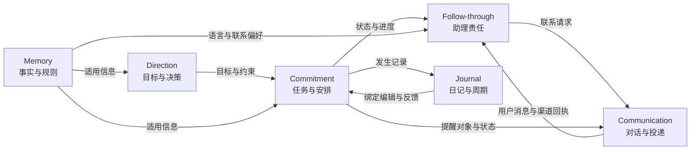

# 私人 AI 助理的领域设计

> 版本：2.0｜日期：2026-11-03
> 本文是领域设计参考。`ARCHITECTURE.md`规定系统必须达到什么，本文规定业务概念由谁负责、怎样连接。`DECISIONS.md`记录为什么这样选择。

## 1. 先区分三种东西

当前文档混乱的根因，是把业务模块、应用编排和技术设施放在同一层。

### 1.1 业务模块

业务模块回答一个稳定的业务问题，拥有自己的概念和不变量。它可以独立说明“谁能改什么”。

### 1.2 应用编排

应用层把一次用户用例串起来。例如，一条“明天下午继续英语”的消息，可能同时查询记忆、修改任务、更新日记和创建后续责任。应用层负责顺序，不拥有这些业务对象。

### 1.3 技术基础设施

模型、QQ、调度器、SQLite、文件系统和恢复机制都属于基础设施。它们提供能力，但不拥有“任务完成”“目标暂停”这类业务含义。

因此，**模块不是一个文件，也不是一个工具。模块是一组由同一个业务规则约束的概念。**

## 2. 六个业务上下文

本项目只保留六个业务上下文。每个上下文都有一个核心问题、自己的对象和明确的边界。

| 上下文 | 它回答的问题 | 聚合根 | 不负责 |
| --- | --- | --- | --- |
| Direction | 为什么做，做到什么算完成，冲突时依据什么取舍 | `Goal` | 今天几点做、提醒、完成记录 |
| Commitment | 用户要做什么，什么时候做，实际发生了吗 | `Task`、`Habit` | 人生方向、聊天措辞、渠道投递 |
| Follow-through | 助理还欠什么，何时继续，什么证据算办完 | `Work` | 用户任务成果、QQ发送 |
| Memory | 哪些背景和规则以后仍然适用 | `Fact`、`Rule` | 任务、排程、模型猜测 |
| Journal | 内容写到哪份笔记，怎样保留人工正文 | `PeriodDocument` | 任务验收、目标方向、消息发送 |
| Communication | 现在要不要联系，消息是否真正送出 | `Conversation`、`Message` | 任务是否完成、目标是否达成 |

这六个上下文是业务边界。不是六个微服务，也不是六个 Agent。当前采用模块化单体，先在同一个 Core 进程中保持边界。

## 3. Direction：方向与决策

### 3.1 核心问题

> 我究竟要解决什么问题，想得到什么结果，受到什么限制？

### 3.2 对象

```text
Goal
├── problem             要解决的问题
├── desired_outcome     希望得到的结果
├── acceptance[]        达标条件
├── constraints[]       约束
├── non_goals[]         明确不做的事
├── milestones[]        阶段性结果
├── decision_log[]      关键选择及理由
└── status              proposed / active / paused / achieved / abandoned
```

### 3.3 不变量

1. 没有问题、结果和验收条件，目标不能进入 `active`。
2. 修改验收条件必须产生新版本。
3. 目标结束后，不能新建引用它的执行安排。
4. 完成目标必须提交证据。经过时间或完成任务数量不等于目标完成。
5. 目标暂停不删除历史事实。

### 3.4 对外命令

```text
propose_goal
activate_goal
revise_goal
pause_goal
complete_goal
abandon_goal
add_milestone
record_decision
```

Direction 只输出方向、约束和影响范围。它不直接改时间表，也不直接发消息。

## 4. Commitment：任务、习惯与安排

### 4.1 核心问题

> 用户承诺做什么，最低标准是什么，什么时候做，实际发生了什么？

### 4.2 对象关系

```text
Task / Habit
    ↓ 安排
Plan
    ↓ 执行反馈
Occurrence / Progress
    ↓ 验收
done / did / blocked / skipped / unknown
```

- `Task`表示成果。它有验收条件。
- `Habit`表示重复行为。它只要求最低行为发生。
- `Plan`表示执行窗口。窗口结束不等于任务完成。
- `Occurrence`表示某次真实发生。报告时间和发生时间分开保存。

### 4.3 不变量

1. 任务完成必须符合原验收条件。
2. 习惯记录不把可选目标变成硬门槛。
3. 没有回复不等于没有完成。
4. 改执行时间不能偷偷改硬截止。
5. 所有排程入口使用同一套冲突、依赖和缓冲检查。

### 4.4 对外命令

```text
create_task / update_task / report_task_progress / complete_task
create_habit / report_habit
schedule / reschedule / cancel_item
```

Commitment 是日常执行的核心上下文。目标只提供方向，Commitment 才决定具体安排。

## 5. Follow-through：助理责任

### 5.1 核心问题

> 助理答应要做的事情，怎样保证不会在一次回复后消失？

### 5.2 对象和状态

```text
Work
├── summary
├── next_action
├── done_when
├── delegation
├── refs[]
└── status
    open / waiting_user / waiting_condition / paused / resolved
```

`Work`只能表示助理自己的责任。例如“查到词表并发给用户”。它不能表示“用户已经背完单词”。

### 5.3 不变量

1. 每个未结束 Work 都有下一步和完成条件。
2. 模型分析结束不等于 Work 结束。
3. 等待用户、等待外部条件和暂停必须分开。
4. 没有新事实时，不重复调用模型。
5. 目标、任务或规则变化后，Work必须重新检查引用是否仍有效。

## 6. Memory：记忆与规则

### 6.1 核心问题

> 哪些内容以后仍然可以影响判断？

### 6.2 对象

- `Fact`。有来源的背景事实。
- `Rule`。用户明确接受的长期做法或临时例外。
- `Revocation`。撤销和忘记记录。

聊天全文不是长期记忆。模型猜测也不是事实。

### 6.3 不变量

1. 没有用户明确确认，推测不能升级为规则。
2. 每条记忆都有来源、适用范围和有效期。
3. 临时例外不会自动变成永久规则。
4. 撤销后，查询、Work、待发消息和恢复流程都不能继续使用旧内容。
5. 冲突事实保留冲突，不能只按最新一句话覆盖。

## 7. Journal：日记与周期记录

### 7.1 核心问题

> 业务结果应该投影到哪份笔记，怎样不破坏人工内容？

### 7.2 对象

- `PeriodDocument`。年、季、月、周、日文件。
- `Template`。创建周期文件的模板。
- `Projection`。业务对象在笔记中的受管区域。
- `DiaryBinding`。任务、习惯与笔记条目的绑定。

### 7.3 不变量

1. Markdown 是正文唯一真源。SQLite 不保存日记全文副本。
2. 日记创建必须走模板。
3. 投影只能修改受管区域，不能覆盖自由正文。
4. 年、季、月、周、日按自然时间逐层引用。
5. 文件冲突时保留人工修改，业务记录不能被文档冲突回滚。

## 8. Communication：对话与投递

### 8.1 核心问题

> 现在是否应该联系，消息是否真的送出？

### 8.2 对象

- `ConversationTurn`。一条用户输入及其处理状态。
- `ContactDecision`。联系、等待、合并或取消的决定。
- `Message`。待发送消息。
- `DeliveryReceipt`。渠道回执。

### 8.3 不变量

1. 业务已保存不等于消息已发送。
2. 消息已发送不等于用户已读。
3. 用户改口后，旧消息必须失效。
4. 状态已经明确时，不重复追问。
5. 投递结果未知时，不能当成成功，也不能盲目重发。

自然语言由模型生成，但是否允许联系、消息是否仍有效，由 Communication 和程序规则决定。

## 9. 上下文之间怎样协作



模块之间只传引用、版本和回执，不传整个 Registry：

| 来源 | 目标 | 传递内容 |
| --- | --- | --- |
| Direction | Commitment | `goal_id`、`milestone_id`、目标版本、约束 |
| Commitment | Follow-through | `task_id`、`plan_id`、当前状态、下一步 |
| Commitment | Journal | 业务日期、绑定区域、业务版本、操作ID |
| Memory | 其他上下文 | 规则ID、适用范围、有效期 |
| Follow-through | Communication | 联系目的、有效窗口、取消条件 |
| Communication | Follow-through | 渠道结果、消息ID、失败原因 |
| Journal | Commitment | 文档版本、人工修改、绑定反馈 |

## 10. 应用层和基础设施

### 10.1 应用层只负责编排

应用层可以把多个上下文串起来，但不拥有业务对象。

```text
用户说“明天继续英语，语法改下午”
    1. Communication 接收并去重
    2. Model 解释当前意图
    3. Memory 提供适用规则
    4. Direction 提供相关目标
    5. Commitment 修改任务和安排
    6. Journal 更新受管投影
    7. Follow-through 保存助理后续责任
    8. Communication 根据真实回执回复
```

### 10.2 基础设施不拥有业务含义

| 基础设施 | 作用 |
| --- | --- |
| Model Gateway | 调用模型并返回结构化理解或文案 |
| Scheduler | 到时间唤醒系统 |
| Persistence | 保存文件、SQLite、版本和恢复记录 |
| QQ Adapter | 转换 QQ 入件和出件 |
| Workspace Adapter | 在允许目录内读写 Markdown |
| Recovery | 处理崩溃、重试、幂等和版本冲突 |

Scheduler 可以发现“到了 08:00”，但不能判断“用户已经完成背单词”。

## 11. 当前代码的对应关系

代码不要求立即搬成六个服务，但写入口必须向六个上下文收敛。

| 上下文 | 当前主要入口 | 当前状态 |
| --- | --- | --- |
| Direction | `packages/domain/goals.ts` | 第一阶段已落地，跨模块传播未完成 |
| Commitment | `packages/domain/actions.ts`、`planning.ts`、`scheduling.ts` | 规则最多，仍需收敛写入口 |
| Follow-through | `packages/domain/work.ts`、`apps/core/work-runner.ts` | 已有模型，完成检查需统一 |
| Memory | `apps/core/facts.ts`、`assistant.ts` | 分页、撤销和适用范围仍需收紧 |
| Journal | `apps/core/journal.ts`、`workspace.ts` | 需要继续保护人工正文 |
| Communication | `apps/core/core.ts`、`scheduler.ts`、`qq.ts` | 需要继续处理并发、顺序和未知投递 |
| Application | `apps/core/application.ts`、`core.ts` | 只编排，不再增加万能判断 |
| Infrastructure | `store.ts`、`agent-client.ts`、`maintenance.ts`、适配器 | 不得决定业务状态 |

## 12. 模块划分的验收标准

一个模块只有在下面五个问题都能回答时，才算划分完成：

1. 它解决哪一个稳定的业务问题？
2. 它拥有哪几个核心对象？
3. 哪些不变量只能由它保证？
4. 哪些事情明确不归它负责？
5. 其他模块通过什么命令、查询或事件连接它？

如果一个“模块”只是在描述某个文件、某个工具或某个线程，它不是 DDD 模块。

## 13. 实施顺序

1. 列出所有业务写入口，禁止绕过所有者直接修改 Registry。
2. 先收敛 Commitment，因为它决定任务、习惯、安排和发生事实。
3. 再连接 Follow-through 与 Communication，保证助理承诺不会消失、过时消息不会发送。
4. 再收紧 Memory 的分页、撤销和跨会话取回。
5. 最后完善 Journal 投影和跨周期同步。
6. 每一步都验证用户能观察到的结果，不用“函数存在”作为通过条件。

DDD 的目的不是把系统拆碎，而是让每个业务概念只有一个真正负责的地方。
