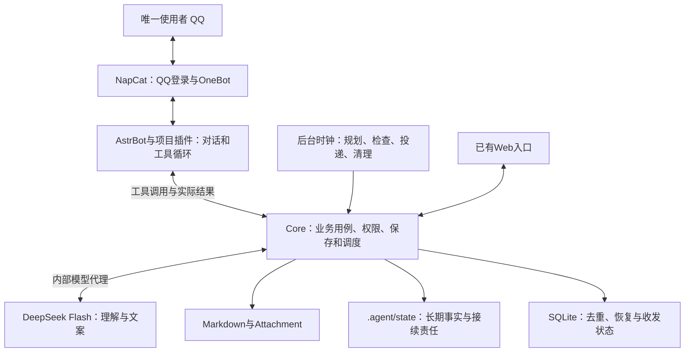
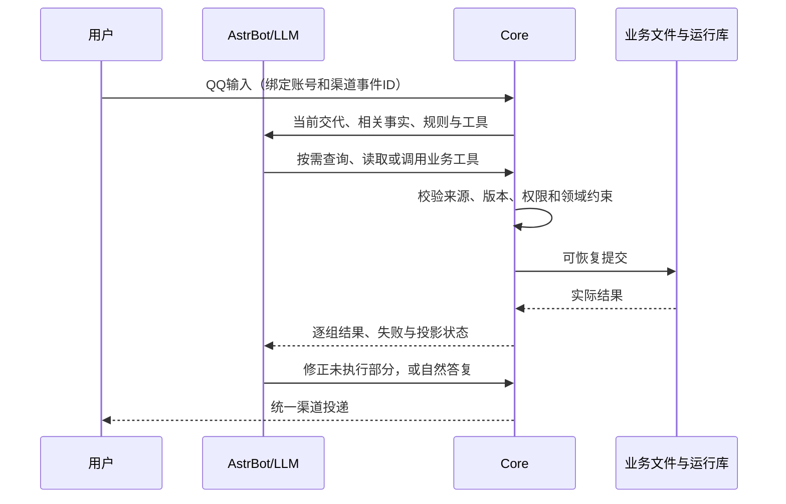

# DDD｜架构与领域设计

范围：单用户 QQ 助理、服务端一个笔记工作副本。本文维护当前实现、运行维护与验证证据；后续改造的执行基线见[ARCHITECTURE.md](ARCHITECTURE.md)，产品目标见[PRD.md](PRD.md)，价值与使用入口见[README.md](README.md)。第1—13节描述现有实现与验证边界；第14节保留研究与M1—M6方案来源，具体改造要求由ARCHITECTURE收束，不能把目标设计当作已经实施。

**基线对齐说明（2026-10-27）：** ARCHITECTURE v2.2 是目标规格；本页保留的现有结构、v1 数据、历史发布与测试记录不自动升级为 v2.2 已实现。差距以该规格 §6.1 的 G1—G14 为准，实施与验收按 §6.3、§6.4 逐项记录。[架构图册](Architecture-Atlas.md)只表达目标关系，不替代本页的实际证据。

## 1. 交付目标与约束

用户交代事情后，系统保存承诺、安排下一步、按约定触发支持、记录反馈，并在变化后接着处理。普通明确交代直接办；讨论保持待定；重要取舍由用户决定。用户不用维护状态表、记工具名称或反复解释前文。

以下约束适用于所有入口：

1. 习惯判断最低行为是否发生；任务按已接受的成果标准验收。
2. 开始、进展、完成和未知分开；沉默、过期、计时结束不能替代完成证据。
3. 执行窗口、硬截止和预计用时分开；改期不能偷偷改成果或截止。
4. Markdown是正文唯一真源；长期业务事实在文件中；SQLite管理必要运行状态。
5. 已发生的副作用不因重试重复执行；部分成功、未知结果分别报告。
6. 权限、版本、暂停、静默和联系预算由程序检查，不能被人格或模型建议覆盖。

## 2. 总体结构



**Core是业务应用服务与执行内核。**它不是另一个LLM，也不只是几把文件工具。它组织领域规则、保存、调度与适配器，提供模型可调用的能力，并对实际效果负责。

模型理解交代、查资料、选择工具、根据结果继续办理并组织语言；程序核验是否合法并真正执行。主QQ路径不依赖“确认”“取消”等关键词路由，不要求每轮输出固定提案包。确定性规则用于业务约束和时间触发，语言理解由模型处理。

当前采用单体工程，不为每个业务领域部署服务。Core、AstrBot、NapCat分容器是为数据、工具和账号连接分配权限。Web/Caddy是兼容入口，当前MVP不扩展其功能、付费或多用户能力。

## 3. 职责与代码位置

服务源码位于 `.dev/secretary-service/`，下表路径相对此工程。

| 职责 | 主要位置 | 负责的结果 |
| --- | --- | --- |
| 接口与身份 | `apps/core/app.ts`、`application.ts` | 来源绑定、API、受限工具入口与模型代理 |
| 对话办理与提交 | `apps/core/core.ts`、`agent-runtime.ts` | 输入、工具会话、决定、逐组回执和投影 |
| 领域规则 | `packages/domain/actions.ts`、`decisions.ts` | 任务、习惯、安排、验收与方案决定 |
| 排程与影响分析 | `packages/domain/planning.ts`、`apps/core/coordinator.ts` | 可用时间、依赖、局部重排、夜间准备和取舍 |
| 规则与持续跟进 | `packages/domain/assistant.ts`、`followups.ts`、`work.ts`、`apps/core/assistant.ts` | 原则、例外、计时、自动化、检查点与接续责任 |
| 主动投递 | `apps/core/scheduler.ts` | 到期机会、文案、预算、租约和发前检查 |
| 持久化与恢复 | `apps/core/store.ts`、`files.ts`、`maintenance.ts` | 单写入、文件发布、运行库、恢复和清理 |
| 笔记与文件边界 | `apps/core/journal.ts`、`workspace.ts`、`packages/calendar/` | 模板、正文保护、路径权限和日历索引 |
| 契约 | `packages/contracts/` | 类型、动作字段表、API schema和工具目录生成 |
| 模型与QQ适配 | `apps/core/agent-client.ts`、`integrations/astrbot/astrbot_plugin_secretary/` | 实际AstrBot工具循环、QQ入站与投递 |

领域模块不引用应用层文件、数据库或网络驱动；通用标识与序列化位于 `packages/shared/identity.ts`。领域规则处理数据和约束，应用层负责锁、端口与持久化。边界按实际写入责任落实，没有为套用DDD名称建立八套类和仓储。

领域所有权按五个逻辑上下文理解，不代表代码已经拆成五个独立包：

| 上下文 | 拥有的事实与决定 | 不能代替的职责 |
| --- | --- | --- |
| Work：事项与承诺 | 任务、习惯、验收、行为事实、方案决定、接续责任 | 排程结束不能替它判定完成 |
| Planning：安排与影响 | 可用时间、窗口、依赖、冲突与重排结果 | 不能自行改变成果、硬截止 |
| Policy：有效规则 | 授权、偏好、临时例外与联系限制 | 人格和模型推断不能签发权限 |
| Journal：笔记与索引 | 周期、模板、文件版本与受管条目绑定 | 普通正文不自动成为承诺 |
| Communication：触达 | 渠道输入、消息关联、发送状态与去重 | 投递不代表行为发生或已读 |

跨上下文由Core用例协调。“接受任务并安排时间”可以共同提交相关业务事实；日记投影和外部QQ投递仍有独立结果，不能宣传为覆盖所有介质的原子事务。

## 4. 数据模型与唯一真源

| 对象 | 含义与约束 |
| --- | --- |
| Habit / 每日发生记录 | 最低行为、重复机会与提示方式；发生记录保留当时定义快照，可选目标独立 |
| Task | 成果、验收、硬截止、状态、下一步、依赖与进展；开始不自动满足验收 |
| Plan | 执行窗口、时长、下一步、固定或弹性属性；与任务截止独立 |
| Proposal / Decision | 未决定的具体方案，以及绑定该版本的选择、修订、接受、拒绝或暂缓 |
| Rule | 明确原则、范围、版本、生效期和例外；摘要缺失不代表不存在 |
| Automation / Focus | 一次/重复提醒、小时回顾、状态检查与专注计时；不是任务成果 |
| Followup / Work | 未收尾问题、现状、下一处理者、下一步、等待条件和检查点 |
| DiaryLink | 事项与受管日记条目的关联；任意模板复选框不自动成为承诺 |

重要对象带ID、版本、时间与来源。任务状态为 `draft/ready/in_progress/blocked/done/cancelled`；习惯机会区分 `unreported/did/did_not/skipped/partial`。等待、暂停联系、取消和完成分别处理。

```text
笔记根目录/
├─ MOC.md、01. Daily/、02. Decisions/、03. Manual/
├─ Template/、Attachment/
└─ .agent/
   ├─ config.json                    非秘密配置覆盖
   ├─ prompts/                       身份、性格、工作与执行提示
   ├─ context/                       必要长期文字记忆（可选）
   ├─ state/registry.json            事项、安排、提案、规则与接续责任
   ├─ state/days/YYYY-MM-DD.json     当天事实、更正与规划状态
   └─ data/                         SQLite、恢复与删除恢复区等
```

`state/`和`data/`由服务创建，不要求用户手工维护。JSON保存结构化业务事实，Markdown保存正文，两者不是同一内容重复存储。

SQLite只有 `schema_meta/documents/inbox/events/outbox` 五类表，参见 [SQL契约](../contracts/schema.sql)与服务实际使用的 [schema](../../.dev/secretary-service/resources/schema.sql)。`documents`存路径、hash和版本；`inbox`存有界短期渠道输入；`events`存去重标识、有限补丁和恢复引用；`outbox`存短期消息与投递状态。禁止把日记、知识库、完整registry快照或模型会话复制成SQL正文库。

## 5. 从自然对话到真实执行



入站实际经NapCat、AstrBot插件转发，图中省略连接细节。插件不能绕过Core自行改业务文件或发业务消息。

### 5.1 工具与契约

正常QQ使用 `tools-v2`，工具由 `packages/contracts/agent-tools.ts`与API schema生成：

| 工具 | 用途 |
| --- | --- |
| `get_context` | 当前回合必要上下文 |
| `secretary` | 查询事项/安排/规则/接续责任/近期对话；`apply_changes`办理，`save_proposals`保存待定，`resolve_proposals`决定原案 |
| `workspace` | 列目录、搜索、读取、创建和条件编辑授权文件；删除进入恢复区 |
| `submit_proposal` | 旧协议与受限后台兼容，普通自主对话不强制使用 |

`action-fields.ts`限定每个命令接受哪些字段，schema与领域规则校验值和语义。例如改期使用实际 `plan.id/version`，任务下一步放入 `planning`，不能附上其他命令字段后静默忽略。完整参数以 [生成工具目录](../../.dev/secretary-service/integrations/astrbot/astrbot_plugin_secretary/tools.json) 为准，本文不另复制一份易漂移的schema。

### 5.2 接受与修订

明确且足够的交代直接执行；新建议或“先讨论”保持待定。复杂讨论收束时整体复述当前版本，自然接受后一起落实，不要求固定口令。普通“好”需要结合当前明确对象理解，引用材料不构成授权。

决定绑定原案ID、版本和选择，修订逐项对应被选中的原动作；同一事项的关联动作不能拆半执行。`proposal.decisions`保留原动作、选择、实际修订、hash、来源和操作ID。暂缓有记录，但不冒充执行成功。

### 5.3 提交、并发与幂等

`call_id`标识工具调用；`action_identity`标识当前输入中的稳定业务组。换调用ID、拆组或重排不能重复执行已提交内容；同标识换意图会被拒绝。新输入仍能合法创建另一件同类事项。

默认按独立组返回结果，共享对象、规则或日程资源的组从同一基线提交；`all_or_nothing`明确要求整批业务一起成功或全部不提交。`updated_ids_scope=commit_set`说明多组回执指向共同提交集合，不是每组额外新增一遍。

对象使用读取时版本，同批不猜下一版本。用户新交代、规则或时间边界变化时，尚未执行的旧结果停止提交。当前全局围栏较保守，可能多要求一次查询，尚未改成每个读集的精细fingerprint。

业务提交、日记投影、渠道接受是三个结果。`projection.status`表达同步、待同步或冲突；日记失败不能重建已接受任务。未知副作用只允许核对，不能换标识盲重做。

### 5.4 表达与预算

四份提示词按 `system/persona/workflows/execution` 加载；工作区文件优先，缺失时用服务默认，execution由服务补充。人格不能覆盖领域约束。

聊天、提醒、核对和失败说明由LLM组织，不直接发送机器回执。错误可在原工具预算内纠正，不能无限循环。最终表达可有一次无工具复核，最多使用剩余预算中的12秒；失败不重做业务，不换程序固定话术。用户明确指定的Hello等按原文投递。

## 6. 主动推进与个性化

### 6.1 前夜准备

默认21:00，可通过个人规则调整。后台检查到期条件，不需要模型每秒思考：

1. 用日历路由和模板入口定位次日与父级，补缺失文件，保留已有正文。
2. 读取必要层级重点、已接受事项、可用时间、保护时段和有效规则，不逐层全读历史日记。
3. 检查依赖、容量、用时和截止，准备可执行下一步与必要取舍。
4. 授权内安排由Core核验；新承诺、改成果或截止等保留待决定。
5. 通过绑定写入日记，保存作业状态与必要通知；重复巡检不重复创建。

可用时间默认为空，不能把全天空白当成有空。关闭自动规划后仍可处理明确请求的 `plan_day`。后台模型作业尝试有上限，失败保留原有效计划。

周末、自然月末、季末、年末的回看可合并到晚间作业。使用已记录事实和授权重点，空白不算失败；不虚构下期目标，不复制逐日日记凑汇总。

### 6.2 提示、反馈与异常

提示围绕一个现在能开始的动作，有真实材料才给入口；习惯使用最低行为，任务保留验收。设计意图是降低摩擦、匹配时机，不等于已证明行为干预有效。

处理顺序：事实 → 影响范围 → 最小改动 → 冲突检查 → 执行或取舍 → 更新提醒。只调整受依赖或争用时间影响的安排，不机械平移全天。

| 情境 | 当前处理 |
| --- | --- |
| 晚开始、还需更多时间 | 尝试已确认空档和缓冲；固定承诺、成果和截止不自动改变 |
| 缺资料、不会做、任务太大 | 区分资源、能力和范围阻碍，准备入口或具体下一步 |
| 等待别人或条件 | 保存等待与检查点，不假装已经收到回复 |
| 多次明确没开始 | 按真实反馈识别停滞，建议改时机、准备或动作；不猜人格、不羞辱、不补欠账 |
| 没回复 | 保持未知，不算失败/同意，不无限追问 |
| 昨天做、今天补报 | 保存发生与报告时间，归原日期/时段；未知时间不编造 |
| 明确逾期补救 | 保留原硬截止，另存 `overdue_recovery` 授权；普通改期越过截止拒绝 |
| 完成、取消或暂停 | 分别处理并撤销失效提醒；暂停联系不取消任务 |

同批时段互换允许内部暂时交叉，最终时间表必须无冲突。验收保持原标准：文件存在不代表内容合格，工具验收只证明明确配置的检查条件。

### 6.3 学习与接续责任

明确个人原则存在 `user_rules`，带范围、生效期、版本和例外。新会话按需查询正式记录，今天例外不变成永久规则；旧context文字记忆可查询，不批量迁移历史。

`save_work/control_work`复用followups，保存 `key/summary/owner/next_action/condition/source` 和可选检查点，用于真正未收尾的协作，不为闲聊创建第二套任务。活动上限64；等用户/条件且没有检查点时不反复催问。检查点复用既有模型、预算和发前守卫。

番茄钟、小时回顾、状态检查和一次/重复提醒使用已有受限自动化，不让模型编写常驻脚本。未支持的私人自动化应说明限制，不能以“记住了”冒充获得执行能力。

## 7. 提醒与投递

Core先判断机会和资格，再请模型生成文案；生成期间不持有业务写锁，发送前再检查目标、版本、暂停、静默、窗口和预算。生成后事项已变，旧文案不能照发。

| 参数 | 默认值与含义（以有效配置/规则为准） |
| --- | --- |
| tick | 1秒检查计时/投递，不是模型调用或QQ送达时限 |
| 静默 | 23:00—08:00；全局暂停优先，明确近期一次提醒/计时可有受限实例例外 |
| 额外建议 | 每日最多4条，至少60分钟间隔 |
| 明确订阅 | 首次安排提示、夜间计划、自动化、计时等独立保护预算，最多60条/日 |
| 同刻合并 | 最多3项，保留各自关联 |
| 租约 | 60秒；同时受去重键和当前状态约束 |
| 失败 | 重试有界，明确失败与结果未知分开 |

出件状态为 `pending/sending/sent/failed/unknown/cancelled/expired/abandoned`。`sent`需渠道消息ID与时间，仅表示渠道接受；超时后unknown不盲重发。重启遗留sending转未知，不集中补发过期消息。暂停、完成和改期使相应旧动作失效。

## 8. 日记与文件

周期创建走统一日历和模板服务。使用自然季度、ISO周；日记按当天年月归档。周计划按周一与自然年首日较晚者归档，跨年保留当年片段；跨月日记可引用位于前月目录的同一周计划。

```text
01. Daily/YYYY年/年度计划.md
01. Daily/YYYY年/第N季度/季度计划.md
01. Daily/YYYY年/第N季度/MM月/月度计划.md
01. Daily/YYYY年/第N季度/MM月/YYYY-Www/周计划.md
01. Daily/YYYY年/第N季度/MM月/YYYY-Www/YYYY-MM-DD.md
```

`YYYY年`是静态展示样例，其中“年计划/周记”等名称不等于生成器的实际路径。年→季→月→周→日引用重点，不复制父文全文。历史笔记不批量套模板。QQ服务使用兼容模板引擎，不运行Obsidian插件、不照贴Templater脚本。

按 `planning.auto_create_daily`，已接受的有效当日/未来安排可补日记和父级，不仅依靠夜间创建；不为历史结束时段批量建文件。模板损坏或不支持时明确失败。

受管条目通过绑定同步，普通未绑定勾选不自动激活习惯。修改先读hash/version，冲突返回409并保留双方；勾选绑定条目转为业务反馈。禅、改进、随笔等私人叙述只在明确要求/授权时分析，不作为夜间规划默认材料。

## 9. 恢复、清理与备份

### 9.1 可恢复提交

文件与SQLite没有天然跨介质事务。Store先保存prepared操作、有限补丁与引用，再发布文件、记录applied。正常业务读取先恢复半提交，不能暴露半套事实；失败保留现场，未知操作不重放。

运行库不可用但已知没有未完成提交时，普通正文保存可受限降级，绑定勾选不能假记账。损坏/丢库时隔离旧库，从长期文件恢复并保护旧投递；失去短期去重记录不等于可以安全重发。

### 9.2 清理

默认本地04:30维护，启动可补到期维护。出件正文7天、出件回执30天、终态入件30天、已完成事件90天、结束安排约30天、删除恢复区7天。未完成提交、活动责任和长期事实受保护；带决定的提案保留审计。数据库只在空间/碎片条件满足时压缩，不每日盲目全量压缩。

### 9.3 备份与恢复

Git备份为可选实现，当前关闭。启用需明确授权私有数据远端、专用deploy key与known_hosts；冲突停推、保留双方，不强推。代码仓库与私人数据分开，禁止把私人日记、运行库或凭据推送到公开模板库。

恢复应保留正文、附件、state与必要context。在线导出带逐文件hash，排除密钥、SQL运行库、日志和代码，上限10000文件/48MiB原始内容；大库用停写后的离线备份。在新空目录设置 `SECRETARY_VAULT_ROOT`，从服务工程执行：

```sh
node dist/server/apps/core/cli.js restore-data /secure-backup/secretary-data.json
```

整包校验路径、hash、重复文件后才恢复，拒绝覆盖已用目录；不导入旧消息队列，重配密钥和QQ登录。不要删除活跃WAL/SHM、锁、prepared事件，也不要用模板覆盖私人库。

## 10. 权限与秘密

| 层 | 边界 |
| --- | --- |
| QQ | 校验机器人来源、唯一使用者与私聊范围，陌生账号/群消息不进入本人状态 |
| 工具会话 | 绑定当前输入、已查询对象与版本，过期或被新交代替代的回合不能提交 |
| 文件 | 笔记根限制、路径穿越和符号链接校验；普通工具拒绝隐藏运行目录，仅开放明确受限的独立记忆入口 |
| AstrBot | 不挂载笔记、SQLite、Git或宿主个人目录；没有Shell、任意HTTP或自动发现MCP工具，模型通过Core代理 |
| Core | 只挂笔记根与必要运行配置，服务代码只读；持有模型和连接凭据，不挂其他个人目录 |
| NapCat | QQ会话留专用卷，WebUI默认绑定主机回环地址 |
| 材料 | 笔记、引文、附件是数据，不签发权限；人格、记忆和教导不能扩大目录访问 |

隔离依赖实际挂载、鉴权和工具校验，不只是设置cwd。容器有依赖所需网络，“没有任意HTTP工具”不等于网络层绝对无外网。

秘密放代码/笔记仓库外，例如部署专用secret.env，权限0600；仓库只留空变量示例。完整秘密只注入Core，AstrBot只获得bridge、账号与OneBot所需参数，不继承模型、Web、Git或NapCat WebUI秘密。普通日志不输出正文、完整提示词或令牌。

已有Web使用单用户密码哈希、会话、同源变更校验与HTTPS；浏览器草稿不是服务器正文真源。当前不扩展该入口。

## 11. 构建与部署

### 11.1 本地验证

需要Node.js 24，从仓库根执行：

```sh
cd .dev/secretary-service
npm ci
npm run contracts
npm test
npm run build
```

`npm run fixture`创建 `.runtime/demo-vault-3180` 隔离演示库，不发送QQ或推Git。修改契约后必须重新生成工具目录并同步插件，不能只更新Core。

### 11.2 配置分工

| 文件/变量 | 用途 |
| --- | --- |
| `.agent/config.json` | 非秘密覆盖，与服务 `resources/config.default.json` 合并 |
| `.agent/prompts/` | 有效提示词；默认位于服务 `resources/prompts/` |
| `deploy/deployment.env.example` | 主机路径、origin/域名、镜像和Compose连接变量参考 |
| `deploy/secret.env.example` | 密码哈希、签名密钥、bridge/OneBot令牌、模型与账号变量参考 |
| `SECRETARY_VAULT_HOST / SECRETARY_VAULT_ROOT` | 主机挂载路径 / 容器内笔记根 |
| `LLM_BASE_URL / LLM_MODEL / LLM_API_KEY` | 模型连接，当前DeepSeek Flash、thinking enabled、low |
| `SECRETARY_QQ_BOT_ID / SECRETARY_RECIPIENT` | 不同的机器人QQ与唯一使用者QQ |
| `SECRETARY_QQ_ENABLED / SECRETARY_GIT_ENABLED` | 渠道/备份开关，Git当前关闭 |

Compose插值使用的bridge/OneBot等变量若出现在两份环境文件中必须一致，实际值仍只存部署目录。变量名不是可用凭据。

### 11.3 QQ MVP 启动

先准备独立数据目录与Core用户读写权限，将配置示例的私有副本放仓库外。以下为部署路径示例，在服务工程执行：

```sh
docker compose --env-file /etc/secretary/deployment.env \
  --env-file /etc/secretary/secret.env \
  -p deploy -f deploy/compose.yaml up -d --build core astrbot napcat
```

填写Compose所需origin配置；只用QQ不必开放Web端口，启用已有Caddy入口时另配域名/HTTPS。首次通过NapCat本地WebUI完成扫码，可用SSH隧道访问6099；不要公网暴露管理端口。扫码后再核验QQ连接。

Docker主机运行 `python3 scripts/check-deployment.py --project deploy` 可只读检查环境白名单、挂载、只读镜像、端口和模型代理，不替代业务联调。

### 11.4 发布与回滚

1. 在隔离库验证相关行为，冻结编译代码、工具目录与四份合并后的有效提示词。
2. 备份真实数据、旧镜像与原提示词。评测使用将要发布的实际人格/工作规则。
3. 切换代码和明确更新的提示词，保留正文、state、配置、密钥和NapCat登录卷；不以默认覆盖生产设置。
4. 重启Core/AstrBot，比对运行文件/插件/hash和提示词，检查模型自检、QQ及后台状态。
5. 失败回滚运行代码，保留新近事实与现场；未知操作不重做，旧队列不盲发。

提示词变更也应记录版本和相关验证，协议自检不代替自然对话验收。本次整理只更新文档入口，不重启生产或推送Git。

## 12. 问题、解决方式与排查

| 历史问题 | 原因与当前处理 |
| --- | --- |
| 说建好了却没提醒 | 提案未落地却报成功；现在按实际business和逐组结果区分待定/已提交 |
| 一次确认只办一项 | 决定范围与执行混在一起；现在绑定方案版本、选择和修订，逐组回执 |
| 列目录还要求粘贴 | 只有预载上下文；现在提供workspace自主读取，Core检查权限 |
| 同批第二项版本错 | 猜递增版本；改用读取基线，共享根一起校验提交 |
| 拆组重试重复创建 | 仅按工具调用去重；现在记录当前输入内稳定业务组与意图指纹 |
| 互换时段被拒 | 把中间交叉当最终冲突；改为最终校验，真冲突整组回滚 |
| 改期顺带改变截止 | 窗口/截止混淆；现在分开，授权逾期补救另存来源 |
| 昨天反馈落今天 | 混淆发生/报告时间；现在归原日期与时段 |
| 模板失败又建任务 | 提交/投影混淆；分别报告，修投影而非重建事项 |
| 清聊天后忘了待决事 | 依赖会话；现在从规则、followups和work接续 |
| 读到一半更新 | 读取绕过恢复；现在正常业务读取先恢复半提交 |
| 启动自检暂时失败 | AstrBot未就绪；观察后续有界重试，不抹去初次失败 |

没提醒时依次查：有效事项/时段 → 依赖和当前版本 → 暂停/静默/预算 → 模型文案 → QQ登录/连接 → outbox状态。不能从渠道或模型在线推断已经发消息。

模板无效、磁盘不可写、hash冲突、权限拒绝等应保留原因和未完成部分，不通过删库、重置或跳过测试制造正常状态。

## 13. 验证方法与已知边界

| 层 | 通过条件 |
| --- | --- |
| 领域与用例 | 隔离数据/时钟，检查持久状态、版本、来源和失败零残留，不只看答复 |
| 文件与恢复 | 在prepared、部分发布、回执前制造故障，恢复不重复、不暴露半状态、不覆盖正文 |
| SDK与工具 | 实际AstrBot依赖中检查schema、版本、纠错预算与同轮接续 |
| 自然理解 | 实际模型执行连续对话，检查真实效果；保留所有失败与复验 |
| 真实QQ | 账号入站、出站消息ID与状态单独留证，渠道接受不等于手机已读 |
| 长期 | 可控时间推进、真实连续运行、用户行为效果分别记录 |

测试入口是服务 `tests/command-contracts.test.ts`、`native-agent.test.ts`、`domain.test.ts`、`recovery.test.ts`、`workspace.test.ts`、`scheduler.test.ts` 等；SDK测试为 `test_bridge.py/test_agent_loop.py`；实际模型脚本为 `scripts/evaluate-model.py/evaluate-model.mjs`，仅在隔离合成数据与录制渠道运行。

最近一次功能发布快照（2026-10-26）：

| 项目 | 实际结果 |
| --- | --- |
| 本地 | 25文件309/309，零失败/跳过，build/contracts通过 |
| SDK | 桥接11项、循环9项，20/20 |
| 实际模型 | 14个不同场景有通过证据：首轮13/14；N12误将合法progress限成started，修正oracle并加严日期检查后关键5场景5/5，不能写成一轮14/14 |
| 部署 | 候选83c497362386已激活；38个Core、5个插件与4份有效提示词相符；模型passed、后台无当前错误 |
| QQ | 当次等待扫码，未完成该轮真实收发；本次整理未远程复查，快照不是实时状态 |
| 长期 | 已有可控时钟跨清理/重启检查；真人7/30/90天与协作负担改善未完成 |

原始证据保留在Git忽略的服务 `.runtime/ddd-mvp-unit-final.json` 与 `.runtime/ddd-mvp/evidence/`，不再每轮另写项目报告。源码测试不删除。本次文档整理不重跑付费模型，也不把历史目标用例全部标成通过。

已知限制：并发围栏较保守；不支持任意脚本型自动化；未增加未来生效的习惯标准排期；目标用例并非全项独立验收；自然表达和真人长期收益仍需反馈。新反例应修改对应规则与测试，不能继续追加互相冲突的说明稿。

## 14. 真实助理如何工作：研究与能力改进报告

本节研究已收束为[目标架构与改造执行规格](ARCHITECTURE.md)。实施使用该规格，实际结果回填本文；本节的旧提议不作为另一套并行执行要求。

按现实问题、协作机制、长期共事、冲突与目标取舍展开的完整研究稿见[《助理协作指南》](Assistant-Study.md)。本节保留五层分析、静态审计和M1—M6工程方案，研究稿不替代这些实施与验收要求。

研究日期：2026-10-26。范围：当前单用户QQ MVP。本次交付为研究、静态审计与修改方案，未修改服务行为、部署或重新运行模型验收；第13节的历史验证快照不因此更新。

### 14.1 研究对象与方法

研究问题：在交代不完整、安排变化、用户不回复和工作长期持续时，助理如何减少用户的组织负担，同时使已接受的事情持续有去向？这些工作机制，怎样以最少修改落实到本项目？

研究沿目标、现象、主要矛盾、决策原则、行动方案五层展开。每项建议都应能回溯到目标与证据，并说明改变什么条件、怎样检查结果。五层用于组织研究，不变成机器人每天询问用户的五张表。

本次为目的性取样的定性调查，不是系统综述、从业者普查或效果实验。选取材料时覆盖正常办理、信息不全、责任交接、日程冲突、等待反馈、出错修复和长期跟进，并纳入未能解决的反例。没有对邮件全集逐封编码，也没有开展真人访谈；不能声称样本代表所有助理。

分析一段往来时，记录：用户要什么、当时已知什么、缺少什么、助理实际做什么、谁接下一步、回复改变了什么、是否有收尾证据。一次流畅回复不是一次完整交付。

证据分为五种，不能互相替代：

| 类型 | 能支持什么 | 不能支持什么 |
| --- | --- | --- |
| 公开原始往来 | 这段记录确实这样表达、交接或更正 | 未展示的执行、电话沟通及最终结果 |
| 企业公开手册/岗位规范 | 该组织要求助理这样工作 | 每位员工实际遵守、做法普遍有效 |
| 从业者第一人称访谈/自述 | 本人描述的工作办法与困难 | 独立核实的因果效果或行业发生率 |
| 原始研究与理论 | 有条件的概念、机制与研究发现 | 我们的软件已经达到同样效果 |
| 本地源码/测试静态审计 | 当前结构、分支和测试如何编写 | 本轮实际运行通过、生产实时状态 |

采用方法时保留两个校正：第一，用户明确表达是目标的重要依据，行为只是补充，不能凭几次未做就替用户认定“真正动机”。第二，心理机制有条件且可能受训练和环境影响，不能因为归入客观机制，就把倾向写成永远不能改变的定律。用户资料中的案例用于启发分析，其心理学判断不自动成为科学证据。

### 14.2 第一层：目标——交付怎样的助理

**目标是让已接受的事情持续推进，并减少用户为此付出的记忆、组织、协调和重复决策。** 自然语言是协作入口，提醒是其中一种手段。

| 层次 | 当前定义 | 判断方式 |
| --- | --- | --- |
| 最终价值 | 用户可以把组织工作交出去，更容易开始、中断后接回，并保留对承诺的决定权 | 真实使用中观察重复交代、更正、手工补救与行为发生；不能只看聊天满意度 |
| MVP阶段目标 | QQ交代、查证、办理、日记、条件检查、变化处理和收尾形成同一闭环 | 连续剧情检查实际对象、文件、后续动作与消息 |
| 工程手段 | LLM工具循环、领域约束、模板、持久责任、后台调度和最小运行库 | 在反例、并发、重启与清理后仍满足约束 |
| 当前研究动作 | 调查真人工作、审计现有结构、定位差距并规定最小改法 | 每个改法有现状、改变条件、位置、验收与不通过情况 |

成功至少包含六件事：交代有去向；下一步能动手；变化后相关安排一致；必要决策有建议；用户回来能接续；结果与事实相符。另需满足三条代价限制：不靠不断追问获得完整数据，不靠施压制造回复，不靠扩大权限弥补工具不足。

范围保持单用户、QQ优先、Markdown正文唯一真源与一个服务器工作副本。不新增Web产品、商业化、多角色组织、任意脚本或第三方代发。真人助理能打电话、现场协调和观察环境，本项目没有这些来源时必须保持未知，不能用拟人化补出感知和执行。

目标假设需要分别验证：可靠接续能否减少重复交代；准备入口能否降低启动摩擦；适时支持能否改善行为连续性。前两项工程行为通过，不代表第三项效果已经成立。

### 14.3 第二层：现象——真实工作与当前实现

#### 14.3.1 外部证据及其边界

| 编号 | 材料与实际观察 | 对本项目的启发及限度 |
| --- | --- | --- |
| E1 | Enron公开邮件镜像中，Rosalee简短确认两场会议出席；另一次先说不在当地，随后更正并接下核实时间；还有一段只转达同意后，对方追问谁联系，她再明确由对方处理。[原始往来镜像](https://gist.github.com/kerkkoh/198cebdfa0acc1655ae142970593d93b) | 区分决定、核实和执行交接。邮件显示的出席确认及责任分配，均不证明最后活动或外部联系已完成。镜像不等于本次逐封独立鉴定。 |
| E2 | Fleet手册要求先查陌生邀请背景、准备讨论，再协调确认或替代安排；安排不下工作时带备用方案。[企业手册](https://fleetdm.com/handbook/ceo) | 助理吸收调查和方案工作，只把必要取舍交给用户。这是特定组织规范，不直接移植其时间阈值。 |
| E3 | GitLab的EBA岗位说明包括预判需要、保护高管时间、持续跟进和在了解业务后自主处理。[岗位说明](https://handbook.gitlab.com/job-description-library/people-group/executive-business-administrator/)；CEO排程页要求预约经过助理审核，并提前准备相关资料。[排程规范](https://handbook.gitlab.com/handbook/eba/ceo-scheduling/) | 预约审核与前置准备属于工作内容，不能简化为到点通知。岗位要求不构成软件效果证据。 |
| E4 | Shelley Trask在访谈中提及等待回复时设置后续提醒、用工具保留稍后处理事项，并反思复制邀请造成信息错误。[访谈原文](https://leaderassistant.com/ep-65-shelley-trask-senior-ea-to-cto-at-slack/) | 外部记忆、主动回看和复核共同支撑可靠性；这是本人经验，不是对某个工具的有效性试验。 |
| E5 | 匿名助理自述中，模糊要求经样稿与数次追问仍未得到反馈；已发送报告又被询问。[原帖](https://www.reddit.com/r/ExecutiveAssistants/comments/1auyl7s/) | 提供“反复询问仍失败”的反例，不推断其发生率，也不宣称帖子展示了解决办法。 |
| E6 | 对500封Clinton邮件的初步研究发现，角色间差异更多体现在内容与功能，而非单纯语气。[原始研究](https://link.springer.com/article/10.1007/s41701-018-0034-2) | 优先研究承接、汇报与协调功能。样本有限，不能推出统一的助理口吻或性别人格。 |
| E7 | Clark与Brennan讨论共同理解及双方协作成本。[原始章节](https://web.stanford.edu/~clark/1990s/Clark,%20H.H.%20_%20Brennan,%20S.E.%20_Grounding%20in%20communication_%201991.pdf)；Horvitz讨论不确定性、打扰成本及人机主动权分配。[原始论文](https://www.microsoft.com/en-us/research/wp-content/uploads/2016/11/chi99horvitz-1.pdf) | 让交流达到足以推进当前事情的理解程度；在操作、询问、等待间选择。共同理解不等于用户授权。 |
| E8 | Fogg模型以动机、能力、提示分析行为发生。[模型作者说明](https://www.behaviormodel.org/home)；COM-B将外部机会与能力、动机一起纳入分析。[原始研究](https://pmc.ncbi.nlm.nih.gov/articles/PMC3096582/) | 用来检查启动条件，防止一律归因于态度。两个框架的概念不同，不把Opportunity直接改名成Prompt，也不当成已验证的预测公式。 |
| E9 | JITAI研究区分决策时点、支持选项、适配信息和决策规则，并讨论行为支持的时机。[原始论文](https://pmc.ncbi.nlm.nih.gov/articles/PMC5364076/) | 将“现在是否需要帮助、给哪种帮助、是否联系”分开。论文主要讨论健康行为，迁移到学习/任务是待验证设计。 |
| E10 | Lally等人的真实生活研究观察到，稳定情境中的重复与自动性发展相关，个体过程差异明显。[原始研究](https://onlinelibrary.wiley.com/doi/10.1002/ejsp.674) | 不承诺固定天数养成，不把一次缺席变成补课欠账；任务完成与行为自动化分别观察。 |

这些证据足以提出工作机制与开发假设，尚不足以证明“所有真人助理都这样工作”或“照做即可让所有人形成习惯”。本次没有开展代表性调查，也没有据此估计效果大小。

#### 14.3.2 真人工作的功能分解

下表是依据证据建立的项目分析框架，不声称它是全行业统一标准。

| 环节 | 助理实际承担什么 | 应留下什么 | 本项目对应 |
| --- | --- | --- | --- |
| 承接 | 分清问题、讨论、交代、反馈与更正 | 已决定内容及必要待决项 | 原对话、事项/提案与来源 |
| 查证 | 利用资料补足背景，分清已知与未知 | 当前事实、来源、未确定条件 | workspace、业务查询、有效规则 |
| 取舍 | 比较重要性、期限、依赖和现实容量 | 推荐方案及真正需要用户决定的差异 | planning、提案决定 |
| 准备 | 找材料、接回位置、降低开始难度 | 可用入口和具体下一步 | note_refs、preparation、next_action |
| 协调执行 | 在授权内落实并处理有关影响 | 真实结果与未完成部分 | apply_changes、事务与日记投影 |
| 跟进 | 记住等待对象、检查条件与后续责任 | 谁接下一步、何时/何条件再检查 | followups/work及后台作业 |
| 异常修复 | 更正事实、收束影响、准备补救 | 修复结果、保留的承诺与取舍 | 版本检查、局部重排、恢复机制 |
| 收尾学习 | 停止失效动作，保留有效规则和经验 | 收尾状态、可复用且有来源的做法 | 控制项、规则版本、事实历史 |

八个环节可以交错进行。用户临时纠正日期时，应直接回到相关安排，不要求从承接步骤重新走一遍。

#### 14.3.3 语言如何服务这些工作

需要区分两层：她在对话中完成什么动作，以及她用了什么措辞。前者包括回答、接下核实、提出取舍、报告进度、更正与交接；后者才是直接、温和、熟悉和简短。

| 对话动作 | 内容要求 | 项目示例，非真实记录、非固定脚本 |
| --- | --- | --- |
| 办妥 | 只报告实际变化与关键结果 | “四项都存好了，语法放在下午三点。” |
| 准备中 | 分开已完成步骤、当前依赖与下一步 | “材料找到了，最新数据还缺，我继续查。” |
| 必要询问 | 事实、影响、推荐及一个可决定的问题 | “报告还差一小时。建议阅读挪到周末，保住报告。按这个排吗？” |
| 更正 | 明确错在哪里，修复哪些影响 | “刚才日期看错了，是周五；关联提醒已经改正。” |
| 交接 | 对方需要做什么、自己接着做什么 | “时间需要你定；资料我先整理，不耽误准备。” |
| 结束 | 当前交流目的已满足即停止 | 不惯性追加邀请、口令教学或进度审问 |

这些内容随情境选择，不能每条凑齐。已核对过的共同信息只报告变化；有重要冲突或部分失败时允许多说。温度来自尊重、记得上下文和具体帮助，不依靠反复夸奖、假装生气或自述人格。

#### 14.3.4 当前项目的静态审计

审计对象是当前本地工作区，含尚未提交的修改，不是GitHub基线或生产实时状态。下表“已有”只表示本轮读到实现/测试，不代表本轮重新运行。

| 编号 | 静态可见现状 | 精确差距或待证问题 |
| --- | --- | --- |
| O1 | [agent-runtime.ts](../../.dev/secretary-service/apps/core/agent-runtime.ts)主通路支持自主工具、多组提交、原案决定与逐组结果；[core.ts](../../.dev/secretary-service/apps/core/core.ts)在tools-v2分支使用自主模式 | 不能再概括成“当前只会关键词路由”。[conversation.ts](../../.dev/secretary-service/apps/core/conversation.ts)仍有旧协议分类；应检查是否漏入新路径，而非一概删除保护规则 |
| O2 | core.context保留近期对话、规则、事项和work，支持再查询；同时使用前30事项、前20未来安排、末6条work及总上下文裁剪 | 数量上限不是缺陷本身；但当前所指对象或关键等待项可能不在预载中。截断后的自主补查与相关性排序，需专门验收 |
| O3 | [work.ts](../../.dev/secretary-service/packages/domain/work.ts)保存summary、owner、next_action、condition、source及check_at；等待无检查点不会被不断催问 | 有责任记录不代表形成闭环。工作步骤实际完成、责任改变与记录收尾之间，没有据本次静态审计得到全链路保证；不能把生成建议done当工作完成 |
| O4 | [assistant.ts](../../.dev/secretary-service/apps/core/assistant.ts)的support在联系关闭、静默、受保护专注时直接返回，普通支持还受建议名额限制；plan也检查contact.enabled | 准备工作与联系资格有可见耦合。是否造成具体遗漏需场景重现；设计上应允许“别联系我”与“继续已授权准备”分别表达 |
| O5 | [followups.ts](../../.dev/secretary-service/packages/domain/followups.ts)有证据指纹、尝试历史、明确未开始判断；后台支持能安全准备下一步，其他改动留建议 | 已有防重复机制；风险是生成一次建议后，真正的等待责任、阶段变化和新帮助机会能否继续接上，不能用再过一天机械重催代替 |
| O6 | [coordinator.ts](../../.dev/secretary-service/apps/core/coordinator.ts)有局部影响、准备材料、模板与风险；[scheduler.ts](../../.dev/secretary-service/apps/core/scheduler.ts)有发前检查 | 不重做排程器。需验证准备结果、安排变化、日记同步、待发消息和接续责任是否共同更新 |
| O7 | [AstrBot插件](../../.dev/secretary-service/integrations/astrbot/astrbot_plugin_secretary/main.py)已有无工具最终表达复核，接收实际工具记录；[execution.md](../../.dev/secretary-service/resources/prompts/execution.md)已有自然收束和事实约束 | 不能再把“加润色调用”列为新方案。同一模型的复核可能重复原错误，现有机制不构成事实可靠性的独立证明 |
| O8 | native-agent等测试通过预写interpret桩检查执行；[evaluate-model.mjs](../../.dev/secretary-service/scripts/evaluate-model.mjs)另有实际模型场景 | 两者证据不同。桩里直接选择四份原案，证明批处理接口，并未证明模型理解“都这样办”；真实模型已有场景，也未覆盖本文新增的全部反例 |

本轮没有据此新增“全部失败”或“全部通过”的结论。O4是明确的结构耦合，O2/O3/O5/O6/O7主要是需定向验证的风险，O8是测试证明范围的限制。

### 14.4 第三层：主要矛盾——为什么会显得不像助理

#### 14.4.1 先分清客观机制、协作规则与当前假设

| 类别 | 本项目中的内容 | 处理方向 |
| --- | --- | --- |
| A：客观机制及约束 | 时间容量有限；渠道结果可能未知；LLM输出不确定；人机共享理解需要维护；行动受个人能力与现实机会影响 | 承认限制、补充证据与恢复机制；不承诺零错误或无限行为控制 |
| B：人为规则与设计 | 21点规划、联系预算、允许移动哪些安排、哪些上下文预载、后台何时可准备 | 能按用户授权和验证结果调整；不把默认值说成科学规律 |
| C：解释与假设 | “像助理就要少问”“更主动就要多催”“字段更多就更聪明”“没回复就是没做” | 用反例纠正；最后一项没有事实根据，不得进入行为记录 |

对应证据E7—E10提供机制框架，E1—E5展示具体工作与失败；当前约束还包括源码中实际可用的输入和工具。

#### 14.4.2 当前最值得优先解决的问题

工作假设H1：**用户把一件事情作为连续协作交给助理，而系统容易把它切成独立回合、单个工具结果和单次提醒。** 跨回合的决定、责任、准备和变更若没有贯通，就需要用户重新启动协作。

它能解释多种历史体验：需要反复解释同一批事项；确认只处理一部分；报告了下一步却没有继续；已保存但误说未保存；聊天像助理但真实安排没跟上。这些历史体验不能直接视作当前版本仍然复现；O1—O8显示项目已修复部分基础问题，剩余需按连续协作验收。

候选解释及反证：

| 候选解释 | 可解释什么 | 什么情况说明它不足 |
| --- | --- | --- |
| 模型理解不足 | 否定、指代、整体接受或日期理解错 | 已正确理解，但提交、投影或发送阶段出错 |
| 工具表达能力不足 | 理解对了却无法表示批量修改或责任交接 | 现有工具可正确表达，模型却没用或用错 |
| 协作连续性不足 | 新会话、等待、变更后接不上 | 相关事实完整取回后仍理解错，应回查理解或契约 |
| 权限过度保守 | 已授权事项仍反复请示 | 涉及改变成果/截止等新承诺，询问可能必要 |
| 语言表达不合适 | 把结果讲成字段说明或反复邀请 | 改写回复后事项仍没办，应回到执行链 |
| 使用目标不匹配 | 助理可靠但行为仍不发生 | 行为困难来自目标、身体、资源或机会，需改行动条件，不能只加模型能力 |

因此H1是当前优先调查的系统问题，不是宣称所有故障只有一个原因。若对照实验表明主要损失发生在检索或工具契约，应调整优先级。

### 14.5 第四层：决策原则——怎样选择改法

| 原则 | 来源 | 优先什么 | 保留什么 | 排除什么 |
| --- | --- | --- | --- | --- |
| P1 以连续工作为单位 | 目标、H1、E1/E4 | 当前共识、责任与下一步贯通 | 现有任务和提案真源 | 为每轮聊天重建一套事项 |
| P2 按事实说明结果 | E1、O7、渠道与事务约束 | 执行/投影/投递的各自结果 | 用户可接受的简洁 | 靠回复、意图或分析完成证明事情办好 |
| P3 授权内先处理 | E2/E3/E7 | 查证、准备、局部协调 | 用户对目标和承诺的控制 | 每个可逆步骤都请示，或用人格扩大权限 |
| P4 准备与联系分开 | E4/E7/E9、O4 | 合法低成本准备；恰当联系 | 静默、暂停及预算 | 不发消息就什么都不做；准备好就一定通知 |
| P5 改变相关条件 | E8/E9、异常事实 | 针对时机、资源、动作或目标冲突给支持 | 原验收与最低行为，除非用户决定修改 | 没开始就一律催、更小或鸡汤 |
| P6 优化协作总成本 | E6/E7 | 少重复交代、少无效决定、结果可找到 | 必要解释与必要提问 | 把字数短、回复快或消息多作为价值指标 |
| P7 用反例控制扩张 | 五层研究方法、O8 | 优先复现真实失败，证明修改收益 | 已有可靠结构和隔离边界 | 换框架、加一层Agent或堆提示词代替定位问题 |

人格只影响表达方式和对人的态度，不决定真假、完成、授权或联系资格。用户说话可以灵活，业务约束依然明确；两者并不冲突。

### 14.6 第五层：行动方案——最少修改怎样落实

以下M1—M6是待实施方案，不是新增能力清单。优先复用现有函数、对象和测试，不增加服务、数据库正文副本或用户维护表。

#### M1 让当前共识优先进入上下文

改变的条件：重要信息存在却未被取回，或被无关旧事项挤出。

位置：core.context、application的conversation/state查询、AssistantRuntime.preferences；原则P1/P6。

先按当前消息引用、刚展示的方案、近期工作责任、受影响安排组织一个有界工作视图，再补普通近期内容。视图引用原对象与版本，至少回答：当前说哪件事、已决定什么、还缺什么、谁接下一步。它由现有task/proposal/work/rule和近期对话派生，不另存全文或永久“第二份共识库”。

超出预算时保留当前对象的ID/版本与未决项，明确省略范围，并能按需查询；无可靠所指时才问对象。完整分页查询已有，先改善选择与使用，不默认引入向量数据库。

验收：加入40个无关任务和10条work后，用户说“刚才第二项改成三点，其余照旧”；仅当前批次对应项变化，已完成/取消项不复活。移除关键记录后必须澄清，不能猜；换话题后的“好”不能批准旧案。

#### M2 把接续责任与真实工作结果连起来

改变的条件：已经保存“我来办”，但后续只有一次分析或一句建议。

位置：workAction、syncFollowups、Coordinator.afterActions、AssistantRuntime.support；原则P1/P2。

复用work的summary/owner/next_action/condition/check_at及来源。已有任务引用原事实，不复制正文。每项助理责任至少有一个可执行的下一步或明确阻碍；能够自行检查的条件不能仅写“等用户”。没有触发来源时，明确保留等待，不能假装能感知外部变化。

发生相关业务变化时，重新核对责任：完成本步骤则转下一步，真正收尾则结束，等待变更则更新条件。若现有source无法准确关联对象，可只增可选的对象ID引用，兼容旧记录，不引入新工作流引擎。准备分析done继续只表示分析结束，绝不替代任务完成或work收尾。提交已成功而收尾记录中断时，通过恢复核对，不能重做业务操作。

验收：交代准备A、后续B依赖A；用户不再发消息，授权范围内A实际执行，责任转B；重启接续且不重复A。没有能力执行A时保持受阻并准确说明。用户完成/取消原任务时，关联责任与旧提醒同步停止；分析生成成功但实际操作失败时不得收尾。

#### M3 把“可以准备”与“可以联系”拆开

改变的条件：O4所示的准备与联系门槛耦合。

位置：AssistantRuntime.support/plan及Scheduler发送资格；原则P3/P4。

将判断拆为准备资格与联系资格。准备检查：已接受事项、有效授权、真实到期责任/新事实、已有作业结果、模型与成本上限。联系另查：用户订阅/约定、静默、暂停、专注、预算、当前信息价值及发送前版本。以现有控制和规则派生两种资格，先不新增设置界面。

“今天别联系”只禁止主动外发，不应隐含撤销已授权的低风险准备；“这件事先停下”暂停对应推进；“暂停协助/关闭后台”停止准备与外发。新增任务、扩大承诺和修改目标不能借静默准备执行。无事项、无新证据、无到期检查时不调用模型；同指纹作业不反复运行。静默期间若有重要风险，记录事实与候选方案；除非已有例外授权，不越过静默联系。

验收：关闭联系、进入静默、正在专注、联系预算耗尽四种条件分别测试，获准准备按需完成且QQ外发为零；恢复联系只发送仍有效且有用的合并信息，不补发过期队列。取消任务或暂停推进时，旧准备结果不能提交。没有准备责任时模型调用为零。

#### M4 把变化、实际结果与对外说明贯通

改变的条件：本步骤成功但相关安排未更新，或部分成功被讲成整体成功。

位置：Coordinator.afterActions、businessCall、投影结果、inputEffects及现有最终表达复核；原则P1/P2/P3。

复用局部影响分析，按任务依赖、时间争用、文件绑定和关联责任确定范围。执行窗口、预计结束、硬截止、成果标准分别维护。适用的授权内局部调整直接处理；会改变承诺的部分形成一个具体取舍，不能为了完成自动重排而偷改截止或验收。

将已有逐组回执、投影状态与文件工具结果整理为有界事实摘要供现有表达阶段使用。区分“当前存在”“本轮新增”“待决定”“未执行”“结果未知”“日记待同步”。模型组织自然语言，不给程序增加一套固定话术；关键失败和未知不得被润色删除。不默认增加第二次模型审核，先利用已有复核和确定性回执。

验收：四项中三项成功、一项失败，回复与状态对应；只修失败项，不重做三项。业务已存但模板损坏，只修日记同步。前一轮生成中用户改期，旧结果不能覆盖；固定会议和无关事项保持不变。语言复核超时也不能改写真实事实。

#### M5 根据真实障碍调整支持，不按失联加码

改变的条件：已知执行困难与给出的帮助不匹配。

位置：activationIssues、followupEvidence、support的策略与preparation；原则P4/P5/P6。

在现有事实范围内，区分五种可操作障碍：没有现实机会、缺资源、不知道下一步、动作太大、目标/优先级冲突。不要求用户填分类表，不从语气猜心理；来源不足则保持原因未知。对应提供改时机、真实入口、示例或首步、小试做、必要取舍。用户明确的最低行为与成果不自动改变。

每轮支持记住已经尝试的办法及实际反馈，下一次有新证据时检查是否应换办法。没有反馈只能说效果未知；不能把无回复记成方案失败，也不能把小试做发生记成原任务达标。重复失败时可以直接指出当前办法未奏效，并提出改法，不假装生气。用户拒绝调整时保留决定，不换个口吻重新提交同一要求。

验收：相同“没做”分别配缺资料、时间冲突、不会开始三种事实，产出与操作必须有对应差异；资料不存在时不编入口。已经开始则保护执行，不再按未开始催。教过的原则在重启后影响实际安排，临时例外到期恢复，规则冲突时只问必要优先关系。

#### M6 验证协作过程，而非只验接口和措辞

改变的条件：测试通过的含义超出其实际证明范围。

位置：现有native-agent、coordinator、support、system-invariants及evaluate-model脚本；原则P2/P6/P7。

保留模型桩：它们适合测试事务、版本、去重、投影、发送与恢复；名称和报告明确标注它们没有验证语义理解。实际模型覆盖理解到工具选择的整条链，以结构化事实为主要判据，语言检查作为额外门槛。

同一场景增加两类变换：意思相同、表述不同，实际结果应相同；表述接近但否定、所指、日期或范围改变，结果必须相应改变。状态查询/存在性检查优先于“回复包含某个词”；自然表达的合格标准是语义正确、必要内容齐全、没有虚构与无效追问，不绑定唯一句子。允许多种合理排程，但必须满足同一约束。

关键模型场景先在独立数据上重复3次，全部结果保留；一次严重失败就阻止该能力通过，不能只展示最好一轮。3次是本项目工程检查选择，不代表统计可靠性或未来零错误。稳定的确定性测试不因文案小改全面重跑；只回归相关行为和共享约束，避免重复消耗。

#### 14.6.1 冲突处理覆盖矩阵

下表为目标行为，未在本轮全部实测。聊天例句用于解释，不写成关键词分支或固定台词。

| 情况 | 内部处理 | 回复重点 | 不通过 |
| --- | --- | --- | --- |
| 信息缺失但资料已有 | 自主查证并使用当前版本 | 必要时只报告新结论 | 要用户重复粘贴可访问资料 |
| 两个对象都可能被指代 | 先查引用和共同方案，仍无法确定才问对象 | 一个容易回答的问题 | 猜对象执行，或重问全部需求 |
| 多项整体接受但有局部否定 | 使用当前方案版本和实际选择 | 接受/保留部分的真实结果 | 全部照办或只办最后一项 |
| 起晚、超时、临时急事 | 检查当前容量、依赖和固定边界 | 已调整部分及剩余取舍 | 机械顺延整天或改硬截止 |
| 等别人/条件 | 保存真实等待项与检查来源，推进独立部分 | 等什么、自己已做什么 | 假装已经联系、收到回复或解除阻碍 |
| 用户整天未回复 | 保持未知，处理授权内责任 | 仅在约定或新增影响时联系 | 记失败、默认批准、不断加码 |
| 连续明确未开始 | 核对尝试与条件，准备不同帮助 | 现状与一个具体改法 | 羞辱、猜懒惰或复读提醒 |
| 用户说今天不催 | 停止相应联系，保留允许的准备 | 当前对话中简要确认范围 | 继续外发，或隐式取消任务 |
| 助理发现自己判断错 | 更正事实并修复相关影响 | 错处、现状、补救 | 只道歉而不修正安排 |
| 操作成功但回复丢失 | 查回执并接续说明 | 实际结果 | 再创建一份 |
| 部分成功/投递未知 | 分别保存各阶段结果，核对未知 | 已做与未定部分 | 整体报成功或全部重试 |
| 休息、改目标、放弃 | 按范围处理承诺和联系，保留必要历史 | 实际变化和必要代价 | 原提醒继续，或误删无关内容 |
| 一段时间后回来 | 查原事项、等待与有效规则，从当前接回 | 现在能做的下一步 | 补发积压消息、要求补打卡 |
| 跨周期或模板失败 | 统一索引和模板，分别保留业务/投影状态 | 可继续与需修复部分 | 伪造上层目标、重建已存任务 |

上述每类至少考虑正常路径、信息不足和执行故障；再覆盖跨日、规则变更、重启等会改变结果的交叉条件。不能用一张矩阵宣称穷尽所有现实情境；新反例仍需回到对应机制修正。

#### 14.6.2 优先级与实施收口

| 顺序 | 先做什么 | 改变哪项条件 | 进入下一步的条件 |
| --- | --- | --- | --- |
| 1 | 对O2/O3/O4编写最小反例，不先扩大代码 | 区分真缺陷与未经证实的担忧 | 重现轨迹、预期状态及失败位置明确 |
| 2 | 按反例落实M1/M2/M3，共享事实与责任 | 查得到、接得上、静默也可合法准备 | 相关确定性断言与负向边界通过 |
| 3 | 落实M4/M5的贯通与策略选择 | 变化后真实状态、后续动作和语言一致 | 并发、部分失败、未知及策略差异可观察 |
| 4 | 用M6执行实际模型连续剧情 | 验证语义理解到实际结果 | 严重错误为零，保留完整失败及复验 |
| 5 | 真实QQ小范围使用，观察长期价值 | 验证渠道与真实协作负担 | 账号入出站有证据；长期结果单独留证 |

不先换AstrBot/NapCat/DeepSeek，不为八个工作环节建立八个Agent，不改现有日记层级，不要求用户每天维护新表。新增持久字段必须有明确查询/更新/清理和兼容需求；能从现有对象派生的就不保存。

#### 14.6.3 贯通验收剧情与严格通过标准

| 编号 | 连续剧情 | 主要检查 |
| --- | --- | --- |
| R1 | 连续讨论四项→修订第二项→整体接受→只部分需提醒→日记同步 | 当前版本、全部承接、原子边界、实际文件 |
| R2 | 关键工作被大量无关事项挤出摘要→换会话说“照刚才”→改变日期 | 自主补查、准确所指、不接受旧案、不复活完成项 |
| R3 | 已接受准备责任→用户进入静默/关闭联系→后台准备→重启→用户回来 | 准备与联系分离、责任连续、外发为零、入口真实 |
| R4 | 当前任务超时→影响依赖→固定事项不能移动→用户暂不回复→后来接受取舍 | 局部影响、承诺保留、未知、决定后所有关联更新 |
| R5 | 提醒后无回复→晚间确认缺资料→助理准备入口→仍没开始→调整办法 | 不把沉默算失败，帮助随证据变化，最终验收不漂移 |
| R6 | 教原则→清聊天→换同类任务→当天例外→重启→例外过期 | 找得到、用得对、范围正确、历史事实不改写 |
| R7 | 三组提交成功、一组失败→修失败组→投影再失败→恢复→回复投递未知 | 各阶段事实、成功不重做、未知不盲发、说明准确 |
| R8 | 项目跨周/月→部分完成→等待条件→长时间离开→重新接续→最终结束 | 目标与现状连续、未决保留、无欠账/积压、收尾停止 |

每条记录：前置对象、完整用户输入、实际模型/提示词版本、工具轨迹、执行前后差异、日记hash、待发动作及结果、失败与复验。使用合成数据与录制渠道；不把私人笔记/密钥写入公开证据。

通过必须同时满足：

1. **实际结果对。** 事项、安排、责任、规则及受管日记符合当前共识，用户正文保留。
2. **约束没破。** 零越权、零未授权承诺、零重复副作用、零虚假完成；有一次则该场景失败。
3. **后续接得上。** 推进时钟、清短期记录和重启后仍能在条件满足时正确处理；不只检查当前回合。
4. **回复对得上。** 每个结果性陈述有来源；未知和部分失败不被隐藏；需要用户决定时说明真实差异。
5. **负担合理。** 没有重问已知信息、形式确认、口令要求和无价值追加联系；确实必要的澄清不计为失败。
6. **证据不混用。** 模型桩、实际模型、真实QQ、时间推进与真人连续使用分别报告；本轮仅设计用例，不标通过。

#### 14.6.4 验证实际价值与回溯规则

工程可靠性与用户行为效果分开。前者检查不漏、不重复、不越界、能恢复；后者检查用户是否更容易开始、回来后是否更容易接续、记录和重复决策负担是否下降。机器人持续在线、消息增加、回复增加，都不能单独证明用户生活改善。

MVP先从正常记录中观察重复交代次数、无效请示、更正/手工补救、启动与恢复的明确反馈、每项工作模型调用和等待耗时；不新增每日评分。完成率同时列已确认行为、明确未做和未知，不能只删掉未知来美化结果，也不能将未知全部算失败。

可以先以个人使用前后作探索性比较，保留任务难度和现实条件变化；不能由此宣称因果。若将来要对外宣传行为改善，再设计合适的对照和更长观察。本轮材料足够指导能力改进，不足以支撑普遍有效的营销承诺。

结果不好时按层回查，而不是统一“再催一点”：

| 观察结果 | 优先回到哪层 | 下一步 |
| --- | --- | --- |
| 该执行的动作没有执行 | 行动方案 | 检查触发、权限、契约和恢复 |
| 动作执行但条件未改变 | 决策原则与方案 | 检查是否选错帮助或只完成表面动作 |
| 条件改变但目标未推进 | 主要矛盾 | 重查因果解释、其他障碍及目标层次 |
| 新事实与原来调查不同 | 现象 | 扩充反例、修正事实与未知 |
| 系统达标但用户觉得不值得 | 目标 | 重审价值、代价和使用边界 |

研究给出的优先结论是：复用现有工具和持久化，把共同理解、后续责任、合法准备、实际结果和适时联系贯通。是否真正改善，需要上述场景与真实使用分别给证据，不能靠这份报告本身宣布完成。

## 15. ARCHITECTURE v2.2 实施记录

日期：2026-10-27。状态：实施进行中，尚未达到整版发布门禁。此次明确包含软件代码；第13节保留的2026-10-26发布快照不是本次代码的生产验证。未推送、未切换服务器、未发送真实QQ测试消息。

### 15.1 已落代码与证据边界

| 范围 | 本次实际修改 | 当前边界 |
| --- | --- | --- |
| D03/D07/D25 责任与迁移 | `contracts/work.ts`统一输入合同；Work增加refs/step/done_when/delegation；独立paused；旧prepared恢复后幂等升级registry v2；应用检查真实材料/决定/任务条件 | 遗留记录不推断授权；完整的下一步交接与user_confirmed仍需补验 |
| D04/D05 后台工具 | `background-grant.ts`核对Core绑定步骤、代次、期限、固定对象/路径及输出路径；原范围内可读和写指定准备稿，不能把输入文件变成输出；协议由源生成 | 周期创建/弹性重排的委托闭环还需继续；自然语言授权正确性未由程序桩证明 |
| D08—D10 当前共识与提交 | 当前展示案保留有序version/hash；save_proposals可修订原案；同输入同语义换标签仍去重；观察记录改称observed_refs；集合/空集合与文件读取stamp在writer前核验 | 当前state/rules/followups有范围stamp，其他查询还不能宣称全部无幻读；需继续补全 |
| D12/D13/D18/D19 主动处理 | `work-runner.ts`按步骤与事实机会准备，联系关闭不阻止授权准备；assistance.enabled独立；模型文案准备不再阻塞派发；指定原文不与需生成内容合并 | 周期规则首个责任、完整公平调度与所有暂停组合还在贯通 |
| D20/D21/D22 运行限制 | Linux用内核flock持有打开文件描述符；Windows开发仍用原锁；模型物理请求持久预留/幂等结算；缺usage保守计费；服务端作业绑定期限和12次请求上限 | Linux实际运行、参考负载、完整排空和公平性尚未完成验收 |
| D02/D23 时间与重放 | Clock区分墙钟/单调时间；跳变保持不可信；入件检查时间窗口/未来偏差/同ID异payload；清理前持久推进防重水位 | 生产需核实时间同步，部署预检与真实乱序重连仍需实测 |
| D24/D26 文件与清理 | 安全打开后fstat拒绝异常文件/硬链接；有类型提取活动引用，保护必要事件与实体；大VACUUM标为维护 | 父目录安全仍依赖唯一可信写者；清理全链和大数据持锁时间待测 |
| D27 备份与恢复 | 独立密钥AES-GCM备份；完整认证/路径/hash校验后在同卷临时目录初始化并发布；新运行库建立持久恢复保护，不导旧队列 | 备份调度/排空、明确解除保护、部署挂载与恢复演练还需完成；不宣称RPO/RTO达标 |

模型工具目录的完整生成合同保留双端验证；Python `model_contract.py`仅对送给模型的schema作机械去重投影，不能代替原合同验证。提示词去除重复说明，保留习惯/任务、自然交谈、权限与真实效果约束；仅同步与旧工程默认相同的受管覆盖文件，私人system覆盖保留。

本地计量采用固定版本DeepSeek tokenizer与协议余量，实际usage结算并检测预留偏差。资源来源与hash位于服务 `resources/tokenizer/provenance.json`，不是精确计费承诺；未知模型回退保守字节上界。尚未用实际提供者验证该版预算/上下文组合。

### 15.2 验证记录与发现的反例

- 开始前代码基线：25文件309项通过。
- v2新增8项定向用例在`tests/architecture-v2.test.ts`，检查迁移/暂停、真实准备、撤权、内容验收、费用重启、慢模型原文派发和时钟跳变。
- 新增慢模型用例首次失败：原文Hello与需生成任务合并，导致一同等待。修复合并及可派发候选选择后，该用例通过。
- 更新后第一次全量：26文件317项中316通过，1项仍断言旧authorized_objects内部字段。修改为observed_refs后继续定向验证；不能将这轮写成全过。
- 相关主体优先取回后，一项旧用例硬编码“所指主体必定不在预载”，触发桩断言；将该用例改为真正需要完整查询的未命名情境，保留分页与实际发生记录断言。
- 本轮有一批24项定向测试通过，随后仍有后续修改。最近一次类型检查、契约生成和生产构建通过；最终准确统计及产物指纹将在收口时更新。

上述为隔离数据与模型/渠道桩证据。实际AstrBot SDK、实际模型连续语义、Linux部署/重启、真实QQ与真人长期使用分别待验，不能互相替代。

### 15.3 本轮收口结果（2026-10-27）

本节取代15.2末尾的“最终统计待更新”，记录本轮实际测得的数字；仍只代表本地工作区。

- 确定性回归：27个文件 **334/334 通过**，零失败零跳过；`tsc --noEmit`、契约生成、生产构建通过（仅剩 Vite 大 chunk 警告）。
- 性能（5,000 篇/100 MiB 参考集，Windows 开发机）：冷搜索 **1.58 s**、读 p95 **8.9 ms**、存 p95 **36 ms**、峰值 RSS **396 MiB**，包络检查 `passed=true`。
- 本轮修掉的实际缺陷：`restoreData` 在 Windows 从“已删除的空目录”改名会 EBUSY，改为空目标先改名为旁路目录、发布失败再回滚，恢复用例恢复通过。
- 新增模块均已接入并通过断言：`work.ts`（refs/step/done_when/paused）、`background-grant.ts`、`read-stamps.ts`、`model-budget.ts`＋`token-counter.ts`（DeepSeek tokenizer）、`recovery-control.ts`、`snapshot-backup.ts`、`retention.ts`、`compatibility.ts`。
- 仍未取得证据：真实 DeepSeek 对话评测、AstrBot SDK 实机循环、手机 QQ 收发、生产部署与灾备演练。原因：本次会话 WSL 调用被沙箱拒绝、本机无可用服务器 SSH 凭据。

### 15.4 接续工作

继续按ARCHITECTURE §6.4与§6.5逐项收束，优先处理：
1. 恢复服务器访问后，用同一候选跑真实模型评测（R1—R8、E1—E10）并保留失败样本；
2. 真实 QQ 单聊闭环（交代→办理→定时出站→反馈→日记更新→重启接续）；
3. 部署带快照回滚的候选，并核对运行文件与提示词指纹；
4. G11/G12/G14 的剩余部分：父目录竞态声明、degraded/draining 完整门禁、分层证据重建。证据。实现未完成和验证未覆盖都明确保留，不能通过改写目标或删测试收口。

