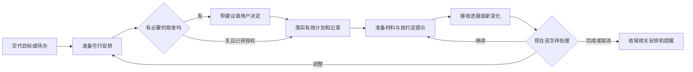

# 私人行动助理｜产品需求文档

> 版本：0.1｜日期：2026-11-01｜范围：单人、QQ、个人自用MVP
>
> 本文定义用户价值、使用过程、产品规则和验收要求，不代表这些能力已经全部实现。依据是项目发起人的需求、对话中提供的使用反馈及现有设计资料；尚未完成面向其他用户的需求验证。
>
> 阅读关系：本文回答“为谁做、解决什么、做到什么程度”；[ARCHITECTURE.md](ARCHITECTURE.md)是现有工程实施基准；[架构研究](ARCHITECTURE-OVERVIEW.md)包含待验证的改造方案。产品要求若与工程合同冲突，应先明确修订，不能默认文档更新等于软件更新。

## 1. 产品定义

### 1.1 一句话说明

**一位通过QQ与你协作的个人行动助理：接住你决定要做的事，帮助安排和启动，在事情变化后继续跟进，让你少花精力管理自己的计划。**

“接住”不只是记下来。它意味着这件事有明确去向：已安排、等待条件、需要你决定、正在推进，或者已经结束。

“跟进”不只是定时问一句。它意味着利用已有进展，判断现在需要准备、调整、询问还是安静等待。

### 1.2 用户购买或使用的是什么价值

| 用户原本承担的负担 | 产品替用户承担的工作 | 用户能够感受到的变化 |
| --- | --- | --- |
| 不断记住自己交代过什么 | 保留承诺、进展与尚未解决的问题 | 过几天回来，事情还能接上 |
| 每天重新决定什么时候做什么 | 根据目标、可用时间与实际进展准备安排 | 到执行时主要考虑如何动手 |
| 计划一乱就重新整理整天 | 找出影响范围，调整获准移动的部分 | 一次延误不需要自己重排所有事项 |
| 面对任务不知道从哪里开始 | 找材料、接续上次位置、明确下一步 | 收到的是可开始的动作 |
| 反复教机器人自己的规则 | 保存并在适用情境运用，允许更正 | 不必每次从头解释自己的习惯 |

用户仍负责选择自己的目标、提供系统无法观察到的事实，以及完成必须亲自发生的行为。助理可以准备学习材料，不能代替用户学过；可以帮助做取舍，不能擅自决定人生方向。

### 1.3 成功体验与不作出的承诺

期望体验是：**“我把事情说清楚，她就知道接下来怎么帮我；有变化也不用从头再来。”**

我们希望这种支持有助于行动持续发生，但不承诺让所有人变得自律，不把没有完成归因为人格缺陷，也不把“机器人一直在运行”当成“用户已经形成习惯”。

## 2. 用户与问题

### 2.1 当前明确服务谁

第一位用户是项目发起人：同时有学习、锻炼、个人项目等事项，愿意用自然语言沟通，希望有外部力量帮助持续推进；已经使用日记与周期计划，又不愿额外维护复杂的管理系统。

潜在的相似用户是：知道自己想推进什么，但经常在启动、安排、变化后的接续上耗费精力的人。这是后续访谈需要验证的用户假设，不是已经证实的市场规模或共同需求。

当前不面向企业团队、专业项目经理、多成员协同或需要医疗干预的人群设计专门服务。

### 2.2 用户在什么情境下需要它

| 情境 | 用户真正需要完成的事 | 常见失败体验 |
| --- | --- | --- |
| 前一天晚上 | 把明天安排到能直接开始 | 助理让用户自己重新列完整计划 |
| 即将开始 | 知道下一步，准备好入口 | 只提醒“该学习了”，仍需自己找材料 |
| 临时变化 | 在现实条件下保住重要事情 | 机械顺延，撞上固定预约 |
| 不想继续或反复没推进 | 弄清是否需要换方法、调整或放弃 | 立刻取消，或重复劝坚持 |
| 多日后回来 | 不补课式地重新接续 | 翻旧账、补发提醒、要求补打卡 |
| 教过它一个做法 | 后续遇到同类情况不用再教 | 只说记住了，下一次仍犯原错 |

用户反馈中还出现过：只生成提案却宣称任务已建立、读取资料失败、反复发送固定承接话、答复过长、连续交代不能一起落实。这些是需求来源，不代表本次重新测试确认它们仍然全部存在。

### 2.3 为什么不能只做提醒工具

固定提醒能解决“忘了到点”，但不能独自解决“现在还适不适合做”“之前说过的变化有没有生效”“遇到阻碍下一步怎么办”。

本产品的价值假设是：把提醒放进一个持续理解和更新的协作过程，比孤立提醒更有用。如果实际使用仍需要用户自己维护计划、解释背景、追查是否办成，产品没有兑现这个假设。

## 3. 产品定位与取舍

### 3.1 三项核心价值

1. **事情接得住。** 一次交代可以有多件事，讨论与执行分得清，反馈能对应原事项。
2. **变化处理得了。** 已授权的调整主动完成；必须由用户决定的取舍，带着建议提出。
3. **长期接得上。** 跨天、跨会话、服务恢复后，仍能找到有效承诺、进展和个人规则。

自然沟通、可靠运行和数据可控，是三项价值成立的必要条件，不能作为与它们无关的装饰功能。

### 3.2 个性化必须带来行动差异

| 用户告诉助理的内容 | 产品应发生的变化 |
| --- | --- |
| “晚上八点和我准备明天的计划” | 新时间生效，旧时间不再重复触发 |
| “报告期间，不要打断我问进度” | 已知正在执行时，普通核对延后；固定承诺仍按约定处理 |
| “学习时间可以挪，会议不能挪” | 能自主调整的范围不同 |
| “今天例外，明天恢复” | 只影响今天，不变成长期偏好 |
| “以后不要按这个方法了” | 后续建议与未执行安排不再沿用旧方法 |

个性化包含目标、时间约束、授权和协作偏好。称呼与语气也可以调整，但不是其主要价值。不要求用户编写提示词、编辑配置文件或重启服务来完成日常个性化。

### 3.3 产品原则及其实际约束

| 原则 | 设计必须如何体现 |
| --- | --- |
| 低摩擦，用完即可离开 | 不强制每日表单、主观评分和完整汇报；简单交代直接处理 |
| 有立场，也尊重选择 | 围绕用户认可的目标提供帮助；明确取消必须尊重 |
| 习惯与任务分开 | 最低行为发生不等于成果完成，不偷换验收标准 |
| 主动承担，而非多问多发 | 先利用已有资料；能处理就处理，联系需带来实际帮助 |
| 真实可靠 | 只有实际办成才报告成功；不知道与没完成分开 |
| 用户拥有自己的记录 | 保留笔记正文，可查、可改、可导出；不把用户锁在聊天窗口 |

## 4. 使用流程

### 4.1 首次使用：从一件真实的事开始

部署和QQ账号连接属于使用前准备，不计入用户日常交互流程。首次聊天不做长篇问卷。

1. 用户交代一件要做的事。助理先看已有资料，提取结果、时间和下一步。
2. 缺少会影响执行的信息时再问。例如有明确时间安排，却不知道用户是否有空。
3. 用户明确要求且信息充分，就直接办理；双方还在讨论时，先整理方案，等待相应决定。
4. 需要主动联系时说明并确定联系条件。尚未确定时，不凭开发者默认给用户增加联系负担。
5. 保存并反馈实际结果。其余偏好在使用中逐渐形成，不要求第一次全部配置完。

首次价值成立的标志：用户完成一次真实交代，能看到正确保存，并在约定条件到来时得到有效支持。

### 4.2 日常协作：计划、行动、反馈与接续

这个过程可以跨多天，不要求用户每一步都回复。没有新事实时保留未知，不自动记录失败。

### 4.3 前一晚：准备第二天，而不是把决策重新推给用户

在用户约定的时点，助理检查当天已知进展、未完成承诺、明天固定事项和可用时间，准备一个可执行的建议。

创建次日日记时，通过现有模板及周期引用定位年、季、月、周；缺失层级按模板补齐，但空白目标保持空白。已有日记正文保留，不为了生成计划而重建文件。

计划至少明确：做什么、何时开始、预计何时结束、第一步、做到什么程度；存在硬截止时单独保留。已接受的任务按规则安排，新建议保持待定。

沟通应聚焦变化，例如“单词继续，语法昨天卡在从句。明天先用半小时把那两道题弄清楚，合适吗？”这是交互示意，不是强制回复脚本，也不是不经用户授权新增任务的依据。

用户没有回应时，不把整份提案自动批准。已获授权的有效安排继续，待定部分保留。

### 4.4 当天：根据事实提供帮助

| 时点 | 助理应该做什么 | 用户不应承担什么 |
| --- | --- | --- |
| 开始前 | 找到相关材料、上次位置和下一步 | 再解释一次整个目标 |
| 执行中 | 接收进展，保护执行时间，必要时提供支持 | 为证明在做事而反复回复 |
| 出现变化 | 检查受影响部分，在授权范围内调整 | 手动重排整天、逐条撤销旧提醒 |
| 完成后 | 按原标准记录、同步日记、结束相关跟进 | 在多个地方重复打卡 |
| 暂时离开 | 保留责任与未知状态，按联系规则处理 | 回来先补齐所有漏报记录 |

### 4.5 周期结束与长期回来

周、月、季、年边界需要关注不同尺度的取舍：哪些承诺继续，哪些方向改变，现实容量是否足够。多个周期同时结束时，合并沟通，避免发送多份重复总结。

回看服务下一步安排，不重复抄写子层记录。用户离开一段时间后，先检查当前仍有效的目标、期限和规则，从现在能做的部分接续；不补发过去积压的普通提醒。

## 5. MVP功能需求

### 5.1 范围与优先级

**P0是本次私人QQ助理必须闭环的范围。**下面是一组互相衔接的能力，不是要求同时新增七套独立系统。实现可复用，验收需完整。

| 编号 | P0能力 | 输入与产品行为 | 用户可观察的通过条件 |
| --- | --- | --- | --- |
| F01 | 自然承接与查询 | 处理连发、引用、更正、多事项及资料查询 | 用户说“刚才四项都确定，第二项改下午”，四项均有正确去向，不重复确认已明确部分 |
| F02 | 任务与习惯 | 区分成果、最低行为、开始、进展、完成、跳过、暂停和取消 | “开始了”不变成完成；习惯按约定最低行为记录，任务保留成果要求 |
| F03 | 可行计划与日记联动 | 根据时间、依赖、固定事项与周期目标组织计划，按模板生成记录 | 排不下时指出缺口；更改执行时间不偷改截止；已有正文不被覆盖 |
| F04 | 主动准备与跟进 | 查材料、准备下一步、检查条件和风险，按约定联系 | 知道近期进展就不重复问；条件解除能继续；自己答应查的事后来有结果或具体阻碍 |
| F05 | 变化处理与收尾 | 局部重排、处理受阻、必要取舍、完成或取消后的关闭 | 无关安排保留；旧提醒失效；完成事项不会明天又被排进去 |
| F06 | 个人规则与长期接续 | QQ内设置、查询、修改、撤销规则，运用相关经历 | 换会话、重启、过一个月后仍能用有效规则，临时例外不会永久化 |
| F07 | 协作反馈与数据可控 | 简短自然表达、必要进展通知、查询办理状态、记录更正与导出 | 等待有去向，失败不冒充成功；用户能查到真实记录并纠正 |

每项当前状态均须按实际验收标注，不能因存在相关代码而标记完成。具体测试与工程落点归入架构文档，不在此复制测试清单。

### 5.2 通用规则：哪些直接做，哪些询问

| 情形 | 产品行为 |
| --- | --- |
| 明确交代、信息充分、属于已允许操作 | 直接办理，反馈实际结果 |
| 还在探讨“要不要做” | 帮助判断，不新增执行承诺 |
| 一批方案讨论完，用户明确统一接受 | 一次落实整批，不拆成多轮确认 |
| “好”无法判断对应哪件事 | 只澄清对象，不要求重讲全部内容 |
| 调整已接受任务，仍在既定授权与时间边界内 | 主动调整，并说明有意义的变化 |
| 修改成果、硬截止、固定承诺或超出授权 | 给出建议及影响，请用户决定 |
| 用户明确撤销或暂停 | 按范围生效，不设置劝说门槛 |
| 用户只说“不想做” | 查看背景，理解是表达感受、寻求帮助还是改计划；不能自动取消或降低要求 |

问题的数量取决于是否影响决定，不规定永远只问一句。重要事项存在关键未知时可以继续问，但每个问题都应有明确用途。

### 5.3 常见异常必须怎样处理

| 发生什么 | 必须保留的事实 | 下一步 |
| --- | --- | --- |
| 用户没回复 | 状态未知 | 按其联系规则处理；继续独立可做的工作 |
| 用户很晚才反馈 | 实际行为时间与回复时间不同 | 归到原事项及正确日期；只在必要时补问 |
| 工作超时或晚开始 | 剩余工作与现实时间 | 调整依赖及冲突事项；保护固定承诺和必要休息 |
| 多次没有推进 | 已知事实，不推断人格或动机 | 检查难度、条件、方法与目标；提出具体改法 |
| 缺资料或等别人 | 等待对象、条件与检查时机 | 先推进独立部分，条件满足再接续 |
| 两件事不能同时完成 | 具体时间或资源缺口 | 比较代价，推荐取舍，由用户决定必要部分 |
| 用户中途改口 | 最新明确决定与已经发生的效果 | 停止受影响的未执行动作；不能假装已发生效果消失 |
| 一部分办成、一部分失败 | 各项真实结果 | 只接续未完成部分，不整体报成功 |
| 消息未能确认送达 | 投递未知 | 核对结果，不盲目重发；用户询问时解释现状 |
| 记录与聊天反馈冲突 | 两份来源与发生时间 | 先检查，不能悄悄覆盖正文或编造一致 |
| 长时间离开后回来 | 当前仍有效的承诺 | 从现在接续，不惩罚、不补催 |

### 5.4 沟通要求

回复以当前交流目的为准。简单问题直接回答；确实需要等待时，必要的承接说明在查什么。没有实际进展时，不反复发送“正在办理”。

用户可以连续发多条，也可以中途补充。助理应综合相关消息，允许按完整意思分次表达，并在发出后续内容前吸收新的决定。不得用随机拆句或假装打字来模拟人。

日常反馈通常简短，完整计划、查询清单和解释可以长一些。用户要的是容易理解和有用，不是固定字数。避免技术字段、术语堆叠、自我表态和没有用途的“要不要我再帮你”。

## 6. 明确不做与保留边界

### 6.1 本轮不扩展的产品范围

- 不开发Web、桌面端、付费、营销或团队协作功能。
- 不让用户维护任务编号、机器字段、审批面板或多份同步状态。
- 不将Decisions和Manual强制改造成复杂模板；只在授权时查询和使用相关内容。
- 不自动给所有日记复选框建立提醒或习惯承诺。
- 不引入默认连续打卡惩罚、每日主观评分、无限催促或未经接受的生活目标。
- 不开放向第三方发消息、购物、对外承诺等新权限。

番茄钟、固定间隔回顾等可以作为已明确接受的重复安排服务，不扩展成一套新的专注管理产品。它们不得绕开统一的联系规则、暂停和取消。

### 6.2 用户可控的底线

用户能随时问：你记住了什么、还有什么在进行、什么时候会联系我、为什么这样安排；也能改、停、撤销和导出。

记录保持个人所有，AI使用范围明确。内部可以使用获准资料，但不能因笔记里出现指令而扩大权限。没有获得外部联系授权，不替用户向别人发消息。

## 7. 一段完整的目标体验

> 以下是虚构的验收剧情，用于说明期望效果，不是实测聊天记录；示例时间均由该用户接受，不是默认提醒设置。

### 7.1 前一晚

小明说：“明天背单词，继续今天的语法。上午十点到十一点有空。”

助理找到当天记录，发现语法停在从句练习。它据此准备安排；若剩余工作量无法确定，就提出试做时段或问必要信息，不承诺一小时必定完成。小明接受后，助理按模板准备次日日记，保存有效计划与已约定提醒。

### 7.2 临时变化

第二天，小明连发：“上午有事。”“下午两点有一小时。”“语法先放放。”

助理把这几句话作为一次相关调整，确认下午没有冲突，按已有授权移动单词安排。若“语法先放放”的范围会影响后续安排，就只澄清是今天跳过还是长期暂停。上午旧提醒失效，无关任务保持。

### 7.3 执行与反馈

下午开始前，助理提供词表和上次位置。小明说：“今天不太想学。”

助理不马上撤销，也不机械要求背二十分钟。它先看已有情况；不清楚时自然地询问，例如“今天是太累了，还是这份词表不想继续了？”这个例句只是可能的问法，真实问题应由情境决定。

若小明选择只做一个小步骤，助理如实记录这个决定和实际行为，不把未达到的原成果写成完成。若小明明确取消当天安排，就停止相应跟进。

### 7.4 下一次接续

晚上，助理根据真实进展准备下一天，而不是复制原计划。几天后小明回来，能直接从现有进度继续。用户无需为助理的遗忘、错记和重复提醒再做一份管理工作。

## 8. 验收与产品判断

### 8.1 三个层次分别判断

| 层次 | 要回答的问题 | 证据 |
| --- | --- | --- |
| 软件是否可靠 | 有没有漏办、重复执行、错改、虚假成功 | 隔离场景中的文件、实际状态、操作与投递记录 |
| 协作是否有用 | 是否减少重复交代、无效询问和手工补救 | 真实模型交互、用户使用记录及具体反馈 |
| 行为是否更稳定 | 用户认可的行为是否持续发生 | 用户已提供的行为事实；未知不补成失败或成功 |

前一层通过不能替代后一层。产品不会因为部署成功或所有程序测试通过，就自动达到用户期望。

### 8.2 MVP交付门槛

1. 第7章完整剧情及第5.3节异常，在隔离环境可重复验证；关键场景出现越权、正文丢失、虚假成功或重复业务副作用即不通过。
2. 真实模型能够处理多事项、连续输入、改口和上下文指代，检查最终记录和动作，不只看回复文案。
3. 完成一次经用户接受的真实QQ闭环：交代、保存、约定支持、反馈、更正和收尾。
4. 从连续一周自用开始观察负担与可靠性，继续积累长期证据。一个月、九十天的模拟时间测试与真实运行分别报告。
5. 有能力边界和故障状态的准确说明，不能把尚未验证的功能宣传为已稳定交付。

一周只是首轮观察窗口，不是证明已经养成习惯的期限。测试中的零失败也不保证所有未来情境。

### 8.3 最少但有用的衡量方式

| 指标 | 统计口径 | 用途 |
| --- | --- | --- |
| 接纳完整性 | 已明确接受的事项中，正确保存且有去向的数量/总数 | 检查漏项与承接质量 |
| 到期责任兑现 | 约定条件已满足且应到期的助理责任中，按约办成的数量/总数 | 检查是否真的持续办事；等待用户、外部受阻单列 |
| 协作返工 | 每百次有效交代中，因系统误解、遗忘或错办导致的重复解释与手工补救次数 | 判断有没有减少管理负担 |
| 联系质量 | 主动联系中，重复询问已知事实、过时或不符合规则的数量/总数 | 检查打扰是否有价值 |
| 规则运用 | 适用场景中正确运用有效规则的比例，同时记录不适用时错误套用 | 检查个性化是否有效 |

先建立基线，再判断改版是否改善；不预填漂亮成功率。对自然度通过完整对话评审，说明哪句话为什么不合适，不仅打一个主观总分。无需让用户每天填写评分问卷。

### 8.4 当前仍需验证的产品假设

| 假设 | 如何验证 | 如果不成立 |
| --- | --- | --- |
| 持续接续比单纯提醒更有价值 | 同类真实事项观察接续次数、返工和负担 | 收缩不必要的主动行为 |
| 深度个性化值得维护 | 比较有无相关个人条件时的实际安排与重复解释 | 简化记录，去掉无决策价值的画像 |
| QQ足以承载当前协作 | 观察任务查询、方案比较和更正是否难用 | 先改善聊天呈现，再决定是否真需新界面 |
| 温和且有立场的推进能被接受 | 观察不想做、反复未推进、明确取消的真实交互 | 调整授权和沟通方式，不能用更强催促补救 |

## 9. 后续工作的顺序

先用本PRD确认产品边界，再把P0要求映射到现有架构合同与代码证据，找出真实差距；按完整用户场景做最小改造，再做真实QQ自用验证。

每次新增机制都回答三个问题：它帮助用户少做哪件事？它在什么场景改变结果？怎样知道它没有增加新的负担？回答不清楚，就不因为技术上能做而加入MVP。

产品最终交付的不是一张更复杂的功能表，而是：用户交代以后，能够放心把注意力放回自己的生活与工作；回来时，事情仍有连续、真实、可调整的进展。
