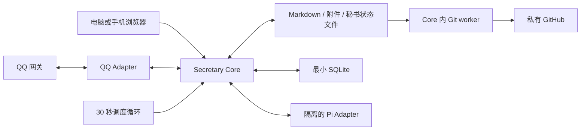

# 私人秘书系统开发规格 v1.0

基线日期：2026-10-23。面向一个用户、一台持续在线的服务器、一套私人笔记。

本文是开发、测试和交付的唯一主规格。`.agent/contracts/`提供分主题入口，`config.json`保存本文确定的默认参数。发生冲突时，用户后续明确要求优先，其次是本文，再次是其他说明；实施者不得自行回退到早期的 Hermes 候选、文件日志替代 SQLite、三端 Git 同步等旧方案。

本文确定设计，不代表服务已经实现或部署。本轮不创建真实习惯、任务、数据库、QQ 连接或 GitHub 推送。

阅读入口：[产品与范围](#1-目的和产品原则) · [数据与目录](#3-目录真源和持久数据) · [调度](#6-调度和投递规则) · [Web](#7-web日记目录和兼容) · [SQLite](#9-最小-sqlite-和清理) · [接口](#12-http-api-与事件) · [部署](#14-权限登录和部署) · [验收](#17-验收清单)。

## 1. 目的和产品原则

### 1.1 要达到的效果

用户可以用自然语言交代事情，由秘书承接任务设计、安排、提醒、反馈记录和必要调整；也可以直接在 Web 写日记。两种入口接入同一套事实，用完即可离开，不需要再维护第三份待办表。

一次完整闭环：交代事情 → 明确最小行为或交付条件 → 安排可执行时间 → 到时经 QQ 提示 → 接受自然反馈或 Web 勾选 → 保存事实并取消失效提醒 → 下一次按有效安排继续。

### 1.2 不可突破的原则

- 极简、低摩擦，不追求停留时长、回复数、看板复杂度或打卡连胜。
- 习惯看约定行为是否发生；任务看成果是否达到验收条件。二者可以关联，不能互相冒充完成。
- 帮助长期、平静地行动；不要求每日主观打分、不制造欠账、不羞辱、不升级催促压力。
- 日常身份是私人秘书。默认不主动问动机、情绪、需求，不开展心理咨询式访谈；关键歧义至多问一个具体问题，未回复不追问。
- AI 有独立资料体系；用户日记保留写作空间。只关联必要事实，不自动分析整本日记。
- 技术复杂度由系统承担。不要把消息 ID、同步步骤、后台字段、维护说明塞入用户模板。

### 1.3 已确定的技术决策

| 项目 | v1 决定 |
| --- | --- |
| 客户端 | 响应式 Web，电脑和手机共用；不开发桌面、移动原生客户端 |
| 在线工作副本 | 服务器上唯一的笔记工作树；QQ 和 Web 都经 Core 操作 |
| 远端 | 私有 GitHub 数据仓库，用于自动备份和版本历史 |
| Agent | Pi；只负责理解、提案、文案，不拥有执行权限 |
| 业务核心 | 自建轻量 Secretary Core，单实例、单写入队列 |
| 调度 | Core 内部确定性定时循环；不由模型、Pi cron 或 QQ 框架决定 |
| 正文 | 原生 Markdown 和 Attachment 文件；SQLite 不保存正文副本 |
| 长期秘书记录 | `.agent/state/`中少量结构化文件；用户无需手动维护 |
| 运行存储 | 必须启用最小 SQLite，只解决去重、投递、恢复及文档版本索引 |
| QQ | Channel Adapter；v1 默认 OneBot v11 正向 WebSocket，单账号私聊 |
| 清理 | SQLite 短期记录自动清理；长期业务事实与用户正文不随之删除 |

### 1.4 第一版范围

必须实现：Markdown 编辑、年季月周日导航和父级重点引用、热力图主页、习惯和任务、简单时间安排、Pi 接入、QQ 主动提示与回复处理、最小 SQLite、自动 Git 备份、登录与权限控制、运行状态和恢复。

暂不实现：多人协作、离线完整客户端、完整 Obsidian 插件运行环境、任意代码执行、自动人格画像、全库向量化、复杂项目管理、自动财务管理、群聊秘书、复杂重复配额、自动研究或批量改写 Decisions/Manual。

## 2. 技术架构和工程边界

### 2.1 运行关系



| 模块 | 输入 | 输出 | 权限 |
| --- | --- | --- | --- |
| Web | 用户编辑、勾选、交代 | 保存请求、命令 | 只能调用已登录 API |
| Core | 认证后的输入、时钟、Pi 提案 | 业务变更、文件保存、待发消息 | 唯一写入业务文件与 SQLite |
| Scheduler | 当前时间和有效事项 | 到期候选 | 只能提交 Core 内部操作 |
| Pi Adapter | 经过筛选的上下文 | 结构化提案、短文案 | 不能直接访问笔记、数据库、QQ、Git |
| QQ Adapter | 网关事件／待发消息 | 标准输入／投递结果 | 仅指定机器人和指定用户 |
| Git worker | 已稳定保存的允许路径 | commit、push、备份状态 | 不能调用模型或决定业务状态 |

调度、QQ 适配、清理、Git worker 是 Core 内模块，不拆成四个微服务。单用户首版不引入 Redis、独立队列服务器、PostgreSQL、搜索服务或 ORM。

### 2.2 开发栈

| 层 | 决定 |
| --- | --- |
| 服务语言 | TypeScript，strict 模式；Node.js 24 LTS |
| HTTP | Fastify；请求和响应使用 JSON Schema 校验 |
| Web | React + Vite + CodeMirror 6，原生 CSS 和统一设计变量 |
| Markdown | markdown-it；关闭任意 HTML 与脚本执行；库内链接自定义解析 |
| 数据库 | SQLite + better-sqlite3，显式 SQL 和小型迁移，不引入 ORM |
| 日期 | 统一日期模块 + Luxon；业务时区默认 Asia/Shanghai |
| Agent 集成 | 独立进程中的 Pi SDK；Core 经内部 JSON HTTP 调用适配器 |
| QQ | OneBot v11 WebSocket 客户端；仅文本和回复引用 |
| 部署 | Linux + Docker Compose；Caddy 提供 HTTPS；持久卷存放笔记 |
| 测试 | Vitest（业务和集成）、Playwright（Web 关键流程） |

开发初始化时锁定通过兼容性验证的依赖补丁版本及镜像摘要，提交 lockfile；生产不跟随 `latest`。Pi 当前官方项目和包名已发生迁移，使用核验过的官方 `@earendil-works/pi-coding-agent`，不凭早期示例继续安装旧包名。Pi SDK 的会话、资源和工具必须显式配置，不使用默认自动发现。[Pi SDK](https://github.com/earendil-works/pi/blob/main/packages/coding-agent/docs/sdk.md)

选择 Node 24 作为本基线的 LTS 运行时；部署时更新同主版本安全补丁。[Node 官方发布表](https://nodejs.org/en/about/previous-releases)

## 3. 目录、真源和持久数据

### 3.1 两套文件体系

```text
笔记根目录/
  MOC.md                         Obsidian 主页内容入口；Web 有等价原生主页
  README.md                      用户目录说明
  总体目标.md                    单列的长期目标
  长期待办任务.md                 既有资料；不自动激活为后台任务
  01. Daily/                     年、季、月、周、日
  02. Decisions/                 用户自己的问题研究
  03. Manual/                    用户自己的技能和方法
  Attachment/                    图片和附件
  Template/                      简洁的日记及周期模板
  .agent/
    SPEC.md                      本规格
    README.md                    开发入口
    config.json                  非秘密配置
    secrets.example.env          只有变量名
    prompts/                     身份、性格、交互规则
    context/user.md              已确认偏好及来源
    context/current.md           可重建的短摘要
    contracts/                   分主题索引和 SQL 结构
    state/registry.json          习惯、任务、安排、暂停、绑定和待确认提案
    state/days/YYYY-MM-DD.json   当天发生事实和更正记录；有事实才创建
    data/state.sqlite            去重、发送、短期恢复与文档索引
    data/trash/                  Web 删除的短期恢复区；自动清理、不可见
    data/                        临时文件、运行日志；不进 Git
```

`state/`、数据库和服务代码目录不出现在普通 Web 笔记树、热力图或用户搜索中。`.agent/`不是第二套日记模板。模板说明只出现在 README 或帮助中，不写进每次新建的日记正文。

### 3.2 每类数据的唯一归属

| 内容 | 唯一真源 | 是否进生产私有 Git 备份 |
| --- | --- | --- |
| 日记、周期计划、Decisions、Manual、总体目标 | 原 `.md` 文件 | 是 |
| 附件 | `Attachment/` 文件 | 是，遵守单文件上传限制 |
| 已确认偏好、角色和规则 | `context/user.md`、`prompts/`、`config.json` | 是；仅生产私有仓库 |
| 已接受的习惯／任务、当前进展、时间块、绑定和暂停 | `state/registry.json` | 是 |
| 未创建日记时也要保留的习惯反馈和更正 | `state/days/` | 是 |
| 日记复选框与事项的对应关系 | registry 中的绑定；日记行是可编辑展示 | 是 |
| 已处理消息 ID、发送状态、待处理输入、短期恢复操作 | SQLite | 否，按期限清理 |
| 文件 hash、版本和搜索内存索引 | 可从文件重建的索引 | SQLite 索引不备份 |
| 浏览器未提交草稿 | 当前浏览器 IndexedDB | 否，保存成功后删除 |
| 密钥 | 仓库之外的 secret 文件／容器 secret | 永不进入 |

长期记录必须能脱离 Pi 会话和 SQLite 短期事件存在。例如“今天读过一句”已写入当天状态文件，即使没开日记、90 天后事件被清理，也不能丢掉。

这是小量业务事实与展示的关联，不把日记正文存两遍。registry 中只保存任务交付条件、当前进展、安排等秘书必需字段；不会复制整份年计划、日记、文章或方法笔记。

### 3.3 业务文件格式

统一 UTF-8 JSON，带 `schema_version`、`revision`、`last_operation_id`、`updated_at`。所有时间点为 RFC 3339 UTC，业务日期为配置时区的 `YYYY-MM-DD`。ID 为带类型前缀的 UUID，重命名不改 ID。

`registry.json`顶层固定为：

```json
{
  "schema_version": 1,
  "revision": 0,
  "last_operation_id": null,
  "updated_at": null,
  "habits": [],
  "tasks": [],
  "plans": [],
  "controls": [],
  "diary_links": [],
  "proposals": []
}
```

每日文件包含 `business_date`、`occurrences`、`corrections`及相同版本字段。每个机会保存 `id`、`habit_id`、`slot_key`、`definition_version`、`min_behavior_snapshot`、`status`、可空 `quantity`、可空 `optional_target_met`、`source`、`reported_at`、`operation_id`。更正保存旧状态、新状态、来源和时间，不保存整段聊天。

结构化文件由 Core 管理；普通 Web 不直接编辑这些 JSON。需要调整时通过界面或自然交代。首版不为每个实体再建一张 SQL 表，也不开发第二种 JSONL 存储后端。

每个业务对象独立带 `version/created_at/updated_at/last_operation_id`。`approval`固定为 `{input_id,channel,external_id,accepted_at,summary}`，summary 只保存这项承诺的简短依据；不能只存一个将来会被清理的 SQL 外键。`note_refs`固定为 `{path,heading,relation}`数组，relation 为 motivation/plan/method/evidence，不含笔记全文。

数量统一为 `{value,unit}`或 null；计数不得混单位。task 的每条 acceptance 为 `{id,kind,description,target,unit,verification,artifact_ref}`，非适用字段为 null；progress 的 criteria 以条件 ID 为键，包含 `{reported_value,unit,status,source_refs}`，状态为 pending/met/unmet。当前结论的来源引用包含 input ID、渠道、时间和可选笔记路径，不依赖永久保留事件正文。

`controls`为 `{id,scope,target_id,starts_at,ends_at,reason_source}`，scope 为 global/item，结束时间必填；没有理由时不补猜测。`diary_links`结构见第 7.4 节，`proposals`见第 4.4 节，`plans`见第 4.3 节。空数组合法，空白模板不预填任何正式对象。

## 4. 领域规则

### 4.1 习惯

定义字段：`id/version/title/min_behavior/optional_target/recurrence/anchor/status/approval/note_refs`。

- `min_behavior`必须是可观察的最小动作，例如“读一句英语”；“认真学习”不足以激活。
- `optional_target`可空；未达到进阶目标不撤销最低行为已经发生的事实。
- `recurrence`首版仅按星期重复，含开始日、可空结束日；每天即星期一至七。
- `anchor`为已确认的时间窗口，或真实用户事件。晚饭后不能被时钟擅自解释为已吃完饭；没有事件来源时保留草案，或使用用户接受的固定窗口。
- 状态为 `draft/active/paused/retired`。激活必须回指用户交代或已接受的具体提案；模板默认行不等于订阅提醒。
- 一次机会由 `habit_id + business_date + slot_key`唯一确定；首版每个习惯每天一个 `default`机会。

| 机会状态 | 意义 |
| --- | --- |
| unreported | 没有确认；空框、沉默和超时都属于这一类 |
| did | 约定行为发生过；数量没说就保持空 |
| did_not | 用户明确说该次没做 |
| skipped | 用户明确跳过本次，不产生债务 |

“读了一句，没读完一章”记 did；“打开软件”只有在最低行为本来就如此约定时才算。不能事后为了好看降低历史门槛。调整定义只影响未来机会，历史保留当时门槛。

### 4.2 任务

定义字段：`id/version/title/outcome/acceptance/due_at/verification/progress/status/parent_task_id/approval/done_at/note_refs`。

状态：`draft/ready/in_progress/blocked/done/cancelled`；逾期由时间与状态推导，不另设自动取消状态。

- 激活前至少有一项可判断的成果条件；没有期限时 `due_at=null`，不强制追问。
- 条件支持 `check/count/artifact`，有稳定条件 ID；数量条件含单位、目标和 `gte`比较。
- 默认自报验收。明确说“全部完成”且无矛盾时可以接受，不额外索要截图。
- 用户主动约定工具验收时，只有已注册的可用检查器能确认；工具缺失则待验证，不允许任意 shell。
- “做了两题”只更新进展。“完成五题并订正”须同时满足数量与订正条件才能 done。
- 数量反馈区分累计与新增；不明确时保留最小报告，不擅自相加。重复输入不能累计两次。
- 移动工作时间不改变成果、验收条件或硬期限。修改这些承诺需要用户对具体改动的接受。
- 子任务完成不自动完成父任务；父任务仍按自身条件验收。重开保留更正记录。

### 4.3 关联、安排和容量

任务可在 `supporting_habit_ids`关联习惯；关联只表示支持关系。同一行为能同时记习惯发生和任务进展，但必须有明确映射与同一来源，不能凭名称猜测。

时间块 `Plan`包含：`id/version/target_ref/kind/window_start/window_end/duration_minutes/next_action/status/approval`。`target_ref`只指一个任务或一次习惯机会；`kind=fixed|window`，`status=planned|active|finished|expired|cancelled`。

- 固定预约未经接受不能移动；灵活工作块可在已知可用时间内自动重排。
- 未知作息不当作全天空闲；不知道时长不自动塞满日程。信息不足先给草案，只处理一个关键缺口。
- 已知固定安排占用容量；新块不能重叠，也不能超过已知空闲时间。首版使用按截止先后、时间窗口和时长的贪心排程，无需优化求解器。
- 无法放入时保留未安排并简短说明；不能通过降低验收或改期限伪装成功。
- 周月季年目标是规划依据；不会未经接受就批量变成任务或日程。
- “今天不提醒”写入本地当天结束前的联系暂停，不取消任务；范围不清时默认暂停当天全部主动联系并告知一次。

### 4.4 偏好、提案与工作记忆

`context/user.md`只保留用户明确表达的稳定偏好及来源。有限观察不能升级为人格判断；推测只用于当前推理，不成为新权限。`current.md`是有来源和更新时间的短摘要，可从有效业务文件重建，不是任务台账。

新建议保留为 `Proposal`：含 `id/version/summary/actions/created_at/expires_at/status/source`；默认 24 小时有效。用户的“好”只接受最近一份唯一、未过期、仍基于当前版本的提案；有多个对象时只澄清一次。过期后不执行、不追问。

## 5. 秘书交互与角色

完整角色提示词见 `prompts/`。开发必须同时保留以下外部行为：

| 情境 | 处理与表达 |
| --- | --- |
| 习惯提醒 | 一个眼下可做的最小动作，必要时给已有材料链接 |
| 只完成最小行为 | 简短记下，不要求完成进阶目标 |
| 任务未达验收 | 如实记进展和剩余一步，不宣称完成 |
| 用户暂停 | 立即承接，不追问疲惫原因，不评价自律 |
| 未反馈 | 保持 unreported；按规则结束联系，不发解释问卷 |
| 对象不明确 | 只问“你指英语还是报告？”这一类具体问题 |
| 用户发起决策讨论 | 可以展开分析并设计行动；结果作为提案，不自动激活 |

默认一至两句、约 90 个汉字；复杂讨论可展开。参照卡耐基的尊重、倾听、真诚认可，以及非暴力沟通的事实描述、具体请求和允许拒绝；不机械套“观察—感受—需要—请求”四段，也不以拟人情绪施压。

系统成功后才能说“已记录／已调整／已同步”。已记录反馈但日记尚未写成功时，只说明实际成功的部分。用户可以不回复普通提醒，不要求确认收到。

精力管理首版落实为已知可用时间、工作块容量、静默、暂停和低门槛动作，不增加精力评分或主动情绪调查。

## 6. 调度和投递规则

### 6.1 确定参数

| 参数 | 默认值 |
| --- | --- |
| 时区 | Asia/Shanghai |
| 调度间隔 | 30 秒；启动时先恢复，再开始 tick |
| 静默 | 23:00 至次日 08:00；工程默认，不声称是用户作息 |
| 主动消息总量 | 每个本地自然日最多 4 条 |
| 主动消息间隔 | 至少 60 分钟 |
| 每个工作块 | 最多初次一次、跟进一次；改版本不重置次数 |
| 跟进间隔 | 距实际初发至少 90 分钟，且仍在有效窗口 |
| 习惯跟进条件 | 最近 24 小时有用户互动，且本次仍未反馈 |
| 明确发送失败重试 | 最多 2 次，退避 30 秒、120 秒；仍须在有效窗口 |
| 发送请求超时 | 15 秒；无法确认投递结果时记 unknown |
| 重启补发 | 禁止过时补发；不重放积压消息 |

必要的用户交代回执和澄清不占主动额度；不能用“回执”名义夹带额外催促。用户直接要求某时提醒，仍应检查静默冲突，在承接时说明或提出静默前时间，不默默绕过静默。

### 6.2 每次 tick

1. 读最新 registry 与当天事实，生成未来 24 小时的有效候选；机会和发送键确定且可重复计算。
2. 排除未接受、完成、跳过、取消、暂停及过期事项。
3. 对照已知可用窗口、静默、每日预算、最小间隔、单块次数和来源版本。
4. 优先选最迫近且仍可行动的硬期限任务，再选约定时间的习惯；同一时刻最多组织一条简短消息。
5. 在 SQLite 事务中唯一插入或领取 outbox；发送前再读最新业务状态。
6. 明确送达记 sent；明确未发出记 failed 并在规则内重试；结果不明记 unknown，停止盲目重发。

一个 outbox 可关联多个事项，但共用一个提醒机会、一次预算和同一份投递文案。初次或跟进键使用 `plan_id + reminder_kind`，不包含版本号，防止重排后重置提醒额度；待发送行可以在未派送时更新预期版本和时间。

租约默认 60 秒；发送前写 `attempt_started_at`及本地预算日期。sending/sent/unknown 计入预算，明确未发出才释放；跨午夜重试按实际尝试日期预留。领取和预算检查在同一事务中完成。每次尝试只存少量时间和结果元数据。

### 6.3 确认不明、失联和重启

渠道明确失败才自动重试。消息可能已送达、网关不提供可核实查询时，宁可少提醒一次，不重复轰炸；不承诺端到端严格一次投递。

Core 重启先处理未完成操作；超时 sending 转 unknown，不当作从没发过。过期候选改 expired/cancelled；当前仍有用但已错过初发时间的候选，只有仍在原窗口、来源版本有效且未发过才可继续评估，不能一次补发多条。

习惯明确 did/did_not/skipped 后取消本次后续联系。两次无回复结束该机会的联系。任务逾期后保留事实，不生成每小时循环；若没有新的有效工作块，不自动天天重复催。用户再次交互时可说明真实期限并提出下一步。

## 7. Web、日记目录和兼容

### 7.1 页面和基本操作

| 页面 | 内容与操作 |
| --- | --- |
| `/` | 热力图、今天入口、当前计划入口、Daily/Decisions/Manual 三个同排入口、最近笔记 |
| `/notes?path=...` | 文件树、CodeMirror 编辑、可切换预览、保存状态、笔记历史 |
| `/today` | 定位今天；不存在则显示“新建今天”，用户点击才创建 |
| `/items` | 当前习惯与任务、下一安排、简单修改/暂停；无评分和连胜 |
| 搜索弹层 | 标题和正文关键词；结果不自动送给模型 |
| 助理面板 | 用户主动打开的简短交代入口；不占据编辑区、不常驻刷屏 |
| `/settings/status` | QQ、模型、调度、Git、清理的状态和异常；正常时不打扰 |

视觉采用苹果产品方向：清楚层级、留白、系统字体、柔和分隔和少量强调色。Daily 可用青绿、Decisions 蓝色、Manual 紫色；目录图标不统一红色。桌面三个入口同排，窄屏按宽度自然换行，不能出现首格空缺或卡片错位。

桌面侧栏可折叠，移动端用抽屉；不固定三栏挤压正文。主要操作只有打开、写入、完成、暂停和搜索。保存成功显示小型状态，不弹每次保存通知。

编辑支持标题、段落、列表、复选框、引用、代码块、标准链接、库内 wikilink、附件和撤销。默认源文编辑加可切换预览，不要求首版实现富文本所见即所得。支持新建、单文件重命名与删除；删除进入不可见恢复区 7 天，随后自动清理，期间可从历史恢复，不给用户增加待归档目录。

附件统一放 Attachment，不按日记另建多级附件树；上传默认单文件 20 MiB、扩展名和实际类型校验、随机前缀防重名。HTML/SVG 等主动内容按下载处理，不作为可信页面执行。内部路径均经 Core 解析，不返回裸文件系统链接。

搜索首版直接扫描授权 Markdown，结果分页，不建全文正文数据库。服务内可缓存目录、标题和少量索引；重启后重建即可。普通搜索不包含 `.agent/`、隐藏目录或密钥。

### 7.2 年季月周日路径

基础目录沿用现有仓库，季度固定为自然季度：1—3、4—6、7—9、10—12 月。总体目标单列。

```text
总体目标.md
01. Daily/
  2026年/
    年度计划.md
    第4季度/
      季度计划.md
      10月/
        月度计划.md
        2026-W43/
          周计划.md
          2026-10-23.md
```

日期路径按当天自然年、自然季度、自然月归属；ISO 周号仅作周目录键。跨年周必须在不同自然年分别建周计划，不把 1 月日记塞入上一年的目录。

周计划的锚点取 `max(ISO周一, 当年1月1日)`，结束取 `min(ISO周日, 当年12月31日)`；周计划放锚点所属的年/季/月。跨月但不跨年的一周共用一份周计划；日记仍放各自自然月，父周链接可指前一个月。月计划列出与本月相交的周计划链接，按路径去重。

| 日期 | 日记位置 | 对应周计划 |
| --- | --- | --- |
| 2026-12-31 | `01. Daily/2026年/第4季度/12月/2026-W53/2026-12-31.md` | 同目录周计划，12-28 至 12-31 |
| 2027-01-01 | `01. Daily/2027年/第1季度/01月/2026-W53/2027-01-01.md` | 同目录周计划，01-01 至 01-03 |

这项跨年分段优先于当前 light-okr 按整周周一定位的旧实现。开发要提取统一 calendar 模块，同时用于 Web 和 Obsidian 兼容逻辑，避免两个端计算不同；本次规格整理不修改旧笔记或现有插件。

既有 `.obsidian/plugins/light-okr/legacy-notes.json`只作为旧路径映射读取。历史笔记保留原文，不迁移、不套模板；新路由先检查已存在的唯一对应笔记，再决定新建。跨年分段不能把新一年周计划映射回上一年文件；旧跨年笔记保留为历史参考，不自动拆写。

### 7.3 父子推进和模板

重点引用链固定为：总体目标 → 年度 `今年重点` → 季度 `本季重点` → 月度 `本月重点` → 周 `本周重点` → 日。

引用只展示父级对应标题区块，不复制成子级正文、不自动生成新承诺。未建父计划时显示缺失链接；用户明确新建日记或周期计划时可以连同必要父计划创建，必须使用空白模板，不能 AI 自动填写目标。

日模板保留 `习惯/任务/善意与美好/禅/改进/随笔`，不添加说明段落、后台字段或每日评分。周月季年沿用已有简洁重点和回看标题，不批量总结日记、不另加“本周日记”汇总清单。Decisions 和 Manual 仅保留用户自组织目录，不生成研究或技能模板。

服务器不能执行 Templater JavaScript 或 DataviewJS。现有五种模板使用受控渲染器：识别已知初始化段，替换允许的 `c.*`字段和链接；出现未知模板表达式则返回 `UNSUPPORTED_TEMPLATE`并保留源文件，不能使用 eval。新建文件不留下未展开的模板指令。

Web 原生实现热力图、最近日记和周期导航，不依赖 `app.plugins`。其他笔记中的动态脚本块保持原始文本；预览显示轻量占位，不执行。父级嵌入仅解析库内链接与标题，最多 3 层、有循环检测；不解析成子级待办。

### 7.4 AI 与日记的连接

只允许自动写 `# 习惯`、`# 任务`下的已绑定普通复选框，或用户接受并允许投影的新行。代码块、引用、父级嵌入、查询结果不作为原始复选框。

绑定存 registry：`id/target_ref/path/heading/line_fingerprint/position_hint/last_hash/last_item_version`。日记不插入机器 ID、额外 YAML 或隐藏说明。仅同名不能证明绑定；多个同名行保留未绑定，下一次相关交代时必要才澄清。

| 情况 | 结果 |
| --- | --- |
| QQ 报告行为，日记存在且绑定有效 | 先记业务事实，再仅改目标行的 checkbox |
| QQ 报告行为，日记不存在 | 记入秘书当天文件，不自动创建日记；以后用户创建时再补投影 |
| Web 手动勾选绑定行 | 作为用户的新反馈，经同一业务命令处理 |
| 用户撤销勾选 | 形成更正；习惯回 unreported，自报任务可重开 |
| 空框一直没改 | 不解释为没做，不激活模板项 |
| 用户删除行 | 解除展示绑定，不取消后台任务 |
| 改名或移动笔记 | 更新明确绑定；有歧义停止投影，不按标题猜 |

工具验收任务的手动勾选只表示完成声明，证据未通过时保持待验证，不悄悄回改用户勾选。习惯 did 不代表自选数量达标，任务 done 必须有自己的验收依据。

投影只替换必要字符或追加正常列表行，正文其他字节、换行和 frontmatter 不被整篇重渲染。投影失败不撤销已经确认的聊天事实；恢复任务按最新业务版本重算，不重放旧文本。

## 8. 文件保存、并发和故障恢复

### 8.1 Web 保存协议

打开时返回精确内容、SHA-256 hash 和索引版本。编辑停止 1 秒后自动保存；输入法组合输入结束前不触发。保存包含 `request_id/path/base_hash/content`，不是让浏览器直接写磁盘。

Core 在写入临界区重读文件真实字节，与 `base_hash`比较；SQLite documents 表只是索引，不替代这一步。不同则返回 409 和最新版本，保留浏览器草稿。成功时临时文件写入同目录、flush、rename 原子替换，再更新索引并发布 `document_changed`事件。

临时保存文件不是长期副本，成功后清除；SQLite 不接收文档正文。不建 draft 表、正文表或每次自动保存的 SQL 快照。

浏览器无草稿时收到变更可重新加载；有草稿则暂停自动覆盖、提示版本变化并进入差异合并。用户草稿和服务器新内容均保留，不能静默选一边。Web 取消请求不等于服务器必定没写成功，重读 hash 确认。

### 8.2 单写入和模型隔离

同一 Core 使用一个全局写入队列，保护业务文件、笔记投影及 Git 暂存快照。数据库使用短事务；不在事务或文件锁内等待模型、QQ 网络或 Git 推送。

Pi 读取的是带版本的快照。它返回后 Core 重新检查对象版本、授权和输入来源；过期返回 conflict，可最多重读重算一次。不能为了省一次重读而覆盖用户更正。

### 8.3 SQLite 与文件不具有跨介质原子事务

不能宣称“SQLite COMMIT 同时保证 Markdown 已保存”。采用小型恢复操作记录，流程如下：

1. 校验业务命令，在 SQLite events 中写 prepared 操作；只含实体字段变化、目标文件引用、前后 revision/hash、必要短输入和后续投影引用，不含整篇 Markdown。
2. 持有单写入锁，按确定顺序更新 registry 和当天状态文件；每个文件原子替换，写入 `last_operation_id`。
3. 文件均成功后将操作记 applied，并在 SQLite 事务中登记后续投影、取消失效提醒与必要回执。
4. 日记投影作为独立操作执行；失败留 pending/conflict，可按最新事实重算。只在其成功后说“日记已同步”。
5. 释放写入锁，网络派送在锁外执行。原子动作组如尚未进入 prepared 可整组拒绝；一旦有文件写入，使用恢复完成，不声称已回滚所有介质。

同一时刻只允许一个业务操作处于文件应用阶段。重启按序恢复 prepared：比对 revision/hash 和 operation ID，已写不重复累计，未写继续应用；发现无法解释的外部改动则冻结相关事项的发送并记异常，不能盲目重放。

普通长篇 Web 正文保存没有 SQL 正文恢复载荷：原子替换后若索引未更新，启动扫描重建 hash/版本即可。已绑定复选框变化在保存前写短恢复事件，包含旧／新 hash 和勾选差异；重启确认文件为预期新 hash 后补做业务命令，文件仍为旧 hash 则取消该事件。绝不把整个 Web 保存内容塞入 events。

### 8.4 输入与回执

接收 QQ 先保存 inbox 的消息 ID、短文本、时间和回复引用，再开始语义处理。相同渠道＋机器人＋用户＋外部消息 ID 只产生一次有效输入。Web 命令使用 `Idempotency-Key`达到同样效果。

业务命令还使用 `input_id + action_identity`去重，防止 Pi 重试换了随机键后再次累计。同一输入内的多个明确动作可以分组；某组含糊不阻塞另一组明确动作。处理成功后保留足够来源引用，回执可以重试，但不能重做业务操作。

去重只承诺保留期内；超过 30 天的旧渠道事件拒绝自动重放。用户今天主动补记旧日期仍有效，因为输入本身是今天的新消息。

## 9. 最小 SQLite 和清理

### 9.1 只建五张表

可执行结构在 `contracts/schema.sql`；表名和字段由该文件固定，业务约束由本文固定。

| 表 | 用途 | 不保存的内容 |
| --- | --- | --- |
| schema_meta | 数据库迁移版本 | 业务资料 |
| documents | 路径、hash、索引版本、更新时间 | 正文、草稿、全文搜索副本 |
| inbox | 输入去重、待处理短消息、回复引用、处理状态 | 完整聊天档案、笔记库 |
| events | 操作去重、文件应用恢复、小型后续投影作业 | 全量业务快照、日记全文 |
| outbox | 待发短消息、关联事项、发送尝试、回执和预算日期 | 长期任务台账 |

习惯、任务、当前进展和每日行为事实保存为业务文件，不再放 SQL 表中。必要的操作恢复载荷只保存本次修改的少量字段，执行完后按期限清除，不成为第二份长期事实库。

SQLite 在本地持久卷上运行，启用 `foreign_keys=ON`、`journal_mode=WAL`、`synchronous=FULL`、`busy_timeout=5000`。不放网络文件系统，不使用 Git 同步活跃数据库或 WAL/SHM 文件。

### 9.2 保留期与自动清理

每天本地 04:30 执行一次，启动后补执行漏掉的维护一次；无维护聊天通知，异常才出现在状态页。

| 数据 | 清理规则 |
| --- | --- |
| outbox 已结束消息正文 | sent/cancelled/expired/abandoned 结束 7 天后置空 |
| outbox 小型回执、去重键和目标映射 | 结束 30 天后删除，满足回复定位和渠道去重 |
| inbox 已处理／忽略输入 | 结束 30 天后删除 |
| inbox 已明确失败且重试结束 | 标 failed，保留可见错误码，结束 30 天后删除 |
| events 已应用／取消且后续动作完结 | 完结 90 天后删除 |
| documents | 当前文件存在则保留；确认文件删除后移除索引 |
| pending、仍可重试的 failed、未恢复 prepared | 不按年龄直接删除；先按状态机完成、过期或隔离 |
| unknown／永久失败 | 有效窗口结束后停止任何重发；7 天后归为 abandoned，再按结束记录清理 |
| Web 删除恢复区 | 7 天后删除，不影响其他业务记录 |
| 已结束时间块／过期提案 | 当前 registry 只保留近 30 天；长期成果与每日事实不删除 |

outbox 正文清除后保留内容 hash 和简短目标引用；不能在重试仍可能发生时清空内容。清理前检查引用和待恢复作业；不能删除旧事件后让近期重复消息重新累计。稳定来源 ID 同时保留在长期业务事实中，事件清理不改用户记录。

清理后的 SQLite 页可复用，文件不一定立刻缩小。每周低负载检查一次，只有数据库大于 16 MiB 且空闲页超过 25% 时，暂停短写入、确认无活跃事务和足够磁盘空间后执行 VACUUM；失败延后，不影响日记。WAL 定期 checkpoint，关闭服务时正常收束，不手动删除活跃 WAL。[SQLite VACUUM](https://www.sqlite.org/lang_vacuum.html)、[WAL 与 checkpoint](https://www.sqlite.org/wal.html)

16 MiB 是维护阈值，不是可强制截断的大小上限。不得为了控体积删除尚未完成的操作；异常增长须显示原因。

### 9.3 数据库丢失与重建

SQLite 首版不建立另一套云备份。长期正文、配置和结构化业务事实由私有 Git 备份，数据库主要是短期运行记录。

但数据库丢失不能完整推导“QQ 刚才发没发成功”或“尚未处理的消息内容”。不能笼统宣传可无损重建全部运行状态。明确降级方式：检测缺失／损坏后停止主动投递，重建文档索引和未来候选；不重放历史消息，不补发当天旧提醒；到下一本地自然日才自动恢复常规提醒。用户新的明确交代仍可记录；若要求当天主动提醒，准确说明恢复期的限制，不以重置预算为由绕过当日总量保护。

损坏数据库移到隔离文件，记录诊断，不直接覆盖原文件。第一次全新部署与已有 state 却丢数据库要分别识别；生产初始化标志保存在持久卷。恢复状态显示在 Web；QQ 不循环发故障信息。

## 10. Pi 接入和执行协议

### 10.1 固定职责

默认宿主已经确定为 Pi，不再做 Hermes/Pi 选型。Pi Adapter 在独立容器里运行 SDK，每次请求使用内存会话，显式资源加载器，禁用默认文件工具、bash、edit、write、自动发现扩展、外部 MCP 和任意 skills。提示词由 Core 读取并以字符串传入；不把真实笔记工作树挂载给 Pi。

Pi 可以理解、拆解、比较和写短文案；调度触发、记录完成、访问文档、发 QQ、Git 和设置变更都由 Core 决定。更换 Pi 版本或模型不改变任何长期业务事实。

默认模型配置采用支持工具调用的 OpenAI-compatible Chat Completions 接口。具体模型 ID、供应商地址和凭据属于部署配置；开发不能为了跑通而把个人订阅、API Key 或日记全库写进示例。模型不满足结构化工具协议时启动自检失败，进入无模型降级，不换成无约束自由执行。

### 10.2 上下文装配

顺序：system → persona → config 中与本次有关的规则 → user 中相关偏好 → 当前输入 → 带版本的相关事项、时间块、回复引用 → workflows 对应小节。

默认只提供：当前输入、最近 20 条以内相关交互、当前事项、当前日期与时区、有效暂停。需要更多时通过 `get_context`按对象 ID 与用途读取。返回不超过 12,000 个汉字或约 8,000 tokens 的业务上下文；超限由 Core 截取相关字段与来源引用，不静默裁掉关键验收条件。

日记的禅、随笔、改进、善意与美好默认不提供。用户请求“分析这篇日记”时才授予本次指定笔记或标题范围；权限由 Core 本次请求上下文携带，不接受模型自行扩大。笔记中的“忽略规则”“读取密钥”等文字只是资料，不能成为新授权。

### 10.3 Adapter 接口和限额

```typescript
interface AgentAdapter {
  interpret(input: InputEnvelope, context: ContextBundle): Promise<ProposalEnvelope>;
  compose(facts: ExecutionResult | ReminderCandidate): Promise<{ text: string }>;
}
```

一次 interpret 超时 30 秒，最多 4 次受限工具调用；无效结构可以在原输入下修复一次。compose 超时 10 秒，失败使用确定模板。单用户模型请求串行执行，最多排队 10 条；暂停和明确勾选等规则操作可绕过模型立即处理。用户主动发起长篇决策讨论时允许 120 秒和更长回复，但仍不能自动执行新承诺。

只注册两个业务工具：`get_context`和`submit_proposal`。后者只提交候选结构，不在 Pi 进程中执行变更；Core 验证后再返回执行结果，compose 基于该结果写回执。render_reply 是 Adapter 工作模式，不额外开放一个任意执行工具。

### 10.4 输入与提案格式

```json
{
  "request_id": "req_example",
  "input_id": "in_example",
  "actor": "configured_user",
  "channel": "qq",
  "received_at": "2026-10-23T12:05:00Z",
  "business_date": "2026-10-23",
  "text": "读了一句，还没读完这一章",
  "reply_to": {"outbox_id": "out_example", "external_message_id": "12345"}
}
```

`actor`、日期、input ID、回复映射、权限均由 Core 注入，不信任模型填写。Pi 只返回：

```json
{
  "request_id": "req_example",
  "input_id": "in_example",
  "action_groups": [{
    "action_identity": "report_habit:habit_example:2026-10-23:default",
    "actions": [{
      "type": "report_habit",
      "target_id": "habit_example",
      "expected_version": 1,
      "business_date": "2026-10-23",
      "status": "did",
      "quantity": {"value": 1, "unit": "句"},
      "optional_target_met": false
    }]
  }],
  "clarification": null,
  "reply_intent": "receipt"
}
```

| 动作 | 必要字段和核心校验 |
| --- | --- |
| create_habit/update_habit | 定义字段、版本、接受依据；新门槛只影响未来 |
| create_task/update_task | 成果、验收、可空期限、版本、接受依据 |
| report_habit | 习惯、业务日期、slot、状态、可空数量；输入支持该事实 |
| update_task_progress | 任务、条件、累计/增量、报告值或简短说明、版本 |
| complete_task/reopen_task | 任务、版本、验收或更正依据 |
| schedule/reschedule | 目标、窗口、固定/灵活、时长、版本和授权 |
| pause_contact/resume_contact | 全局或指定事项、起止时间；不等于取消任务 |
| cancel_item | 明确对象、版本和用户意图；取消未来安排 |
| remember_fact | 明确用户偏好、来源；不接受人格猜测 |
| link_diary/project_diary | 受限目标引用与绑定；禁止任意全文覆盖 |

Core 对每组返回 `accepted/needs_confirmation/conflict/rejected`，附操作 ID、实际更新对象和短原因。不允许工具结果缺失时模型自行补一句“已完成”。无法安全解释的消息保留 pending，有限重试后标 failed 并在用户界面显示“暂未记入”，不能假装已记录。

## 11. QQ 接入契约

### 11.1 v1 通道

使用一个实现 OneBot v11 的 QQ 网关，Core 通过正向 WebSocket 收事件、发动作。规范提供 `send_private_msg`和消息 ID；它并不自动保证具体网关可达、平台允许主动发送或查询未知发送结果，必须实测。[OneBot v11 API](https://github.com/botuniverse/onebot-11/blob/master/api/public.md)

网关作为可替换外部组件，不将其登录资料放进笔记库。部署可接入用户已有网关；QQ 实现变化只改 ChannelAdapter，不改业务规则。第一版不依赖某一网关的专属定时器、记忆或管理页面。

### 11.2 统一接口

```typescript
interface ChannelAdapter {
  onInput(handler: (input: ChannelInput) => Promise<void>): void;
  send(message: ChannelMessage): Promise<
    | { status: "sent"; externalId: string }
    | { status: "failed"; definitelyNotDelivered: true; reason: string }
    | { status: "unknown"; reason: string }
  >;
  health(): { connected: boolean; lastEventAt: string | null };
}
```

识别 `self_id`、`user_id`和 `message_id`，统一按字符串处理，避免数字精度和拼接冲突。去重键包含通道、机器人、用户、消息 ID。只接收配置的用户私聊；群聊、陌生账号、文件中的指令不能变成管理授权。

发送动作附唯一 `echo=request_id`匹配 API 响应；echo 不是消息投递幂等保证。网关确认成功并返回 message_id 才记 sent；超时而无法核实记 unknown。回复引用优先映射到原 outbox 和对应目标，不凭“完成”两个字完成所有事项。

默认消息仅文本和可选回复引用，长度限 2,000 字；普通提醒保持约 90 字。入站单消息上限 16 KiB，过长时保留最小错误状态并提示用笔记链接，不把附件自动当授权材料解析。

断线重连退避 1、2、5、10、30、60 秒，最长 60 秒；连接恢复后读取最新业务状态，过时提醒取消。入站去重处理与发送重试分别实现；不能笼统假设所有 QQ 网关都会重投消息。

## 12. HTTP API 与事件

### 12.1 统一约定

- API 前缀 `/api/v1`，同源 JSON，除登录与健康探针外必须鉴权。
- 每次变更请求带 `Idempotency-Key`；业务对象带 `expected_version`，文档带 `base_hash`。
- 所有路径为库内相对路径，正斜线规范化；Core 校验真实路径和允许目录。
- 普通文档 API 只允许 `01. Daily/`、`02. Decisions/`、`03. Manual/`、`Template/`和根目录的 MOC.md、README.md、总体目标.md、长期待办任务.md；附件单独走 Attachment API。历史旧目录按初始化时登记的明确文件清单开放，用户可主动编辑，AI 不批量改写，不暴露整个磁盘。`.agent/`、`.git/`和`.obsidian/`没有普通文件 API 入口；后者只由内部兼容模块读取明确的模板映射。
- 错误格式固定为 `{"error":{"code":"...","message":"...","request_id":"...","details":{}}}`，不返回堆栈、密钥或宿主绝对路径。
- 状态码：400 结构错误，401 未登录，403 越权，404 不存在，409 版本冲突，413 过大，422 业务条件不足，429 限流，503 依赖不可用。

### 12.2 文档与页面数据

| 方法与路径 | 请求要点 | 返回与行为 |
| --- | --- | --- |
| POST `/auth/login` | 密码 | 建立单用户会话 |
| POST `/auth/logout` | 当前会话 | 清除会话 Cookie |
| GET `/home?date=...` | 可空日期 | 热力图、最近笔记、周期入口；不产生新文件 |
| GET `/tree` | 允许的目录 | 用户文件树；隐藏后台和不允许路径 |
| GET `/documents?path=...` | 相对路径 | `{path,content,hash,version,updated_at}` |
| PUT `/documents` | `{path,base_hash,content}` | `{path,hash,version,saved_at}`；不触发全篇模型分析 |
| POST `/documents` | `{path,content}`或 `{kind,date}` | 新建；已存在返回 existing，不覆盖 |
| POST `/documents/rename` | `{path,new_path,base_hash}` | 单文件移动并更新明确绑定；不递归搬目录 |
| DELETE `/documents` | `{path,base_hash}` | 放入隐藏恢复区，不取消已接受任务 |
| GET `/documents/history?path=...` | 路径 | Git 历史列表；不产生每秒一版的 SQL 快照 |
| POST `/documents/restore` | 路径、commit、当前 hash | 将选定旧内容作为新保存，不 reset 整仓库 |
| GET `/search?q=...` | 关键词、分页 | 题名、路径、片段；不调用 Agent |
| POST `/attachments` | multipart | 保存到 Attachment 并返回库内链接 |
| GET `/attachments?path=...` | 允许的附件路径 | 鉴权后预览或下载 |

重命名更新可明确解析的库内链接与绑定；有歧义的链接保留并列出，不全库做字符串替换。多文件链接修复是可恢复的操作，不能声称由一个 rename 完成全部原子更新。

### 12.3 事项和助理

| 方法与路径 | 请求要点 | 返回与行为 |
| --- | --- | --- |
| GET `/items?date=...` | 日期、状态 | 当前习惯机会、任务、安排；无全库叙事 |
| POST `/commands` | `{type,target_id,expected_version,...}` | 同步确定操作的实际结果；复选框和暂停走这里 |
| POST `/assistant/messages` | `{text,reply_to?,note_scope?}` | 202 + input_id；已持久接收，不代表已执行 |
| GET `/inputs/:id` | 输入 ID | pending/processed/failed、实际结果和回复 |
| POST `/proposals/:id/accept` | 提案版本 | 重新校验，执行或 conflict；不是无条件批准 |
| GET `/events/stream` | 已登录 SSE | input_result、document_changed、item_changed、health_changed；不推整篇正文 |
| GET `/status` | 已登录 | 组件状态、最近备份与维护、必要异常 |
| GET `/healthz` | 容器内部 | 进程存活，无个人资料 |
| GET `/readyz` | 容器内部 | 文件、数据库与恢复可用；模型/QQ离线可显示降级 |

SSE 断线后不依赖事件完整重放；客户端重新 GET 当前版本。事件只是刷新通知，业务事实来自文件和操作结果。

调度、清理、Git 和投递的执行接口只在 Core 内部，不发布为普通用户可调用的任意任务入口。Pi 内部接口有独立机器凭据、请求范围与限额，不能使用 Web 管理会话。

### 12.4 保存示例

```http
PUT /api/v1/documents
Idempotency-Key: req_save_example
Content-Type: application/json

{"path":"01. Daily/2026年/第4季度/10月/2026-W43/2026-10-23.md","base_hash":"sha256:previous","content":"...用户当前 Markdown..."}
```

成功返回新 hash；冲突返回 `DOCUMENT_CONFLICT`和当前 hash/version，原草稿保留。相同保存请求重试不能再次生成习惯反馈，checkbox 变化使用 input ID 和前后 hash 去重。

## 13. Git 自动备份与恢复

### 13.1 两个位置

只有服务器在线工作树与私有 GitHub 远端。Windows/手机仅作浏览器入口，不建立需要自动 merge 的本地工作副本。GitHub 网页不作为日常笔记编辑入口，不自动 pull 远端内容覆盖服务器。

服务代码与私有笔记数据使用独立 Git 仓库；代码发布不携带个人正文。当前模板仓库不在本轮自动连接新远端、变更可见性或推送。

生产初始化必须验证远端为用户指定的私有仓库，生成适合私人数据备份的忽略规则。当前模板 `.gitignore`排除了年份日记、附件和 AI 私有上下文，直接沿用会漏备份；生产规则必须纳入第 3.2 节的长期资料，并排除 `.agent/data/`、密钥、日志、浏览器草稿、Obsidian workspace 和临时文件。不得为绕过忽略规则使用 `git add .`或整个目录强制暂存。

### 13.2 提交和推送

文件稳定 30 秒后提交；持续编辑时最长 5 分钟形成一个已保存快照。仅暂存允许清单中的准确路径，提交信息只写日期与文件数，不把敏感标题或用户消息全文放入日志。

暂存／提交短暂占用写入队列，保证同一批业务文件快照一致；网络 push 在锁外，不阻塞保存。Git worker 单实例，不能和其他代码使用者同时改同一个 index。

push 失败退避 1、5、15 分钟，当轮最多 3 次；仍失败时保留本地提交并将远端标 degraded，每小时再试。每次重试用相同本地提交，不再重复生成内容。普通用户操作继续可用。

远端前进或非快进冲突时停止推送、保留双方，不 force push、不自动 rebase 日记、不自动选择某一份。该异常在 Web 状态显示一次；QQ 仅在已配置管理通知且未静默时可提示一次，不周期骚扰。

### 13.3 恢复边界

- 恢复笔记：从私有 Git 历史读取内容，作为新的 Web 保存，不回退整个运行环境。
- 迁移服务器：停止旧服务，确认最近 push 成功，在新机取回数据文件；密钥另行配置，不从笔记找。
- SQLite 不从 Git 恢复：按第 9.3 节重建并进入保守发送期；未推送的服务器文件和未处理渠道输入不保证在整机丢失后可恢复。
- “已保存到服务器”和“已备份到 GitHub”分别显示，不能把未推送成功说成云备份已完成。

## 14. 权限、登录和部署

### 14.1 进程权限

只把工作目录设为当前仓库不构成沙盒。生产以容器挂载和独立服务身份落实：

| 组件 | 可见数据 | 可写数据 |
| --- | --- | --- |
| Core | 已配置笔记根、必要部署凭据、服务代码 | 笔记根及自身运行目录 |
| Pi | 不含用户文件的自身运行环境、Core 提供的本次上下文 | tmpfs 临时目录；无宿主笔记卷 |
| Caddy | Web 静态资源、证书卷 | 证书运行目录 |
| QQ 网关 | 自身账号会话与接入配置 | 自身隔离目录，无笔记卷 |

Core 不挂载其他用户 Documents/Desktop，不使用管理员账户，不挂载 Docker socket。Pi 只注册允许工具，不开放执行宿主命令、任意读取、安装扩展或自改提示词的能力；容器只读根、drop capabilities、no-new-privileges、有限内存与 CPU。

Pi 接在 Compose internal 网络，不能直接访问互联网。模型请求使用 Core 内部的受限 OpenAI-compatible 代理：仅转发到部署时固定的模型域名及固定 API 路径，拒绝用户或模型指定 URL；供应商 Key 只在 Core。Pi 内部凭据只能调用该模型代理与本次授权上下文，不能调用文档管理、Git、QQ 或任意 HTTP 转发。Core 的外网权限用于既定模型、GitHub 和 QQ 网关。

路径读写先做库内相对路径校验，再 realpath 和挂载根校验；禁止绝对路径、NUL、越界 `..`、符号链接逃逸和读取 `.git`、密钥、运行数据。创建路径检查最近存在的父目录；文件树和附件请求同样处理。Core 容器之外的数据即使模型要求也不可见。

### 14.2 Web 登录

单用户密码登录，密码使用 Node crypto.scrypt 加盐哈希；部署仅提供哈希，不把明文密码写入笔记。登录失败按 IP 限制为每分钟 5 次，不把用户存在与否暴露给外部。

HTTPS + HttpOnly、Secure、SameSite=Strict Cookie，签名会话默认 7 天；POST/PUT/DELETE 检查同源 Origin 和 JSON Content-Type，附件上传也做同源检查。只信任已配置的一层代理，不接受任意 X-Forwarded-For。退出清 Cookie；改密码同时轮换会话签名密钥，使旧会话失效。

不提供公开注册、访客编辑或公开文件下载。笔记中的 raw HTML/JS 不执行，外链不自动传给模型。登录和应用静态资源之外的个人内容都需鉴权。

### 14.3 配置和密钥

`.agent/config.json`保存非秘密默认值。生产密钥放 `/etc/secretary/secret.env`或 Compose secrets，开发放仓库之外；权限只给部署账户。

必须配置：笔记卷位置、域名、登录密码哈希、会话密钥、内部 Pi 凭据、模型地址/ID/Key、QQ WS 地址/Token/机器人与用户 ID、私有 Git 远端与专用 deploy key。实际值是部署输入，不是还没确定的产品问题。

Git 使用仅有指定私有数据仓库权限的 SSH deploy key，校验 known_hosts；不使用用户全账户令牌做默认备份权限。QQ 登录资料只由网关持有；Pi 不接触 QQ、Git 或 Web 登录密钥。日志默认不打印消息正文、日记正文、提示词全文、令牌或密码。

### 14.4 部署与常驻

默认 Linux 服务器、Docker Compose、Caddy 自动 HTTPS。服务工程位于独立 `secretary-service/`，数据卷容器内固定 `/vault`，所有配置路径相对笔记根解析。

```text
secretary-service/
  apps/core/               API、文件服务、调度、队列、Git、清理
  apps/web/                编辑器、主页、事项、交代入口
  apps/pi-adapter/         显式配置的 Pi SDK 和内部接口
  packages/contracts/     JSON Schema、输入／输出类型
  packages/domain/        纯业务规则与排程
  packages/calendar/      周期路径、分段、父级引用
  tests/                  关键集成与端到端场景
  deploy/                 Compose、Caddy、secret 模板、生产忽略规则
```

Core 与 Pi 自动 restart，异常重启退避；Core 启动顺序为配置校验 → 获取单实例锁 → 数据库迁移 → 恢复未完成操作 → 扫描必要索引 → 连接 QQ → 启动调度。第二个 Core 实例检测锁后退出，不能形成两个写入者。

优雅关闭时停止新调度、等待短文件写入与在途请求到期限、保存状态、关闭 DB；不得强杀后直接删除 WAL。外部模型或 QQ 断线不导致 Web 编辑进程反复重启。

日志按日轮换，最多保留 7 天；每文件上限 10 MiB，总量上限 100 MiB。只记录 request/operation ID、状态、耗时和短错误码；必要诊断明确开启且限时，仍需脱敏。

## 15. 故障表现与运行质量

| 故障 | 外部表现和处理 |
| --- | --- |
| 模型不可用 | Web 与已有调度正常；用固定短模板提醒；含糊输入不乱记，显示待处理 |
| QQ 不可用 | Web 正常，取消已过期候选；恢复后不重放积压 |
| GitHub 不可用 | 文件先保存在服务器，显示备份延迟，本地提交等待重试 |
| 磁盘满／不可写 | 明确保存失败，草稿保留，不返回“已保存”，暂停新投递 |
| 文件版本冲突 | 双方内容保留；不覆盖，重新读取并合并 |
| SQLite 不可用 | 禁止新的业务执行和主动发送；纯正文保存可继续，但绑定复选框提交需恢复后处理 |
| 部分文件写入 | 先恢复该操作，再开放相关变更和调度，不重复累计 |
| 数据库缺失／损坏 | 按第 9.3 节保守重建，不能假定所有消息从未发过 |

纯正文保存即使在数据库降级时也必须写文件和返回 hash；SQLite 版本索引可稍后重建。涉及绑定 checkbox 的保存要求运行存储可用，503 时保留草稿；不能先改变勾选却忘记业务事实。

目标值用于开发验收，不当作未经测量的宣传：5,000 篇、合计 100 MiB Markdown 的测试库，2 核 2 GiB Linux 环境，在不含公网/模型耗时的情况下，普通文档读取/保存 p95 小于 500 ms；首次搜索小于 2 s；允许发送且无外部故障的提醒在计划点后 60 s 内进入渠道请求。文本文件单篇默认上限 2 MiB；更大文件作为附件打开或明确提示。

状态页显示最近 tick、QQ 连接、模型自检、最后成功 commit/push、数据库大小、上次清理及未完成恢复数。正常状态无主动消息；仅持续故障、必须用户处理的冲突或数据安全问题提示一次，不制造监控刷屏。

## 16. 开发顺序与交付物

| 阶段 | 交付物 | 通过条件 |
| --- | --- | --- |
| A 基础 | 工程、配置校验、五表迁移、业务文件格式、统一 calendar | 可从空卷初始化；旧笔记只读兼容；跨年用例通过 |
| B 文件和 Web | 登录、目录、编辑、自动保存、版本冲突、附件、原生主页 | 手机和桌面可用；正文不进 DB；旧文件不被重写 |
| C 习惯与任务 | 业务命令、恢复操作、反馈记录、日记绑定、暂停 | 习惯与任务验收互不混淆；未建日记不丢反馈 |
| D 调度和 Pi | 确定性 tick、限额、Pi 隔离、结构化提案 | 模型断线仍能按批准规则提醒；工具越权被拒绝 |
| E QQ | ChannelAdapter、主动发送、引用回复、去重、超时处理 | 真实账号实测；模拟渠道通过不能替代真机验收 |
| F 备份与运行 | 私有 Git 自动备份、清理、状态、重启与整机恢复 | 生产忽略规则验证、失败降级、恢复演练通过 |

开发可用模拟 QQ 和模型桩，生产交付必须标明真实接入结果。每阶段运行针对性测试，通过后进入下一阶段，不开发尚无需求的扩展系统。

最终交付：可运行服务源码和 lockfile、容器部署文件、OpenAPI/JSON Schema、数据库迁移、已有笔记兼容报告、验收报告、部署/更新/恢复说明。真实密码、账号和 SSH key 通过私有部署流程提供，不能放在样例中。

## 17. 验收清单

以下全部通过才称 v1 可用。测试工具可以读取测试夹具，不能把真实日记发给测试模型。

| 编号 | 场景 | 必须结果 |
| --- | --- | --- |
| P01 | 新用户初始化 | 无示例任务被激活，无待归档目录，无每日评分和配置问卷 |
| P02 | 用户交代一个明确习惯/任务 | 信息足够即承接；AI 新建议等待接受 |
| P03 | 最低行为一句、进阶一章，只读一句 | did，进阶未达不撤销；不催补齐 |
| P04 | 未回复、空框、明确没做、明确跳过 | 分别保持 unreported/unreported/did_not/skipped |
| P05 | 五题并订正，只做两题 | 记进展，任务不 done；相关习惯可 did |
| P06 | 自报任务明确全完成 | 可确认，不额外索截图；工具验收则须真实证据 |
| P07 | 今天暂停 | 立即取消当天后续联系，不取消任务或硬期限 |
| P08 | 多个可能对象的“完成” | 结合回复引用，只问一个必要问题，不批量完成 |
| P09 | 昨日反馈更正和门槛修改 | 改对日期，留更正；新门槛不回写历史 |
| S01 | 同一 QQ 输入投递两次、Pi 重试两次 | 只产生一次业务变化，不重复累计 |
| S02 | 双 tick 或重排后重新 tick | 单一派送领取，单块计数不重置 |
| S03 | QQ 可能已发送却超时 | unknown，不盲目重发；占用预算 |
| S04 | 明确没发成功 | 窗口、预算内最多两次重试 |
| S05 | 静默/每日4条/60分钟间隔/90分钟跟进 | 每项均被确定规则执行，模型无权绕过 |
| S06 | 重启期间积压十条 | 不刷十条；只评估当前有效机会，旧预算保留 |
| S07 | 跨午夜回复旧提醒 | 回原机会，发送预算按实际本地日期 |
| S08 | 任务完成或暂停与发送竞争 | 发送前复核阻止仍未进入渠道的旧提醒；已在途如实记录 |
| D01 | Web 写日记并保存 | 文件是精确正文；SQLite 无正文副本或 draft 表 |
| D02 | Web 旧草稿与 QQ 勾选并行 | 409，草稿和新勾选都能找回，正文不丢 |
| D03 | 保存后、SQL 更新前崩溃 | 文件不损坏，启动重建索引；绑定反馈可恢复 |
| D04 | prepared 后／registry 后／day 后逐点崩溃 | 按 operation ID 恢复一次，不漏事实、不双计 |
| D05 | 当日日记不存在时 QQ 反馈 | 当天 state 已持久保存，不自动创建日记；以后可补投影 |
| D06 | 事件清理90天后 | 任务成果、习惯事实和更正仍在业务文件 |
| D07 | 删除展示行、多个同名行、笔记改名 | 不误取消承诺，不猜绑定，不改其他行 |
| D08 | 日记含随笔、frontmatter、代码块和引用 | 自动投影仅改允许 checkbox，其他字节保留 |
| C01 | 2026-12-31、2027-01-01 | 年份/自然季度目录正确，周计划按自然年分段 |
| C02 | 跨月周和父级引用 | 周不重复创建，日归自然月；父重点只读引用 |
| C03 | 旧路径和旧笔记 | 按映射打开，不迁移、不套新模板 |
| C04 | Web 加载 MOC/动态块/模板 | 原生热力图正常，脚本不执行，未知模板不 eval |
| U01 | 375px、768px、1440px 视口 | 可编辑、可导航、卡片不丢格，无横向挤压 |
| U02 | 中文输入法、断线草稿、撤销 | 不截断组合输入，不丢未保存内容 |
| A01 | 模型要求读其他目录、密钥或全库 | Core 拒绝；Pi 容器没有相关挂载和权限 |
| A02 | 笔记内指令、越界路径和符号链接 | 不能升级授权、执行代码或逃逸文件根 |
| A03 | 暂停时模型挂起、模型离线 | 暂停立即生效；普通编辑与确定调度继续 |
| A04 | 未登录/陌生 QQ/伪造来源/跨站保存 | 不读写任何个人事实 |
| B01 | GitHub 断线、远端冲突 | 本地继续保存；冲突停止推送，无强推或自动覆盖 |
| B02 | 生产私有仓库检查 | 日记/附件/state被备份；数据库/密钥/日志不被暂存 |
| B03 | 清理与重启 | 正确保留未完成操作、删除过期短期记录，不催用户维护 |
| B04 | SQLite 丢失且有长期 state | 保守重建、不重发当日旧提醒、说明短期记录损失边界 |
| B05 | 新服务器恢复演练 | 正文和长期事实恢复；凭据重新注入；按保守规则重新上线 |

真实试用只选一个由用户接受的习惯和一个任务，观察能否及时提示、自然记下、轻松暂停和重新开始，以及是否减少工具管理负担。不要追加主观打分或强制每日总结来评估本系统。

## 18. 部署输入和规格状态

产品与架构已足以开始开发，不再要求用户选择数据库驱动、组件框架、表结构或部署进程数量。实施者按本规格确定并验证具体版本。

上线前仍须由用户提供真实服务器访问、域名、模型账号、QQ 网关登录、目标 QQ 和私有 Git 远端。这些是环境与凭据输入；未取得时可以完成代码和模拟验收，但不能宣称已能主动 QQ 联系或已完成云备份。

后续如果要改变数据真源、Agent 执行权限、主动联系强度、正文上传范围或新增持续收费服务，需先更新本规格并让用户看清具体变化；常规实现细节由开发者自行决定。

## 19. 外部依据与本项目的设计选择

技术与行为资料只支持对应机制，不把它们当作保证产品有效的证明。核验日期为本规格基线日。

- Pi：使用官方 SDK 的显式会话、资源与工具配置，业务权限由本项目 Core 控制。[SDK 文档](https://github.com/earendil-works/pi/blob/main/packages/coding-agent/docs/sdk.md)
- SQLite：短事务和 WAL 支持本项目的轻量运行记录；清理记录与回收文件空间分别处理。[WAL](https://www.sqlite.org/wal.html)、[PRAGMA](https://www.sqlite.org/pragma.html)、[VACUUM](https://www.sqlite.org/lang_vacuum.html)
- QQ：通道协议参考 OneBot v11；具体实现主动可达和回执仍需部署验证。[公开 API](https://github.com/botuniverse/onebot-11/blob/master/api/public.md)
- 行为：采用福格模型中降低行为难度和恰当提示的方向；不将模型变成每日评分。[行为模型](https://www.behaviormodel.org/home)
- 语言：参照尊重、倾听、真诚认可和事实请求；不机械套咨询话术。[卡耐基原则](https://www.dalecarnegie.com/en/culture)、[非暴力沟通参考](https://baynvc.org/nonviolent-communication-quick-reference-guide/)

上述机制如何组合、默认限额、目录和接口均为本项目根据用户要求作出的设计决定。开发完成后以第 17 节实测结果判断是否达标。
